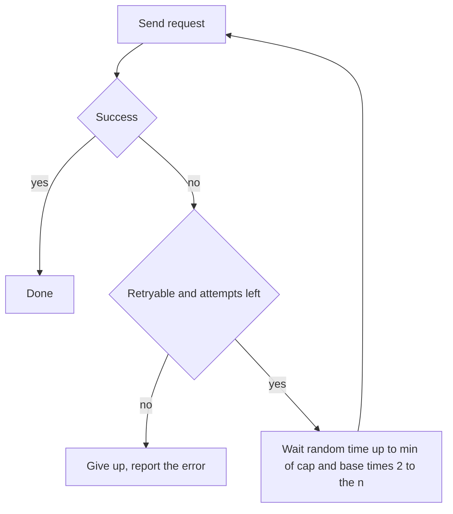

## The hook

A database hiccups for two seconds. Ten thousand app servers see errors and immediately retry. Then retry again. And again. The database comes back to find not its normal load but several times it, all arriving in the same instant, and falls over again. A two-second blip becomes a twenty-minute outage.

The cure is two ideas so simple they fit in one line of code: wait longer after each failure, and add a little randomness to the wait. Together they are exponential backoff with jitter.

## Where you meet it every day

- **Cloud SDKs and API clients**, such as the AWS SDKs, retry failed calls with exponential backoff and jitter by default; AWS has published an often-cited analysis of jitter strategies.
- **Ethernet's original design** used binary exponential backoff after collisions: devices that collided waited a random number of slots from a range that doubled after each further collision.
- **Mobile apps and browsers** reconnect to servers with growing delays after connection failures, so a server restart does not trigger a synchronized reconnection storm.

Whenever a well-built client [[retry|retries]], it is almost certainly backing off.

## The intuition

:::analogy
Imagine a hundred people calling a busy helpline. If everyone redials the instant they hear the engaged tone, the line stays jammed forever. If each person waits a bit longer after every failed attempt, and each picks a slightly random moment to try again, the calls spread out, the line clears, and everyone eventually gets through.
:::

"Wait longer each time" is [[exponential backoff]]. "Pick a slightly random moment" is [[jitter]]. Without the first, retries hammer a struggling service; without the second, everyone backs off by the same amounts and still crashes into each other at the same instants.

## How it works

For attempt number n (starting at 0), with a base delay and a maximum cap:

$$\text{delay}_n = \min(\text{cap},\ \text{base} \times 2^n)$$

Then add jitter. The common "full jitter" approach waits a random time between 0 and that value:

$$\text{sleep} = \text{random}(0,\ \min(\text{cap},\ \text{base} \times 2^n))$$

- base is the first delay, for example 100 ms.
- $2^n$ doubles the delay with each failed attempt.
- cap stops delays from growing forever.
- random spreads clients across the whole window instead of clustering at its edge.



:::insight
Backoff gives the failing service breathing room; jitter breaks the synchronisation between clients. A [[thundering herd]] is a coordination problem, and randomness is the cheapest way to uncoordinate a crowd.
:::

### Which failures to retry

Retry only failures that are likely temporary and safe to repeat: timeouts, connection resets, 503 Service Unavailable, 429 Too Many Requests (respecting any `Retry-After` header). Do not retry 400 Bad Request or 404 Not Found, which will fail again. And never automatically retry a non-idempotent action, such as a payment, unless it carries an idempotency key.

## Walk through an example

Base 100 ms, cap 2,000 ms, full jitter.

| Attempt n | base × 2ⁿ | Window after cap | Example random wait |
|---|---|---|---|
| 0 | 100 ms | 0 to 100 ms | 63 ms |
| 1 | 200 ms | 0 to 200 ms | 150 ms |
| 2 | 400 ms | 0 to 400 ms | 41 ms |
| 3 | 800 ms | 0 to 800 ms | 512 ms |
| 4 | 1,600 ms | 0 to 1,600 ms | 1,270 ms |
| 5 | 3,200 ms | 0 to 2,000 ms | 880 ms |

Now picture a thousand clients that all failed at time zero. Without jitter, all thousand retry at exactly 100 ms, then 300 ms, then 700 ms: synchronized spikes. With full jitter, their retries are spread across each window, so the service sees a gentle, roughly even flow.

:::try-this
A thousand clients retry once, each waiting a random time between 0 and 1 second. Roughly how many retries arrive in any 100 ms slice? Compare with no jitter, where all retry exactly at 1 second. (About 100 per 100 ms slice, spread evenly, instead of 1,000 in the same instant.)
:::

## The code

```pseudo
call_with_retries(request, max_attempts, base, cap):
    for n in 0 .. max_attempts - 1:
        response = send(request)
        if response is success: return response
        if not retryable(response) or n == max_attempts - 1:
            return response
        sleep(random_between(0, min(cap, base * 2^n)))
```

Many systems also enforce a [[retry budget]]: retries may add at most, say, 10% extra load across the whole client. When the budget is spent, clients fail fast instead of piling on.

## Why it is clever

It needs no coordination at all. Clients never talk to each other or to a central scheduler, yet the crowd's behaviour becomes gentle: total retry load drops quickly as delays grow, and randomness flattens the peaks. A tiny local rule produces a healthy global effect, which is the hallmark of good distributed algorithms.

## Where it falls short

:::warning
Common misconception: "more retries make a system more reliable." Past a point they make it less reliable, because retries multiply load exactly when the system is weakest. If every layer of a five-layer stack retries three times, one failing request at the bottom can become 3⁵ = 243 attempts. Retry at one layer, cap attempts, and use budgets.
:::

- **Long tails for users.** Backoff can leave a user waiting several seconds; interactive paths often need tighter caps and fewer attempts than background jobs.
- **It does not fix overload.** If a service is permanently under-provisioned, backoff only slows the failure. Circuit breakers and load shedding handle that case.
- **Tuning matters.** Base, cap and attempt counts depend on how quickly the dependency typically recovers.

## Key takeaways

- Exponential backoff doubles the wait after each failed attempt, up to a cap, giving a struggling service room to recover.
- Jitter randomises each wait so clients that failed together do not retry together in synchronized waves.
- Full jitter, a random wait between zero and the capped backoff, spreads retries evenly over time.
- Retry only temporary, safe failures, and never repeat non-idempotent actions without an idempotency key.
- Limit retries with attempt caps and retry budgets, because retries at every layer multiply load during outages.
