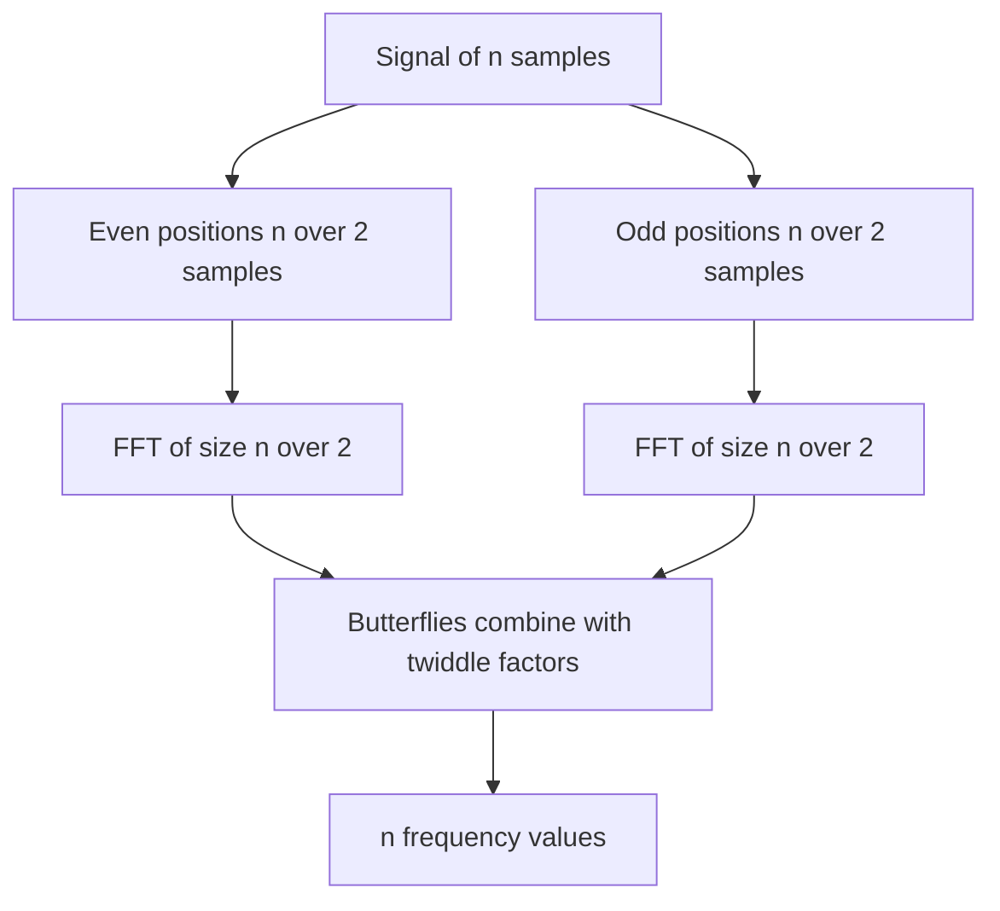

## The hook

A pianist presses three keys at once. Your ear receives one wobbly pressure wave, a single number changing over time, yet you hear three separate notes. Somewhere between the eardrum and the brain, that one wave was split into the pure tones it is made of.

Computers do the same split millions of times a second: to compress music, sharpen photos, decode Wi-Fi and even multiply huge numbers. The obvious way to compute it takes n² steps, hopeless for a million samples. In 1965 James Cooley and John Tukey published a way to do it in n log n, and it became one of the most used algorithms ever written. Predict the trick, given that it is a divide-and-conquer algorithm. (Split the samples into even and odd positions, and notice the two halves share almost all their work.)

## Where you meet it every day

- **Audio**: equalisers, noise cancellation and spectrum displays work in the frequency domain; compressed audio formats rely on closely related transforms.
- **Images**: JPEG uses the discrete cosine transform, a close relative computed with FFT-style algorithms.
- **Wi-Fi and 4G/5G**: OFDM radios use an inverse FFT to build the transmitted signal and an FFT to receive it.
- **Big-number and polynomial multiplication**: libraries for huge integers switch to FFT-based multiplication for very large inputs.

## The intuition

:::analogy
A **prism splits white light into colours**. The light is one beam, but it is secretly a sum of many pure colours, and the prism reveals how strong each is. The Fourier transform is a prism for any signal: in goes a list of samples, out comes how much of each pure frequency it contains. The FFT is a cleverly built prism that does the job far faster.
:::

The **[[discrete Fourier transform]]** of n samples x₀ … xₙ₋₁ gives n numbers X₀ … Xₙ₋₁, one per frequency. Each Xₖ asks: "how much does the signal look like a wave that turns k times around a circle over the n samples?" That is a sum of n products, so all n outputs cost n² operations.

## How it works

You do not need to follow complex-number algebra fully. Hold on to three facts.

**1. The "waves" are points on a circle.** Let w = e^(−2πi/n), a **[[root of unity]]**: wⁿ = 1. The DFT is

Xₖ = Σⱼ xⱼ · w^(jk)

So Xₖ is the signal evaluated as a polynomial, x₀ + x₁z + x₂z² + …, at the point z = wᵏ on the unit circle.

**2. Split by even and odd positions.** Write the polynomial as E(z²) + z · O(z²), where E holds the even-position samples and O the odd ones. Squaring the n-th roots of unity gives the (n/2)-th roots of unity, each twice. So both halves are DFTs of size n/2.

**3. One half-size result serves two outputs.** Because w^(k + n/2) = −wᵏ:

- Xₖ = Eₖ + wᵏ · Oₖ
- Xₖ₊ₙ/₂ = Eₖ − wᵏ · Oₖ

One multiplication by the **[[twiddle factor]]** wᵏ produces two outputs. This pair of formulas is called a **butterfly**.



The cost: T(n) = 2T(n/2) + O(n), the same recurrence as merge sort, so **O(n log n)**. Wait, why does such a small identity save so much? Because the direct method recomputes, for every output, products that the half-size transforms compute once and share between output k and output k + n/2.

## Walk through an example

Signal x = [1, 2, 3, 4], so n = 4 and w = e^(−2πi/4) = −i.

| Step | Values |
|---|---|
| Even positions [1, 3]: size-2 DFT is [1 + 3, 1 − 3] | E = [4, −2] |
| Odd positions [2, 4]: size-2 DFT is [2 + 4, 2 − 4] | O = [6, −2] |
| X₀ = E₀ + w⁰ O₀ = 4 + 6 | 10 |
| X₂ = E₀ − w⁰ O₀ = 4 − 6 | −2 |
| X₁ = E₁ + w¹ O₁ = −2 + (−i)(−2) | −2 + 2i |
| X₃ = E₁ − w¹ O₁ = −2 − (−i)(−2) | −2 − 2i |

Result: [10, −2 + 2i, −2, −2 − 2i], the same as NumPy's `fft` and the C++ program below. X₀ = 10 is the sum of all samples (the "zero frequency", or average level); the others measure how strongly the signal rises and falls at each frequency.

### Multiplying with it

Multiplying polynomials is a **[[convolution]]** of their coefficients, which costs O(n²) directly. In the **[[frequency domain]]** it becomes pointwise multiplication:

1. FFT both coefficient lists (padded to a power of two at least as long as the product).
2. Multiply the values pairwise: n multiplications.
3. Inverse FFT, then divide by n.

(1 + 2x)(3 + 4x) gives coefficients 3, 10, 8, that is 3 + 10x + 8x². Treat digits as coefficients and 123 × 456 gives raw coefficients 18, 27, 28, 13, 4 (lowest digit first); carrying gives 56088.

:::try-this
Compute the DFT of [1, 1, 1, 1] using the even–odd split, before checking. (E = DFT[1, 1] = [2, 0] and O = [2, 0]. X₀ = 2 + 2 = 4, X₂ = 2 − 2 = 0, X₁ = 0 + (−i)·0 = 0, X₃ = 0. A constant signal has only the zero frequency: [4, 0, 0, 0].)
:::

## The code

```pseudo
fft(a):                                   // length n, a power of two
    if n == 1: return a
    E = fft(a[0], a[2], a[4], ...)
    O = fft(a[1], a[3], a[5], ...)
    for k in 0 .. n/2 - 1:
        t = w^k * O[k]                    // w = e^(-2*pi*i/n)
        out[k]       = E[k] + t
        out[k + n/2] = E[k] - t
    return out

multiply(p, q):
    pad p, q to length n >= len(p) + len(q) - 1, a power of two
    P = fft(p); Q = fft(q)
    R[i] = P[i] * Q[i] for all i
    return inverse_fft(R) / n, rounded
```

```cpp
#include <bits/stdc++.h>
using namespace std;
using cd = complex<double>;
const double PI = acos(-1.0);

// Recursive FFT. invert = true computes the inverse (without the 1/n scaling).
void fft(vector<cd>& a, bool invert) {
    int n = a.size();
    if (n == 1) return;
    vector<cd> even(n / 2), odd(n / 2);
    for (int i = 0; i < n / 2; i++) { even[i] = a[2 * i]; odd[i] = a[2 * i + 1]; }
    fft(even, invert);
    fft(odd, invert);
    double ang = 2 * PI / n * (invert ? 1 : -1);
    for (int k = 0; k < n / 2; k++) {
        cd w = polar(1.0, ang * k);          // k-th twiddle factor
        a[k]         = even[k] + w * odd[k];
        a[k + n / 2] = even[k] - w * odd[k];
    }
}

// Multiply polynomials given by coefficient lists (lowest degree first).
vector<long long> multiply(const vector<int>& p, const vector<int>& q) {
    int n = 1;
    while (n < (int)(p.size() + q.size())) n <<= 1;
    vector<cd> fp(p.begin(), p.end()), fq(q.begin(), q.end());
    fp.resize(n); fq.resize(n);
    fft(fp, false); fft(fq, false);
    for (int i = 0; i < n; i++) fp[i] *= fq[i];   // multiply point values
    fft(fp, true);
    vector<long long> r(p.size() + q.size() - 1);
    for (size_t i = 0; i < r.size(); i++) r[i] = llround(fp[i].real() / n);
    return r;
}

int main() {
    vector<cd> s = {1, 2, 3, 4};
    fft(s, false);
    for (auto& x : s) cout << "(" << x.real() << "," << x.imag() << ") ";
    cout << "\n";                                                  // (10,0) (-2,2) (-2,0) (-2,-2)
    for (long long c : multiply({1, 2}, {3, 4})) cout << c << " "; // 3 10 8
    cout << "\n";
    vector<long long> d = multiply({3, 2, 1}, {6, 5, 4});          // 123 * 456, digits lowest first
    long long carry = 0; string out;
    for (long long x : d) { x += carry; out += char('0' + x % 10); carry = x / 10; }
    while (carry) { out += char('0' + carry % 10); carry /= 10; }
    reverse(out.begin(), out.end());
    cout << out << "\n";                                           // 56088
}
```

Production FFTs are iterative and in place (a bit-reversal permutation followed by rounds of butterflies), avoiding the recursion's extra vectors.

## Why it is clever

The direct DFT treats each of n outputs as an independent sum of n terms. The FFT notices that the outputs are evaluations at points on a circle with deep symmetry: squaring them halves the number of distinct points, and the points k and k + n/2 differ only in sign. Exploiting that symmetry recursively turns 1,048,576² ≈ 1.1 × 10¹² operations into about 2.1 × 10⁷, roughly 50,000 times fewer. Gauss used a similar idea around 1805 to interpolate asteroid orbits, but it was the 1965 Cooley–Tukey paper, arriving with digital computers, that made it everywhere.

:::insight
The FFT is divide and conquer on a polynomial evaluated at the roots of unity: split into even and odd coefficients, solve two half-size problems, and combine each pair of outputs with one twiddle multiplication. That symmetry turns n² into n log n, and turning convolution into pointwise multiplication makes it a tool for far more than sound.
:::

## Where it falls short

- **Floating-point error**: results are approximate. For exact integer multiplication, round carefully and keep inputs small enough, or use the **number-theoretic transform** (the same algorithm modulo a prime), common in competitive programming.
- **Power-of-two sizes** in the simple version; other sizes need padding or mixed-radix variants.
- **Edge effects**: the DFT treats the signal as repeating forever, so a jump between the end and the start leaks energy into other frequencies; real systems apply window functions.
- **Small inputs**: for short polynomials, plain O(n²) multiplication or Karatsuba is faster than the FFT's constant overhead.

:::warning
Common misconception: "the FFT is an approximation of the Fourier transform." The FFT computes exactly the same DFT as the n² formula, only faster; any difference comes from floating-point rounding, not from the algorithm.
:::

### Interview follow-ups

**"Where does FFT appear in competitive programming?"** Polynomial multiplication, counting pairs with a given sum (convolution of frequency arrays), and string matching with wildcards.

**"Why pad to length at least len(p) + len(q) − 1?"** The product has that many coefficients; a shorter transform wraps the high coefficients around onto the low ones (circular convolution).

**"How is this divide and conquer like merge sort?"** Both split into two halves, recurse, and combine in linear time, giving T(n) = 2T(n/2) + O(n), as analysed in [Splitting a Big Job Between Two Teams, Again and Again](article:dsa-divide-and-conquer).

## Key takeaways

- The discrete Fourier transform turns n samples into the strengths of n frequencies, and computing it directly costs n² operations.
- The FFT splits the samples into even and odd positions, computes two half-size transforms and combines them with butterflies, giving O(n log n).
- The speed comes from the symmetry of the roots of unity: one twiddle multiplication produces both output k and output k + n/2.
- Because convolution becomes pointwise multiplication in the frequency domain, the FFT multiplies polynomials and huge integers in O(n log n).
- FFT results carry floating-point error, so exact integer work often uses the number-theoretic transform instead.
