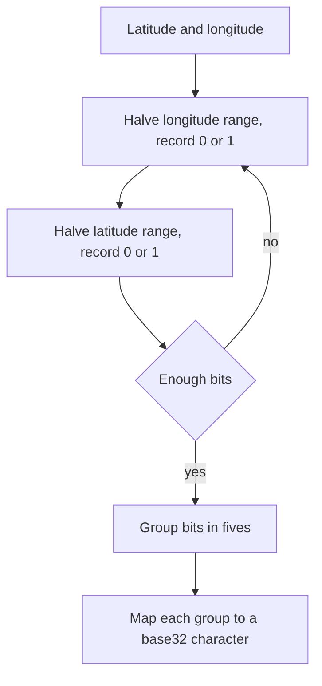

## The hook

A food delivery app has 300,000 restaurants and a hungry user at a particular latitude and longitude. "Show restaurants within 3 km" sounds easy, but computing the distance to all 300,000 for every search, thousands of times a second, is wasteful. And a normal database index sorts by one number at a time, not by two coordinates at once.

In 2008, Gustavo Niemeyer published a neat trick: turn every location into a short string, so that nearby places usually share a beginning. Then a plain string index, or a prefix search, finds neighbours fast.

## Where you meet it every day

- **Redis GEO commands** store locations in a sorted set using a 52-bit geohash-style score, so radius searches become range queries over a sorted structure.
- **Elasticsearch** offers geohash grid aggregations to bucket points into cells for heat maps.
- **Ride-sharing, delivery and "near me" features** often use geohashes or similar cell systems to group drivers, restaurants or users by area.
- **Geohash strings** also appear in URLs and databases as compact location keys.

## The intuition

:::analogy
Think of zooming into a map by repeatedly cutting it in half. First, is the place in the east half or the west half? Then the north or south half of that? Then east or west again, and so on. Every answer is one bit, and after enough cuts you have pinned down a small square. Two places that got the same answers for the first twenty cuts are inside the same small square, so they are close.
:::

That sequence of answers is a [[geohash]]. Each answer halves the current region, and the string of answers is a precise address that gets more specific as it gets longer.

## How it works

1. Start with longitude in [−180, 180] and latitude in [−90, 90].
2. Alternate, starting with longitude. For the current coordinate, compare it with the middle of its range: write 1 and keep the upper half if the value is at or above the middle, otherwise write 0 and keep the lower half.
3. Repeat. The bits alternate longitude, latitude, longitude, latitude: [[bit interleaving]].
4. Group the bits in fives and write each group as one [[base32]] character from `0123456789bcdefghjkmnpqrstuvwxyz`.



### Precision by length

Each character adds 5 bits, so each extra character shrinks the [[cell]] by a factor of 32 in area. Roughly, at the equator:

| Length | Approximate cell size |
|---|---|
| 4 | about 39 km × 20 km |
| 5 | about 4.9 km × 4.9 km |
| 6 | about 1.2 km × 0.6 km |
| 7 | about 153 m × 153 m |
| 8 | about 38 m × 19 m |

### Finding neighbours

To find places near a point, compute its geohash at a length whose cell is about the search radius, then look up every stored point with that [[prefix]]. Because a close neighbour may lie just across a cell edge, also search the 8 surrounding cells, then filter the candidates by exact distance.

:::insight
Geohash folds two dimensions into one sortable string, so tools built for one dimension, a sorted index, a prefix search, a key-value store, can answer "what is near here?". Every extra character is another round of halving, zooming the map in.
:::

## Walk through an example

Encode a point in Bengaluru, latitude 12.97, longitude 77.59. The first bits:

| Bit | Coordinate | Range | Middle | Value vs middle | Bit |
|---|---|---|---|---|---|
| 1 | lon | [−180, 180] | 0 | 77.59 ≥ 0 | 1 |
| 2 | lat | [−90, 90] | 0 | 12.97 ≥ 0 | 1 |
| 3 | lon | [0, 180] | 90 | 77.59 < 90 | 0 |
| 4 | lat | [0, 90] | 45 | 12.97 < 45 | 0 |
| 5 | lon | [0, 90] | 45 | 77.59 ≥ 45 | 1 |
| 6 | lat | [0, 45] | 22.5 | 12.97 < 22.5 | 0 |
| 7 | lon | [45, 90] | 67.5 | 77.59 ≥ 67.5 | 1 |
| 8 | lat | [0, 22.5] | 11.25 | 12.97 ≥ 11.25 | 1 |
| 9 | lon | [67.5, 90] | 78.75 | 77.59 < 78.75 | 0 |
| 10 | lat | [11.25, 22.5] | 16.875 | 12.97 < 16.875 | 0 |

First five bits 11001 = 25 → character **t**; next five 01100 = 12 → character **d**. Continuing gives the full 6-character geohash **tdr1v9**. A point a little north-east, 12.98, 77.60, encodes to **tdr1vf**: the same 5-character prefix, so the two are in the same cell of about 5 km. Chennai, at 13.08, 80.27, encodes to **tf346t**: it shares only the first character.

:::try-this
Without computing everything, decide the first bit for a point in New York (longitude about −74) and the second bit (latitude about 40.7). (Longitude −74 is below the middle 0, so bit 1 is 0; latitude 40.7 is above 0, so bit 2 is 1.)
:::

## The code

```pseudo
encode(lat, lon, length):
    lat_range = [-90, 90]; lon_range = [-180, 180]
    bits = []; use_lon = true
    while len(bits) < 5 * length:
        range, value = (lon_range, lon) if use_lon else (lat_range, lat)
        mid = (range.low + range.high) / 2
        if value >= mid: bits.append(1); range.low = mid
        else: bits.append(0); range.high = mid
        use_lon = not use_lon
    return base32 characters of bits, 5 at a time

nearby(point, radius):
    cell = encode(point, length chosen so cell size ≈ radius)
    candidates = items with prefix in {cell and its 8 neighbours}
    return candidates filtered by exact distance <= radius
```

## Why it is clever

It reuses binary search on each axis, the same "halve the range" idea as [Binary Search Without the Off-by-One Fear](article:dsa-binary-search), and interleaves the two searches into one string. Locality comes almost for free: points that share a long prefix are guaranteed to be in the same small cell. And the string can be truncated to any precision, so one stored value supports both "same city" and "same street" queries.

## Where it falls short

:::warning
Common misconception: "if two geohashes are very different, the points are far apart." The reverse of the prefix rule does not hold. Two points a few metres apart can sit on either side of a big cell boundary, such as the equator or the prime meridian, and share no prefix at all. That is why neighbour cells are always searched.
:::

- **Edge effects**: neighbours across boundaries need extra lookups and exact distance filtering.
- **Cells are not uniform**: they are rectangles in latitude and longitude, so their real-world size shrinks toward the poles.
- **Hot cells**: in dense city centres, one cell can contain far more points than others; adaptive structures like quadtrees split busy areas further.
- **Alternatives** such as Google's S2 and Uber's H3 use different cell shapes and hierarchies for more uniform coverage.

## Key takeaways

- A geohash encodes a location by repeatedly halving longitude and latitude ranges and interleaving the resulting bits.
- Bits are grouped in fives and written in base32, and each extra character shrinks the cell by a factor of 32 in area.
- Points sharing a long prefix lie in the same small cell, so prefix and range queries on strings find nearby places.
- Nearby points can fall across cell boundaries, so search the 8 neighbouring cells and filter by exact distance.
- Redis GEO and Elasticsearch use geohash-style encodings, while S2 and H3 offer alternative cell systems.
