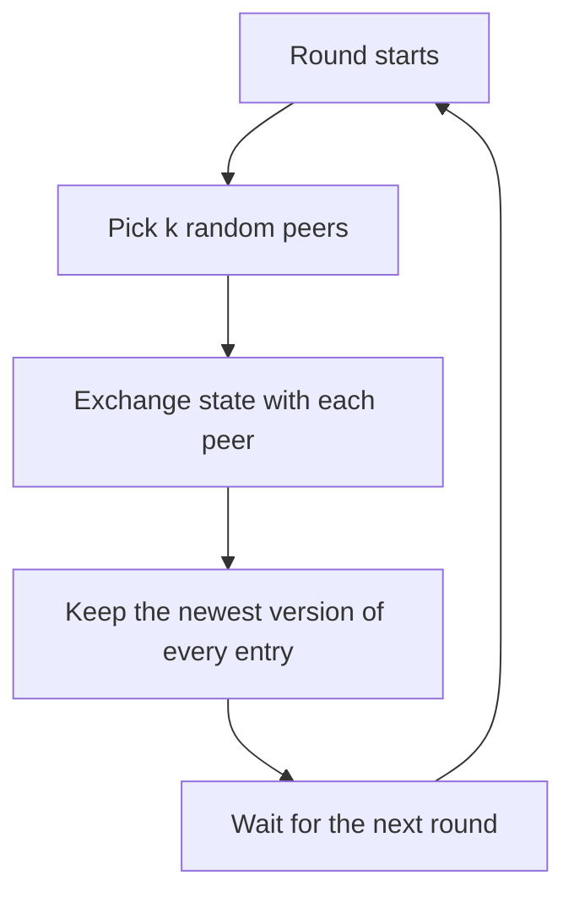

## The hook

In an office of five hundred people, nobody sends an email to announce that the manager is leaving. Yet by lunch, everyone knows. Each person mentions it to a couple of colleagues at the coffee machine, those colleagues tell a couple more, and the news races through the building with no one in charge of it.

Large distributed systems spread information in exactly this way. It sounds sloppy. It turns out to be one of the most scalable and fault-tolerant ideas in computing.

## Where you meet it every day

- **Apache Cassandra** uses gossip so every node learns which other nodes exist, their state, and roughly how healthy they are.
- **HashiCorp Consul and Serf** use a gossip protocol based on SWIM for cluster membership and failure detection.
- **Amazon's Dynamo design** used gossip to propagate membership changes and ring information between nodes.

Membership lists, failure suspicions, configuration versions and cluster metadata are the classic things gossiped.

## The intuition

:::analogy
Think of office gossip at the coffee machine. You do not need a company-wide announcement or a central noticeboard. Each person who knows something tells a couple of random colleagues every break. Within a few breaks, nearly everyone has heard, and it does not matter if a few people are on leave, because the news reaches everyone else through other conversations.
:::

A [[gossip protocol]] works the same way. Every [[round]], each node picks a few random peers and exchanges what it knows. Nobody coordinates, nobody waits for everyone, and no single node is critical.

## How it works

Each node keeps some state, often a [[membership list]] with a version or heartbeat counter per node. Every round (say once per second):

1. Pick k random peers, the [[fan-out]], often 1 to 3.
2. Exchange state with each: send your newer entries, receive theirs ("push-pull").
3. Merge, keeping the newest version of each entry.



### Why it is fast

If each informed node tells at least one new node per round, the number of informed nodes roughly doubles every round: 1, 2, 4, 8, ... So reaching n nodes takes about log₂ n rounds, plus a few extra rounds to catch the last stragglers, since late in the process most random picks hit nodes that already know. A thousand-node cluster needs only around ten to twenty rounds.

:::insight
Gossip trades certainty for scale. No node ever knows that everyone has heard, but with random peers and a logarithmic spread, practically everyone hears quickly, and the cost per node stays constant no matter how large the cluster grows.
:::

### Two flavours

- **Rumour mongering:** spread a new piece of news actively for a while, then stop once most peers you contact already know it.
- **[[Anti-entropy]]:** continuously compare full state with random peers and repair any differences. Slower, but it eventually fixes everything, including updates that rumours missed. Merkle trees make these comparisons cheap.

## Walk through an example

Eight nodes, A to H. A learns that node X joined. Fan-out 1, push only. Peers are random; here is one plausible run:

| Round | Who tells whom | Informed nodes |
|---|---|---|
| 0 | — | A |
| 1 | A→D | A, D |
| 2 | A→F, D→B | A, B, D, F |
| 3 | A→C, B→H, D→F (already knew), F→E | A, B, C, D, E, F, H |
| 4 | several, G finally picked | all 8 |

Four rounds for eight nodes: about log₂ 8 = 3, plus one round lost to a wasted pick. Notice that if node B had crashed after round 2, H and others would still have heard through different paths.

:::try-this
Estimate rounds for 1,000,000 nodes if the informed count doubles each round. How many doublings get from 1 to a million? (About 20, because 2²⁰ is about a million. Add a few rounds for stragglers, and a cluster of a million nodes converges in well under a minute with one-second rounds.)
:::

## The code

```pseudo
state = map from key to (value, version)

every round:
    for peer in random_sample(members, k):
        send state digest to peer
        receive peer's newer entries
        merge(received)

merge(entries):
    for key, (value, version) in entries:
        if key not in state or version > state[key].version:
            state[key] = (value, version)
```

## Why it is clever

The cost per node per round is constant: a few small messages, regardless of cluster size. Yet the spread time grows only logarithmically. And because peers are random, there is no single point of failure and no fixed path to break. Adding nodes makes the system bigger without making any node's job harder.

## Where it falls short

:::warning
Common misconception: "gossip gives every node the same view at the same time." It gives [[eventual consistency]]: views converge over a few rounds, but at any moment some nodes are behind. Use it for membership and metadata, not for anything that needs a single agreed answer right now, which needs consensus such as Raft.
:::

- **No delivery guarantee at a fixed time.** You get "very likely within a few rounds", not "definitely by time t".
- **Bandwidth adds up** if the gossiped state is large; systems send digests or deltas instead of full state.
- **Slow failure detection on its own.** Simple heartbeat gossip can take a while to notice a dead node, which is why SWIM-style protocols add direct and indirect probing.

### Interview follow-ups

**"How fast does a rumour reach 1,000 nodes?"** Each informed node tells a few random peers per round, so the informed set roughly multiplies each round. Spreading takes O(log N) rounds, a small number even for thousands of nodes, and each node sends only a constant number of messages per round.

**"Push, pull or push-pull?"** Push is fast early, when few nodes know the rumour. Pull is fast late, because uninformed nodes ask and nearly everyone they ask knows. Push-pull combines both and is what most systems use.

**"Where is gossip used in practice?"** Cluster membership and failure detection (Cassandra, Consul's Serf layer), spreading configuration or schema versions, and anti-entropy between replicas. It suits information that is fine to arrive a few rounds late.

**"How do you stop gossip from flooding the network with big state?"** Exchange digests (version numbers or hashes) first and send only the entries the other side lacks. Bound fanout and round frequency.

## Key takeaways

- In a gossip protocol, every node periodically exchanges what it knows with a few random peers, with no central coordinator.
- News spreads like a rumour, roughly doubling the informed set each round, so it reaches n nodes in about log n rounds.
- Random peers create many redundant paths, which makes gossip robust to failed nodes and lost messages.
- Anti-entropy compares and repairs full state in the background, catching anything rumours missed.
- Gossip is eventually consistent, so it fits membership and metadata but not decisions that need everyone to agree at once.
