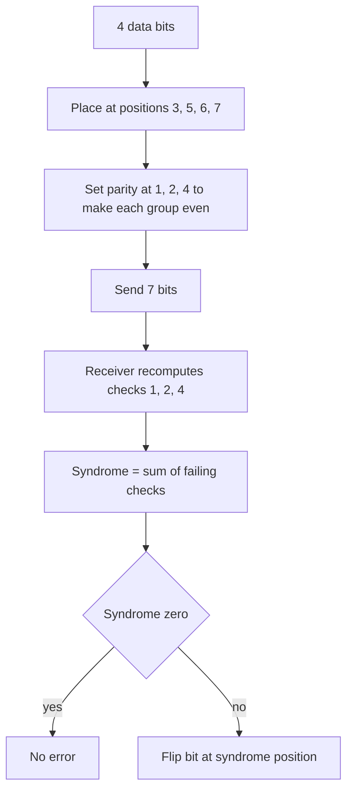

## The hook

As Richard Hamming later told the story, in the late 1940s he was using relay computers at Bell Labs that could detect certain errors but not fix them. When the machine detected an error it simply stopped, and over a weekend his job would sit unfinished until someone restarted it. His frustration led to a simple question: if a machine can tell that something went wrong, why can it not tell *where*, and fix it?

His 1950 paper answered it with a scheme so efficient that its descendants still guard the memory in servers today. A handful of extra bits, arranged cleverly, can point straight at a single flipped bit.

## Where you meet it every day

- **ECC memory** in servers and workstations uses Hamming-style SECDED codes: a common layout stores 8 check bits for every 64 data bits.
- **CPU caches and on-chip memories** often carry similar single-error-correcting codes.
- **Flash storage and some communication links** have used Hamming codes, though stronger codes such as BCH, LDPC and Reed-Solomon now dominate there.
- **Teaching**: Hamming codes are the standard first example of error correction, and the ideas behind them, distance and syndromes, run through all coding theory.

## The intuition

:::analogy
Imagine a 4 × 4 grid of numbers where every row and every column has a total written next to it. If someone changes a single cell, exactly one row total and one column total stop matching. The broken row and the broken column cross at exactly one cell: the culprit. You do not just know the grid was altered; you know which cell to fix. Hamming codes do the same thing with bits and cleverly overlapping groups, using as few check bits as possible.
:::

A single [[parity bit]] is one row total: it says "something in this group changed" but not what. Several overlapping groups, arranged so that every position belongs to a unique combination of groups, turn the pattern of failures into an address.

## How it works

### Overlapping groups chosen by binary numbers

Number the codeword positions 1 to 7. Put parity bits at the powers of two, positions 1, 2 and 4, and data bits at 3, 5, 6 and 7. That is [[Hamming(7,4)]].

Parity bit p covers every position whose binary representation has the p bit set:

| Parity bit | Positions checked | Binary of those positions |
|---|---|---|
| 1 | 1, 3, 5, 7 | xx1 |
| 2 | 2, 3, 6, 7 | x1x |
| 4 | 4, 5, 6, 7 | 1xx |

Each parity bit is set so that its group has an even number of 1s.

### The syndrome is an address

When a codeword arrives, recompute the three checks. Each failing check contributes its value: failing checks 1 and 4 give 1 + 4 = 5. This [[syndrome]] is exactly the position of the flipped bit, because position 5 (binary 101) is the only position covered by checks 1 and 4 but not 2. A syndrome of 0 means no error. Flip the bit at the syndrome position and the codeword is repaired.



### Why it works: distance

The [[Hamming distance]] between two strings counts the positions where they differ. Any two valid Hamming(7,4) codewords differ in at least 3 positions. If one bit flips, the received word is distance 1 from the true codeword and at least 2 from every other, so the nearest codeword is unambiguous. In general, minimum distance d lets you correct ⌊(d − 1)/2⌋ errors or detect d − 1, so distance 3 corrects 1 or detects 2.

### Efficiency and SECDED

With r parity bits, the syndrome can name 2ʳ − 1 non-zero positions, so a Hamming code protects 2ʳ − 1 − r data bits: 3 parity bits for 4 data bits, 7 for 120. Adding one overall parity bit gives [[SECDED]]: if the syndrome is non-zero and the overall parity fails, it is one error and can be fixed; if the syndrome is non-zero but overall parity passes, two bits flipped, which is detected and reported instead of miscorrected.

:::insight
Give every position a unique binary address, and make parity check k responsible for every position whose address has bit k set. Then the set of failing checks spells out the address of the flipped bit, and r check bits can locate an error among 2^r − 1 positions.
:::

## Walk through an example

Data bits **1011** go to positions 3, 5, 6, 7.

| Position | 1 | 2 | 3 | 4 | 5 | 6 | 7 |
|---|---|---|---|---|---|---|---|
| Role | p1 | p2 | d | p4 | d | d | d |
| Data | | | 1 | | 0 | 1 | 1 |

- p1 covers 3, 5, 7: 1 + 0 + 1 = 2, already even, so p1 = 0.
- p2 covers 3, 6, 7: 1 + 1 + 1 = 3, odd, so p2 = 1.
- p4 covers 5, 6, 7: 0 + 1 + 1 = 2, even, so p4 = 0.

Codeword: **0110011**.

Noise flips position 5. Received: **0110111**.

| Check | Positions | Bits | Sum | Result |
|---|---|---|---|---|
| 1 | 1, 3, 5, 7 | 0, 1, 1, 1 | 3 | fail (+1) |
| 2 | 2, 3, 6, 7 | 1, 1, 1, 1 | 4 | pass |
| 4 | 4, 5, 6, 7 | 0, 1, 1, 1 | 3 | fail (+4) |

Syndrome 1 + 4 = **5**. Flip position 5 back: 0110011, and the data 1011 is recovered. ✓

Now flip two bits instead, positions 3 and 6: received 0100001. The checks give syndrome 5 again, so the decoder "fixes" position 5, an innocent bit, and ends up with three wrong bits. That is why SECDED adds the extra overall parity bit.

:::try-this
Encode the data bits 0110 at positions 3, 5, 6, 7. (Position 3 = 0, 5 = 1, 6 = 1, 7 = 0. p1 checks 3, 5, 7: 0 + 1 + 0 = 1, so p1 = 1. p2 checks 3, 6, 7: 0 + 1 + 0 = 1, so p2 = 1. p4 checks 5, 6, 7: 1 + 1 + 0 = 2, so p4 = 0. Codeword 1100110.)
:::

## The code

```pseudo
encode(d1, d2, d3, d4):
    c[3], c[5], c[6], c[7] = d1, d2, d3, d4
    for p in (1, 2, 4):
        c[p] = XOR of c[i] for i in 3..7 where (i & p) != 0
    return c[1..7]

decode(c):
    syndrome = 0
    for p in (1, 2, 4):
        if XOR of c[i] for i in 1..7 where (i & p) != 0 is 1:
            syndrome += p
    if syndrome != 0: c[syndrome] ^= 1
    return c[3], c[5], c[6], c[7]
```

```cpp
#include <bits/stdc++.h>
using namespace std;

array<int, 8> encode(array<int, 4> d) {
    array<int, 8> c{};                       // index 1..7
    c[3] = d[0]; c[5] = d[1]; c[6] = d[2]; c[7] = d[3];
    for (int p : {1, 2, 4})
        for (int i = 3; i <= 7; i++)
            if ((i & p) && i != p) c[p] ^= c[i];
    return c;
}

int syndrome(const array<int, 8>& c) {
    int s = 0;
    for (int p : {1, 2, 4}) {
        int x = 0;
        for (int i = 1; i <= 7; i++) if (i & p) x ^= c[i];
        if (x) s += p;
    }
    return s;
}

int main() {
    auto c = encode({1, 0, 1, 1});
    for (int i = 1; i <= 7; i++) cout << c[i];
    cout << '\n';                            // 0110011
    c[5] ^= 1;                               // noise
    int s = syndrome(c);
    cout << "syndrome " << s << '\n';        // syndrome 5
    if (s) c[s] ^= 1;
    for (int i = 1; i <= 7; i++) cout << c[i];
    cout << '\n';                            // 0110011
}
```

## Why it is clever

It uses the minimum possible number of check bits for single-error correction: r bits can name exactly 2ʳ − 1 positions plus "no error", and Hamming codes use every one of those names. Decoding needs no search, just a few XORs whose results directly form the error's address, so it fits in a memory controller's tight timing budget. And it introduced the vocabulary of distance and syndromes on which all later error-correcting codes are built.

## Where it falls short

:::warning
Common misconception: "a code that detects two errors can also correct two." Distance 3 gives either single-error correction or double-error detection, not double-error correction. A plain Hamming decoder facing two flips will confidently "fix" the wrong bit. Count carefully what a code detects versus what it corrects.
:::

- **Only one error per codeword**: bursts that flip neighbouring bits overwhelm it unless data is interleaved across codewords.
- **Bit-level only**: storage and communication errors often damage whole bytes or blocks, where byte-oriented codes such as Reed-Solomon work far better, as in [Why a Stained QR Code Still Scans](article:famous-algos-reed-solomon).
- **Overhead on small blocks**: 3 check bits for 4 data bits is 75% extra; real systems use long codes such as 8 check bits for 64 data bits.

### Interview follow-ups

**"How many parity bits does single-error correction need for m data bits?"** The smallest r with 2^r ≥ m + r + 1, because the syndrome must name every bit position plus "no error". For 4 data bits r = 3, giving Hamming(7,4). For 64 data bits r = 7; adding one overall parity bit for double-error detection gives the 72-bit words used by ECC memory.

**"What does the syndrome tell you?"** Recompute each parity check; the failing checks, read as a binary number, are the position of the flipped bit. Zero means no single-bit error.

**"Why do ECC systems interleave data?"** A burst that flips neighbouring bits would put two errors in one codeword. Spreading consecutive bits across different codewords turns one burst into several single errors, each correctable.

## Key takeaways

- A Hamming code places parity bits at power-of-two positions, each checking every position whose binary address has that bit set.
- The failing checks add up to a syndrome that equals the position of a single flipped bit, so it can be corrected directly.
- Valid codewords differ in at least 3 bits, which allows correcting one error or detecting two, but not correcting two.
- Adding one overall parity bit gives SECDED, which ECC memory uses to correct single and detect double errors.
- With r parity bits, a Hamming code protects 2^r − 1 − r data bits, the most possible for single-error correction.
