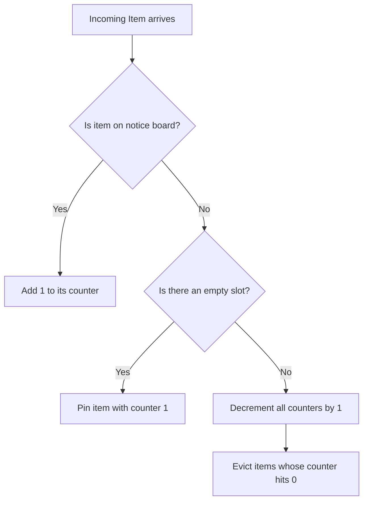
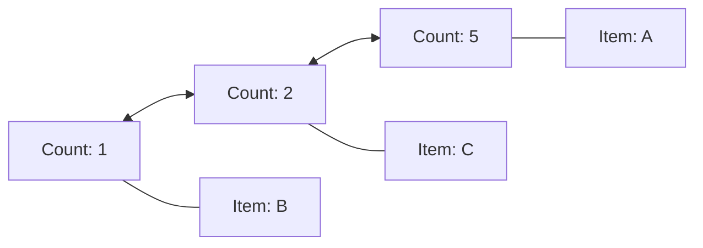

## The hook

Ten gigabits of packets hit your router every second. Somewhere in that hurricane of traffic, an attacker is launching a distributed denial-of-service attack, blasting millions of requests from a single IP address. You need to catch that IP address immediately.

There is just one problem: your router has barely enough high-speed memory to store a few hundred integers. A standard hash table that counts every visitor would explode in memory within three seconds. 

How do you find the few needles dominating a haystack of billions when you cannot even remember the haystack?

## Where you meet it every day

- **Network routers and firewalls:** Cisco and Juniper switches track top bandwidth consumers (the "elephants" among millions of small "mice" flows) to stop denial-of-service attacks in hardware.
- **Search engines and social media:** Google and X track trending search queries and breaking hashtags over rolling windows without storing every raw search.
- **Content delivery networks:** Akamai and Cloudflare detect which URLs receive over 1% of all traffic so they can pin them into ultra-fast edge memory.
- **Database query optimisers:** Systems like PostgreSQL and Spark inspect column distributions to spot heavy values, deciding whether to build an index or rewrite a join plan.

Whenever a system must answer "what are the biggest items right now?" over a continuous firehose of data, it is solving the [[Heavy hitters]] problem.

:::analogy
Picture a small notice board at a busy village square that has room for only three names. 

Whenever someone mentions a villager, you look at the board. If the name is already pinned there, you add a tally mark next to it. If there is an empty slot, you pin the name with one tally. 

Now the dilemma: what if all three slots are full, and someone shouts a name that is not on the board? 

Instead of erasing someone at random, you erase one tally mark from every name on the board, and you ignore the newcomer. If anyone's tally hits zero, you take their card off the board. 

Notice what just happened: you grouped four different names together (the three on the board, plus the newcomer) and cancelled one vote from each of them.
:::

## The intuition

The cancellation trick on the village notice board is the entire engine of the algorithm. 

If you have a stream of votes, how can you guarantee that a popular candidate is not erased by random noise? If you discard votes in balanced groups containing one vote for every active slot plus one vote for the newcomer, you destroy noise far faster than any true front-runner.

A candidate with over half the votes can never be eliminated if votes are cancelled in pairs. Expand that thinking: an item taking up more than one-third of the stream cannot be eliminated if votes are cancelled in groups of three.



## How it works

The foundation was laid by Jayadev Misra and David Gries in 1982. The [[Misra-Gries algorithm]] finds all items that appear more than a fraction $1/k$ of a [[Stream|stream]] of length $m$, using only $k - 1$ counters.

:::history
In 1982, Jayadev Misra and David Gries published a short paper titled *Finding Repeated Elements*. Computer science had just begun confronting problems where datasets exceeded memory limits. Most researchers assumed finding frequent elements required sorting or large hash maps. Misra and Gries proved that a pocket-sized array of counters could provide deterministic guarantees.
:::

Let us unpack the arithmetic. Suppose a stream contains $m$ elements, and you want to find every item that appears more than $m / k$ times.

1. You maintain at most $k - 1$ distinct items and their counters.
2. For each incoming item $x$:
   - If $x$ is already tracked, increment its counter: $c_x \leftarrow c_x + 1$.
   - If $x$ is not tracked and you have fewer than $k - 1$ items, track $x$ with counter $c_x \leftarrow 1$.
   - If all $k - 1$ slots are occupied and $x$ is not among them, decrement every tracked counter by 1. Evict any item whose counter drops to 0.

### Can a frequent item disappear?

Here is the first test for your intuition. If an item appears 201 times in a stream of 1,000 items, and you run Misra-Gries with $k = 5$ (which uses $5 - 1 = 4$ counters), could that item get knocked off the board and stay off at the very end?

Take a guess before reading on: can early arrivals be decremented away by an unlucky sequence of later items?

Reveal: it is mathematically impossible.

Whenever all $k - 1$ slots on the notice board are full and an untracked item arrives, you decrement all $k - 1$ counters and discard the new item. That action eliminates $k$ distinct items from the stream (the $k - 1$ items in memory, plus the 1 new item).

How many times can you possibly do this group elimination across the whole stream of length $m$?

$$\text{Maximum decrement rounds} \le \frac{m}{k}$$

Each round of decrements subtracts at most 1 from your target item's counter. If your target item appears $f$ times, its counter can be decremented at most $m / k$ times:

$$c_x \ge f - \frac{m}{k}$$

In our case, $m / k = 1000 / 5 = 200$. An item appearing 201 times can be decremented at most 200 times. Its counter will be at least $201 - 200 = 1$. It cannot be eliminated!

### The Space-Saving variant

In 2005, Ahmed Metwally, Divyakant Agrawal, and Amr El Abbadi introduced the [[Space-Saving algorithm]]. Instead of decrementing all counters when the board is full, Space-Saving does something bolder.

It finds the item currently on the board with the **minimum counter** value, evicts it, puts the new item in its place, and increments that minimum count by 1.

A "wait, why?" moment: why give a brand new arrival credit for counts it never earned?

Space-Saving maintains an estimate $\hat{f}_i$ alongside an uncertainty $\varepsilon_i$. When a new item evicts the minimum element (say, an item with count 5), it assumes: "In the worst case, this new item appeared all 5 times while I wasn't watching, so its count is now 6, but its error bound is 5."

Space-Saving guarantees that the true frequency $f_i$ is trapped tightly:

$$\hat{f}_i - \varepsilon_i \le f_i \le \hat{f}_i$$

Here, $\hat{f}_i$ is the counter stored in memory, $\varepsilon_i$ is the value the counter held when item $i$ was inserted, and $f_i$ is the true count. Both algorithms use $O(k)$ space, but Space-Saving tends to be more accurate in practice when the data follows a power-law distribution.

## Walk through an example

Let us run Misra-Gries by hand on a tiny stream.

We want to find any item appearing more than $1/3$ of the time in a stream of 9 letters. Here $k = 3$, so our notice board has $k - 1 = 2$ slots. The threshold is strictly greater than $m/k = 9/3 = 3$ occurrences.

Stream: **A, B, C, A, A, B, C, A, A**

Before checking the table, predict what happens at Step 3: the board holds A (count 1) and B (count 1), and newcomer C arrives. Which item gets evicted: A, B, or C?

Reveal: none of them wins! Misra-Gries decrements both A and B to 0, evicts both, and discards C. All three distinct items cancel each other out in a single step.

| Step | Item | Notice Board (Item: Count) | What happened? |
|---|---|---|---|
| 1 | A | (A: 1) | Empty slot: add A |
| 2 | B | (A: 1), (B: 1) | Empty slot: add B |
| 3 | C | Empty | Full! Decrement A and B to 0; discard C |
| 4 | A | (A: 1) | Empty slot: add A |
| 5 | A | (A: 2) | Match: increment A |
| 6 | B | (A: 2), (B: 1) | Empty slot: add B |
| 7 | C | (A: 1) | Full! Decrement A and B. B hits 0 (evicted) |
| 8 | A | (A: 2) | Match: increment A |
| 9 | A | (A: 3) | Match: increment A |

Look at the final state of the board: **(A: 3)**.

True counts across the entire stream:
- A appeared 5 times.
- B appeared 2 times.
- C appeared 2 times.

Only A exceeded $m/3 = 3$. Misra-Gries caught A without storing the 9-letter sequence.

:::try-this
Suppose you have a stream of 12 items and $k = 4$ (3 counter slots). Can an item that appears exactly 3 times survive on the board? 
*(Answer: It might, but it is not guaranteed. Since $m/k = 12/4 = 3$, an item must appear strictly more than 3 times to be guaranteed a spot. If it appears exactly 3 times, 3 decrement rounds can reduce its counter to 0.)*
:::

## The code

Here is the logic for Misra-Gries in plain steps.

```pseudo
function misra_gries(stream, k):
    board = empty map from item to count   // stores at most k - 1 items

    for item in stream:
        if item in board:
            board[item] = board[item] + 1
        else if size(board) < k - 1:
            board[item] = 1
        else:
            // Notice board is full: cancel k distinct items
            for tracked_item in keys(board):
                board[tracked_item] = board[tracked_item] - 1
                if board[tracked_item] == 0:
                    delete board[tracked_item]

    return board
```

Scanning all $k - 1$ items on every miss takes $O(k)$ time per miss. 

We can do better. By grouping counters into a doubly linked list of frequency buckets, both Misra-Gries and Space-Saving run in $O(1)$ worst-case time per item!



Each bucket holds items sharing that count. When an item gains a vote, it moves to the next bucket in $O(1)$ pointer operations.

## Why it is clever

Misra-Gries turns a storage problem into an elimination game.

:::insight
You do not need to count every item to find the most frequent ones. You only need to cancel out distinct items in groups of $k$. Since a stream of size $m$ can contain at most $m/k$ such groups, any element appearing more than $m/k$ times cannot be eliminated.
:::

Return to our notice board analogy. If four candidates contest an election where one candidate holds over 50% of all votes ($k = 2$, so $k - 1 = 1$ slot), every time the front-runner is paired with a rival and both votes are discarded, the front-runner still has votes left over. 

This simple guarantee yields two major benefits:
1. **Deterministic survival:** Unlike probabilistic sketches such as a [Bloom filter](article:famous-algos-bloom-filter), if an item is a true heavy hitter ($f > m/k$), it is guaranteed to be on the board at the end. Zero false negatives.
2. **Tiny memory:** To catch any IP address consuming over 1% of your bandwidth ($k = 100$), you need only $100 - 1 = 99$ counters. You can monitor high-speed traffic using cache lines that fit comfortably inside L1 CPU cache.

## Where it falls short

:::warning
Misra-Gries guarantees **no false negatives**, but it does produce [[False positive|false positives]]. An item surviving on the board at the end is not guaranteed to have exceeded $m/k$.
:::

Look back at our worked example: at Step 6, item B sat on the board with count 1. If the stream had stopped there, B would be returned as a candidate, even though its true count at that point was only 2 out of 6 (not strictly greater than $6/3 = 2$).

If you must guarantee that every reported item is genuinely a heavy hitter, you need a **two-pass algorithm**:
1. Pass 1: Run Misra-Gries to find the $k - 1$ candidates.
2. Pass 2: Count the exact occurrences of only those $k - 1$ candidates.

In high-speed networking, a second pass is impossible because packets cannot be replayed. In those environments, engineers pair candidate tracking with a [Count-Min sketch](article:famous-algos-count-min-sketch) to verify counts on the fly.

Other limitations include:
- **Underestimated counts:** The reported counter is not the exact frequency. It satisfies $f_x - m/k \le c_x \le f_x$.
- **Concept drift:** If an item dominates the first half of a billion-item stream and then goes silent, its count decays slowly. It can linger on the board long after it ceases to be active.

What happens when you do not need to identify the top individual items, but instead need to count how many distinct elements have flowed past your servers using almost no RAM? For that, read [Counting a Billion Visitors With Twelve Kilobytes](article:famous-algos-hyperloglog).

### Interview follow-ups

**"How does Misra-Gries differ from the Boyer-Moore Majority Vote algorithm?"**
Boyer-Moore is Misra-Gries with $k = 2$. Boyer-Moore uses a single counter ($2 - 1 = 1$) to find an element appearing more than $50\%$ of the time ($m / 2$). Misra-Gries is the direct generalisation of Boyer-Moore to any fraction $1/k$.

**"Can Misra-Gries handle item deletions or negative weights?"**
No. The decrement step relies strictly on counting positive arrivals. If stream items can be deleted or have negative frequencies, Misra-Gries breaks down. For streams with deletions, you must use linear sketches like Count-Min Sketch or Count Sketch.

**"What happens if all items in the stream are unique?"**
Whenever the board fills to $k - 1$ items, the next incoming item triggers a decrement of all counters down to 0, wiping the board clean. The algorithm uses $O(k)$ memory throughout and ends with an empty or near-empty board, correctly signalling that no item exceeded $m/k$.

**"How much memory does Space-Saving need compared to Count-Min Sketch for finding heavy hitters?"**
Count-Min Sketch needs $O(\frac{1}{\varepsilon} \log \frac{1}{\delta})$ counters, but it does not track which keys belong to those counts. To find heavy hitters, Count-Min must either test every possible item ID or maintain an auxiliary heap. Space-Saving directly tracks item IDs alongside their counters in $O(\frac{1}{\varepsilon})$ space.

## Key takeaways

- The heavy hitters problem asks for all items appearing more than $m/k$ times in a stream of length $m$.
- Misra-Gries tracks candidates using only $k - 1$ counters by decrementing all counters whenever an untracked item arrives to a full board.
- The algorithm guarantees zero false negatives: any item appearing more than $m/k$ times is mathematically guaranteed to be on the board at the end.
- Reported counts are lower bounds; each counter underestimates the true frequency by at most $m/k$.
- When the goal changes from finding the most frequent items to counting total unique visitors in a firehose, the answer is [Counting a Billion Visitors With Twelve Kilobytes](article:famous-algos-hyperloglog).
