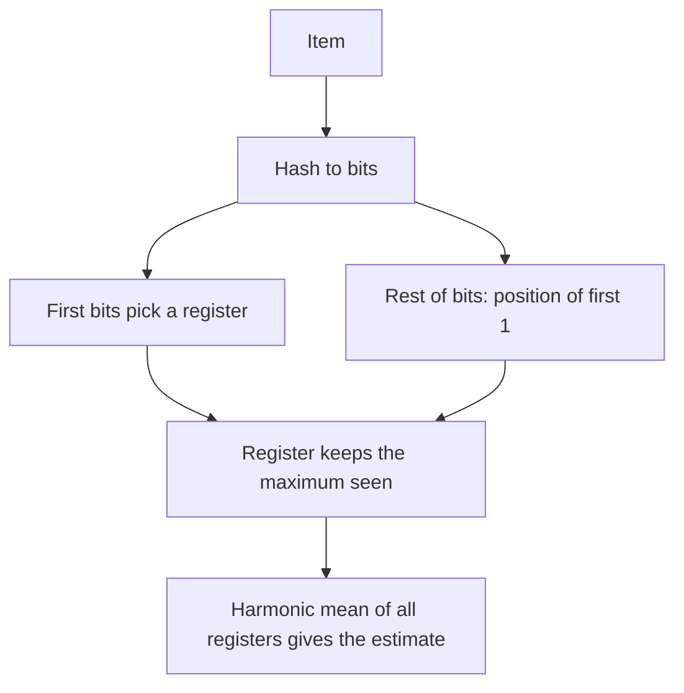

## The hook

A news site wants to show "1.2 million people read this today." Counting page views is easy: add one per view. Counting **distinct** readers is not. The obvious way is to keep a set of every reader ID seen today, and for a popular site that set has millions of entries, for every article, every day.

HyperLogLog gets a good answer, typically within a couple of percent, using a few kilobytes. It does it with an idea that sounds like a party trick: watch for unusually lucky coin flips.

## Where you meet it every day

- **Redis** has HyperLogLog built in through the `PFADD` and `PFCOUNT` commands; each one uses at most about 12 KB of memory.
- **Analytics databases and query engines** offer approximate distinct counts (often named like `APPROX_COUNT_DISTINCT`) built on HyperLogLog or close variants, because exact distinct counts over billions of rows are slow.
- **Dashboards** that show unique visitors, unique search queries or distinct devices per hour usually rely on a sketch like this.

The question is always [[cardinality]]: how many distinct things, not how many things.

## The intuition

:::analogy
Imagine friends flipping coins and shouting out their longest streak of heads in a row. If the best streak anyone reports is two, there were probably only a few people flipping. If someone reports twenty heads in a row, there were almost certainly a huge number of flippers, because a streak that long only happens about once in a million tries. The longest streak tells you roughly how many people played.
:::

A good hash function turns each item into what looks like random coin flips: its bits. The run of [[leading zeros]] is the "streak of heads". Seeing a hash that starts with k zeros suggests you have hashed about 2ᵏ distinct items. Duplicates do not help, because the same item always produces the same hash, the same coin flips.

## How it works

One coin-flip game is too noisy: a single lucky item can fool it. HyperLogLog runs many small games at once and averages them carefully.

1. Hash each item to a long string of bits.
2. Use the first few bits to choose one of m [[register]]s (for example, 14 bits pick one of 16,384 registers).
3. Look at the remaining bits and count the position of the first 1 (leading zeros plus one).
4. Store the **maximum** such value ever seen in that register.

To estimate, combine the registers with a [[harmonic mean]], which keeps one unusually lucky register from dominating, and multiply by a correction constant:

$$E \approx \alpha_m \cdot m^2 \cdot \left(\sum_{j=1}^{m} 2^{-M_j}\right)^{-1}$$

- $M_j$ is the value stored in register j.
- $2^{-M_j}$ shrinks fast for big registers, so the sum is a harmonic-style average.
- $\alpha_m$ is a constant from the analysis that removes a systematic bias.

The standard error is about $1.04 / \sqrt{m}$. With 16,384 registers that is roughly 0.8%, and each register needs only 6 bits, around 12 KB in total.



Real implementations add small fixes, such as switching to a simpler formula when very few items have been seen, but the core is exactly this.

## Walk through an example

A toy version with m = 4 registers and short 8-bit hashes (made up for the example). The first 2 bits choose the register; we look for the first 1 in the remaining 6 bits.

| Item | Hash | Register (first 2 bits) | Rest | First 1 at position | Register after |
|---|---|---|---|---|---|
| alice | 01 001010 | 1 | 001010 | 3 | M1 = 3 |
| bob | 11 100000 | 3 | 100000 | 1 | M3 = 1 |
| alice | 01 001010 | 1 | 001010 | 3 | M1 = 3 (unchanged) |
| chen | 01 000011 | 1 | 000011 | 5 | M1 = 5 |
| dana | 00 010000 | 0 | 010000 | 2 | M0 = 2 |

The repeated "alice" changed nothing. "chen" happened to have a lucky hash in register 1, raising it to 5. With only four registers, this one lucky value would skew a plain average badly, which is exactly why the harmonic mean and thousands of registers are used in practice.

:::try-this
Merge this sketch with a second one whose registers are M0 = 1, M1 = 2, M2 = 4, M3 = 0. Take the larger value in each position. (You should get 2, 5, 4, 1. The merged sketch describes all items from both streams, as if they had been added to one sketch.)
:::

## The code

```pseudo
create(p):                       // m = 2^p registers
    M = array of 2^p zeros

add(item):
    x = hash64(item)
    j = top p bits of x
    w = remaining bits of x
    rank = number of leading zeros in w, plus 1
    M[j] = max(M[j], rank)

estimate():
    Z = sum over j of 2^(-M[j])
    E = alpha(m) * m * m / Z
    apply small-range correction if E is small
    return E

merge(A, B):
    return [max(A[j], B[j]) for each j]
```

## Why it is clever

:::insight
HyperLogLog never stores items, only the most extreme "luck" seen in each register. Because the same item always produces the same luck, duplicates are ignored for free, and because each register is a maximum, two sketches merge with a simple register-by-register max.
:::

That [[mergeable]] property is what makes it so useful in big systems. Each server, each hour or each shard keeps its own sketch; you can then answer "distinct users this week across all servers" by merging, without ever re-reading raw logs. Exact sets cannot do this cheaply.

## Where it falls short

:::warning
Common misconception: "HyperLogLog can tell you whether a specific user visited." It cannot. It keeps no items, only registers, so it answers only "about how many distinct". For membership, use a Bloom filter; for frequency, a Count-Min Sketch.
:::

- **It is approximate.** A percent or two of error is fine for dashboards, but not for billing or anything that must be exact.
- **No deletions.** You cannot remove an item, because registers only remember maximums.
- **Intersections are weak.** Unions merge perfectly, but estimating "users in both A and B" by subtraction adds up the errors and can be very inaccurate for small overlaps.

### Interview follow-ups

**"How accurate is it, and how much memory?"** Standard error is about 1.04/√m for m registers. With m = 16,384 registers of 6 bits that is about 0.81% error in 12,288 bytes, which is where the famous 12 KB comes from. Quadrupling memory halves the error.

**"Daily unique users are stored per day. How do you get weekly uniques?"** Merge the 7 daily sketches by taking the register-wise maximum, then estimate. You cannot add the 7 daily counts, because a user active on 3 days would be counted 3 times. Mergeability is the reason HyperLogLog wins this question.

**"Why does it need a good hash?"** The whole method reads leading zeros of hashed values as random coin flips. A biased hash makes some patterns too common and the estimate drifts.

**"What about very small counts?"** The raw estimator is biased when many registers are still zero, so implementations switch to linear counting (estimating from the number of empty registers) for small cardinalities.

## Key takeaways

- HyperLogLog estimates the number of distinct items using only a small array of registers, independent of how many items arrive.
- Each register remembers the longest run of leading zeros seen in hashes routed to it, like the longest streak of heads in a coin game.
- A harmonic mean across thousands of registers turns those noisy maxima into an estimate with about 1.04 divided by root m error.
- Duplicates never change it, and two sketches merge by taking the maximum of each register.
- It cannot answer membership, delete items or estimate small intersections accurately.
