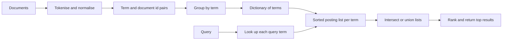

## The hook

Type three words into a search box and results from billions of pages appear in a fraction of a second. Reading every page for those words would take far longer than that, even for a huge data centre. The search engine is not reading pages when you search. It did the reading long before, and built a structure that answers "which pages contain this word?" instantly.

That structure is the inverted index. It powers web search, Elasticsearch, the search bar in your email, the full-text search in PostgreSQL, and the "search in this repository" box on code hosting sites. It is also a favourite system design building block: "design search for X" almost always starts here.

## Where you meet it every day

- **Web search engines** keep inverted indexes over their crawled pages.
- **Elasticsearch and Apache Solr**, both built on the Lucene library, store every searchable text field as an inverted index.
- **PostgreSQL full-text search** uses GIN indexes, which are inverted indexes over terms.
- **Email, chat and note apps** use inverted indexes for their search boxes.

## The intuition

:::analogy
Think of the index at the back of a textbook. The book itself is organised page by page, each page listing its words. The index flips that around: each important word is listed once, in alphabetical order, followed by the page numbers where it appears. To find "photosynthesis" you do not read 400 pages; you look up one word and jump straight to pages 12, 87 and 203.
:::

A search engine's [[inverted index]] is that back-of-the-book index for every word in every document. "Inverted" because the natural storage is document → words, and the index flips it to word → documents.

## How it works

### Building the index

1. **[[Tokenisation]]**: split each document into terms, lowercase them, and strip punctuation.
2. **Normalisation (optional)**: apply [[stemming]] so "running" and "runs" both become "run", and decide what to do with [[stop words]].
3. **Record postings**: for each term, append the document id to its [[posting list]]. Optionally also store how many times the term appears (for ranking) and at which positions (for phrase queries).
4. **Sort and store**: keep each posting list sorted by document id, and keep the terms themselves in a dictionary (a hash map, sorted array or trie) for fast lookup.



### Answering queries

- **AND** query: intersect the posting lists. Because they are sorted, walk them with two pointers, advancing whichever points to the smaller id, in O(m + n). Start with the shortest list, so the intermediate result stays small.
- **OR** query: merge the lists, also linear.
- **Phrase** query ("new york"): intersect, then check that the stored positions are consecutive.

### Ranking

Matching is not enough; results must be ordered. The classic score is [[TF-IDF]]: term frequency (how often the word appears in this document) times inverse document frequency (rarer words count more). Modern engines use refinements such as BM25, then add signals like freshness, popularity or learned models on top. The inverted index supplies the candidates and the counts that these scores need.

### Compression

Posting lists for common terms can contain millions of ids. Since they are sorted, store [[gap encoding]]: [3, 7, 21, 22] becomes [3, 4, 14, 1]. Small numbers fit in fewer bytes using variable-length encodings, so the index takes a fraction of the space and more of it fits in memory.

:::insight
Doing the expensive work at write time, reading every document once, makes every later read cheap. A query then costs time proportional to the lengths of a few posting lists, not to the size of the whole collection.
:::

## Walk through an example

Three documents:

- D1: "The cat sat on the mat"
- D2: "The dog sat on the log"
- D3: "The cat chased the dog"

After lowercasing and tokenising:

| Term | Posting list |
|---|---|
| cat | 1, 3 |
| chased | 3 |
| dog | 2, 3 |
| log | 2 |
| mat | 1 |
| on | 1, 2 |
| sat | 1, 2 |
| the | 1, 2, 3 |

- "cat AND dog": intersect [1, 3] and [2, 3]. Pointers at 1 and 2: advance the smaller (1 → 3). Now 3 and 2: advance 2 → 3. Both 3: match. Result **[3]**.
- "cat AND sat": [1, 3] ∩ [1, 2] = **[1]**.
- "mat OR log": [1] ∪ [2] = **[1, 2]**.
- "the" appears in every document, so it helps no query narrow anything down: that is why it is a stop word candidate, and why its IDF is lowest.

:::try-this
Using the table, answer "sat AND dog" and "cat OR log". (sat ∩ dog = [1, 2] ∩ [2, 3] = [2]. cat ∪ log = [1, 3] ∪ [2] = [1, 2, 3].)
:::

## The code

```pseudo
build(docs):
    index = map from term to list
    for id, text in docs (in increasing id order):
        for term in unique(tokenise(text)):
            index[term].append(id)            // stays sorted
    return index

intersect(a, b):                              // both sorted
    i = j = 0; out = []
    while i < len(a) and j < len(b):
        if a[i] == b[j]: out.append(a[i]); i++; j++
        else if a[i] < b[j]: i++
        else: j++
    return out

and_query(terms):
    lists = [index[t] for t in terms], sorted by length
    result = lists[0]
    for l in lists[1:]: result = intersect(result, l)
    return result
```

## Why it is clever

It turns search from scanning everything into looking up a few lists, and it relies on structures you already know: a hash map for the dictionary and the sorted-list merge from two pointers. Sorted posting lists make AND, OR and phrase queries linear merges, and also make compression easy. The design separates concerns: the index finds candidates quickly, and a separate ranking step orders them, so ranking can improve without rebuilding the index.

## Where it falls short

:::warning
Common misconception: "removing stop words and stemming always improves search." Both trade precision for recall and size. Stemming can merge words with different meanings, such as "university" and "universe" under some stemmers, and dropping stop words breaks phrase queries. Many modern engines keep stop words and apply language-specific normalisation carefully.
:::

- **Updates are expensive**: inserting into sorted, compressed lists is costly, so engines write new small index segments and merge them in the background, an idea close to LSM trees.
- **Exact terms only**: an inverted index finds words, not meanings. Searching "car" does not find "automobile" without synonyms, or without semantic vector search alongside.
- **Common terms have huge lists**: queries with very frequent words need skip pointers, early termination or caching to stay fast.
- **Sharding**: big indexes are split across machines, by document or by term, each with its own trade-offs for query fan-out.

## Key takeaways

- An inverted index maps each term to a sorted posting list of the documents that contain it.
- Building it means tokenising, optionally normalising, and recording postings, all done once at write time.
- AND, OR and phrase queries become linear merges of sorted lists, starting with the shortest list.
- Ranking scores such as TF-IDF and BM25 use the counts stored in postings to order matching documents.
- Gap encoding compresses sorted lists, and segments merged in the background make updates practical.
