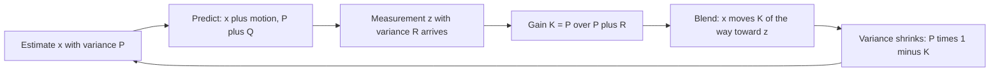

## The hook

The blue dot on your phone's map moves smoothly as you walk, even though the GPS reading behind it jumps around by several metres, and even when it drops out under a flyover. Your phone is not trusting any single source. It combines a prediction from the phone's motion sensors with each noisy GPS fix, weighting each by how reliable it is right now.

The method behind that blending was published by Rudolf Kalman in 1960. Within a decade it was guiding spacecraft: NASA used Kalman filtering in navigation for the Apollo programme. Today it runs in GPS receivers, drones, self-driving cars, robot vacuums, and anywhere noisy sensors must be fused into one confident estimate.

## Where you meet it every day

- **Phone location**: blending GPS with accelerometer, gyroscope and other signals for a smooth, stable position.
- **Drones and robots**: estimating position and orientation from cheap, noisy sensors many times a second.
- **Cars**: fusing radar, camera and wheel-speed data to track the car itself and the vehicles around it.
- **Aircraft and spacecraft navigation**, the field where the filter first proved itself.

## The intuition

:::analogy
Picture a ship's navigator on a foggy night. They know the ship's speed and heading, so every hour they mark a new position on the chart by dead reckoning: "we should be 10 km further east". Currents and wind make that guess drift, so they grow less sure with every hour. Then, briefly, a lighthouse shows through the fog and they take a bearing. The bearing is also imperfect. A wise navigator does not throw away either: they move the chart mark toward the lighthouse fix, by a lot if the fix is clear and their dead reckoning is old, by a little if the fog is thick and their last fix was recent.
:::

Dead reckoning is the [[prediction step]]. The lighthouse sighting is the [[update step]]. How far the navigator moves the mark is the [[Kalman gain]], and "how sure am I?" is tracked as a [[variance]] for both the estimate and the measurement.

## How it works

Track an estimate x of the [[state]] and its variance P. Each time step has two phases.

### 1. Predict

Move the estimate forward with the motion model, here "position plus distance travelled u":

$$x^- = x + u \qquad P^- = P + Q$$

Q is the [[process noise]]: how much the real motion can differ from the model. Predicting always *increases* uncertainty, like dead reckoning drifting.

### 2. Update

A measurement z arrives with [[measurement noise]] variance R. Compute the gain:

$$K = \frac{P^-}{P^- + R}$$

then blend and shrink the uncertainty:

$$x = x^- + K\,(z - x^-) \qquad P = (1 - K)\,P^-$$

- If the prediction is very uncertain (P⁻ much larger than R), K is close to 1: trust the measurement.
- If the measurement is very noisy (R much larger than P⁻), K is close to 0: barely move.
- z − x⁻ is the surprise, called the innovation: how far the measurement is from what we expected.

The new P is always smaller than both P⁻ and R, because two independent pieces of evidence, combined well, beat either one alone.



:::insight
The Kalman filter is a weighted average where the weights are not fixed but recomputed every step from current uncertainty. Predictions add uncertainty, measurements remove it, and the gain is simply "what share of the total uncertainty belongs to my prediction".
:::

### Beyond one dimension

Real systems track several quantities at once, such as position and velocity, so x becomes a vector, P a covariance matrix, and the update uses matrix versions of the same formulas. A neat consequence: the filter can estimate velocity even if only position is measured, because the motion model links them. For non-linear motion or sensors, the extended and unscented Kalman filters apply the same predict-update loop with approximations.

## Walk through an example

A ship sails east at 10 km per hour. Start: x = 0 km, P = 1. Each hour adds process noise Q = 1. The lighthouse fix has variance R = 4 (fairly foggy).

| Hour | Predicted x⁻ | P⁻ | Measured z | K = P⁻ / (P⁻ + 4) | New x | New P |
|---|---|---|---|---|---|---|
| 1 | 10.00 | 2.00 | 11.5 | 0.333 | 10 + 0.333 × 1.5 = **10.50** | 1.333 |
| 2 | 20.50 | 2.33 | 19.0 | 0.368 | 20.5 − 0.368 × 1.5 = **19.95** | 1.474 |
| 3 | 29.95 | 2.47 | 31.0 | 0.382 | 29.95 + 0.382 × 1.05 = **30.35** | 1.528 |

Notice three things:

- Each estimate lands between the prediction and the measurement, closer to the prediction because the fog (R = 4) makes fixes less trustworthy than dead reckoning.
- Variance rises at each prediction (to about 2.3 to 2.5) and falls at each update (to about 1.3 to 1.5).
- P settles to a steady value, and K settles with it; for a constant model, the filter quickly finds a stable balance.

:::try-this
Your prediction is x⁻ = 50 with P⁻ = 3, and a clear-weather fix reads z = 54 with R = 1. What are the new estimate and variance? (K = 3 / 4 = 0.75. x = 50 + 0.75 × 4 = 53. P = 0.25 × 3 = 0.75. The sharp fix pulls the estimate most of the way, and uncertainty drops a lot.)
:::

## The code

```pseudo
kalman_1d(x, P, Q, R, steps):
    for each step with motion u and measurement z:
        // predict
        x = x + u
        P = P + Q
        // update
        K = P / (P + R)
        x = x + K * (z - x)
        P = (1 - K) * P
        output x, P
```

```cpp
#include <bits/stdc++.h>
using namespace std;

int main() {
    double x = 0, P = 1, Q = 1, R = 4, u = 10;
    for (double z : {11.5, 19.0, 31.0}) {
        x += u; P += Q;                    // predict
        double K = P / (P + R);            // gain
        x += K * (z - x); P *= (1 - K);    // update
        printf("K=%.3f x=%.2f P=%.3f\n", K, x, P);
    }
    // K=0.333 x=10.50 P=1.333 / K=0.368 x=19.95 P=1.474 / K=0.382 x=30.35 P=1.528
}
```

Each step costs O(1) in one dimension, or O(n³) for an n-dimensional state because of matrix operations, which is small for the handful of quantities typically tracked.

## Why it is clever

It needs only the current estimate and its uncertainty, not the whole history, so it runs in constant memory, in real time, on tiny chips. It turns fusing sensors into arithmetic with a clear meaning: trust each source in proportion to its precision. It handles missing measurements gracefully: if the lighthouse is hidden, just predict and let uncertainty grow. And for linear systems with Gaussian noise, it is provably the best possible estimator.

## Where it falls short

:::warning
Common misconception: "the Kalman filter works on any noisy data." Its optimality assumes a roughly linear model and noise that is roughly Gaussian with known variances Q and R. Wrong noise settings make it either sluggish or jumpy, outliers such as a GPS fix reflected off a building can drag it badly, and strongly non-linear systems need extended or unscented variants, or particle filters.
:::

- **Tuning Q and R** is often more art than science and can dominate performance.
- **A wrong motion model** makes predictions confidently wrong; the filter cannot fix a bad model.
- **Multi-modal beliefs**, like "the robot is in one of two corridors", cannot be represented by a single estimate with a variance; particle filters handle those.

## Key takeaways

- The Kalman filter repeatedly predicts the state with a motion model, then updates it with a noisy measurement.
- Prediction increases the variance by the process noise, and each measurement reduces it.
- The Kalman gain, P divided by P plus R in one dimension, decides how far to move toward the measurement.
- The result is a weighted average whose weights come from current uncertainty, and it needs only the latest estimate, not the history.
- It is optimal for linear systems with Gaussian noise, and needs careful tuning or non-linear variants elsewhere.
