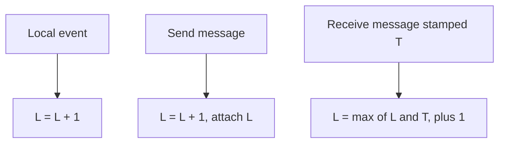

## The hook

Two servers record events with their own clocks. Server A logs "user deleted the file" at 10:00:00.120. Server B logs "user edited the file" at 10:00:00.100. So the edit came first? Not necessarily: B's clock might run 50 milliseconds fast. Physical clocks on different machines never agree exactly, and in distributed systems even small disagreements reorder events.

In 1978, Leslie Lamport published a paper with a radical answer: stop asking what time something happened. Ask instead what could have caused what. That paper is among the most cited in computer science, and it was part of the work recognised by his 2013 Turing Award.

## Where you meet it every day

- **Consensus protocols** such as Raft number their leadership terms and log entries with ever-increasing counters, the same idea of ordering by logic instead of wall-clock time.
- **Distributed databases** like CockroachDB use hybrid logical clocks, which combine physical time with a Lamport-style counter so ordering stays consistent despite [[clock skew]].
- **Collaborative editing and CRDTs** tag operations with Lamport-style timestamps plus a replica id, so every replica sorts concurrent edits the same way.

Any time a system must agree on an order of events across machines, a [[logical clock]] is usually somewhere underneath.

## The intuition

:::analogy
Imagine pen pals who number their letters. Each writer keeps a counter and bumps it before every letter they write or receive. When a letter arrives carrying a bigger number than your own counter, you jump ahead past it before replying. That way, every reply always carries a higher number than the letter that prompted it, even though nobody ever looks at a calendar.
:::

The pen pals cannot say on which day a letter was written. But they can guarantee something more useful: if one letter could have influenced another, the influenced one has the bigger number.

## How it works

Lamport defined the [[happened-before]] relation, written a → b:

- a and b are on the same machine and a comes first, or
- a is sending a message and b is receiving that message, or
- there is a chain of such steps from a to b.

Events with no chain between them are [[concurrent events]]: neither could have affected the other.

Each machine keeps an integer counter L, starting at 0, and follows three rules:

1. **Before each local event**, increment: L = L + 1.
2. **When sending** a message, increment, then attach L to the message.
3. **When receiving** a message stamped T, set L = max(L, T) + 1.

This guarantees the **clock condition**: if a → b then L(a) < L(b).



:::insight
A Lamport clock does not measure time at all. It measures influence. Every message carries enough information to push the receiver's counter past everything that could have caused it.
:::

To get a [[total order]] that every machine agrees on, sort events by (timestamp, machine id). Ties are broken the same way everywhere, so all replicas produce the same order.

## Walk through an example

Three machines, all counters starting at 0.

| Step | Machine | Event | Rule | Counter after |
|---|---|---|---|---|
| 1 | A | local event a1 | +1 | A = 1 |
| 2 | A | sends m1 to B | +1, stamp 2 | A = 2 |
| 3 | C | local event c1 | +1 | C = 1 |
| 4 | B | receives m1 (stamp 2) | max(0, 2) + 1 | B = 3 |
| 5 | B | sends m2 to C | +1, stamp 4 | B = 4 |
| 6 | C | receives m2 (stamp 4) | max(1, 4) + 1 | C = 5 |

Check the clock condition: a1 (1) → send m1 (2) → B's receive (3) → send m2 (4) → C's receive (5). Every step on the chain increases.

Now look at c1 with timestamp 1 and a1 with timestamp 1. They are concurrent: no message connects them. Their equal timestamps are broken by machine id, giving the agreed order a1, then c1.

:::try-this
Add a step 7: A has a local event a3 after step 2. What is its timestamp? Is a3 before or after C's receive at step 6 in the happened-before sense? (a3 gets 3. There is no chain from a3 to C's receive or back, so they are concurrent, even though 3 < 5.)
:::

## The code

```pseudo
L = 0                              // one counter per machine

on local_event():
    L = L + 1
    record event with timestamp (L, my_id)

on send(msg):
    L = L + 1
    msg.timestamp = L
    transmit msg

on receive(msg):
    L = max(L, msg.timestamp) + 1
    process msg with timestamp (L, my_id)

order(e1, e2):                     // agreed total order
    compare (e1.L, e1.id) with (e2.L, e2.id)
```

## Why it is clever

The trick is that the receive rule makes causality flow forward through the counters. A machine that learns about an event, directly or through a chain of messages, always ends up with a larger counter than that event. No synchronised clocks, no central coordinator, one integer per message.

Lamport also showed how to use this total order to build things, such as a mutual exclusion algorithm where every machine processes lock requests in the same timestamp order, without a central lock server.

## Where it falls short

:::warning
Common misconception: "if L(a) < L(b), then a happened before b." The clock condition only goes one way. A smaller timestamp is consistent with a happening first, but the events might be completely unrelated. To detect concurrency, for example to spot conflicting writes, you need vector clocks, which keep one counter per machine.
:::

- **No link to real time.** A Lamport timestamp cannot tell you that an event happened at 10:00, or that a user's request came before another user's in wall-clock terms.
- **The total order is somewhat arbitrary** for concurrent events: tie-breaking by machine id is consistent but not meaningful.
- **Lost or never-sent messages** mean causality the system cannot see, such as two users talking on the phone, is invisible to the clocks.

### Interview follow-ups

**"State the update rules."** Before each local event or send, increment your counter. Attach the counter to every message. On receive, set counter = max(own, received) + 1. That is the whole algorithm.

**"Why not just use wall-clock timestamps?"** Machine clocks drift and get adjusted, so a reply can carry an earlier timestamp than the request that caused it. Lamport clocks guarantee that if a caused b, then L(a) < L(b), whatever the physical clocks say.

**"How do you get a total order everyone agrees on?"** Sort by (timestamp, machine id). Ties between concurrent events are broken the same way on every machine, which is enough for things like a distributed mutual exclusion queue.

**"Lamport or vector clocks for detecting conflicting writes?"** Vector clocks. A Lamport timestamp cannot tell "concurrent" from "happened before"; a vector clock can, at the cost of one counter per participant.

## Key takeaways

- Physical clocks on different machines drift, so they cannot reliably order events in a distributed system.
- A Lamport clock is one counter per machine, incremented on every event and pushed past the timestamp of every received message.
- If one event happened before another, it always has a smaller Lamport timestamp.
- A smaller timestamp does not prove causality; detecting concurrent events needs vector clocks.
- Sorting by timestamp with machine id as a tie-breaker gives every machine the same total order of events.
