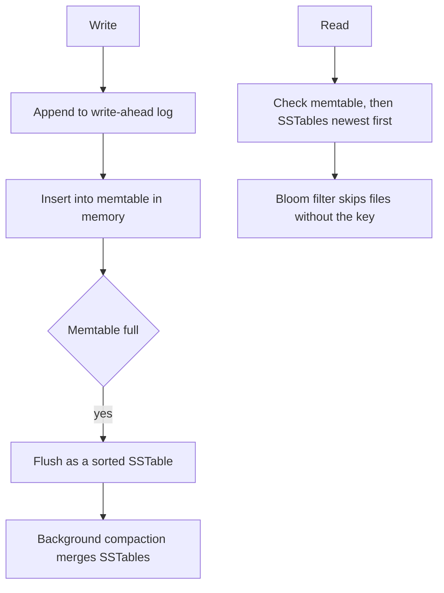

## The hook

A messaging app stores billions of messages, and every second hundreds of thousands more arrive. A storage engine that updates records in place, seeking to the right spot on disk for every write, would spend most of its time jumping around.

Many modern databases take a different approach: never update in place. Collect writes in memory, write them out as sorted files in one sweep, and tidy up later in the background. That design, the log-structured merge tree, sits under RocksDB, LevelDB, Cassandra, HBase and many others.

## Where you meet it every day

- **RocksDB**, which grew out of Google's **LevelDB**, is an embedded LSM engine used inside many systems, including as a storage engine in databases such as CockroachDB (which later moved to Pebble, an LSM engine inspired by RocksDB) and in services at large companies.
- **Apache Cassandra and HBase**, modelled on ideas from Amazon's Dynamo and Google's Bigtable, store data in LSM-style SSTables.
- **Time-series and logging systems** often use LSM-style designs because their workloads are dominated by continuous writes.

If a database advertises very high write throughput, there is a good chance an [[LSM tree]] is underneath.

## The intuition

:::analogy
Think of taking notes in a pocket diary all day, writing each new note on the next line without going back to fix old ones. Every evening, you sort the day's notes and file them as a neat, dated booklet. Every week, you merge several booklets into one bigger sorted binder, throwing away notes that later notes replaced. Writing is always fast; tidying happens later, in bulk.
:::

The pocket diary is the [[memtable]]. Each sorted booklet is an [[SSTable]]. Merging booklets into binders is [[compaction]].

## How it works

### The write path

1. Append the write to a write-ahead log on disk, so it survives a crash.
2. Insert it into the memtable, an in-memory sorted structure (often a skip list or balanced tree).
3. When the memtable is full, freeze it and write it to disk as a new SSTable: one sequential write of sorted data.

Deletes are writes too: since SSTables are immutable, a delete writes a [[tombstone]] that says "this key is gone".

### The read path

To read a key, check the newest data first: the memtable, then SSTables from newest to oldest. The first match wins; a tombstone means "not found". Two tricks keep this fast:

- **Bloom filters**: each SSTable has a small filter that answers "definitely not here" for most keys, so most files are skipped without a disk read. See [The Data Structure That Is Allowed to Lie](article:famous-algos-bloom-filter).
- **Sparse indexes**: within an SSTable, a small index of key ranges lets the engine jump close to the right block.



### Compaction

Over time, many SSTables pile up, and the same key may appear in several. Compaction merges sorted files, like merging sorted lists in merge sort, keeping only the newest value per key and dropping overwritten values and old tombstones. This keeps the number of files a read must check small and reclaims space.

:::insight
An LSM tree turns many small random writes into a few large sorted writes. It pays for that speed later, in background merging, and uses Bloom filters so reads do not have to pay too.
:::

## Walk through an example

Memtable capacity: 3 keys.

| Step | Operation | Memtable | SSTables on disk (newest first) |
|---|---|---|---|
| 1 | put a=1, c=3, b=2 | {a:1, b:2, c:3} | — |
| 2 | memtable full, flush | {} | S1 {a:1, b:2, c:3} |
| 3 | put a=9, delete b, put d=4 | {a:9, b:✝, d:4} | S1 |
| 4 | flush | {} | S2 {a:9, b:✝, d:4}, S1 {a:1, b:2, c:3} |
| 5 | compact S2 + S1 | {} | S3 {a:9, c:3, d:4} |

A read of b at step 4 checks S2 first, finds the tombstone ✝ and returns "not found", without needing S1. After compaction, the old a=1, b=2 and the tombstone are gone.

:::try-this
At step 4, read key c. Which files are checked, and what helps skip one of them? (The memtable is empty; S2's Bloom filter most likely says "definitely not here", so S2 is skipped; S1 contains c=3, which is returned.)
:::

## The code

```pseudo
put(key, value):
    wal.append(key, value)
    memtable.insert(key, value)
    if memtable.size > LIMIT:
        sstables.push_front(write_sorted_file(memtable))
        memtable = new empty sorted map

get(key):
    if key in memtable: return memtable[key] (or not found if tombstone)
    for table in sstables, newest first:
        if table.bloom.might_contain(key):
            if key in table: return table[key] (or not found if tombstone)
    return not found
```

## Why it is clever

Disks and SSDs are far faster at large sequential writes than at scattered small ones. B-trees, the classic alternative, update pages in place, so each write may touch random locations. The LSM tree makes every disk write sequential and every file immutable, which also simplifies crash recovery and replication: files never change once written, so they are easy to copy, cache and verify.

## Where it falls short

:::warning
Common misconception: "LSM trees are strictly better than B-trees." They trade read and space costs for write speed. Reads may consult several files, and compaction rewrites data many times, which costs disk bandwidth and wears SSDs. Read-heavy workloads with many updates in place often suit B-trees better.
:::

- **[[Write amplification]]**: each byte may be rewritten several times as it moves through compaction levels.
- **Compaction stalls**: if writes outpace compaction, files pile up and reads slow down, or the engine throttles writes.
- **Space amplification**: old versions and tombstones occupy space until compaction removes them.
- **Tuning is complex**: leveled versus size-tiered compaction trade read, write and space costs differently.

### Interview follow-ups

**"Walk through a read for a key that does not exist."** Check the memtable, then each on-disk file from newest to oldest. A per-file Bloom filter answers "definitely not here" for most files, so most of them are skipped without touching disk.

**"How does a delete work if files are immutable?"** Write a tombstone, a record that says "this key is deleted". Reads that hit the tombstone stop and return not found. Compaction later drops the tombstone together with the older values it hides.

**"Leveled or size-tiered compaction?"** Leveled compaction keeps each level's key ranges non-overlapping, so a read checks few files, at the cost of more rewriting: better for reads and space. Size-tiered merges similar-sized files, rewriting less: better for heavy writes, but reads may check more files and space usage is higher.

**"When would you pick a B-tree instead?"** When reads dominate, data is updated in place often, and predictable read latency matters more than ingest speed. Many relational databases use B-trees; write-heavy stores such as Cassandra and RocksDB use LSM trees.

## Key takeaways

- An LSM tree buffers writes in an in-memory memtable and flushes them as immutable, sorted SSTables.
- Every disk write is a large sequential batch, which makes write throughput very high.
- Reads check the memtable and then SSTables from newest to oldest, using Bloom filters to skip files that cannot contain the key.
- Deletes are tombstones, and background compaction merges files, keeps the newest values and reclaims space.
- The price is write amplification, compaction work and more complex reads, so B-trees can still win for read-heavy update workloads.
