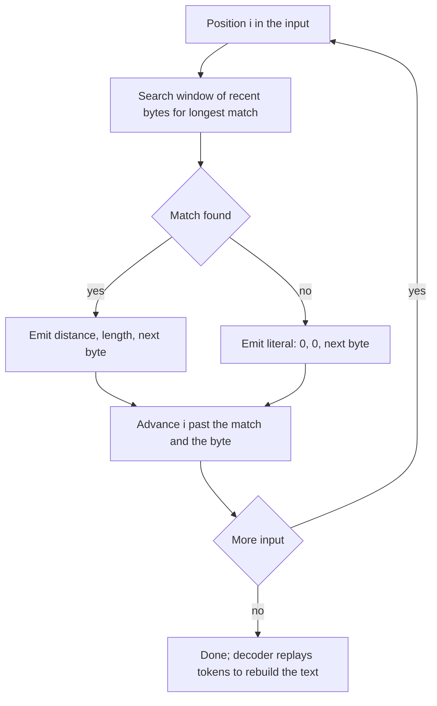

## The hook

Open a web page and the HTML, CSS and JavaScript usually arrive compressed, often to a fraction of their size. Download a ZIP file, save a PNG, or look at a server log archived as `.gz`, and the same trick is at work. Text, code and logs repeat themselves constantly: the same tags, the same variable names, the same timestamps and phrases. Storing each repetition again is wasteful.

In 1977, Jacob Ziv and Abraham Lempel published a simple, powerful way to exploit that: whenever text repeats something recent, write a short pointer to the earlier copy instead. Their method, now called LZ77, is the first half of DEFLATE, the format behind gzip, ZIP and PNG, and the ancestor of modern compressors.

## Where you meet it every day

- **gzip and HTTP compression**: web servers commonly send pages with `Content-Encoding: gzip`, which is DEFLATE, which is LZ77 plus Huffman coding.
- **ZIP archives** use DEFLATE for most files.
- **PNG images** compress their pixel rows with DEFLATE through the zlib library.
- **Modern compressors** such as LZ4, Zstandard and Brotli are built on the same LZ77-style matching, with different speed and size trade-offs.

## The intuition

:::analogy
Think of filling in a long handwritten table, row after row. When a cell says exactly the same thing as the cell above it, you do not write it out again; you write a ditto mark, meaning "same as above". A smarter ditto could say "same as the 3 words starting 2 lines up". Anyone reading the table can expand every ditto, because the thing it points to is already written on the page above.
:::

LZ77 is that smarter ditto. As the encoder walks through the data, it looks back over the recent text, the [[sliding window]], for the longest match with what comes next. If it finds one, it writes a [[back-reference]] instead of the bytes. If not, it writes the byte as a [[literal]]. This is [[lossless compression]]: expanding every ditto gives back exactly the original.

## How it works

### Tokens

The original LZ77 emits a stream of triples:

- **distance**: how far back the match starts,
- **length**: how many bytes to copy,
- **next character**: the byte that follows the match.

A triple with length 0 is just a literal. DEFLATE uses a slightly different alphabet, either a literal byte or a [[distance-length pair]], but the idea is the same.

### Encoding

1. Keep a position i in the input and a window of the last W bytes before it.
2. Find the longest string starting somewhere in the window that matches the input starting at i.
3. Emit (distance, length, next character), and advance i by length + 1.

### Decoding

The decoder keeps its own output. For each token, it goes back *distance* bytes in that output and copies *length* bytes forward, one byte at a time, then appends the next character. It never needs the dictionary sent separately: the dictionary is the text it has already rebuilt.



### Overlapping copies

A back-reference may be longer than its distance. "Go back 1 and copy 6" means copy the previous byte, then copy the byte you just wrote, and so on, which turns one "a" into a run of six. Copying byte by byte makes this work naturally, and it gives LZ77 run-length encoding for free.

### Why a sliding window

Searching all earlier text would be slow and would require unbounded memory in the decoder. A window bounds both: DEFLATE uses a window of 32 KB, so distances fit in a few bits and the decoder needs only 32 KB of history. Finding the longest match quickly is the engineering challenge; real encoders use hash tables of recent 3-byte sequences instead of scanning the whole window, the same moving-range idea as in [The Caterpillar That Reads Arrays in One Pass](article:dsa-sliding-window).

:::insight
The decoder rebuilds the dictionary for free, because the dictionary is simply the text it has already produced. That is why LZ77 needs no table in the file header and works on any kind of data in a single pass.
:::

### The second stage: entropy coding

LZ77 removes repeated phrases, but the tokens themselves still use more bits than needed: some literals and lengths are far more common than others. DEFLATE therefore Huffman-codes the token stream, giving frequent symbols short codes. The two stages together are why gzip often shrinks text and code several times over.

## Walk through an example

Encode **abcabcabcd** with a window large enough to see everything.

| Position | Remaining input | Longest match in window | Token (distance, length, next) | Output so far |
|---|---|---|---|---|
| 0 | abcabcabcd | none | (0, 0, a) | a |
| 1 | bcabcabcd | none | (0, 0, b) | ab |
| 2 | cabcabcd | none | (0, 0, c) | abc |
| 3 | abcabcd | "abcabc" starting 3 back | (3, 6, d) | abcabcabcd |

Four tokens instead of ten characters. The last token is the interesting one: distance 3, length 6. The decoder goes back 3 to the "a", copies "abc", and keeps copying from what it has just written, producing "abcabc", then appends "d". The match overlaps the text it is creating.

A pure run works the same way: **aaaaaaab** encodes as (0, 0, a) then (1, 6, b), "go back one byte and copy it six times, then b".

:::try-this
Decode the tokens (0, 0, x), (0, 0, y), (2, 5, z). (Output x, then xy. Go back 2 and copy 5 bytes one at a time: x, y, x, y, x, giving xyxyxyx, then append z: **xyxyxyxz**.)
:::

## The code

```pseudo
encode(s, W):
    i = 0; tokens = []
    while i < len(s):
        best_len = 0; best_dist = 0
        for j in max(0, i - W) .. i - 1:            // real encoders use a hash table
            l = 0
            while i + l < len(s) - 1 and s[j + l] == s[i + l]: l++
            if l > best_len: best_len = l; best_dist = i - j
        tokens.append((best_dist, best_len, s[i + best_len]))
        i += best_len + 1
    return tokens

decode(tokens):
    out = []
    for (dist, len, ch) in tokens:
        repeat len times: out.append(out[len(out) - dist])   // byte by byte, overlap allowed
        out.append(ch)
    return out
```

```cpp
#include <bits/stdc++.h>
using namespace std;

struct Token { int dist, len; char next; };

vector<Token> encode(const string& s, int W) {
    vector<Token> out;
    int i = 0, n = s.size();
    while (i < n) {
        int bestLen = 0, bestDist = 0;
        for (int j = max(0, i - W); j < i; j++) {
            int l = 0;
            while (i + l < n - 1 && s[j + l] == s[i + l]) l++;
            if (l > bestLen) { bestLen = l; bestDist = i - j; }
        }
        out.push_back({bestDist, bestLen, s[i + bestLen]});
        i += bestLen + 1;
    }
    return out;
}

string decode(const vector<Token>& t) {
    string out;
    for (auto& k : t) {
        for (int c = 0; c < k.len; c++) out += out[out.size() - k.dist];
        out += k.next;
    }
    return out;
}

int main() {
    auto t = encode("abcabcabcd", 16);
    for (auto& k : t) cout << '(' << k.dist << ',' << k.len << ',' << k.next << ") ";
    cout << '\n' << decode(t) << '\n';   // (0,0,a) (0,0,b) (0,0,c) (3,6,d)  then abcabcabcd
}
```

## Why it is clever

It needs no prior knowledge of the data: no fixed dictionary of English words, no model of images. The recent past becomes the dictionary, so it adapts to HTML, source code, logs or pixel rows equally well. Decoding is extremely fast, just copying bytes, which is why decompression is cheap even on small devices. And the encoder can trade speed for size by searching harder or less hard, while every decoder stays the same.

## Where it falls short

:::warning
Common misconception: "a good compressor can shrink any file." Random data, and data that is already compressed or encrypted, has no repetition left, which means high [[entropy]]. LZ77 finds no matches, emits literals plus overhead, and the output can be slightly larger. No lossless compressor can shrink all inputs, because there are fewer short files than long ones.
:::

- **Repeats farther back than the window are invisible**: a 32 KB window cannot see a paragraph repeated 1 MB earlier. Newer formats use much larger windows.
- **Match finding dominates encoding time**: fast compressors accept shorter matches; slow, high-ratio ones search much harder.
- **Tokens need a second stage**: on its own LZ77 leaves statistical redundancy, which Huffman or arithmetic coding removes.

### Interview follow-ups

**"Why can a match overlap the text it is still producing?"** A token like (distance 1, length 10) copies byte by byte from one position back, so each copied byte becomes the source for the next one. That is how a run of ten identical letters encodes as one literal plus one short token.

**"Speed versus ratio: what does a compression level change?"** Mainly how hard the encoder searches for long matches: how many candidates it checks and whether it tries lazy matching. Decoding speed barely changes, which is why formats can offer many encode levels.

**"Should you compress before or after encrypting?"** Before: encrypted data looks random and does not compress. But compressing secret data together with attacker-controlled data can leak secrets through the compressed length, which is the root of attacks such as CRIME on TLS compression.

## Key takeaways

- LZ77 replaces repeated text with back-references that say how far back to look and how many bytes to copy.
- The encoder searches a sliding window of recent text for the longest match, and anything without a match is written as a literal.
- The decoder rebuilds the dictionary from its own output, so decoding is a fast, simple byte copy.
- A copy may overlap its own output, which gives run-length encoding for free.
- DEFLATE combines LZ77 with Huffman coding and powers gzip, ZIP and PNG, but random or already compressed data cannot be shrunk.
