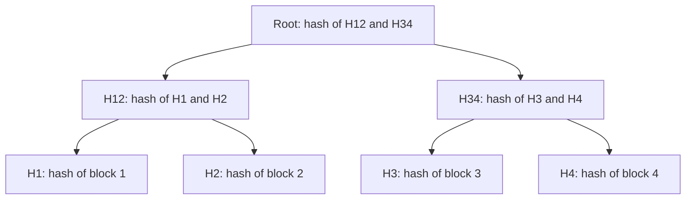

## The hook

Two database replicas in different data centres each hold a billion records. They should be identical, but after a network hiccup some writes may have reached one and not the other. Comparing every record would mean shipping terabytes across the ocean.

What if each side could summarise all billion records in one short fingerprint, and if the fingerprints differ, narrow down exactly where in a few dozen steps? That is a Merkle tree, an idea from Ralph Merkle's cryptography work around 1979, and it now sits inside Git, Bitcoin and many large databases.

## Where you meet it every day

- **Git** names every file and directory by the hash of its contents, and a commit's hash covers the whole tree of directories below it, a Merkle-style structure. That is why a commit id identifies an exact snapshot.
- **Bitcoin and other blockchains** put a Merkle root of a block's transactions in the block header, so a light client can check that one transaction is included without downloading the whole block.
- **Distributed databases** such as Cassandra and Amazon's Dynamo design use Merkle trees during [[anti-entropy]] repair to find which ranges of data differ between replicas.
- **File systems and package managers** use hash trees to verify that large downloads or disks have not been corrupted.

## The intuition

:::analogy
Imagine a company with a pyramid of receipts. Each clerk writes a fingerprint of their day's receipts. Each manager writes a fingerprint of their clerks' fingerprints. At the top, the director has one fingerprint for the whole company. If anyone alters a single receipt, that clerk's fingerprint changes, then their manager's, then the director's. And to find the altered receipt, you follow the changed fingerprints down the pyramid, ignoring every branch whose fingerprint still matches.
:::

Each fingerprint is a [[cryptographic hash]]. The pyramid is a [[Merkle tree]]. The director's fingerprint is the [[root hash]].

## How it works

1. Split the data into blocks. Hash each block: these are the leaves.
2. Pair up neighbouring hashes and hash each pair together: these are the parents.
3. Repeat level by level until one hash remains: the root.



Three things fall out of this shape.

**Change detection.** Equal roots mean, with overwhelming probability, equal data. Change any block and every hash on its path to the root changes.

**Finding differences fast.** Two parties compare roots. If they differ, compare the two children; descend only into subtrees whose hashes differ. Matching subtrees, possibly millions of blocks, are skipped with one comparison.

**[[Inclusion proof]]s.** To prove block 3 is in a tree with root R, give block 3 plus the sibling hashes along its path: H4, then H12. The verifier computes H3, hashes it with H4 to get H34, hashes H12 with H34, and checks the result equals R. That is one hash per level.

:::insight
A Merkle tree lets one short root hash stand for an enormous amount of data, while still pointing to exactly which part changed. Verification and comparison cost grows with the tree's height, log n, not with the amount of data.
:::

## Walk through an example

Eight blocks, so three levels above the leaves. Replica A and replica B differ only in block 6.

| Step | Compare | Result | Action |
|---|---|---|---|
| 1 | roots | differ | check both halves |
| 2 | left half (blocks 1-4) | match | skip all four blocks |
| 2 | right half (blocks 5-8) | differ | check its halves |
| 3 | blocks 5-6 | differ | check both |
| 3 | blocks 7-8 | match | skip |
| 4 | block 5 | match | skip |
| 4 | block 6 | differ | repair block 6 |

Seven hash comparisons found the single bad block among eight. With a billion blocks, about 30 levels, the same walk takes on the order of 60 comparisons when one block differs, instead of a billion.

:::try-this
In the four-block tree in the diagram, list the hashes you must send to prove block 2 is included, and the hashes the verifier computes. (Send H1 and H34. The verifier computes H2 from block 2, then H12 = hash(H1, H2), then the root = hash(H12, H34), and compares it with the known root.)
:::

## The code

```pseudo
build(blocks):
    level = [hash(b) for b in blocks]
    while len(level) > 1:
        if len(level) is odd: duplicate the last hash
        level = [hash(level[i] + level[i+1]) for i in 0, 2, 4, ...]
    return level[0]

diff(nodeA, nodeB):
    if nodeA.hash == nodeB.hash: return []          // identical subtree
    if nodeA is a leaf: return [nodeA.block_id]
    return diff(nodeA.left, nodeB.left) + diff(nodeA.right, nodeB.right)
```

## Why it is clever

It combines two properties that normally fight each other: compactness and precision. A single hash is compact but only says "same" or "different". A hash per block is precise but huge to compare. The tree gives both: a tiny summary at the top, and a path of hashes down to any detail, so verifying or locating a change costs only O(log n) hashes.

## Where it falls short

:::warning
Common misconception: "a Merkle root proves who created the data or that it is true." It only proves integrity: that the data matches the root. If an attacker can replace the root itself, nothing is proven. Roots must come from somewhere trusted, such as a signed commit or a blockchain's consensus.
:::

- **Updates cost a path of rehashing**, O(log n) hashes per changed block, which matters for very write-heavy data.
- **Block boundaries matter.** Inserting a byte near the start of a file with fixed-size blocks shifts every later block and changes almost every leaf; content-defined chunking helps.
- **Both sides must build trees the same way**, with the same block ranges, hash function and ordering, or every comparison will differ.

### Interview follow-ups

**"How big is a proof that one block belongs to a tree of 1 million blocks?"** One sibling hash per level: ⌈log₂ 1,000,000⌉ = 20 hashes. With 32-byte SHA-256 hashes that is 640 bytes, instead of downloading all the blocks.

**"Two replicas hold 1 billion keys and differ in a handful. How do they find the differences?"** Each builds a Merkle tree over key ranges and they compare roots. If roots match, done. If not, compare the children and descend only into subtrees whose hashes differ. Traffic grows with the number of differences times the tree height, not with the data size. Dynamo-style stores use this for anti-entropy repair.

**"Where else does it appear?"** Git (every commit names a tree of hashes), blockchains (a block header commits to all transactions), BitTorrent piece verification, and certificate transparency logs.

**"What if the number of leaves is odd?"** Implementations pick a rule, such as duplicating the last hash or promoting it unchanged. The rule itself does not matter much, but both sides must use the same one, or the roots will never match.

## Key takeaways

- A Merkle tree hashes data blocks into leaves and repeatedly hashes pairs of hashes until one root hash remains.
- Any change to a block changes every hash on its path to the root, so equal roots mean equal data.
- Comparing trees top-down skips identical subtrees, finding differences in about log n comparisons per changed block.
- An inclusion proof needs only one sibling hash per level, letting light clients verify one item without the whole dataset.
- Git, blockchains and replicated databases all use Merkle-style trees for integrity checks and efficient repair.
