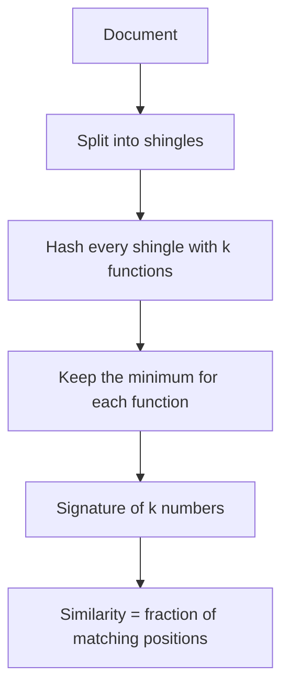

## The hook

A search engine crawls billions of pages and finds that many are almost copies of each other: the same news story syndicated across hundreds of sites, product pages differing only in a header, mirrored documentation. Showing ten copies of one article in the results is useless. But comparing every page with every other page is a quintillion comparisons.

In the late 1990s, Andrei Broder developed a technique for exactly this problem at AltaVista, one of the big search engines of the time. It shrinks each document to a short signature, and two signatures can be compared in microseconds.

## Where you meet it every day

- **Search engines** detect [[near-duplicate]] pages so results are not cluttered with copies, which was the original motivation.
- **Large text datasets** for training language models are commonly deduplicated with MinHash-based pipelines, because repeated documents waste training and encourage memorisation.
- **Plagiarism and code-clone detection** tools use MinHash-style signatures to find documents that share large chunks of text.

Whenever the question is "which of these millions of items are almost the same?", MinHash is a standard first tool.

## The intuition

:::analogy
Picture two people who each own a bag of cards, and you want to know how much their collections overlap. Shuffle a big master deck containing every possible card, and have each person find the first card in that shuffled order that is also in their own bag. If both stop at the same card, it means that card is in both bags. Repeat with many independent shuffles: the fraction of times they stop at the same card is exactly how much their bags overlap.
:::

The "first card in a random shuffle" is what a [[MinHash]] computes: hash every element, take the smallest hash. A random hash function acts like a random shuffle, and the smallest hash is the first card.

## How it works

### Step 1: documents become sets

Break each document into [[shingle]]s: every run of, say, 5 consecutive words. Two near-duplicate documents share most of their shingles. Their similarity is the [[Jaccard similarity]]:

$$J(A, B) = \frac{|A \cap B|}{|A \cup B|}$$

- $A \cap B$ is the set of shingles in both documents.
- $A \cup B$ is the set of shingles in either.
- J is 1 for identical sets and 0 for disjoint ones.

### Step 2: the magic property

Pick a random hash function h. Let min_h(A) be the smallest hash among A's elements. Then:

$$P[\min\nolimits_h(A) = \min\nolimits_h(B)] = J(A, B)$$

Why: look at the union of A and B. The element with the smallest hash in the union is equally likely to be any of them. Both sets report the same minimum exactly when that element is in both sets, and the chance of that is |A ∩ B| / |A ∪ B|.

### Step 3: signatures

Use k different hash functions to get a [[signature]] of k numbers per document. To estimate similarity, count the positions where two signatures agree and divide by k. With k around 100 to 200, each document shrinks from thousands of shingles to a few hundred numbers.



:::insight
MinHash replaces "compare two huge sets" with "compare two short lists of numbers", and the fraction of matches is an unbiased estimate of the true overlap. The cost of a comparison no longer depends on document size.
:::

## Walk through an example

Sets A = {a, b, c, d} and B = {b, c, d, e}. True Jaccard: overlap {b, c, d} is 3, union is 5, so J = 0.6.

Five hash functions (values made up for the example):

| Element | h1 | h2 | h3 | h4 | h5 |
|---|---|---|---|---|---|
| a | 3 | 2 | 9 | 5 | 6 |
| b | 7 | 8 | 4 | 3 | 1 |
| c | 1 | 6 | 7 | 9 | 4 |
| d | 9 | 5 | 2 | 6 | 8 |
| e | 4 | 1 | 8 | 2 | 7 |

- Signature of A (minimum over a, b, c, d): [1, 2, 2, 3, 1]
- Signature of B (minimum over b, c, d, e): [1, 1, 2, 2, 1]

They agree at h1, h3 and h5: 3 out of 5, giving an estimate of 0.6. Here it matches exactly; with real random hashes the estimate wobbles around the true value, and more hash functions make it tighter.

:::try-this
Add element f to set B with hash values h1 = 0, h2 = 9, h3 = 9, h4 = 9, h5 = 9. Recompute B's signature and the estimate. What is the true Jaccard now? (B's signature becomes [0, 1, 2, 2, 1], matching A at h3 and h5 only: estimate 0.4. True Jaccard is 3/6 = 0.5. A small signature is a noisy estimate.)
:::

## The code

```pseudo
signature(set, hashes):           // hashes = [h1 .. hk]
    sig = [infinity] * k
    for x in set:
        for i in 1 .. k:
            sig[i] = min(sig[i], hashes[i](x))
    return sig

estimate_similarity(sigA, sigB):
    matches = count of i where sigA[i] == sigB[i]
    return matches / k
```

Signatures are computed once per document. Comparing two documents is then O(k), independent of their length.

## Why it is clever

The trick is that a single random hash gives a yes-or-no event whose probability is exactly the similarity you want. Averaging many such events estimates it, with error shrinking roughly like one over the square root of k. And signatures are tiny and fixed-size, so they can be stored for billions of documents.

## Where it falls short

:::warning
Common misconception: "MinHash finds similar pairs among n documents quickly on its own." Comparing every pair of signatures is still about n² comparisons. To find candidate pairs fast, MinHash is combined with locality-sensitive hashing, which buckets signatures so only likely-similar documents are compared.
:::

- **It measures set overlap, not meaning.** Two paraphrased articles with different words look dissimilar; semantic similarity needs embeddings.
- **Shingle choice matters.** Too short and unrelated documents look similar; too long and small edits break many shingles.
- **Small signatures are noisy.** Thresholds need enough hash functions to separate "near-duplicate" from "somewhat related" reliably.

### Interview follow-ups

**"Why does the probability that two MinHash values match equal Jaccard similarity?"** Under a random permutation, the first element of A ∪ B to appear is equally likely to be any element of the union. Both sets share the same minimum exactly when that element is in A ∩ B, so the probability is |A ∩ B| / |A ∪ B|.

**"How does banding (LSH) find candidate pairs?"** Split each signature into b bands of r rows; two documents become candidates if any band matches exactly. With b = 20 and r = 5, a pair with similarity 0.8 becomes a candidate with probability 1 − (1 − 0.8⁵)²⁰ ≈ 0.9996, while a pair at 0.3 does so only about 4.7% of the time.

**"Where is it used?"** Near-duplicate detection for web crawling and search, deduplicating training data for language models, and plagiarism or similar-item detection.

## Key takeaways

- Jaccard similarity measures how much two sets overlap, and documents become sets of shingles.
- The probability that two sets share their minimum hash under a random hash function equals their Jaccard similarity.
- A signature of k MinHash values per document lets you estimate similarity by the fraction of matching positions.
- Comparisons cost O(k) regardless of document size, which makes near-duplicate detection feasible at web scale.
- MinHash alone still compares pairs; locality-sensitive hashing is used on top to find candidate pairs quickly.
