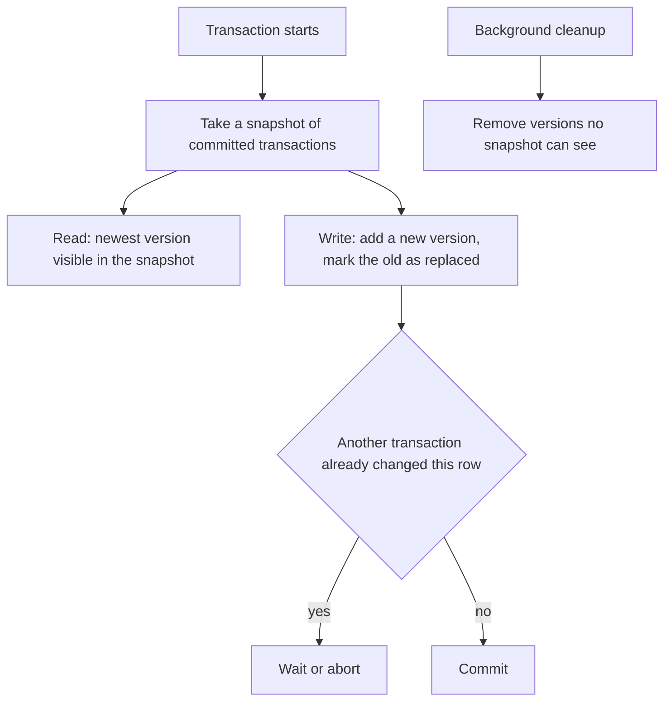

## The hook

An analyst starts a report that reads every order from the last year, which takes ten minutes. Meanwhile, the shop keeps selling: thousands of new orders and refunds per minute. If the report locked every row it read, the shop would freeze for ten minutes. If it read rows without any protection, it might count an order twice or see a refund without the order it refunds.

Modern databases avoid both problems with one idea: never overwrite a row in place. Keep the old version, write a new one, and let each transaction look at the version that matches its own moment in time.

## Where you meet it every day

- **PostgreSQL** stores row versions in its tables and uses transaction ids to decide which version each transaction sees; the vacuum process removes dead versions.
- **MySQL's InnoDB** keeps undo logs so it can reconstruct older versions of rows for consistent reads.
- **Oracle, SQL Server (with snapshot isolation), CockroachDB, and many key-value stores** use multi-version designs too.
- **Git** is a friendly everyday analogy: every commit is a version, and checking out an old commit shows a consistent snapshot while new commits keep arriving.

## The intuition

:::analogy
Think of a wiki where every edit creates a new revision instead of erasing the old text. A reader who opened the page at 10:00 keeps reading the 10:00 revision, consistent from top to bottom, even while someone saves a new revision at 10:02. Editors never wait for readers, readers never see half an edit, and once nobody is reading the old revisions any more, the wiki can archive them.
:::

That is [[MVCC]]. Each row has a chain of versions. Each transaction gets a [[snapshot]], a moment in time, and reads the newest version committed before that moment.

## How it works

Each row version carries metadata, simplified here as:

- **created by**: the [[transaction id]] that wrote this version.
- **deleted by**: the transaction id that replaced or deleted it, if any.

When a transaction starts, it records which transactions had already committed. A version is visible to it if it was created by a committed transaction in its snapshot and not deleted by one.

- **Read:** walk the version chain and return the first visible version. No locks needed.
- **Update:** create a new version and mark the old one as deleted by this transaction. Readers with older snapshots still see the old version.
- **Conflict:** if two transactions try to update the same row, the second must wait or fail, depending on the isolation level. Under [[snapshot isolation]], the "first committer wins" and the other aborts.
- **Cleanup:** versions that no running transaction can see any more are removed by [[garbage collection]].



:::insight
By keeping old versions, MVCC turns a conflict between readers and writers into a question of which version each one should see. Readers get a frozen, consistent view for free, and only writers touching the same rows ever have to coordinate.
:::

## Walk through an example

Row "stock of chai packets" starts at 10, written by transaction T5. Transactions get increasing ids.

| Time | Event | Versions of the row | Who sees what |
|---|---|---|---|
| 1 | T10 starts (snapshot: T5 committed) | v1 = 10 (by T5) | T10 sees 10 |
| 2 | T11 starts, sets stock to 7, commits | v1 = 10, v2 = 7 (by T11) | T10 still sees 10 |
| 3 | T12 starts (snapshot: T5, T11) | v1, v2 | T12 sees 7 |
| 4 | T10 tries to set stock to 9 | T11 already changed it after T10's snapshot | T10 aborts under snapshot isolation |
| 5 | T10 and T12 finish | v1 visible to nobody | cleanup removes v1 |

T10's long read never blocked T11's update, and its view stayed consistent. But T10 could not blindly overwrite T11's committed change, which would have been a lost update.

:::try-this
Two doctors are on call; a rule says at least one must remain on call. Each, in their own transaction, reads "two doctors on call" from their snapshot, and each removes themselves. Both commit, because they updated different rows. What went wrong? (This is [[write skew]]: each transaction's check used a snapshot that the other was changing. Snapshot isolation does not prevent it; serializable isolation, or explicitly locking the rows involved, does.)
:::

## The code

```pseudo
visible(version, snapshot):
    return version.created_by in snapshot.committed
       and (version.deleted_by is none or version.deleted_by not in snapshot.committed)

read(row, snapshot):
    for version in row.versions, newest first:
        if visible(version, snapshot): return version.value
    return not found

update(row, new_value, tx):
    if row has a version committed after tx.snapshot: abort      // first committer wins
    mark current version deleted_by = tx.id
    append new version(created_by = tx.id, value = new_value)
```

## Why it is clever

It removes the classic trade-off between consistency and concurrency for reads. Without versions, a consistent read means locking out writers; with versions, the database simply keeps the past around long enough for anyone who still needs it. It also makes features like long-running backups, consistent analytics queries and time-travel queries natural.

## Where it falls short

:::warning
Common misconception: "MVCC means transactions are fully isolated." Snapshot isolation, the level many MVCC databases provide by default or as an option, still allows write skew. Applications that enforce invariants across rows, such as "at least one doctor on call", need serializable isolation or explicit locking.
:::

- **Storage bloat:** every update leaves an old version; heavy update workloads need regular cleanup.
- **Long transactions hurt everyone:** a transaction that stays open for hours keeps every newer version's predecessors alive and blocks cleanup.
- **Write conflicts still need coordination:** two transactions updating the same row still conflict, and one must wait or retry.
- **Reads walk version chains**, which can slow down hot rows that are updated very frequently.

## Key takeaways

- MVCC keeps multiple versions of each row instead of overwriting in place.
- Each transaction reads from a snapshot, seeing the newest version committed before it started, so readers never block writers.
- Concurrent writes to the same row still conflict; under snapshot isolation, the first committer wins and the other aborts.
- Old versions are removed by garbage collection once no running transaction can see them, and long transactions delay that cleanup.
- Snapshot isolation still allows write skew, so cross-row invariants need serializable isolation or explicit locks.
