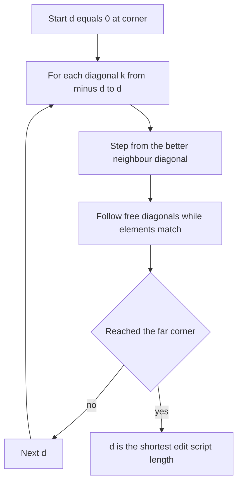

## The hook

You change three lines in a 5,000-line file and run `git diff`. In a blink, Git shows exactly those three lines in red and green, with a little context around them.

Now think about how hard that is. Git does not know what you did. It only has the old file and the new file. There are astronomically many ways to describe one as edits of the other: delete everything and retype it, or shuffle lines around in odd ways.

Git picks the shortest description, and it does it without filling the 5,000 × 5,000 table you met in dynamic programming. Guess how many cells of that table it actually needs to look at. You will be able to answer exactly by the end.

## Where you meet it every day

- **Git** uses Myers' algorithm as its default diff algorithm (`git diff --diff-algorithm=myers` is the default); it also offers patience and histogram variants built on similar ideas.
- **Code review tools** show side-by-side diffs of pull requests using line diffs of this kind.
- **The classic Unix `diff` family and many diff libraries** use Myers' algorithm or close relatives.
- **Collaborative editors and document comparison** features use diffs to show what changed between versions.

## The intuition

:::analogy
Picture **walking across a city grid** from the north-west corner to the south-east corner. Every block east costs one coin, every block south costs one coin. But some intersections have a **free diagonal shortcut** through a park. You want to arrive spending the fewest coins, so whenever a shortcut is available, you take it, and you keep taking shortcuts until there are none.
:::

That city is the **[[edit graph]]**:

- The old text runs along the top (x-axis), the new text down the side (y-axis).
- **East** (x + 1) means *delete* one element of the old text.
- **South** (y + 1) means *insert* one element of the new text.
- **Diagonal** (x + 1, y + 1) is allowed only when the two elements are equal: *keep* it, for free.

A path from (0, 0) to (N, M) is an edit script, and its cost is the number of non-diagonal steps. The cheapest path is the **[[shortest edit script]]**.

This is the same problem as longest common subsequence: every free diagonal is a kept element, so more diagonals means fewer edits. With only insertions and deletions, edits = N + M − 2·LCS. The dynamic programming in [Lining Up Two DNA Strands](article:dsa-lcs-edit-distance) solves it by filling every cell. Myers solves it by exploring only the cheap part of the city.

## How it works

Eugene Myers published the algorithm in 1986. Its key move is to search by **cost**, not by position: first find everywhere reachable with 0 edits, then with 1, then with 2, stopping the moment the far corner is reached.

### Diagonals and the furthest-reaching point

Label each [[diagonal]] by k = x − y. Starting at (0, 0), k = 0. Every deletion moves to k + 1, every insertion to k − 1, and free diagonals keep k unchanged.

After d edits, you can only be on diagonals k = −d, −d + 2, …, d. For each of those, Myers remembers just one number: the **furthest x** reached on that diagonal with d edits. Wait, why is one number per diagonal enough? Because on a fixed diagonal, a point further along is never worse: anything reachable from an earlier point on the same diagonal for the same cost is also reachable from the later one.

### One round

To fill diagonal k for cost d:

1. Arrive from a neighbour: step down (insert) from diagonal k + 1, or step right (delete) from diagonal k − 1, whichever neighbour got further.
2. Then slide down the free diagonal as far as elements match. This "one edit, then all the free diagonals" is a **[[snake]]**.
3. Record the furthest x for k.

As soon as any diagonal reaches (N, M), the current d is the length of the shortest edit script.



## Walk through an example

Old A = `ABCABBA` (N = 7), new B = `CBABAC` (M = 6), the example from Myers' paper. Each cell shows the furthest point (x, y) reached on diagonal k after d edits; snake length is how many free diagonals it slid.

| d | k = −3 | k = −2 | k = −1 | k = 0 | k = 1 | k = 2 | k = 3 | k = 4 |
|---|---|---|---|---|---|---|---|---|
| 0 | | | | (0,0) | | | | |
| 1 | | | (0,1) | | (1,0) | | | |
| 2 | | (2,4) snake 2 | | (2,2) snake 1 | | (3,1) snake 1 | | |
| 3 | (3,6) | | (4,5) | | (5,4) snake 2 | | (5,2) | |
| 4 | | (4,6) | | (5,5) | | (7,5) snake 1 | | (7,3) |
| 5 | | | | | **(7,6) done** | | | |

Read d = 2, k = −2: from (0,1) step down to (0,2), then A[0] = A matches B[2] = A and A[1] = B matches B[3] = B, so two free diagonals to (2,4). At d = 5, diagonal k = 1 reaches (7, 6), the far corner. **The shortest edit script has 5 edits.**

Backtracking through the stored rows gives one shortest script:

| Op | − A | − B | = C | + B | = A | = B | − B | = A | + C |
|---|---|---|---|---|---|---|---|---|---|

Five edits (three deletions, two insertions) and four kept letters, C A B A, the longest common subsequence. Check: 7 + 6 − 2·4 = 5.

:::try-this
Diff old `ABC` against new `ABXC` by hand. What is D, and which diagonals do you follow? (Start at (0,0); free diagonals for A and B reach (2,2). With d = 1, insert X by stepping down to (2,3), then C matches C, slide to (3,4), the corner. D = 1: a single insertion, exactly what a human would say.)
:::

## The code

```pseudo
shortest_edit(a, b):              // returns D, the number of edits
    N = length(a); M = length(b)
    V[1] = 0                      // furthest x on each diagonal k
    for d in 0 .. N + M:
        for k in -d .. d step 2:
            if k == -d or (k != d and V[k - 1] < V[k + 1]):
                x = V[k + 1]      // step down: insert b[y]
            else:
                x = V[k - 1] + 1  // step right: delete a[x]
            y = x - k
            while x < N and y < M and a[x] == b[y]:
                x = x + 1; y = y + 1      // free diagonal
            V[k] = x
            if x >= N and y >= M:
                return d
```

To print the actual diff, save a copy of V after each round of d and walk backwards from (N, M): at each d, see whether you came from diagonal k + 1 (an insertion) or k − 1 (a deletion), emit the kept elements of the snake, and repeat.

## Why it is clever

:::insight
Myers searches by number of edits instead of by position, so its work grows with how different the files are, not with how big they are. The running time is O((N + M)·D), and for a three-line change to a 5,000-line file, D is tiny, so only a thin band of the city around the main diagonal is ever explored.
:::

Two more reasons the output looks natural to humans:

- **Greedy diagonals**: taking every free match as early as possible keeps unchanged lines together, so the diff groups real changes into compact [[hunk]]s instead of scattering them.
- **Red, then green**: within a hunk, diff output lists the removed lines before the added ones, so a changed line reads as old version then new version.

A refinement in the same paper searches from both ends at once and meets in the middle, which brings memory down to linear while keeping the O((N + M)·D) time.

## Where it falls short

:::warning
Common misconception: "a diff is just the LCS dynamic programming table." The DP fills all N × M cells, which for two 100,000-line files is 10¹⁰ cells. Myers finds the same minimum edit count while exploring only about (N + M)·D cells, and real diffs are useful precisely because D is usually small.
:::

- **Huge differences are slow**: when files share almost nothing, D approaches N + M and the time approaches O((N + M)²). Tools add heuristics that cap the search and accept a slightly longer diff.
- **Minimal is not always readable**: the shortest script can align unrelated lines that happen to be equal, such as blank lines or lone closing braces, which makes code diffs ugly. Patience and histogram diffs first anchor on lines that are unique in both files, which often reads better.
- **No idea of moves**: moving a function is reported as a deletion plus an insertion. Detecting moves needs extra passes.
- **Line granularity**: one changed character marks the whole line as changed; word-level diffs run the same idea on words inside changed lines.

### Interview follow-ups

**"How is diff related to LCS and edit distance?"** With only insert and delete, the minimum number of edits is N + M − 2·LCS. Myers computes that minimum and the script without the full table.

**"What is the complexity?"** O((N + M)·D) time, where D is the edit distance; O(N + M) space for the distance alone, more if you keep each round for backtracking, or linear with the middle-snake variant.

**"How would you diff two very large files fast?"** Diff line hashes instead of lines, strip the common prefix and suffix first, and cap D with a fallback heuristic. For syncing files across a network, a different tool fits better: the rolling checksum in [Copying Only the Paragraphs That Changed](article:famous-algos-rsync-rolling-checksum).

**"Why does Git sometimes show a weird diff, and how do you fix it?"** Equal but meaningless lines got matched. Try `--diff-algorithm=patience` or `histogram`, which anchor on unique lines first.

## Key takeaways

- A diff is a shortest edit script: the fewest insertions and deletions that turn the old sequence into the new one, which is equivalent to finding a longest common subsequence.
- Myers models it as a walk on an edit graph where right is a deletion, down is an insertion and matching elements give free diagonal moves.
- The algorithm explores by number of edits, keeping only the furthest-reaching point on each diagonal and greedily sliding along free diagonals, which gives O((N + M)·D) time.
- Because D is usually small for real edits, Git can diff large files almost instantly, and greedy diagonals keep changes grouped into readable hunks.
- Minimal diffs are not always the most readable, so tools also offer patience and histogram diffs that anchor on unique lines.
