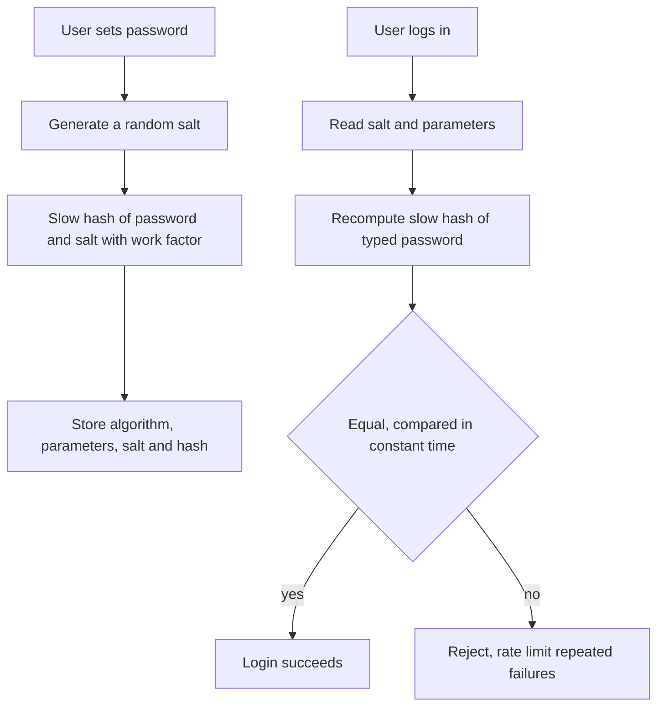

## The hook

Every few months, some company announces that its user database was stolen. The question that decides how bad it is: how were the passwords stored? If they were plain text, every account is open immediately. If they were hashed with a fast hash, most weak and common passwords are cracked within hours. If they were hashed with a salted, deliberately slow function, attackers get very little for a very long time.

The difference is not exotic cryptography. It is three well-understood ideas: never store the password, add a salt, and make each guess expensive.

## Where you meet it every day

- **Every login form** you use should be backed by a password hash, not a stored password.
- **Web frameworks** ship password hashing helpers: Django defaults to PBKDF2 with support for Argon2 and bcrypt, and Ruby on Rails' `has_secure_password` uses bcrypt.
- **Operating systems** store user passwords as salted, slow hashes, such as the SHA-512-based crypt scheme or yescrypt on many Linux systems.
- **Argon2**, winner of the Password Hashing Competition in 2015, is recommended by OWASP's password storage guidance alongside scrypt, bcrypt and PBKDF2 for legacy cases.

## The intuition

:::analogy
Picture a lock that takes a full second to turn, no matter who turns it. For you, entering the right key once a day, a one-second lock is nothing. For a burglar trying a million keys, it is a disaster: a million seconds is over eleven days per door. And if every door's lock is cut differently, even for the same key, the burglar cannot reuse work from one door on the next.
:::

The slow lock is a password hash with a [[work factor]]. The differently cut locks are [[salt]]s. Together, they make honest logins cheap and mass guessing expensive.

## How it works

### Why plain or fast hashing fails

- **Plain text:** a breach reveals every password at once, and people reuse passwords on other sites.
- **Fast hash, no salt:** attackers use [[rainbow table]]s or simply hash common passwords and compare. Identical passwords have identical hashes, so one cracked password exposes everyone who used it.
- **Fast hash with salt:** tables no longer work, but modern GPUs can compute billions of fast hashes per second, so guessing every common password for every user is still cheap.

### The recipe

1. On sign-up, generate a random salt, for example 16 bytes, unique to this user.
2. Compute `hash = slowhash(password, salt, work_factor)`.
3. Store the algorithm name, parameters, salt and hash together, which is what bcrypt and Argon2 output strings already do.
4. On login, read the stored salt and parameters, recompute with the typed password, and compare in constant time.



### The slow functions

- **PBKDF2** applies a keyed hash many thousands of times: simple [[key stretching]].
- **bcrypt** (1999) builds on the Blowfish cipher's expensive key setup, with a cost parameter that doubles the work per step.
- **scrypt** and **Argon2** are [[memory-hard function]]s: each guess needs a configurable amount of memory, which blunts GPUs and custom hardware that have plenty of compute but little memory per core.

Some systems also add a [[pepper]]: a secret key stored outside the database, for example in a hardware module or secret manager, mixed into every hash. A database leak alone is then not enough to start guessing.

:::insight
Password hashing deliberately inverts the usual goal. Normally we want hashes fast; here we want each computation slow and memory-hungry, because the honest user computes one hash per login while the attacker must compute one per guess, per user.
:::

## Walk through an example

Estimate the attacker's cost for 1 million stolen accounts, trying the 10,000 most common passwords against each. All rates below are rough, illustrative estimates for one powerful GPU rig.

| Storage | Guesses needed | Rough guess rate | Time |
|---|---|---|---|
| Fast hash, no salt | 10,000 (hash each common password once, look up everyone) | billions per second | well under a second |
| Fast hash, salted | 10,000 × 1,000,000 = 10¹⁰ | billions per second | seconds |
| Slow salted hash at 10 per second per core, 1,000 cores | 10¹⁰ | about 10⁴ per second | about 10⁶ seconds, roughly 12 days |

The slow hash did not make weak passwords strong; it made each guess thousands to millions of times more expensive, and the salt forced the work to be repeated for every user.

:::try-this
A login takes 250 ms of hashing on your server. An attacker has the same speed per core and 1,000 cores. How many guesses per second can they make, and how long to try 10,000 passwords for one user? (4 guesses per second per core, 4,000 per second total, so 10,000 guesses take about 2.5 seconds for one user, but about 30 days for a million users.)
:::

## The code

Use a vetted library; never invent your own scheme.

```pseudo
register(username, password):
    salt = random_bytes(16)
    record = argon2id(password, salt, time_cost, memory_cost, parallelism)
    store(username, record)              // record includes parameters and salt

login(username, password):
    record = load(username)
    candidate = argon2id(password, record.salt, record.params)
    return constant_time_equal(candidate, record.hash)
```

## Why it is clever

It turns an asymmetry into protection. A legitimate login is one hash, so even a quarter of a second is acceptable. An offline attack is billions of hashes, so the same quarter second becomes an enormous wall. Salts make that wall per user, and the work factor can be raised over the years as hardware gets faster, rehashing each user's password on their next successful login.

## Where it falls short

:::warning
Common misconception: "we encrypt our passwords, so they are safe." Encryption is reversible: whoever gets the key gets every password. Passwords should be hashed with a slow, salted function, which cannot be reversed at all, only guessed.
:::

- **Weak passwords still fall eventually.** Slow hashing buys time; it cannot protect "password123" forever. Rate limiting, breached-password checks and multi-factor authentication matter too.
- **Too slow hurts you.** A huge work factor makes logins slow and turns your login endpoint into a denial-of-service target; tune it to your hardware.
- **Online guessing is a separate problem**, handled by rate limits, lockouts and CAPTCHAs, not by the hash.

## Key takeaways

- Never store passwords in plain text or with fast hashes; store a salted, deliberately slow hash.
- A unique random salt per user defeats precomputed tables and stops identical passwords from sharing a hash.
- bcrypt, scrypt, PBKDF2 and Argon2 add tunable work, and scrypt and Argon2 also demand memory to blunt GPU attacks.
- Store the algorithm, parameters and salt with each hash, compare in constant time, and raise the work factor over time.
- Slow hashing protects stolen hashes; rate limiting and multi-factor authentication protect against live guessing.
