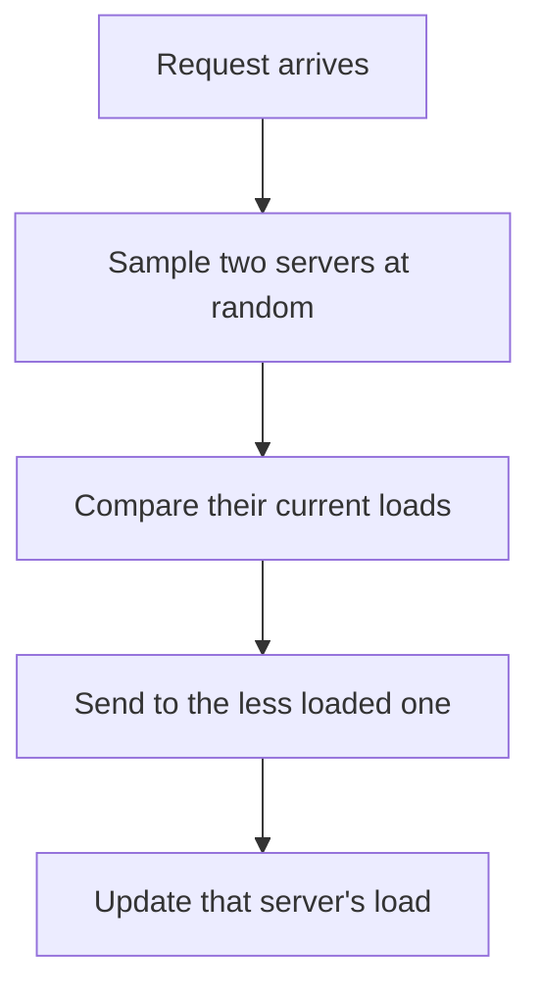

## The hook

You are at a supermarket with twenty checkout lines. Choosing a line at random works badly: sometimes you land behind three full trolleys while the next line is empty. Checking all twenty lines works well but takes ages, and everyone rushes to the same "shortest" line.

Now try something lazy: glance at just two random lines and join the shorter one. It sounds like a tiny tweak. Mathematically, it is a dramatic improvement, and it is one of the most elegant results in load balancing.

## Where you meet it every day

- **Load balancers**: NGINX offers a "random two least connections" style method, and Envoy's least-request balancer uses power-of-two-choices sampling by default when hosts have equal weights.
- **Task schedulers and queues** in large clusters use sampled choices to place work without consulting every machine.
- **Hash tables**: some designs place each key in the emptier of two candidate buckets, the same idea applied to memory, as in cuckoo hashing's two possible homes.

Whenever a system must spread work across many servers quickly with imperfect information, this trick is a strong default.

## The intuition

:::analogy
Back at the supermarket: picking one line at random ignores all information, so bad luck piles up. Checking every line uses all information but is slow, and when everyone checks at once they all stampede to the same line. Peeking at two random lines costs almost nothing, yet it lets you dodge the worst queues almost every time.
:::

The insight is that you do not need the best choice to avoid the bad ones. A [[load balancer]] that compares just two random servers almost never sends work to a heavily loaded server, because for that to happen, both random picks would need to be busy.

## How it works

For each incoming request:

1. Pick two servers uniformly at random.
2. Compare their current load, such as active requests or queue length.
3. Send the request to the less loaded one (break ties randomly).



### Why it works so well

Classic "balls into bins" analysis makes this precise. Throw n balls into n bins.

- With [[random assignment]], the [[maximum load]] is about $\frac{\log n}{\log \log n}$ with high probability.
- With [[two choices]], it drops to about $\frac{\log \log n}{\log 2} + O(1)$.

Going from one random choice to two gives an exponential improvement in the worst bin. Going from two to three or more helps only by a constant factor. Most of the benefit comes from the second look.

:::insight
For a server to receive a request it should not, both random samples must be busy. If a fraction q of servers are overloaded, that happens with probability about q², not q. Squaring a small number makes it much smaller, and that squaring, applied round after round, is why the worst load collapses.
:::

## Walk through an example

Ten servers, each a bin; we place 10 requests. Here is one run of each strategy with the same random numbers (illustrative).

| Request | One random choice: picks | Two choices: samples, then picks |
|---|---|---|
| 1 | S3 | S3, S7 → S3 |
| 2 | S7 | S7, S3 → S7 |
| 3 | S3 | S3, S1 → S1 |
| 4 | S9 | S9, S3 → S9 |
| 5 | S3 | S3, S5 → S5 |
| 6 | S1 | S1, S2 → S2 |
| 7 | S7 | S7, S4 → S4 |
| 8 | S3 | S3, S8 → S8 |
| 9 | S2 | S2, S6 → S6 |
| 10 | S7 | S7, S10 → S10 |

One random choice ends with S3 holding 4 requests. Two choices ends with every server holding at most 1. Real runs vary, but the pattern is typical: the second sample keeps rescuing requests from popular servers.

:::try-this
Suppose 20% of servers are overloaded at some moment. What fraction of new requests land on an overloaded server with one random choice, and with two? (One choice: about 20%. Two choices: only when both samples are overloaded, about 0.2 × 0.2 = 4%.)
:::

## The code

```pseudo
pick_server(servers):
    a = random server
    b = random server different from a
    if load(a) <= load(b): return a
    return b
```

## Why it is clever

It gets most of the benefit of perfect information with almost none of the cost. Global [[least connections]] needs fresh load numbers for every server, and when many load balancers each pick "the" least loaded server from slightly stale data, they all pile onto it at once, a herd effect. Two random samples keep decisions cheap and naturally spread out, because different balancers sample different pairs.

## Where it falls short

:::warning
Common misconception: "more samples are always better, so check ten servers." Gains beyond two are small, and with stale load information, comparing many servers recreates the herd problem: everyone converges on the same apparently idle machine. Two is usually the sweet spot.
:::

- **It needs some load signal.** If load information is very stale or meaningless, the comparison adds little over random choice.
- **Different server capacities** need weighting; comparing raw counts on a big and a small server is misleading.
- **Sticky requirements** such as session affinity or cache locality, where a request must go to a particular server, need consistent hashing instead, as in [Adding a Server Without Moving Everything](article:famous-algos-consistent-hashing).

## Key takeaways

- The power of two choices samples two random servers and sends work to the less loaded of the two.
- Compared with one random choice, it reduces the busiest server's load exponentially, from about log n / log log n to about log log n.
- A request lands on an overloaded server only if both samples are overloaded, which squares an already small probability.
- It avoids the cost and herd effects of always choosing the globally least loaded server.
- Load balancers like NGINX and Envoy offer it, and it is a strong default when load information is cheap but not perfect.
