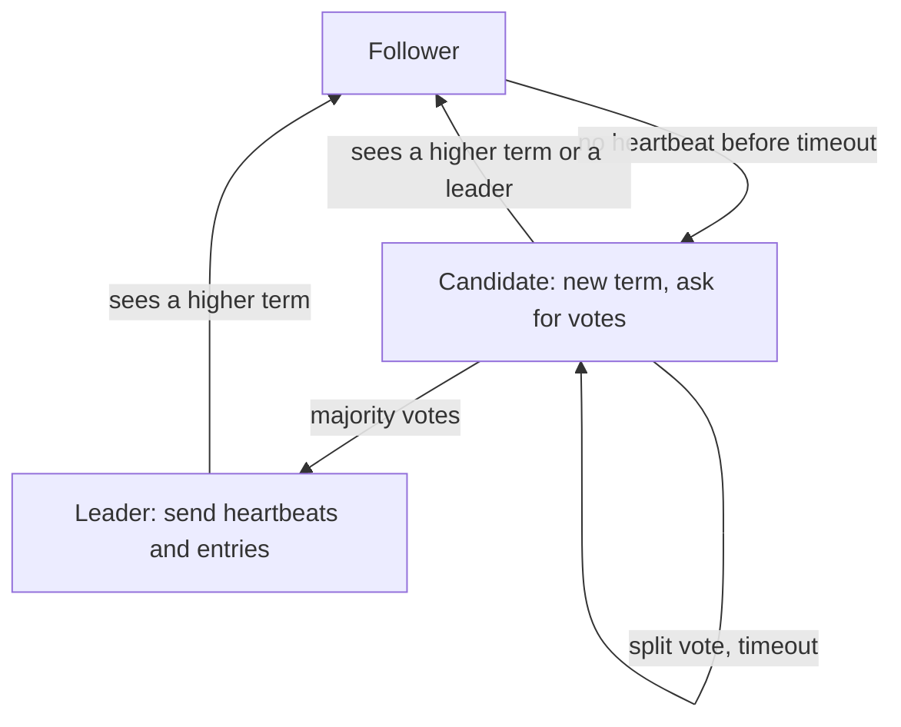

## The hook

Kubernetes stores everything it knows about your cluster, every pod, every config, every secret, in etcd. If etcd's servers ever disagreed about what is stored, your cluster would start doing contradictory things. Yet those servers crash, reboot and lose network links all the time.

They stay in agreement thanks to Raft. Before 2014, the standard answer to this problem was Paxos, famous for being hard to understand. Diego Ongaro and John Ousterhout at Stanford set out to design a consensus algorithm whose first goal was to be understandable. Raft is the result, and it now runs inside etcd, Consul, CockroachDB and Kafka's KRaft mode.

## Where you meet it every day

- **etcd**, the database behind Kubernetes, replicates its data with Raft.
- **HashiCorp Consul** uses Raft among its servers for the service catalogue and configuration.
- **CockroachDB** runs a Raft group for each range of data to replicate it across nodes.
- **Apache Kafka**'s KRaft mode uses a Raft-based protocol to manage cluster metadata, replacing ZooKeeper.

Any time a system says it keeps a few copies of critical state "consistent even if a node fails", there is a good chance Raft or a close cousin is underneath.

## The intuition

:::analogy
Picture a class electing a monitor who keeps the one official notebook. Whenever the teacher announces something, the monitor writes it down and reads it out; classmates copy it into their own notebooks. An announcement counts as official once more than half the class has copied it. If the monitor falls ill, whoever notices first stands for election and becomes monitor if more than half the class votes for them. A student can only win if their notebook is at least as complete as the voters' own.
:::

That is Raft. The class is the cluster. The monitor is the [[leader]]. The notebook is the [[log]]. "More than half" is a [[majority quorum]]. And each election starts a new numbered [[term]], so an old monitor who wanders back after being ill knows they have been replaced.

## How it works

Raft solves [[consensus]] on a log of commands. If every server applies the same commands in the same order, every server reaches the same state. Raft splits the problem into two parts.

### Part 1: leader election

Every server is a follower, a candidate or the leader. The leader sends regular heartbeats. A follower that hears nothing for its election timeout, randomised (the paper suggests a range like 150 to 300 ms), becomes a candidate:

1. It increments the term and votes for itself.
2. It asks the others for votes.
3. A server grants at most one vote per term, and only to a candidate whose log is at least as up to date as its own.
4. A candidate with votes from a majority becomes leader and starts sending heartbeats.



### Part 2: log replication

Clients send commands to the leader. The leader appends each command to its log with the current term, then sends it to followers in an AppendEntries message. Once a majority has stored the entry, it is [[committed]]: the leader applies it, replies to the client, and tells followers to apply it too.

Each AppendEntries message carries the index and term of the entry just before the new ones. A follower whose log does not match at that point rejects it, and the leader steps back and resends earlier entries until the logs agree. Followers' conflicting, uncommitted entries are overwritten. This keeps every log a prefix of the leader's.

:::insight
Raft's safety rests on one fact: any two majorities overlap. An entry stored on a majority will be on at least one server in any future majority, and the voting rule makes sure only a server with a complete enough log can win. So committed entries survive every leader change.
:::

## Walk through an example

Five servers, S1 to S5. S1 is leader in term 3.

| Step | What happens | Result |
|---|---|---|
| 1 | Client asks S1 to `set x = 5` | S1 appends entry 7 (term 3) |
| 2 | S1 sends entry 7 to all | S2 and S3 store it; S4 is slow; S5 is down |
| 3 | 3 of 5 have it (S1, S2, S3) | Entry 7 committed; S1 replies OK |
| 4 | S1 crashes | Heartbeats stop |
| 5 | S4 times out first, starts term 4 | S4 lacks entry 7, so S2 and S3 refuse to vote for it |
| 6 | S2 times out, starts term 4 or 5 | S2 has entry 7; it wins votes from S3 and S4 |
| 7 | S2 leads and brings S4 up to date | `x = 5` survives the crash |

The voting rule in step 5 is what protected the committed entry. A server missing committed data cannot gather a majority, because every majority includes someone who has it.

:::try-this
A cluster has 4 servers instead of 5. How many must agree for a majority, and how many failures can it tolerate? Compare with 3 servers. (A majority of 4 is 3, so it tolerates only 1 failure, the same as a 3-server cluster. That is why clusters usually have an odd number of servers.)
:::

## The code

A sketch of the two core handlers, in pseudocode:

```pseudo
on election_timeout():
    term += 1; state = CANDIDATE; voted_for = me
    votes = 1
    for each peer: send RequestVote(term, me, last_log_index, last_log_term)

on RequestVote(t, candidate, last_idx, last_term):
    if t < term: reply no
    if t > term: term = t; state = FOLLOWER; voted_for = none
    up_to_date = (last_term, last_idx) >= (my_last_term, my_last_idx)
    if voted_for in (none, candidate) and up_to_date:
        voted_for = candidate; reset timeout; reply yes
    else: reply no

on AppendEntries(t, leader, prev_idx, prev_term, entries, leader_commit):
    if t < term: reply fail
    term = t; state = FOLLOWER; reset timeout
    if log[prev_idx].term != prev_term: reply fail      // leader will retry earlier
    delete conflicting entries after prev_idx, append entries
    commit_index = min(leader_commit, last new index)
    reply success
```

## Why it is clever

Raft makes consensus understandable by giving one server, the leader, all the authority for a term, and by making terms a logical clock that instantly exposes stale leaders. Most of the complexity of Paxos-style protocols collapses into two rules: vote only for up-to-date candidates, and commit once a majority has the entry. The result is an algorithm students can implement in a course, and that engineers can reason about during an outage.

## Where it falls short

:::warning
Common misconception: "more Raft servers make the system faster and safer." Each write must reach a majority, so more servers add latency to every write and more network traffic. Five servers, tolerating two failures, is the common sweet spot. For more read capacity, add non-voting replicas or caches instead.
:::

- **Crash faults only.** Raft assumes servers may stop or be slow, not lie. Malicious or corrupted servers need Byzantine fault tolerant protocols.
- **No progress without a majority.** If a partition leaves no side with a majority, writes stop until the network heals. This is the consistency-over-availability choice described by CAP.
- **The leader is a throughput bottleneck.** Every write goes through one server, so large systems run many independent Raft groups, one per shard.

### Interview follow-ups

**"How many failures can a 5-node cluster survive? A 4-node one?"** A majority of 5 is 3, so 5 nodes survive 2 failures. A majority of 4 is also 3, so 4 nodes survive only 1, the same as 3 nodes. That is why clusters use odd sizes.

**"Can two leaders exist at once?"** Briefly, yes: an old leader cut off by a partition may still think it leads. It cannot commit anything, because it cannot reach a majority, and as soon as it hears a higher term it steps down. Safety comes from terms plus majorities, not from there being only one leader.

**"Why are election timeouts randomised?"** If all followers timed out together, they would all become candidates, split the votes and repeat forever. Random timeouts let one node usually start first and win.

**"How do you read the latest value safely?"** A read served from a follower may be stale. For linearizable reads, go through the leader and have it confirm it is still leader, by a heartbeat round to a majority or by holding a time-based lease, before answering.

**"Where is Raft used?"** Coordination stores and metadata services such as etcd and Consul, and the replication layer of several distributed databases. It stores small, critical state that everyone must agree on, not bulk data.

## Key takeaways

- Raft keeps a replicated log identical across servers by electing one leader per term that orders all commands.
- Followers that miss heartbeats start elections with randomised timeouts, and a candidate needs votes from a majority.
- An entry is committed once a majority stores it, and because majorities overlap, committed entries survive leader changes.
- Servers only vote for candidates whose logs are at least as up to date, which prevents a stale server from erasing committed data.
- A cluster of 2f + 1 servers tolerates f failures, which is why five-server clusters tolerating two failures are common.
