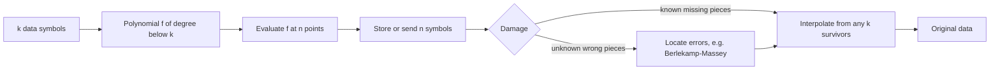

## The hook

Spill coffee on a QR code, tear off a corner, or print a logo in the middle of it, and your phone still scans it. Scratch a CD and the music still plays. Lose three disks at once in a large storage cluster, and nobody loses a file. All three survive damage for the same reason: their data is protected by a Reed-Solomon code.

Irving Reed and Gustave Solomon published the idea in 1960, in a short paper about polynomial codes over finite fields. It is one of the most widely deployed algorithms in the world, and at its heart is a fact from school geometry.

## Where you meet it every day

- **QR codes** have four error-correction levels, L, M, Q and H, which can restore roughly 7%, 15%, 25% and 30% of the codewords.
- **CDs, DVDs and Blu-ray discs** use Reed-Solomon codes, interleaved so that a scratch's long burst becomes small errors spread across many codewords.
- **Distributed storage**: systems such as HDFS offer Reed-Solomon [[erasure coding]], for example 6 data pieces plus 3 parity pieces, instead of keeping three full copies.
- **RAID 6** arrays, satellite and deep-space links, and digital TV broadcast use Reed-Solomon or closely related arithmetic.

## The intuition

:::analogy
Any two points define a straight line. Suppose your data is two numbers, and you encode them as a line. Instead of storing just two points of that line, store four. Now lose any two of the four points, and the remaining two still define the same line, so you can recompute the missing ones. Or suppose one of the four points gets nudged off the line by a smudge: three of the points still agree on a single line, and the odd one out is obviously the damaged one.
:::

That is a [[Reed-Solomon code]]. A line is a polynomial of degree 1; with k data values, use a polynomial of degree k − 1, which any k points determine. Store n > k points, and the extra n − k points are spares.

## How it works

### Encoding

1. Treat the k data [[symbol]]s as the coefficients (or the first k values) of a polynomial f of degree less than k.
2. Evaluate f at n distinct points x₁ ... xₙ.
3. Store or send the n values f(x₁) ... f(xₙ). In the common "systematic" form, the first k values are the data itself and the remaining n − k are parity.

### Recovering erasures

An [[erasure]] is a missing symbol whose position you know, such as a dead disk. Take any k surviving values and run [[interpolation]], for example with Lagrange's formula, to rebuild f; then evaluate it at the missing points. So a code with n − k parity symbols survives up to n − k erasures, which is the best any code can do with that much redundancy.

### Correcting errors

An error is worse: a wrong value at an unknown position. You must first find which values are wrong, which costs twice as much redundancy. Reed-Solomon can correct up to ⌊(n − k)/2⌋ errors, and in general any mix with 2·errors + erasures ≤ n − k. Efficient decoders such as the Berlekamp-Massey algorithm find the error positions without trying every combination.

### Doing arithmetic in a finite field

Interpolation needs division, and the stored values must fit in fixed-size symbols. So all arithmetic happens in a [[finite field]]. In practice that is the field with 256 elements, so every symbol is one byte and a codeword can be up to 255 bytes long. The toy example below uses integers modulo the prime 13, where division means multiplying by a modular inverse, as in [Finding the Undo Button on a Clock](article:cp-modular-inverse).



:::insight
A polynomial of degree below k is pinned down by any k of its values, and two different such polynomials agree on at most k − 1 points. So extra evaluations are pure redundancy: they can stand in for lost values, and a few corrupted values cannot make a different polynomial look right.
:::

### Why bytes, not bits

Hamming codes, from [The Grid That Points at the Wrong Bit](article:famous-algos-hamming-codes), fix single flipped bits. Real damage, such as a scratch, a stain or a dead disk, wipes out runs of bits. Reed-Solomon counts damage in symbols: a byte with 1 bad bit and a byte with 8 bad bits each cost one symbol. That makes it far stronger against bursts, and interleaving spreads longer bursts across codewords.

## Walk through an example

Work modulo 13. Data: two symbols, 3 and 5. Encode them as the line **f(x) = 3 + 5x** and store its values at x = 1, 2, 3, 4 (so k = 2, n = 4).

| x | 1 | 2 | 3 | 4 |
|---|---|---|---|---|
| f(x) = 3 + 5x mod 13 | 8 | 0 | 5 | 10 |

(For example f(2) = 13 ≡ 0 and f(4) = 23 ≡ 10.)

**Two erasures.** Points 1 and 3 are lost; we have (2, 0) and (4, 10). The slope is (10 − 0) / (4 − 2) = 10 · 2⁻¹. The inverse of 2 mod 13 is 7, since 2 · 7 = 14 ≡ 1, so the slope is 70 mod 13 = 5. The intercept is 0 − 5 · 2 = −10 ≡ 3. We recover f(x) = 3 + 5x, the data 3 and 5, and the missing values f(1) = 8 and f(3) = 5. ✓

**One error.** Suppose the stored value at x = 3 is corrupted from 5 to 9: we receive 8, 0, 9, 10. Try the line through each pair of points and count how many of the four it passes through:

| Pair used | Line agrees with |
|---|---|
| (1, 8), (2, 0) | 3 points |
| (1, 8), (4, 10) | 3 points |
| (2, 0), (4, 10) | 3 points |
| any pair including (3, 9) | 2 points |

Only one line agrees with three points, and it is 3 + 5x. The value at x = 3 disagrees with it, so that is the error; correct it back to 5. Here n − k = 2 allowed one error, matching ⌊2/2⌋ = 1. Real decoders reach the same answer algebraically instead of trying pairs.

:::try-this
With the same stored values 8, 0, 5, 10, suppose only the points at x = 1 and x = 4 survive. Rebuild f(2). (Slope = (10 − 8) / (4 − 1) = 2 · 3⁻¹. The inverse of 3 mod 13 is 9, since 27 ≡ 1, so the slope is 18 ≡ 5. Intercept 8 − 5 = 3. f(2) = 3 + 10 = 13 ≡ 0. ✓)
:::

## The code

```pseudo
encode(data[0..k-1], points x[1..n]):       // all arithmetic in a finite field
    f(x) = data[0] + data[1]*x + ... + data[k-1]*x^(k-1)
    return [f(x[i]) for i in 1..n]

recover_erasures(survivors):                // any k pairs (x_i, y_i)
    f = lagrange_interpolate(survivors)
    return f evaluated at the missing points

lagrange_interpolate(points) at x:
    total = 0
    for each (xi, yi):
        term = yi
        for each other (xj, yj): term *= (x - xj) / (xi - xj)   // division = multiply by inverse
        total += term
    return total
```

```cpp
#include <bits/stdc++.h>
using namespace std;
const int P = 13;

int power(int b, int e) { int r = 1; b %= P; while (e) { if (e & 1) r = r * b % P; b = b * b % P; e >>= 1; } return r; }
int inv(int a) { return power((a % P + P) % P, P - 2); }   // Fermat, P prime

int lagrange(const vector<pair<int, int>>& pts, int x) {
    int total = 0;
    for (size_t i = 0; i < pts.size(); i++) {
        int num = 1, den = 1;
        for (size_t j = 0; j < pts.size(); j++) if (i != j) {
            num = num * ((x - pts[j].first) % P + P) % P;
            den = den * ((pts[i].first - pts[j].first) % P + P) % P;
        }
        total = (total + pts[i].second * num % P * inv(den)) % P;
    }
    return total;
}

int main() {
    for (int x = 1; x <= 4; x++) cout << (3 + 5 * x) % P << ' ';   // 8 0 5 10
    cout << '\n';
    vector<pair<int, int>> survivors = {{2, 0}, {4, 10}};           // x = 1 and 3 erased
    cout << lagrange(survivors, 1) << ' ' << lagrange(survivors, 3) << '\n';  // 8 5
}
```

## Why it is clever

It is optimal: with n − k redundant symbols it recovers from any n − k erasures, which no code can beat. It works on bytes, so it shrugs off bursts that would overwhelm bit-level codes. The parameters are flexible: choose k and n to trade overhead against protection, from QR codes that tolerate 30% damage to storage systems that keep 1.5x overhead and still survive three failures. And the whole idea rests on one clean mathematical fact about polynomials.

## Where it falls short

:::warning
Common misconception: "Reed-Solomon can always fix up to n − k damaged symbols." That holds only for erasures, where you know which symbols are missing. For errors at unknown positions, the limit is half that, ⌊(n − k)/2⌋, and beyond the limit a decoder can fail or even return wrong data. Exact recovery limits always depend on the chosen n and k.
:::

- **Repair cost in storage**: rebuilding one lost piece of a 6 + 3 code means reading 6 surviving pieces, far more network traffic than copying one replica. Newer codes reduce this repair traffic.
- **Computation**: finite-field arithmetic and decoding are heavier than XOR parity, though table lookups and SIMD make byte-field arithmetic fast.
- **Length limit**: over the 256-element field a codeword is at most 255 symbols, so large data is split into many codewords and often interleaved.
- **Errors beyond capacity** may go undetected; systems pair Reed-Solomon with checksums such as a CRC, as in [The Remainder That Notices Smudges](article:famous-algos-crc).

### Interview follow-ups

**"Compare 3x replication with a 6 + 3 Reed-Solomon code for storage."** Replication stores 3 bytes per byte of data and survives the loss of 2 copies. A 6 + 3 code stores 9 pieces for 6 pieces of data, 1.5 bytes per byte, and survives the loss of any 3 pieces. The price is repair cost and CPU: rebuilding one lost piece reads 6 others.

**"Erasure versus error?"** An erasure is a missing piece at a known position, like a dead disk; an error is a wrong value somewhere unknown, like a smudged QR module. With n − k parity symbols you can recover n − k erasures but only ⌊(n − k)/2⌋ errors.

**"When would you still choose replication?"** For hot data that needs fast reads and cheap repair, and for small objects where splitting into pieces adds overhead. Many storage systems replicate new or hot data and erasure-code cold data.

## Key takeaways

- Reed-Solomon codes encode k data symbols as a polynomial of degree below k and store its values at n points.
- Any k stored values rebuild the polynomial by interpolation, so up to n − k erasures can be recovered.
- Errors at unknown positions cost double: up to (n − k)/2 can be corrected, and in general 2·errors + erasures ≤ n − k.
- Arithmetic happens in a finite field, usually 256 elements so that each symbol is a byte, which makes the code strong against burst damage.
- QR codes, optical discs and erasure-coded storage use it to survive stains, scratches and failed disks with modest overhead.
