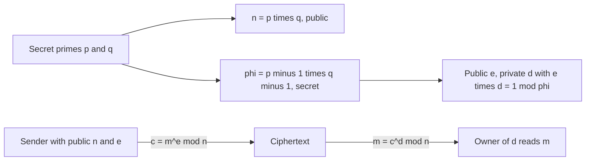

## The hook

Diffie-Hellman showed in 1976 that two strangers can agree on a secret in public. But it left an obvious question open: could you publish one thing, once, so that anyone in the world could send you a secret message, or check that a message really came from you, without ever talking to you first?

A year later, in 1977, Ron Rivest, Adi Shamir and Leonard Adleman found a way, using nothing more exotic than multiplying two primes and raising numbers to powers. RSA, named after their initials, became the most famous public-key system in history. It still signs a large share of the certificates that secure websites, software updates and payments, and it is a favourite interview topic because its maths fits on one page.

## Where you meet it every day

- **HTTPS certificates**: many websites' certificates contain RSA public keys, and certificate authorities sign them with RSA.
- **Software and app signing**: operating systems and package managers verify that updates were signed by the real publisher, often with RSA.
- **SSH keys**: `ssh-keygen` has long offered RSA keys for logging into servers.
- **Email encryption and signing** with PGP and S/MIME commonly use RSA keys.

## The intuition

:::analogy
Imagine you manufacture padlocks that snap shut without a key, and you hand them out to anyone who asks. A friend who wants to send you a secret puts it in a box, snaps one of your padlocks shut, and posts it. Anyone can close the padlock, but once it is closed, only your one key can open it. You never had to meet your friend or share anything secret with them.
:::

In RSA, the open padlock is your [[public key]], which you publish. Snapping it shut is encryption. The only key that opens it is your [[private key]]. The mathematical padlock is a [[trapdoor function]]: easy to lock for everyone, hard to unlock, unless you hold the secret that created it.

## How it works

### Making the padlock (key generation)

1. Pick two large random primes p and q, kept secret.
2. Compute the [[modulus]] n = p × q. This is public.
3. Compute [[Euler's totient]] φ(n) = (p − 1)(q − 1). This is secret.
4. Choose a public exponent e coprime to φ(n). In practice e = 65537 is the standard choice.
5. Compute d, the inverse of e modulo φ(n), so e × d ≡ 1 (mod φ(n)), using the extended Euclidean algorithm from [Finding the Undo Button on a Clock](article:cp-modular-inverse).

Public key: (n, e). Private key: d (and p, q).

### Locking and unlocking

To encrypt a message m (a number smaller than n):

$$c = m^e \bmod n$$

To decrypt:

$$m = c^d \bmod n$$

Both are modular exponentiation, fast even for 2048-bit numbers with repeated squaring from [Raising to the Power of a Billion in Thirty Steps](article:cp-binary-exponentiation).

### Why decryption gives back m

Decrypting computes (mᵉ)ᵈ = mᵉᵈ mod n. Because e × d = 1 + k·φ(n) for some integer k, Euler's theorem from [Counting the Numbers That Share Nothing With n](article:cp-euler-totient) says m^φ(n) ≡ 1 (mod n) when m is coprime to n, so

$$m^{ed} = m \cdot (m^{\varphi(n)})^k \equiv m \cdot 1^k = m \pmod n$$

(The result also holds for the rare m sharing a factor with n, by applying the same argument modulo p and modulo q separately.)

### Why it is hard to break

An attacker knows n and e. To find d they need φ(n), and computing φ(n) from n is as hard as factoring n into p and q. Multiplying two 1024-bit primes takes microseconds; no known classical algorithm factors their 2048-bit product in any practical time. That gap is the trapdoor.



### Signatures: using the padlock backwards

Run RSA the other way round. The owner computes s = hᵈ mod n, where h is a hash of the message, and publishes s with the message. Anyone checks sᵉ mod n = h using the public key. Only the holder of d could have produced an s that passes, so this proves who signed, and that the message was not changed.

:::insight
RSA works because e and d undo each other modulo n, but finding d from e requires knowing how n splits into primes. Publishing the product while hiding the factors turns "multiplication is easy, factoring is hard" into a lock anyone can close and only one person can open.
:::

## Walk through an example

Toy numbers, absurdly small, so you can check every step by hand.

| Step | Value |
|---|---|
| Primes | p = 11, q = 17 |
| Modulus | n = 187 |
| Totient | φ(n) = 10 × 16 = 160 |
| Public exponent | e = 7 (gcd(7, 160) = 1) |
| Private exponent | d = 23, since 7 × 23 = 161 = 160 + 1 |

**Encrypt m = 42:** c = 42⁷ mod 187. By repeated squaring: 42² = 1764 ≡ 81; 42⁴ = 81² = 6561 ≡ 16; 42⁷ = 42⁴ · 42² · 42 ≡ 16 × 81 × 42. 16 × 81 = 1296 ≡ 174, and 174 × 42 = 7308 ≡ **15**. So c = 15.

**Decrypt:** 15²³ mod 187 = **42**. The message is back.

**Sign a hash h = 99:** s = 99²³ mod 187 = 176. Anyone verifies with the public key: 176⁷ mod 187 = 99. ✓

An attacker who could factor 187 = 11 × 17 would get φ = 160 and then d = 23 immediately. With 187 that takes a second; with a 617-digit modulus, it is out of reach.

:::try-this
Build keys from p = 5, q = 11, e = 3. Find d, then encrypt and decrypt m = 8. (n = 55, φ = 40, d = 27 because 3 × 27 = 81 = 2 × 40 + 1. c = 8³ mod 55 = 512 mod 55 = 17, and 17²⁷ mod 55 = 8.)
:::

## The code

```pseudo
keygen():
    p, q = two large random primes
    n = p * q; phi = (p - 1) * (q - 1)
    e = 65537                                 // must be coprime to phi
    d = inverse(e, phi)                       // extended Euclid
    return public (n, e), private d

encrypt(m, n, e): return power_mod(m, e, n)    // m must be padded first
decrypt(c, n, d): return power_mod(c, d, n)
sign(h, n, d):    return power_mod(h, d, n)    // h = padded hash of the message
verify(s, h, n, e): return power_mod(s, e, n) == h
```

```cpp
#include <bits/stdc++.h>
using namespace std;
using ll = long long;

ll powMod(ll b, ll e, ll m) {
    ll r = 1; b %= m;
    while (e > 0) { if (e & 1) r = r * b % m; b = b * b % m; e >>= 1; }
    return r;
}

ll inverse(ll a, ll m) {                 // extended Euclid, assumes gcd(a, m) = 1
    ll g = m, x = 0, x1 = 1, a1 = a;
    while (a1) { ll q = g / a1; tie(g, a1) = make_pair(a1, g - q * a1); tie(x, x1) = make_pair(x1, x - q * x1); }
    return (x % m + m) % m;
}

int main() {
    ll p = 11, q = 17, n = p * q, phi = (p - 1) * (q - 1), e = 7;
    ll d = inverse(e, phi);
    ll c = powMod(42, e, n);
    cout << "d=" << d << " c=" << c << " m=" << powMod(c, d, n) << '\n';   // d=23 c=15 m=42
    ll s = powMod(99, d, n);
    cout << "sig=" << s << " check=" << powMod(s, e, n) << '\n';           // sig=176 check=99
}
```

## Why it is clever

It needs no shared secret at all: one published key lets the whole world send you private messages and check your signatures. The same key pair does both jobs, because encryption and decryption are the same operation with different exponents. Its security reduces to a crisp, heavily studied problem, factoring. And it is short enough to implement in a few lines, which made it the textbook example of public-key cryptography.

## Where it falls short

:::warning
Common misconception: "RSA is just c = m^e mod n." That textbook form is insecure. It is deterministic, so an attacker can encrypt guesses and compare; small messages with small e can be recovered by taking ordinary roots; and the multiplicative structure lets ciphertexts be manipulated. Real RSA always uses randomised [[padding]]: OAEP for encryption and PSS for signatures.
:::

- **Slow and large**: RSA operations are far slower than symmetric ciphers, and keys of 2048 bits or more are needed. In practice RSA protects or signs a small key or hash, and AES encrypts the data.
- **No forward secrecy as key exchange**: if a server's RSA key is stolen, any recorded sessions that used RSA key transport can be decrypted. TLS 1.3 removed RSA key exchange and uses ephemeral Diffie-Hellman, keeping RSA only for signatures.
- **Bad randomness breaks it**: if two keys share a prime because of a weak random generator, computing a GCD of their moduli reveals it.
- **Quantum risk**: Shor's algorithm would factor n efficiently on a large quantum computer, so post-quantum signatures are being introduced.

## Key takeaways

- RSA publishes n = p × q and an exponent e, while keeping the primes and the private exponent d secret.
- Encryption raises the message to e mod n, and decryption raises the result to d mod n, because e × d ≡ 1 modulo φ(n).
- Computing d requires φ(n), which requires factoring n, and factoring large moduli is believed infeasible on classical computers.
- Signatures run RSA backwards: sign a hash with d, and anyone verifies it with e.
- Real RSA needs randomised padding such as OAEP or PSS, and is used to protect keys and hashes rather than bulk data.
