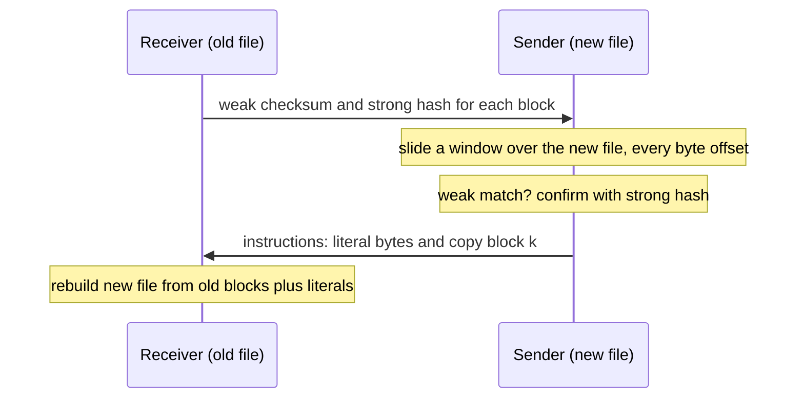

## The hook

You have a 2 GB database backup on a remote server, and today's version on your laptop differs from yesterday's in a few scattered places. Uploading 2 GB again over a slow link takes an hour. If both machines could somehow agree on which parts are the same, you would send a few megabytes instead.

The obvious trick, "send a hash of each block and compare", breaks the moment someone inserts a single byte near the start: every later block shifts and nothing matches. In 1996, Andrew Tridgell and Paul Mackerras described an algorithm that finds matching blocks at *any* byte offset, cheaply, without either side having both files. It became rsync, the standard tool for backups and deployments on Unix systems for decades.

## Where you meet it every day

- **rsync** itself: backups, mirroring servers, deploying websites, copying large directories over SSH.
- **Backup and sync tools** built on rsync or librsync use the same [[delta transfer]] idea to send only changes.
- **Deduplicating backup tools** use rolling hashes to cut files into chunks at content-defined boundaries, so an insertion only changes nearby chunks.
- **String search**: the Rabin-Karp algorithm uses the same "update the hash as the window slides" trick to find a pattern in text.

## The intuition

:::analogy
Imagine two copies of a long book, one in Delhi and one in Chennai, and the Chennai copy has a few edits. Rather than posting the whole book, Delhi sends a fingerprint of every paragraph of its old copy. Chennai slides along its own copy, one character at a time, checking whether the text starting here has a fingerprint on Delhi's list. Whenever it does, Chennai just writes "paragraph 17 goes here"; where nothing matches, it copies out the new text. Delhi rebuilds the edited book from its own paragraphs and the few new passages.
:::

Delhi's paragraphs are [[block]]s. The fingerprint Chennai can update cheaply as it slides one character at a time is the [[rolling checksum]]. To be certain two paragraphs are really identical, not just similar-looking, a second, careful fingerprint, the [[strong hash]], is compared.

## How it works

Call the machine with the old file the **receiver** and the machine with the new file the **sender**.

1. **Receiver fingerprints its blocks.** Split the old file into blocks of L bytes. For each, compute a 32-bit weak checksum and a strong hash, and send the list to the sender. This is small: a few bytes per block.
2. **Sender builds a lookup table** from weak checksum to block numbers.
3. **Sender scans the new file at every byte offset.** It computes the weak checksum of the L bytes starting there, updating it in O(1) per step instead of recomputing.
4. **On a weak match**, it computes the strong hash of the window and compares. If equal, it emits "copy block k" and jumps ahead L bytes. If not, the match was a [[false positive]].
5. **Otherwise**, it emits the current byte as a literal and slides the window by one.
6. **Receiver rebuilds** the new file from block references into its old file and the literal bytes.



### The rolling checksum

For a window of bytes x₀ … x_{L−1}, rsync's weak checksum, similar in spirit to the Adler-32 checksum, has two parts, each modulo 2¹⁶:

$$a = \sum_{i=0}^{L-1} x_i \qquad b = \sum_{i=0}^{L-1} (L - i)\, x_i$$

a is the plain sum; b weights earlier bytes more heavily, so it depends on order. The checksum is b·2¹⁶ + a.

When the window slides one byte, dropping x_out and adding x_in:

$$a' = a - x_{out} + x_{in} \qquad b' = b - L \cdot x_{out} + a'$$

Every byte in the window moves one place closer to the front, so its weight drops by one. That subtracts each byte once from b, which is a, and the outgoing byte loses its weight L entirely. Two additions and a multiplication per step, regardless of block size.

:::insight
The rolling checksum makes "check every byte offset" affordable, and the strong hash makes "is it really the same?" reliable. Splitting the work between a cheap filter and an expensive confirmation is a pattern that appears again and again: Bloom filters before disk reads, hash before full comparison.
:::

## Walk through an example

Old file (receiver): bytes **3 1 4 1 | 5 9 2 6**, block size L = 4.

| Block | Bytes | a | b = 4x₀ + 3x₁ + 2x₂ + x₃ |
|---|---|---|---|
| 0 | 3 1 4 1 | 9 | 12 + 3 + 8 + 1 = 24 |
| 1 | 5 9 2 6 | 22 | 20 + 27 + 4 + 6 = 57 |

New file (sender): someone inserted a 7 at the front: **7 3 1 4 1 5 9 2 6**. Block-by-block comparison at fixed offsets would find nothing. The sender instead rolls:

| Offset | Window | a | b | Match? | Action |
|---|---|---|---|---|---|
| 0 | 7 3 1 4 | 15 | 43 | no | literal 7, slide by 1 |
| 1 | 3 1 4 1 | 15 − 7 + 1 = 9 | 43 − 28 + 9 = 24 | block 0, strong hash agrees | copy block 0, jump 4 |
| 5 | 5 9 2 6 | 22 | 57 | block 1, strong hash agrees | copy block 1 |

Instructions sent: "literal 7, copy block 0, copy block 1". Only one byte of real data crossed the network. With real block sizes of kilobytes and files of gigabytes, the saving is the difference between minutes and hours.

:::try-this
A window [2, 7, 1, 8] has a = 18 and b = 39 (8 + 21 + 2 + 8). The window slides to [7, 1, 8, 2]. Compute a' and b' with the rolling formulas, then check b' directly. (a' = 18 − 2 + 2 = 18 and b' = 39 − 4 × 2 + 18 = 49. Directly: 4·7 + 3·1 + 2·8 + 1·2 = 28 + 3 + 16 + 2 = 49. ✓)
:::

## The code

```pseudo
receiver_signatures(old, L):
    for k, block in enumerate(blocks of old of size L):
        yield (k, weak(block), strong(block))

sender_delta(new, sigs, L):
    table = map weak -> list of (k, strong)
    i = 0; a, b = weak_parts(new[0 : L])
    while i + L <= len(new):
        w = b * 2^16 + a
        if w in table and strong(new[i : i+L]) matches some k in table[w]:
            emit COPY(k); i += L
            if i + L <= len(new): a, b = weak_parts(new[i : i+L])
        else:
            emit LITERAL(new[i])
            if i + L < len(new):                     // roll by one byte
                a = a - new[i] + new[i + L]
                b = b - L * new[i] + a
            i += 1
    emit LITERAL for any remaining tail bytes
```

```cpp
#include <bits/stdc++.h>
using namespace std;

int main() {
    const int L = 4;
    vector<int> x = {7, 3, 1, 4, 1, 5, 9, 2, 6};
    long long a = 0, b = 0;
    for (int i = 0; i < L; i++) { a += x[i]; b += (long long)(L - i) * x[i]; }
    cout << "offset 0: a=" << a << " b=" << b << '\n';                 // a=15 b=43
    for (int k = 0; k + L < (int)x.size(); k++) {
        a = a - x[k] + x[k + L];
        b = b - (long long)L * x[k] + a;
        cout << "offset " << k + 1 << ": a=" << a << " b=" << b << '\n';  // offset 1: a=9 b=24
    }
}
```

## Why it is clever

Neither machine ever needs both files. The receiver sends only small fingerprints; the sender does all the searching. Insertions and deletions anywhere are handled, because matching happens at every byte offset rather than at fixed boundaries. The O(1) rolling update makes that exhaustive search fast enough to run over gigabytes, and the two-level checksum keeps it both cheap and safe.

## Where it falls short

:::warning
Common misconception: "splitting both files into fixed blocks and comparing hashes finds the unchanged parts." It works only for in-place edits. A single inserted or deleted byte shifts every later block boundary, so all later blocks hash differently. Rolling the weak checksum over every offset of the new file is what makes rsync robust to shifts.
:::

- **Block size is a trade-off**: small blocks find more matches but send more signatures; large blocks send fewer signatures but miss small unchanged regions. rsync picks a size based on file length.
- **Compressed or encrypted files** change almost entirely after a small edit, so there is little to reuse.
- **CPU cost on the sender** grows with file size, even when nothing changed.
- **The weak checksum is easy to collide deliberately**, which is why the strong hash must always confirm a match.

## Key takeaways

- rsync sends only the differences between an old and a new file, without either side holding both copies.
- The receiver fingerprints fixed blocks of the old file with a weak checksum and a strong hash.
- The sender slides a window over the new file at every byte offset, updating the weak rolling checksum in constant time.
- Weak matches are confirmed with the strong hash, and the sender emits block references plus literal bytes.
- Matching at every offset is what survives insertions and deletions, which fixed-offset block comparison cannot.
