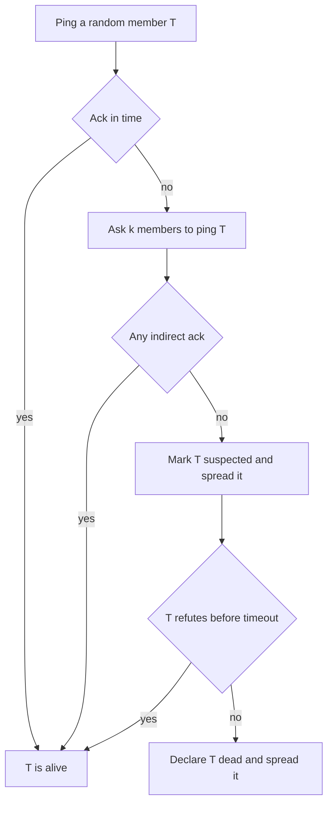

## The hook

In a cluster of a thousand machines, some machine is always having a bad moment: a long garbage collection pause, a saturated network card, a reboot. The cluster must notice real failures quickly, so it can stop routing traffic to dead machines. But if it panics at every hiccup, it will keep evicting healthy machines and reshuffling work.

The simple solution, every machine sending heartbeats to every other machine, sends about a million messages per period for a thousand machines. SWIM, published by Das, Gupta and Motivala in 2002, does the job with a constant number of messages per machine.

## Where you meet it every day

- **HashiCorp's memberlist library**, used by Consul and Serf, implements a SWIM-based protocol for cluster membership and failure detection.
- **Many service meshes and distributed databases** use SWIM-style probing with suspicion, or close variants, to keep membership lists current.
- **Any system with gossip-based membership** needs a [[failure detector]]; SWIM is the classic design for that piece.

## The intuition

:::analogy
You call a friend and they do not pick up. Do you assume something terrible has happened? Not yet. You ask two mutual friends to call them too. If either gets through, your phone or line was the problem. If nobody does, you start to worry, but you still give them a little time to call back before you raise the alarm. Most unanswered calls turn out to be nothing.
:::

That is SWIM's whole personality: probe one member, ask for second opinions when it is silent, then mark it suspected and wait before declaring it dead. Meanwhile, news about who is suspected or dead spreads by gossip.

## How it works

Every protocol period (say one second), each member M:

1. **Picks one random member** T and sends it a ping.
2. **If T replies** with an ack in time, all is well.
3. **If not**, M picks k other members and asks each to ping T on its behalf, an [[indirect probe]].
4. **If any indirect ping succeeds**, T is alive; the path from M was the problem.
5. **If none succeed**, M marks T as suspected and spreads that news.
6. **During [[suspicion]]**, if T hears it is suspected, it spreads a refutation with a higher incarnation number. If the suspicion timeout expires without a refutation, T is declared dead.



Membership updates (joined, suspected, alive, dead) are not sent separately. They ride on the pings and acks already being exchanged, which is called [[piggybacking]]. Because every member pings a random member each period, updates spread through the cluster like gossip, reaching everyone in about log n periods.

:::insight
SWIM separates two jobs that simple heartbeating mixes together: detecting failures, done with cheap random probes and second opinions, and spreading the news, done by piggybacking on those same probes. The result is constant work per member and very few false alarms.
:::

## Walk through an example

Five members, A to E. Period 7. Member A picks C at random and pings it.

| Step | What happens | State |
|---|---|---|
| 1 | A pings C, no ack within the timeout | A unsure |
| 2 | A asks B and E to ping C | indirect probes sent |
| 3 | B's ping reaches C, C acks to B, B relays to A | C alive; A's link to C was flaky |
| 4 | Period 8: D pings C, no ack | D unsure |
| 5 | D asks A and B; neither gets an ack | C suspected by D |
| 6 | Suspicion spreads on the next pings; C does not refute | timeout running |
| 7 | Timeout expires | C declared dead, spread by piggybacking |

In step 3, a naive heartbeat system would have wrongly suspected C. The second opinion saved a healthy member.

:::try-this
Compare message counts per period for 1,000 members. All-to-all heartbeats: each member sends to 999 others. SWIM: each member sends one ping, plus a few indirect requests only when something is silent. Roughly how many messages does each approach send per period? (All-to-all is about 1,000 × 999, close to a million. SWIM is about 1,000 pings plus 1,000 acks, a few thousand messages, and it stays about constant per member as the cluster grows.)
:::

## The code

```pseudo
every protocol period:
    t = random member other than me
    if ping(t) acked within timeout: return
    helpers = k random members other than me and t
    for h in helpers: ask h to ping t and report back
    if any helper reports an ack: return
    mark t SUSPECT, attach "t suspect" to outgoing messages
    start suspicion timer for t

on hearing "me suspect":
    incarnation += 1
    attach "me alive, incarnation" to outgoing messages

on suspicion timer expiry for t (no refutation seen):
    mark t DEAD, attach "t dead" to outgoing messages
```

## Why it is clever

Failure detection always balances speed against false positives. SWIM improves both sides at once: random probing gives each member a constant, predictable workload and an expected detection time that does not grow with the cluster, while indirect probes and suspicion cut false positives caused by one bad link or a short pause. Piggybacking removes the cost of spreading updates almost entirely.

## Where it falls short

:::warning
Common misconception: "a failure detector can know for sure that a machine is dead." In an asynchronous network, a very slow machine and a dead one look the same from outside. Every detector, SWIM included, guesses based on timeouts. Systems that need certainty, such as leader handover, add mechanisms like leases and fencing tokens.
:::

- **Detection is probabilistic and delayed** by the suspicion timeout, so very fast failover needs tuning or other mechanisms.
- **Partitions confuse membership**: each side may declare the other dead. Applications must handle members reappearing later.
- **Tuning matters**: probe intervals, timeouts and k trade detection speed for bandwidth and false alarms.

## Key takeaways

- SWIM detects failures by having each member ping one random member per period, giving constant work per member.
- When a ping goes unanswered, indirect probes through a few other members rule out a bad local network path.
- A suspicion period lets briefly slow members refute rumours of their death before being removed.
- Membership updates are piggybacked on probe messages and spread through the cluster like gossip.
- No failure detector can be certain, so systems needing certainty add leases and fencing on top.
