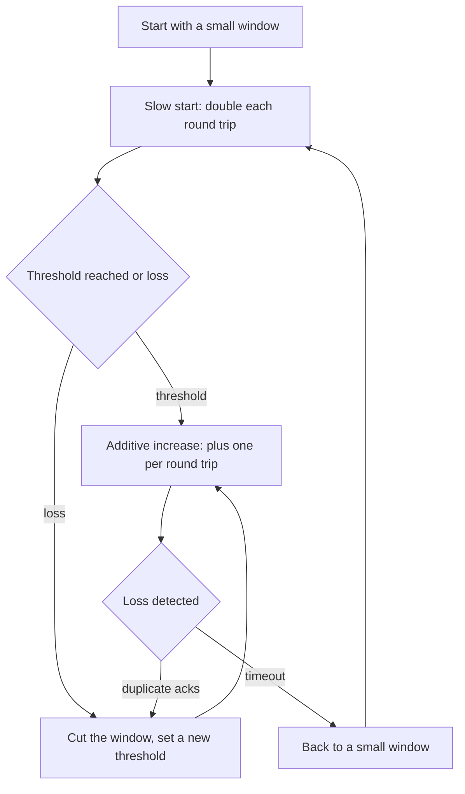

## The hook

In October 1986, the link between Lawrence Berkeley Laboratory and UC Berkeley, a few hundred metres apart, saw its throughput fall from 32 kilobits per second to about 40 bits per second. The network was not broken. It was so full of retransmitted packets that almost nothing useful got through: a congestion collapse.

Van Jacobson and Michael Karels responded with a set of algorithms, published in 1988, that taught every TCP sender to slow down when the network is full and speed up carefully when it is not. Those ideas, refined over decades, are why billions of connections can share the internet today without it seizing up.

## Where you meet it every day

- **Every TCP connection** you open, for web pages over HTTP/1.1 and HTTP/2, file downloads, SSH sessions and database connections, runs congestion control.
- **Operating system defaults**: Linux has used CUBIC as its default congestion control algorithm for years, and Google developed BBR, which is available in Linux and used for its own traffic.
- **QUIC and HTTP/3** implement their own congestion control in user space with the same core ideas.
- **Video streaming** adapts its bitrate partly in response to how much throughput the transport achieves.

## The intuition

:::analogy
Think of merging onto a busy highway at night with no traffic signs. You speed up gently while the road looks clear. The moment you see brake lights ahead, you brake hard. Then you start speeding up gently again. If every driver follows the same rule, the road stays flowing, and nobody can hog it for long, because whoever is fastest also has the most speed to lose when everyone brakes.
:::

A TCP sender cannot see the network. It only sees acknowledgements coming back and, sometimes, signs of lost packets. From those, it adjusts its [[congestion window]]: how much data it allows in flight at once.

## How it works

The sender's rate is roughly the congestion window divided by the [[round-trip time]]. Classic TCP congestion control (in the Reno family) adjusts that window in phases.

**1. [[Slow start]].** Begin with a small window, a few packets. For every acknowledgement received, grow the window by about one packet, which doubles it every round trip. Despite the name, growth is exponential, so the sender quickly discovers roughly how much the path can carry.

**2. Congestion avoidance with [[AIMD]].** After passing a threshold, grow the window by about one packet per round trip: additive increase. Probe gently for more bandwidth.

**3. React to loss.** Router queues that overflow drop packets, so [[packet loss]] is the classic congestion signal.

- Three duplicate acknowledgements suggest one lost packet while others still arrive: halve the window and retransmit (fast retransmit and fast recovery), multiplicative decrease.
- A retransmission timeout suggests heavy congestion: drop back to a small window and slow start again.



:::insight
No central controller tells any sender how fast to go. Each connection follows the same simple rule, increase gently and cut sharply on loss, and the whole internet converges toward using available capacity while sharing it roughly fairly.
:::

### Why AIMD is fair

Picture two flows sharing a link. When they collide and both see loss, both halve, so the gap between them halves too. When they grow, both add the same amount, so the gap stays the same. Repeated over many cycles, the gap keeps shrinking: the flows converge toward equal shares. Additive increase with additive decrease, or multiplicative with multiplicative, would not converge like this.

### Not the same as flow control

[[Flow control]] is a separate mechanism: the receiver advertises how much buffer space it has left, the receive window, so a slow receiver is not overwhelmed. The sender sends at most the smaller of the congestion window and the receive window.

## Walk through an example

Window in packets, threshold initially 16, one row per round trip.

| Round trip | Phase | Window | Event |
|---|---|---|---|
| 1 | slow start | 1 | |
| 2 | slow start | 2 | |
| 3 | slow start | 4 | |
| 4 | slow start | 8 | |
| 5 | slow start | 16 | threshold reached |
| 6 | congestion avoidance | 17 | |
| 7 | congestion avoidance | 18 | |
| 8 | congestion avoidance | 19 | triple duplicate acks: loss |
| 9 | after halving | 9 or 10 | threshold set to about 9 |
| 10 | congestion avoidance | 11 | |

Plotted over time, the window makes the famous "sawtooth": a slow climb, a sharp drop, a slow climb again.

:::try-this
A connection has a 100 ms round-trip time and a congestion window of 64 KB. Roughly what throughput can it achieve? (About window / RTT = 64 KB / 0.1 s = 640 KB/s. On long-distance links, the window must be large for high throughput, which is why window scaling exists.)
:::

## The code

```pseudo
on ack_received():
    if cwnd < ssthresh: cwnd += 1                   // slow start: doubles per RTT
    else: cwnd += 1 / cwnd                          // about +1 per RTT

on triple_duplicate_ack():
    ssthresh = max(cwnd / 2, 2)
    cwnd = ssthresh                                 // multiplicative decrease
    retransmit the missing packet

on timeout():
    ssthresh = max(cwnd / 2, 2)
    cwnd = 1                                        // start over with slow start
    retransmit
```

## Why it is clever

Each sender only sees its own acknowledgements, yet the shared behaviour keeps a global resource, the network, from collapsing. It needs no coordination, no knowledge of other flows, and no help from routers beyond dropping packets when queues overflow. The same pattern of cheap local rules that produce good collective behaviour appears in exponential backoff and power-of-two-choices load balancing.

## Where it falls short

:::warning
Common misconception: "packet loss always means congestion." On wireless links, packets are often lost to interference, not full queues. Loss-based algorithms then slow down needlessly. That is one reason newer algorithms, such as BBR, model bandwidth and delay directly instead of relying mainly on loss.
:::

- **Bufferbloat**: large router buffers delay loss signals, so loss-based TCP fills queues and adds latency before it backs off.
- **Long, fast paths**: linear growth of one packet per round trip is too slow to fill high-bandwidth, long-distance links, which is why variants like CUBIC grow faster.
- **Not all traffic cooperates**: applications that open many connections or use aggressive UDP protocols can take more than a fair share.

## Key takeaways

- TCP congestion control adjusts a congestion window, the amount of unacknowledged data in flight, to match what the network can carry.
- Slow start doubles the window each round trip to find capacity quickly, then additive increase probes gently.
- Loss is the classic congestion signal: duplicate acknowledgements trigger a halving, and timeouts restart from a small window.
- Additive increase with multiplicative decrease makes competing flows converge toward fair shares without any coordination.
- Flow control protects the receiver while congestion control protects the network, and modern variants like CUBIC and BBR refine the same ideas.
