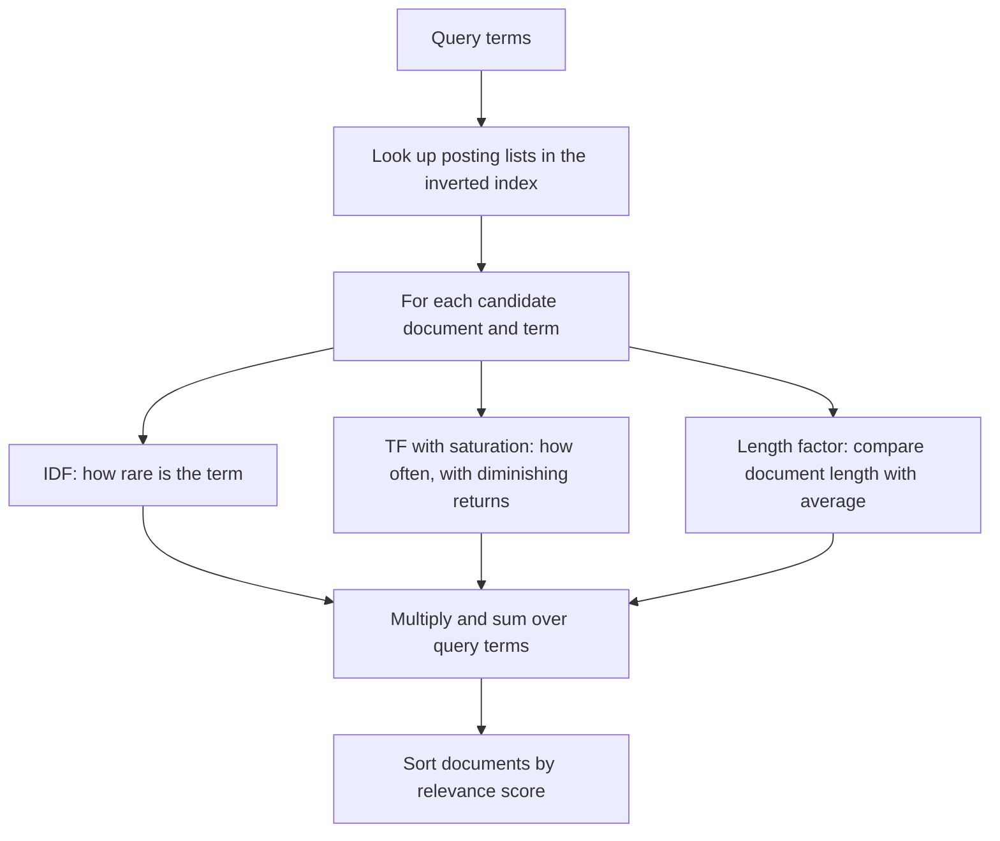

## The hook

You search a recipe site for "tomato pasta". A lookup in an inverted index, as in [The Index at the Back of Every Search Engine](article:famous-algos-inverted-index), instantly finds every document containing either word: a pasta recipe, a soup page that says "tomato" three times, an essay on the history of tomatoes, a quick pasta dinner. Matching is solved. But in what order do you show them?

That is the ranking problem, and for decades the answer was a pair of formulas you can compute by hand: TF-IDF, and its refined successor BM25. BM25 is still the default ranking function in Lucene and Elasticsearch, a standard baseline in search research, and a common first stage in modern AI retrieval systems that feed documents to language models.

## Where you meet it every day

- **Elasticsearch, OpenSearch and Apache Solr** rank full-text results with BM25 by default.
- **Site search** on documentation, shops and blogs is often a BM25 engine underneath.
- **Retrieval for AI assistants** frequently combines BM25 keyword scores with vector similarity, called hybrid search.
- **Keyword extraction**: TF-IDF weights are a classic way to find the words that characterise a document.

## The intuition

:::analogy
Imagine a teacher marking essays for whether they discuss "photosynthesis". Every essay contains "the" dozens of times, so seeing "the" tells the teacher nothing. "Photosynthesis" is rare across the class, so an essay that uses it is probably on topic. An essay using it five times is more on topic than one using it once, but the fiftieth repetition adds nothing. And a short paragraph that mentions it twice is more focused than a forty-page essay that mentions it twice.
:::

Those three judgements are exactly the three ingredients of relevance ranking: rare words matter more, repetition helps with diminishing returns, and length must be accounted for.

## How it works

### TF-IDF

Score each document by summing, over the query terms, two factors:

- [[Term frequency (TF)]]: how often the term occurs in the document.
- [[Inverse document frequency (IDF)]]: how rare the term is across the collection of N documents. If the term appears in df documents (its [[document frequency (DF)]]):

$$\text{IDF}(t) = \ln \frac{N}{df(t)}$$

$$\text{score}(D, Q) = \sum_{t \in Q} tf(t, D) \times \text{IDF}(t)$$

A term in every document gets ln(1) = 0: no information. The IDF idea is due to Karen Spärck Jones, who described it in 1972.

### What TF-IDF gets wrong

- **Unbounded repetition**: a page that repeats "tomato" 30 times scores 30 times higher than one mention. Spammers love that.
- **Length bias**: longer documents naturally contain more occurrences of everything.

### BM25

BM25, developed by Stephen Robertson and colleagues in the 1990s as part of the Okapi retrieval system, fixes both with two parameters:

$$\text{score}(D, Q) = \sum_{t \in Q} \text{IDF}(t) \cdot \frac{f \cdot (k_1 + 1)}{f + k_1 \left(1 - b + b \frac{|D|}{\text{avgdl}}\right)}$$

where f is the term's frequency in D, |D| the document's length in words, and avgdl the average length.

- **[[Saturation]] (k₁)**: as f grows, the fraction approaches k₁ + 1 but never passes it. With k₁ = 1.2 the factor for f = 1, 2, 3, 5, 10 is 1.0, 1.375, 1.571, 1.774, 1.964. The first mention matters most.
- **[[Length normalisation]] (b)**: the denominator grows for documents longer than average and shrinks for shorter ones. b = 0 ignores length; b = 1 normalises fully. Common defaults are k₁ = 1.2 and b = 0.75.

Lucene uses a smoothed IDF that never goes negative:

$$\text{IDF}(t) = \ln\left(1 + \frac{N - df + 0.5}{df + 0.5}\right)$$



:::insight
A [[relevance score]] is evidence accumulated from each query word. Rare words are strong evidence, repeated words add confidence with diminishing returns, and the evidence is discounted for documents that are long enough to contain almost anything. BM25 is that reasoning written as one formula with two tuning knobs.
:::

## Walk through an example

Five tiny documents (lengths in words; average 5.8):

- D1 (8): the pasta recipe uses fresh tomato and basil
- D2 (5): tomato tomato tomato soup recipe
- D3 (7): the history of the tomato in europe
- D4 (4): a quick pasta dinner
- D5 (5): the best pizza dough recipe

Query: **tomato pasta**. "tomato" appears in 3 documents, "pasta" in 2.

**TF-IDF** with IDF = ln(N / df): IDF(tomato) = ln(5/3) = 0.511, IDF(pasta) = ln(5/2) = 0.916.

| Doc | tomato tf | pasta tf | TF-IDF score |
|---|---|---|---|
| D2 | 3 | 0 | 3 × 0.511 = **1.532** |
| D1 | 1 | 1 | 0.511 + 0.916 = **1.427** |
| D4 | 0 | 1 | **0.916** |
| D3 | 1 | 0 | **0.511** |

TF-IDF puts the soup page first, purely because it repeats "tomato", even though D1 actually matches both words.

**BM25** with k₁ = 1.2, b = 0.75 and Lucene's IDF: IDF(tomato) = 0.539, IDF(pasta) = 0.875.

For D2's "tomato": length factor 1 − 0.75 + 0.75 × 5/5.8 = 0.897; the fraction is 3 × 2.2 / (3 + 1.2 × 0.897) = 6.6 / 4.076 = 1.619; times 0.539 gives 0.873.

| Doc | tomato part | pasta part | BM25 score |
|---|---|---|---|
| D1 | 0.467 | 0.758 | **1.224** |
| D4 | 0 | 1.003 | **1.003** |
| D2 | 0.873 | 0 | **0.873** |
| D3 | 0.497 | 0 | **0.497** |

Saturation stops the triple "tomato" from dominating, so D1, which mentions both query words, wins. D4 beats D2 because "pasta" is the rarer word and D4 is short.

:::try-this
With k₁ = 1.2 and b = 0, what is the BM25 frequency factor f(k₁ + 1)/(f + k₁) for f = 4? (4 × 2.2 / 5.2 ≈ 1.69. With b = 0, document length plays no part.)
:::

## The code

```pseudo
bm25(query, doc, index, k1 = 1.2, b = 0.75):
    score = 0
    for term in query:
        f = count of term in doc
        if f == 0: continue
        n = number of documents containing term
        idf = ln(1 + (N - n + 0.5) / (n + 0.5))
        norm = 1 - b + b * len(doc) / avg_len
        score += idf * f * (k1 + 1) / (f + k1 * norm)
    return score

search(query):
    candidates = union of posting lists for the query terms
    return candidates sorted by bm25(query, doc) descending, top k
```

## Why it is clever

BM25 needs no training data, no labelled examples and no GPU: just counts already stored in an inverted index. It encodes sound intuitions, rarity, diminishing returns and length fairness, in two interpretable knobs. It is fast, because only documents in the query terms' posting lists are scored. And it is strong enough that new ranking methods are still routinely compared against it.

## Where it falls short

:::warning
Common misconception: "BM25 has fixed, correct constants." k₁ and b are tunable, and the best values depend on the collection: short tweets, long legal documents and product titles behave differently. Values such as k₁ = 1.2 and b = 0.75 are reasonable defaults, not laws, and several IDF variants are in use.
:::

- **Exact words only**: "car" does not match "automobile". Synonyms, stemming or semantic vector search are needed for meaning.
- **No word order**: "dog bites man" and "man bites dog" score the same unless phrase or proximity features are added.
- **No quality signals**: a relevant but low-quality page can outrank a better one, so real engines add freshness, popularity and learned re-ranking on top.
- **Query terms are treated independently**, ignoring how words combine.

### Interview follow-ups

**"Why does BM25 beat plain TF-IDF?"** Two fixes. Term-frequency saturation: the 20th occurrence of a word adds far less than the 2nd, controlled by k₁. Length normalisation: a long document gets less credit per occurrence, controlled by b. Both match how relevance actually behaves.

**"Search results feel wrong for synonyms. What do you add?"** Keyword scoring only matches exact terms. Add synonym expansion, or combine BM25 with vector (embedding) search in a hybrid ranker, and then often a learned re-ranker on the top results.

**"Where does BM25 sit in a modern search stack?"** As a fast first stage: retrieve the top few hundred candidates with an inverted index and BM25, then re-rank them with heavier signals such as freshness, popularity or a machine-learned model.

## Key takeaways

- TF-IDF scores a document by multiplying how often a query term appears by how rare the term is across the collection.
- Terms that appear in almost every document carry little weight, because their IDF is close to zero.
- BM25 adds saturation, so repeated words give diminishing returns, controlled by k1.
- BM25 also normalises for document length, controlled by b, so long documents do not win by size alone.
- BM25 needs only counts from an inverted index, which is why it remains a default ranking function and a strong baseline.
