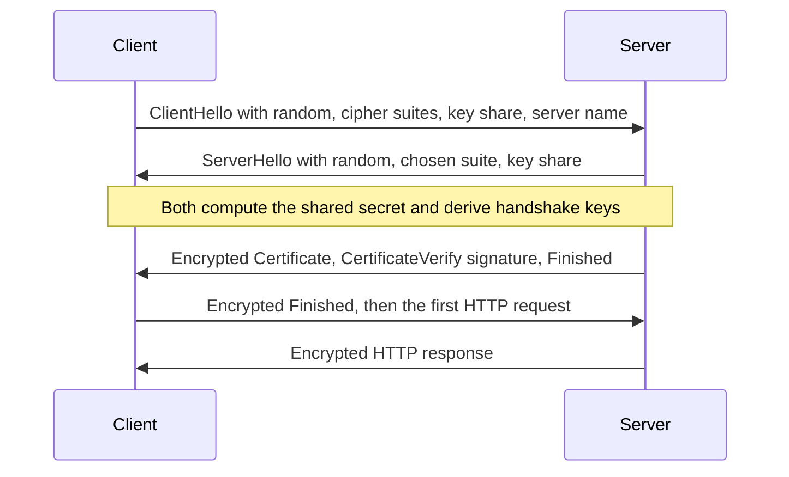

## The hook

You open your bank's website on the café's Wi-Fi. Between your phone and the bank sit the café router, an ISP and a dozen other machines, any of which could read or rewrite your packets. You have never met the bank's server, and you share no secret with it. Yet a fraction of a second later the padlock appears, and from then on nobody in the middle can read your password or change your balance.

That fraction of a second is the TLS handshake: a stranger proving who it is, and two strangers agreeing on a secret while everyone listens. TLS 1.3, published as RFC 8446 in 2018, does it in a single round trip. Predict the two separate problems the handshake must solve. (Agreeing on a key nobody else can compute, and making sure the other side really is the bank.)

## Where you meet it every day

- **Every HTTPS page and app API call**: the padlock means a TLS handshake succeeded.
- **Email, messaging and database connections**: SMTP with STARTTLS, database drivers with "sslmode", and gRPC all use TLS.
- **HTTP/3**: QUIC builds the TLS 1.3 handshake directly into its transport.
- **Inside companies**: services authenticate each other with mutual TLS, where both sides present certificates.

## The intuition

:::analogy
**Two strangers proving their identities, then whispering a shared code.** They meet in a crowded hall. Each calls out half of a puzzle; anyone can hear both halves, but only the two of them can combine their private notes with the other's half to get the same code word. Then one of them shows an ID card signed by an authority both trust, and signs a summary of everything said so far, proving the card is really theirs. From then on they speak only in the code.
:::

The puzzle halves are Diffie-Hellman **[[key share|key shares]]**, from [Agreeing on a Secret While Everyone Listens](article:famous-algos-diffie-hellman). The ID card is a **[[certificate]]** signed by a certificate authority, from [A Chain of Notaries Behind Every Padlock Icon](article:famous-algos-digital-signatures).

## How it works

A TLS 1.3 full **[[handshake]]**:



1. **ClientHello**: the client sends a random value, the cipher suites it supports, the name of the site it wants (SNI), and, guessing which group the server will pick, its Diffie-Hellman key share already.
2. **ServerHello**: the server picks a suite and sends its own key share. Now both sides combine their private value with the other's public share and get the same shared secret, which an eavesdropper who saw both shares cannot compute.
3. From the shared secret and a hash of the conversation so far (the **transcript**), both derive handshake keys with HKDF. Everything after ServerHello is encrypted.
4. **Certificate** and **CertificateVerify**: the server sends its certificate chain, then signs the transcript with the certificate's private key. The client checks the chain up to a trusted root, that the name matches, that it has not expired, and that the signature verifies.
5. **Finished** messages from both sides are MACs over the transcript, proving nobody altered any earlier message (for example, to downgrade the cipher suite).
6. Both derive **[[session keys]]** and the application data flows, protected by **[[AEAD]]** encryption.

Wait, why sign the transcript rather than just send the certificate? A certificate is public: anyone can copy the bank's certificate and replay it. Only the real server has the private key, and signing *this* handshake's transcript, which includes both fresh random values and key shares, proves possession right now, for this connection.

### Forward secrecy

In TLS 1.3 the key shares are **ephemeral**: generated fresh for each connection and discarded afterwards. The server's long-term key only signs. So if that key is stolen later, recorded past sessions stay sealed: **[[forward secrecy]]**. TLS 1.2 also allowed a static RSA key exchange, where the client encrypted the secret with the server's long-term key; stealing that key decrypted every recorded session. TLS 1.3 removed it.

### Resumption and 0-RTT

A returning client can resume with a pre-shared key from the previous session, skipping the certificate. It may even send data in its first flight (0-RTT), at the cost that this early data can be replayed by an attacker, so it should only be used for requests that are safe to repeat.


## Walk through an example

Follow one connection to a test server, as it actually ran:

| Step | What happened |
|---|---|
| ClientHello | Python's client offered TLS 1.3 suites, a key share and the server name localhost |
| ServerHello | the server chose TLS_AES_256_GCM_SHA384 and sent its key share |
| Certificate check | the client verified the test certificate against the copy it was told to trust, and the name localhost matched |
| Finished | both sides confirmed the transcript; `version()` reported TLSv1.3 |
| Data | the client sent hello and the server's encrypted reply HELLO came back |

A local test generated a certificate for "localhost" and connected with Python's ssl module. The connection negotiated TLSv1.3 with the cipher suite TLS_AES_256_GCM_SHA384, and the echo server's reply arrived. Connecting to the same server while expecting the name "bank.example" failed with `CERTIFICATE_VERIFY_FAILED: Hostname mismatch`: the client refused a valid certificate for the wrong name, exactly what stops an impostor.

:::try-this
An attacker on the café Wi-Fi intercepts your ClientHello and answers with their own key share and the bank's real certificate, copied from the bank's site. Where does the handshake fail? (At CertificateVerify: the attacker cannot sign the transcript with the bank's private key, so the signature check fails and the client aborts. If they send their own certificate instead, it is not valid for the bank's name.)
:::

## The code

```pseudo
client_handshake(server_name):
    a = random_private(); A = public_share(a)          // ephemeral Diffie-Hellman
    send ClientHello(random_c, suites, A, server_name)
    receive ServerHello(random_s, suite, B)
    shared = combine(a, B)                              // equals combine(b, A) on the server
    hs_keys = derive(shared, hash(transcript))
    receive encrypted Certificate(chain), CertificateVerify(sig), Finished(mac)
    require chain_valid(chain, trusted_roots, server_name, now)
    require verify(chain.leaf.public_key, sig, hash(transcript))
    require mac == finished_mac(hs_keys, transcript)
    send encrypted Finished
    app_keys = derive(shared, hash(full transcript))
    forget a                                            // forward secrecy
    return app_keys
```

## Why it is clever

TLS 1.3 splits the job in two and uses the right tool for each: ephemeral Diffie-Hellman for secrecy (so the server's long-term key is never used to protect data), and signatures with certificates for identity (so a man in the middle cannot pose as the server). Sending the key share in the very first message, by guessing the group, cuts the handshake to one round trip, and binding everything to a hash of the transcript means any tampering anywhere breaks the Finished check.

:::insight
The handshake answers two questions at once: "what key shall we use?", answered by ephemeral Diffie-Hellman shares exchanged in the hellos, and "are you really the bank?", answered by a certificate chain plus a signature over the whole transcript. Fresh shares per connection give forward secrecy, and TLS 1.3 needs only one round trip before encrypted data flows.
:::

## Where it falls short

- **Trust in certificate authorities**: any trusted CA can issue a certificate for any name; Certificate Transparency logs make mis-issuance visible.
- **Metadata leaks**: the server's IP address and, usually, the site name in the ClientHello are visible; Encrypted Client Hello is designed to hide the latter.
- **0-RTT replay**: early data can be replayed, so it is unsafe for non-idempotent requests.
- **Endpoint security**: TLS protects data in transit only; a compromised server or device sees everything.

:::warning
Common misconception: "TLS is part of HTTP." TLS is a separate layer between TCP (or QUIC) and the application. HTTPS is HTTP inside TLS, but the same TLS also protects email, databases and many other protocols. Confusing the two leads to answers like "HTTP encrypts the data", which interviewers notice.
:::

### Interview follow-ups

**"What changed from TLS 1.2 to 1.3?"** One round trip instead of two, only forward-secret key exchanges, encrypted certificates, a smaller set of strong cipher suites, and 0-RTT resumption.

**"What is mutual TLS?"** The client also presents a certificate and signs the transcript, so the server knows exactly which service or device is connecting.

**"Where does TLS fit when loading a page?"** After DNS and the TCP handshake and before the first HTTP request, as traced in [A Letter's Journey Across the World and Back](article:cs-core-url-to-page).

## Key takeaways

- The TLS handshake solves two problems: agreeing on secret keys over an open network, and proving that the server owns the name it claims.
- In TLS 1.3, the client sends its Diffie-Hellman key share in the first message, so both sides derive keys after one round trip.
- The server proves its identity with a certificate chain to a trusted authority and a signature over the handshake transcript, which a copied certificate cannot provide.
- Finished messages authenticate the whole transcript, so any tampering with earlier messages, such as a downgrade, is detected.
- Ephemeral key shares give forward secrecy, so stealing the server's long-term key later cannot decrypt recorded sessions.
