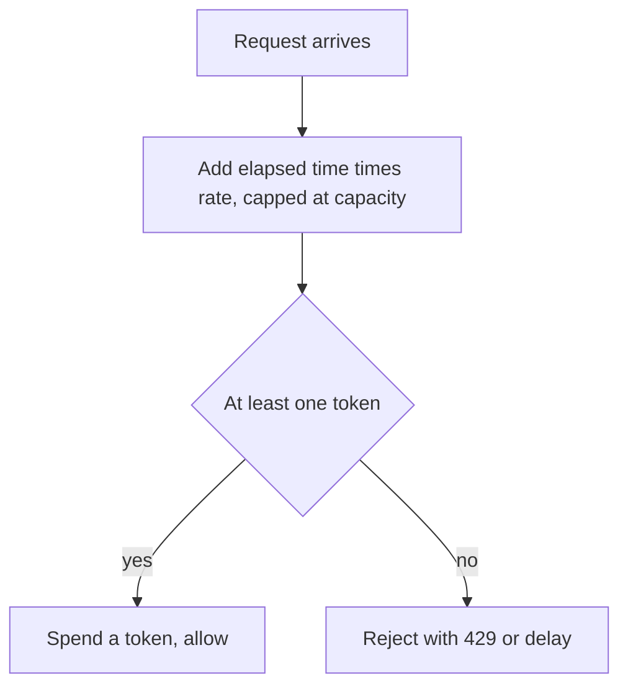

## The hook

A popular API serves millions of developers. One of them writes a loop with a bug and starts sending ten thousand requests a second. Without a limit, that one script can slow the service for everyone else.

But most real clients are bursty, not abusive: an app opening a screen fires twenty requests at once, then goes quiet. A good limiter must stop the runaway loop while letting the honest burst through. The algorithm that does both, with just two numbers per client, is the token bucket.

## Where you meet it every day

- **API gateways and cloud APIs** commonly describe their limits as a steady rate plus a burst, which is exactly a token bucket's two settings. AWS API Gateway, for example, documents throttling in terms of a rate and a burst.
- **Network traffic shaping** in routers and operating systems uses token buckets to cap a connection's bandwidth while allowing short bursts.
- **Application code**: libraries such as Guava's RateLimiter in Java and many middleware rate limiters use token-bucket-style logic.

Whenever you see "429 Too Many Requests", some form of [[rate limiting]] said no, very often this one.

## The intuition

:::analogy
Picture a coffee shop punch card that earns one stamp every minute, but can hold at most ten stamps. Each coffee costs one stamp. If you have not visited all morning, your card is full and you can buy ten coffees for your team at once. After that, you can only buy one more each minute, as stamps trickle back. Nobody can drink a hundred coffees an hour, but a busy morning burst is fine.
:::

The card is the [[token bucket]]. The stamps are tokens. The stamp rate is the [[refill rate]], which sets the long-run average. The card's ten-stamp limit is the [[bucket capacity]], which sets the biggest burst.

## How it works

Each client has a bucket with two pieces of state: the current number of tokens, and the last time the bucket was updated.

On every request:

1. **Refill lazily.** Compute the time since the last update and add `elapsed × rate` tokens, but never more than the capacity. This [[lazy refill]] means no timers are needed.
2. **Spend.** If at least one token is available, remove it and allow the request.
3. **Otherwise reject** (or delay) the request, often with HTTP 429 and a hint about when to retry.



### Two knobs, two meanings

- **Rate** answers "how many requests per second on average, forever?"
- **Capacity** answers "how big a burst do we forgive?"

A capacity of 1 means no bursts: requests must be spaced out evenly. A large capacity means clients can save up and spend quickly, while still respecting the long-run rate.

:::insight
A token bucket separates two questions that a simple counter mixes up: how fast you may go on average, and how much you may save up for a burst. That is why it can stop a runaway loop without punishing a normal app opening a screen.
:::

## Walk through an example

Capacity 5, refill rate 1 token per second. The bucket starts full.

| Time (s) | Event | Tokens after refill | Decision | Tokens after |
|---|---|---|---|---|
| 0.0 | 5 requests at once | 5 | all allowed | 0 |
| 0.5 | 1 request | 0 + 0.5 = 0.5 | rejected | 0.5 |
| 2.0 | 1 request | 0.5 + 1.5 = 2.0 | allowed | 1.0 |
| 2.1 | 1 request | 1.0 + 0.1 = 1.1 | allowed | 0.1 |
| 10.0 | 1 request | min(5, 0.1 + 7.9) = 5.0 | allowed | 4.0 |

The burst at time 0 passed in full; the request at 0.5 was too soon; and after a long quiet stretch the bucket was full again, capped at 5 rather than growing forever.

:::try-this
Same bucket, starting full. A client sends one request every 0.5 seconds, forever. How many are allowed in the first 10 seconds? (Requests arrive at 0, 0.5, 1.0, ... 9.5 seconds: 20 in total. The stored tokens cover the first stretch, then tokens arrive at 1 per second while requests arrive at 2 per second, so only about every other request passes. Tracing it exactly gives 14 allowed: roughly the 5 saved tokens plus about 9 or 10 refilled ones.)
:::

## The code

```pseudo
bucket = { tokens: capacity, last: now() }

allow(bucket):
    t = now()
    bucket.tokens = min(capacity, bucket.tokens + (t - bucket.last) * rate)
    bucket.last = t
    if bucket.tokens >= 1:
        bucket.tokens -= 1
        return true
    return false
```

In a distributed system, buckets live in a shared store such as Redis, keyed by client id. The read, refill and spend must happen atomically, for example in a single script or transaction, or two servers could spend the same token at the same time.

## Why it is clever

It needs constant memory per client, two numbers, and constant time per request, a little arithmetic. There is no queue and no timer, because refilling is computed only when someone asks. And its two settings map directly onto how people describe limits in plain language: "100 per minute, bursts of 20".

A close cousin, the [[leaky bucket]], queues requests and lets them out at a fixed rate. It smooths traffic perfectly, which suits network shaping, but forces bursts to wait. The token bucket lets bursts through immediately, which usually suits APIs better.

## Where it falls short

:::warning
Common misconception: "a rate limiter protects the service from any overload." A per-client limit stops single clients from hogging capacity, but a million well-behaved clients can still overwhelm a service together. Global limits, load shedding and autoscaling handle that separate problem.
:::

- **Distributed accuracy is hard.** With many servers, keeping one shared bucket per client costs a network round trip; local buckets per server are faster but let a client exceed the global limit.
- **Clock issues.** Lazy refill depends on timestamps, so clock jumps on a server can briefly grant too many or too few tokens.
- **Costs are uniform.** One token per request ignores that some requests are far more expensive; weighted costs fix this but need tuning.

## Key takeaways

- A token bucket refills tokens at a steady rate up to a capacity, and each request spends one token.
- The refill rate controls the long-run average, while the capacity controls how large a burst is allowed.
- Lazy refill computes new tokens from elapsed time on each request, so only two numbers per client are stored and no timers are needed.
- A leaky bucket smooths traffic to a fixed rate, while a token bucket lets saved-up bursts through immediately.
- In distributed systems, the bucket update must be atomic in a shared store, or local limits must accept some inaccuracy.
