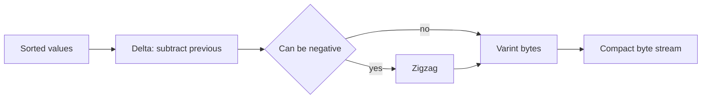

## The hook

A typical `int64` field takes 8 bytes. But most numbers that real systems send are small: a count of 3, a status of 1, an age of 27, a field number of 5. Spending 8 bytes on the number 3 means seven of them are zeros, sent over the network, written to disk and read back millions of times a second.

Two old, simple tricks fix this. Variable-length integers spend bytes only on the bits a number actually needs, and delta encoding turns large, sorted numbers into small differences first. Together they are inside Protocol Buffers, search engine indexes, WebAssembly binaries and many database formats.

## Where you meet it every day

- **Protocol Buffers** encode integer fields as [[varint]]s, and the `sint32`/`sint64` types add [[zigzag encoding]].
- **WebAssembly** and the DWARF debugging format use [[LEB128]] for integers in their binary formats.
- **Search engines** store posting lists of document ids as gaps, then compress the gaps with variable-length codes, as in [The Index at the Back of Every Search Engine](article:famous-algos-inverted-index).
- **Time series databases** store timestamps and values as differences from the previous point.

## The intuition

:::analogy
Think of keeping score in a long cricket match. You could rewrite the full total after every ball: 0, 4, 4, 5, 11, 11, 12. Or you could write only what changed: +4, +0, +1, +6, +0, +1. The changes are small numbers you can scribble in one stroke, while the totals grow into three-digit numbers. Anyone can rebuild the totals by adding the changes back up. And when you do have to write a big number, you use as many digits as it needs, not a fixed width of ten boxes.
:::

Writing only the change is [[delta encoding]]. Using as many digits as needed is a varint. One makes numbers small; the other makes small numbers cheap.

## How it works

### Varints: 7 bits per byte

Split the number's binary form into groups of 7 bits, starting from the least significant end. Each group goes into one byte:

- The low 7 bits of the byte hold the group.
- The top bit is the [[continuation bit]]: 1 if more bytes follow, 0 on the last byte.

Groups are written least significant first, which is the LEB128 layout. To decode, read bytes, take the low 7 bits of each, shift them into place (0, 7, 14, ... bits), and stop at the first byte whose top bit is 0.

| Value range | Bytes |
|---|---|
| 0 to 127 | 1 |
| 128 to 16,383 | 2 |
| up to 2²¹ − 1 | 3 |
| up to 2²⁸ − 1 | 4 |
| full 64-bit values | up to 10 |

### Zigzag: making negatives small

In two's complement, −1 is all ones, so as a 64-bit varint it takes 10 bytes. Zigzag maps signed to unsigned so that numbers close to zero stay small:

| Signed | 0 | −1 | 1 | −2 | 2 | −64 | 64 |
|---|---|---|---|---|---|---|---|
| Zigzag | 0 | 1 | 2 | 3 | 4 | 127 | 128 |

For 64-bit n the formula is `(n << 1) ^ (n >> 63)`, using an arithmetic right shift: it doubles positives and maps negatives to odd numbers. Decoding is `(z >> 1) ^ -(z & 1)`.

### Delta encoding: making big numbers small

For a sorted list such as document ids or timestamps, store the first value, then each difference from the previous one. The gaps are small when the values are dense, so they fit in one varint byte each. Decoding is a running sum. For signed differences, such as sensor readings that go up and down, zigzag the deltas before writing them as varints.



:::insight
Most numbers in real data are small or close to their neighbours. Delta encoding exploits closeness, zigzag exploits "near zero" for signed values, and varints exploit "small" by spending bytes only on significant bits. Each step is cheap and fully reversible.
:::

## Walk through an example

**Encode 300.**

| Step | Value |
|---|---|
| 300 in binary | 1 0010 1100 (9 bits) |
| Low 7 bits | 0101100 = 44 |
| Remaining bits | 0000010 = 2 |
| First byte: continuation 1 + 0101100 | 1010 1100 = **0xAC** |
| Second byte: continuation 0 + 0000010 | 0000 0010 = **0x02** |

Decode: 0xAC has its top bit set, so take 44 and keep going; 0x02 has top bit 0, so take 2 shifted left by 7 = 256, and stop. 44 + 256 = 300. ✓

**Delta + varint on sorted ids [1000, 1003, 1010, 1100, 1105].**

- As varints directly: each value is between 128 and 16,383, so 2 bytes each, **10 bytes**.
- Deltas: [1000, 3, 7, 90, 5]. The first takes 2 bytes, the other four take 1 byte each: **6 bytes**.

Decoding the deltas: 1000, 1000 + 3 = 1003, 1003 + 7 = 1010, 1010 + 90 = 1100, 1100 + 5 = 1105. ✓

:::try-this
Encode 128 as a varint, and give the zigzag value of −3. (128 = 1 0000000: low group 0000000 with continuation gives 0x80, then 0x01, so two bytes 0x80 0x01. Zigzag of −3 is 2·3 − 1 = 5.)
:::

## The code

```pseudo
varint_encode(n):                  // n >= 0
    bytes = []
    loop:
        group = n & 0x7F; n = n >> 7
        if n > 0: bytes.append(group | 0x80)
        else: bytes.append(group); return bytes

varint_decode(bytes):
    result = 0; shift = 0
    for b in bytes:
        result |= (b & 0x7F) << shift; shift += 7
        if b & 0x80 == 0: return result

zigzag(n):   return (n << 1) ^ (n >> 63)
unzigzag(z): return (z >> 1) ^ -(z & 1)

delta_encode(sorted): out = [sorted[0]] + [sorted[i] - sorted[i-1] for i >= 1]
```

```cpp
#include <bits/stdc++.h>
using namespace std;

vector<uint8_t> varint(uint64_t n) {
    vector<uint8_t> out;
    do {
        uint8_t group = n & 0x7F;
        n >>= 7;
        out.push_back(n ? (group | 0x80) : group);
    } while (n);
    return out;
}

uint64_t zigzag(int64_t n) { return ((uint64_t)n << 1) ^ (uint64_t)(n >> 63); }

int main() {
    for (auto b : varint(300)) printf("0x%02X ", b);                // 0xAC 0x02
    printf("\n%llu %llu\n", (unsigned long long)zigzag(-1),
           (unsigned long long)zigzag(-64));                        // 1 127

    vector<uint64_t> ids = {1000, 1003, 1010, 1100, 1105};
    size_t plain = 0, delta = 0;
    for (size_t i = 0; i < ids.size(); i++) {
        plain += varint(ids[i]).size();
        delta += varint(i ? ids[i] - ids[i - 1] : ids[i]).size();
    }
    printf("%zu bytes vs %zu bytes\n", plain, delta);               // 10 bytes vs 6 bytes
}
```

## Why it is clever

The encoding adapts to each value with no table or header: the continuation bit is the length field, spread across the bytes. Encoding and decoding are a few shifts and masks, so they are fast even on small devices. Varints and deltas compose with each other and with general compressors, which is why the same small trick appears in network protocols, file formats and search indexes alike.

## Where it falls short

:::warning
Common misconception: "varints always save space." Large numbers grow: a full 64-bit value needs 10 bytes instead of 8, and a negative `int32` written as a plain Protocol Buffers varint is sign-extended and also takes 10 bytes. Use zigzag types for values that can be negative, and fixed-width types for values that are usually large, such as hashes.
:::

- **No random access**: to find the 1,000th value you must decode the 999 before it, and delta encoding adds a running sum on top. Indexes store skip points every so often to jump ahead.
- **Branchy decoding**: the byte-by-byte loop is harder for CPUs to predict than fixed widths; search engines often use block-based integer codecs that decode many values at once with SIMD.
- **Deltas need sorted or smooth data**: on random values, gaps are as large as the values themselves.

### Interview follow-ups

**"Encode 300 as a varint."** 300 is 0b1_0010_1100. Low 7 bits 0101100 go first with the continuation bit set: 0xAC. The remaining bits are 0b10 = 0x02, with the continuation bit clear. So 300 becomes the two bytes AC 02.

**"What is zigzag encoding?"** It maps signed to unsigned so small magnitudes stay small: 0→0, −1→1, 1→2, −2→3, 2→4, computed as (n << 1) XOR (n >> 63) for 64-bit values. Then −1 takes one byte instead of ten.

**"Why delta-encode posting lists?"** Document ids in a sorted list are large but close together, so the gaps are small and fit in one or two varint bytes. The index shrinks a lot, and smaller indexes mean fewer disk reads and better cache use.

## Key takeaways

- A varint stores 7 bits per byte and uses the top bit to say whether another byte follows, so small numbers take one byte.
- Protocol Buffers and WebAssembly use the LEB128 layout, writing the least significant 7-bit group first.
- Zigzag encoding maps small negative numbers to small positive ones so they stay short as varints.
- Delta encoding turns sorted or slowly changing values into small differences, which varints then store compactly.
- Varints cost more than fixed width for large values and prevent random access without extra skip points.
