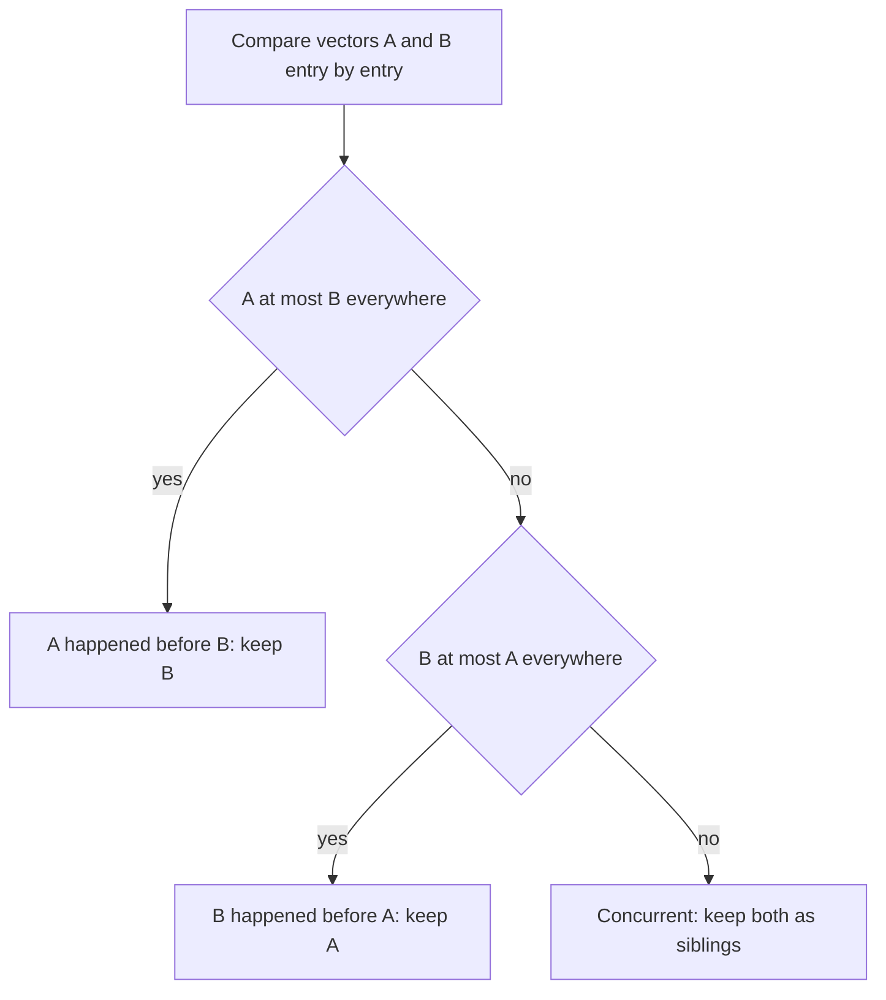

## The hook

You add a book to your shopping cart on your phone. A moment later, on your laptop, you add headphones. Both requests reach different replicas of the cart service during a brief network hiccup. When the replicas sync, which cart is right? If the system simply keeps the "latest" write, one of your items silently disappears.

Lamport clocks cannot help here: they would happily put one write "after" the other. What the system needs to know is something sharper: did either device know about the other's change? Vector clocks answer exactly that.

## Where you meet it every day

- **Amazon's Dynamo design**, described in its 2007 paper, attached vector clocks to object versions so concurrent writes, such as two edits to a shopping cart, were kept and reconciled instead of silently overwritten.
- **Riak**, a Dynamo-style database, exposed concurrent versions to applications as siblings using vector-clock-style metadata.
- **Version vectors in sync tools and replicated stores** follow the same idea to decide whether one replica's copy is strictly newer or genuinely in conflict.

Wherever a system must not lose a write just because two devices were offline from each other, some form of vector clock is usually involved.

## The intuition

:::analogy
Think of a group of pen pals where each person keeps a tally sheet with one column for every friend: "how many letters from Asha have I seen, how many from Ben, how many from Chen." Every letter carries a copy of the writer's tally. If one letter's tally is at least as high as another's in every column, its writer had seen everything the other had, so it came later. If each letter is ahead in a different column, the two writers were working without seeing each other's latest news.
:::

A Lamport clock squashes all that history into one number, so it cannot tell "later" from "unrelated". A [[vector clock]] keeps one counter per machine, and comparing two vectors column by column reveals the difference.

## How it works

With n machines, each keeps a vector V of n counters, all starting at 0. Machine i follows three rules:

1. **Local event or write:** V[i] = V[i] + 1.
2. **Send:** increment V[i], then attach a copy of V.
3. **Receive vector W:** for every j, V[j] = max(V[j], W[j]); then V[i] = V[i] + 1.

Compare two vectors A and B:

- If every A[j] ≤ B[j] and at least one is smaller, B [[dominates]] A: A happened before B.
- If neither dominates, A and B are [[concurrent]].
- If all entries are equal, they describe the same history.



:::insight
A vector clock turns "which came first?" into a column-by-column comparison. If one vector is at least as large in every column, its owner had seen everything; otherwise the two writers acted blind to each other, and only then is there a real conflict.
:::

## Walk through an example

A cart replicated on three servers, X, Y and Z. Vectors are written [X, Y, Z].

| Step | Event | Version's vector | Cart contents |
|---|---|---|---|
| 1 | X writes "book" | [1, 0, 0] | book |
| 2 | Y syncs from X | [1, 0, 0] | book |
| 3 | Phone writes "pen" at X | [2, 0, 0] | book, pen |
| 4 | Laptop writes "headphones" at Y | [1, 1, 0] | book, headphones |
| 5 | Z receives both versions | compare [2,0,0] with [1,1,0] | ? |

At step 5, X's version is ahead in column X, Y's version is ahead in column Y. Neither dominates, so they are concurrent. Z keeps both as [[sibling]]s. The next read returns both carts, and the application merges them into "book, pen, headphones", stored with the merged vector [2, 1, 0] plus Z's increment.

Compare: if the laptop had first synced X's step-3 version and then added headphones, its vector would be [2, 1, 0], which dominates [2, 0, 0]. No conflict: the laptop had seen the pen.

:::try-this
Two versions have vectors [3, 1, 2] and [3, 2, 2]. Another pair has [4, 0, 1] and [3, 1, 1]. Which pair is concurrent? (The first pair is ordered: the second vector dominates. The second pair is concurrent: 4 > 3 in the first column but 0 < 1 in the second.)
:::

## The code

```pseudo
V = [0] * n                        // on machine i

on write():
    V[i] += 1
    store value with copy of V

on receive(W):
    for j in 0 .. n-1:
        V[j] = max(V[j], W[j])
    V[i] += 1

compare(A, B):
    a_le_b = all(A[j] <= B[j])
    b_le_a = all(B[j] <= A[j])
    if a_le_b and b_le_a: return SAME
    if a_le_b: return A_BEFORE_B
    if b_le_a: return B_BEFORE_A
    return CONCURRENT
```

## Why it is clever

It captures causality exactly: two events are ordered by happened-before **if and only if** one vector dominates the other. Lamport clocks only guaranteed one direction; vector clocks give both. That precision lets a store keep every write that might matter, and discard only the versions that are truly obsolete.

It also moves [[conflict resolution]] to the place that understands the data. The database cannot know how to merge two carts, but it can tell the application, precisely, when merging is needed.

## Where it falls short

:::warning
Common misconception: "vector clocks resolve conflicts." They only detect them. Someone still has to decide what the merged value is: the application, a rule like "union of cart items", or a data type designed to merge automatically, such as a CRDT.
:::

- **Size grows with the number of writers.** One entry per machine or client can get large; real systems prune old entries or track per-server rather than per-client counters, which can occasionally hide or invent conflicts.
- **Siblings push complexity to clients.** Applications must handle multiple values on read, which many developers find surprising.
- **Last-write-wins is simpler**, and many systems choose it instead, accepting that some concurrent writes are lost.

## Key takeaways

- A vector clock keeps one counter per machine, so it records how much of every machine's history a version has seen.
- One version happened before another exactly when its vector is less than or equal in every entry and smaller in at least one.
- If neither vector dominates, the writes were concurrent, and a store keeps both as siblings instead of losing one.
- Vector clocks detect conflicts but do not resolve them; the application or a mergeable data type decides the final value.
- Their size grows with the number of writers, which is why real systems prune them or accept simpler last-write-wins rules.
