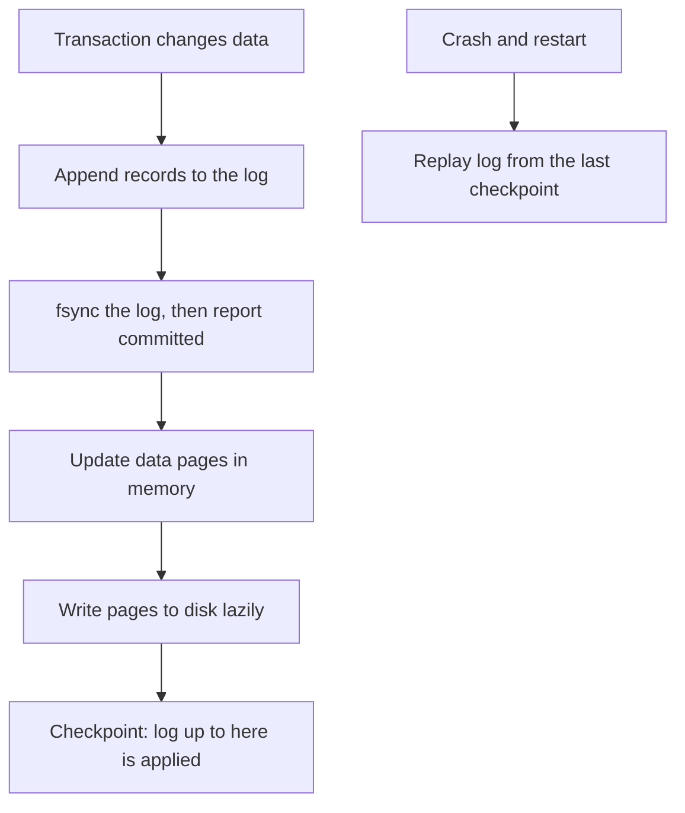

## The hook

A bank's database is halfway through moving money: it has subtracted ₹5,000 from your account, but not yet added it to your friend's. Then the power fails. When the machine restarts, did the money vanish?

In a well-built database, no. Before touching the real data, it wrote one line in an append-only diary: "transfer ₹5,000 from A to B". On restart it reads the diary and finishes or rolls back the job. That diary is the write-ahead log, and almost every serious database has one.

## Where you meet it every day

- **PostgreSQL** calls it the WAL, and also streams it to replicas for replication.
- **MySQL's InnoDB** engine uses a redo log for the same purpose.
- **SQLite** offers a WAL mode, which many mobile apps use under the hood.
- **LSM-based stores** like RocksDB and Cassandra (where it is called the commit log) write each change to a log before the in-memory memtable, as in [Why Modern Databases Write So Fast](article:famous-algos-lsm-trees).
- **Kafka** takes the idea to its conclusion: the log is the database.

## The intuition

:::analogy
A careful bank teller writes every transaction in the ledger before handing over the cash. If the teller faints mid-transaction, the next teller opens the ledger, sees the last entry, and knows exactly what was in progress and what to finish or undo. The cash drawer can be messy for a moment; the ledger never lies.
:::

The ledger is the [[write-ahead log]]. The cash drawer is the database's main data structures, such as its B-tree pages, which are expensive to update and may be half-written during a crash.

## How it works

**The rule:** a change must be safely recorded in the log on stable storage before the change to the main data is considered done.

1. A transaction's changes are appended to the log, each with a sequence number.
2. On commit, the database forces the log to disk with [[fsync]], then tells the client "committed". This is what gives [[durability]].
3. The main data pages are updated in memory and written to disk later, lazily, in big efficient batches.
4. Periodically, a [[checkpoint]] makes sure all changes up to some log position are in the main files; older log segments can then be recycled.
5. After a crash, the database starts from the last checkpoint and performs a [[replay]] of the log, re-applying committed changes and undoing incomplete ones.



:::insight
The log turns many scattered, risky writes into one sequential append that is easy to make durable. The main data can then be updated whenever convenient, because the log can always rebuild it.
:::

### Why it is fast, not just safe

Appending to the end of one file is sequential I/O, the fastest kind. Updating the real data structures directly would mean random writes to many pages for every transaction. With a log, the database pays one sequential append per commit, and batches the random page writes later. [[Group commit]] goes further: when many transactions commit at once, one fsync covers all of them.

## Walk through an example

A tiny database holds A = 100 and B = 50. The last checkpoint was at log position 10.

| Log position | Record |
|---|---|
| 11 | T1 begin |
| 12 | T1: A from 100 to 95 |
| 13 | T1: B from 50 to 55 |
| 14 | T1 commit (fsync done) |
| 15 | T2 begin |
| 16 | T2: A from 95 to 0 |
| — | crash |

On restart, the data file might show A = 0, A = 95 or even A = 100, depending on which pages happened to reach disk. It does not matter. Replay from position 11: T1 committed, so redo it, giving A = 95, B = 55. T2 never committed, so undo its change, giving A = 95. Final state: A = 95, B = 55, exactly the committed history.

:::try-this
Suppose the crash happened just before record 14 reached disk. What would recovery produce, and what should the client that sent T1 believe? (T1 has no commit record, so it is undone: A = 100, B = 50. The client never received "committed", because the reply is sent only after the commit record is on disk, so it must treat T1 as failed or uncertain and retry safely.)
:::

## The code

```pseudo
commit(transaction):
    for change in transaction.changes:
        log.append(change)                  // includes old and new values
    log.append(COMMIT transaction.id)
    log.fsync()                             // durability point
    reply "committed"
    apply changes to in-memory pages        // written to disk later

recover():
    start at last checkpoint
    for record in log after checkpoint:
        redo it                             // bring pages up to date
    undo changes of transactions with no COMMIT record
```

Real systems such as those based on the ARIES recovery method add careful details, like page sequence numbers, so redo is safe to repeat.

## Why it is clever

It separates "is this change safe?" from "is this change applied everywhere?". Safety needs only one sequential write to a log. Application can happen lazily and in bulk. The same log then becomes useful far beyond recovery: databases ship it to replicas, and change data capture tools read it to stream changes to other systems.

## Where it falls short

:::warning
Common misconception: "writing to a file means the data is on disk." Operating systems buffer writes in memory. Without fsync, a power cut can lose data the program believed it had written. Databases that skip or delay fsync for speed are trading durability away, sometimes on purpose.
:::

- **fsync latency limits commit rate**, which is why group commit, battery-backed caches and fast SSDs matter.
- **Logs grow** until checkpoints let them be recycled; slow checkpoints mean long recovery times.
- **Disks can lie**: some storage devices acknowledge writes before they are truly persistent, which undermines the guarantee unless configured carefully.

## Key takeaways

- A write-ahead log records every change in an append-only file before the main data is updated.
- A transaction is durable once its commit record is forced to disk with fsync, and only then is it reported as committed.
- After a crash, replaying the log from the last checkpoint redoes committed changes and undoes incomplete ones.
- Sequential log appends and group commit make durability fast, while page updates happen lazily in batches.
- The same log also powers replication and change data capture in many systems.
