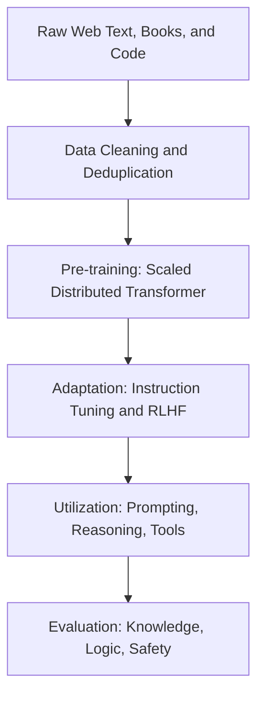
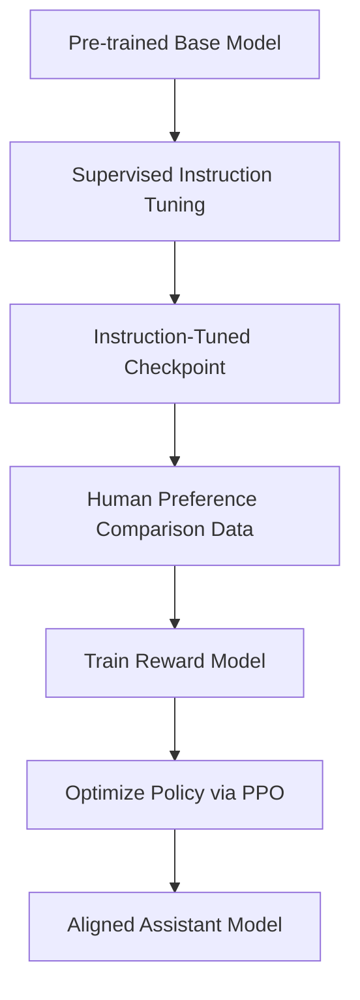

## The hook

In late 2022, artificial intelligence experienced an intellectual land rush. Following the arrival of ChatGPT, the rate of research papers published per day on large language models shot up by more than twenty-fold, surging from less than one paper every two days to nearly nine every single day. 

Researchers around the world found themselves staring at massive neural networks that could write code, explain jokes, and solve multi-step logic puzzles, yet the training recipes and core principles were scattered across confidential lab memos, informal Discord chats, and dozens of disconnected preprints. 

Wayne Xin Zhao and a team of researchers stepped into this chaos to construct the first definitive architectural blueprint of the field, answering a burning question: what actually transforms a raw next-token predictor into a capable, general-purpose reasoning machine?

## Before you start

Before digging into this survey, you should be comfortable with:
- How models learn from internet text by predicting tokens, as explored in [scaling laws](article:paper-scaling-laws).
- How massive models execute tasks without fine-tuning, covered in [GPT-3](article:paper-gpt-3).
- How human preference data reshapes raw text generators into polite assistants, described in [InstructGPT](article:paper-instructgpt).

## The world before this paper

For years, the gold standard in natural language processing was the pre-train and fine-tune workflow. You downloaded a moderately sized model like BERT or GPT-2, attached a new classification head on top, and fine-tuned all the model weights on a small, labeled dataset for your specific task, whether that was sentiment analysis or spam filtering. 

If you had ten tasks, you maintained ten separate fine-tuned models.

:::history
The transition from task-specific helpers to general solvers unfolded across four distinct generations:
1. **Statistical models (1990s):** n-gram models that counted word frequencies with smoothing tricks.
2. **Neural language models (2010s):** Word vectors and recurrent networks that learned continuous semantic representations.
3. **Pre-trained models (2018):** Transformers like BERT that learned context-aware embeddings across unlabeled text.
4. **Large language models (2020 onward):** Giant decoder architectures scaled beyond tens of billions of parameters that tackle open-ended tasks via text interaction alone.
:::

When researchers scaled decoder-only Transformers past tens of billions of parameters, something unexpected happened. The models stopped behaving like narrow semantic feature extractors. 

Instead, they began exhibiting [[Emergent Abilities]], skills like multi-step mathematical deduction and translation in low-resource languages that smaller models simply could not perform. 

Yet nobody had assembled the full picture. How much text do you need? How should you clean it? Why does chain-of-thought prompting work on a 100-billion-parameter model but completely fail on a 7-billion-parameter model? 

Industrial labs held many of the best recipes behind closed doors, leaving academic researchers and software engineers struggling to piece together how these systems were built.

## The big idea

The authors organized the messy universe of LLM research into a clean, four-pillar lifecycle: **Pre-training**, **Adaptation tuning**, **Utilization**, and **Capacity evaluation**.

:::analogy
Think of creating and using a large language model like raising an encyclopedic scholar:
1. **Pre-training** is sending the scholar into a world-class library for years to read millions of books, articles, and code repositories, absorbing foundational facts about the universe.
2. **Adaptation tuning** is sending that scholar to professional etiquette and trade school, teaching them how to answer questions politely, follow instructions, and avoid handing out dangerous recipes.
3. **Utilization** is giving the scholar an open-ended exam with scratch paper so they can show their work step-by-step or check external tools like a calculator.
4. **Capacity evaluation** is administering standardized tests to measure their logic, world knowledge, and ethical boundaries.
:::

Every single breakthrough in modern language modeling belongs inside one of these four pillars.



## How it works

Let us walk through each pillar just as an engineering team must when building a frontier model from scratch.

### Pillar 1: Pre-training and Compute-Optimal Scaling

Pre-training is where a model acquires 99% of its raw knowledge. It requires massive data curation and distributed clusters of GPUs running for weeks or months.

The survey highlights that data quality matters far more than raw volume. Web data from public scrapes like Common Crawl is riddled with low-effort machine translations, toxic rants, and spam. Curation requires three mandatory filters:
- **Heuristic quality filtering:** Removing documents with abnormal punctuation ratios, repetitive character loops, or high word-error rates.
- **Deduplication:** Removing exact and near-duplicate pages. Duplicates cause models to memorize phrases verbatim and drastically increase training loss instability.
- **De-contamination:** Checking that standard evaluation test sets (like high school exam questions) have not leaked into the pre-training text.

To decide how to spend your budget, you turn to empirical scaling laws. The paper examines the debate between the early Kaplan et al. formulation and the compute-optimal Chinchilla formulation proposed by Hoffmann et al.

Under the Chinchilla framework, total compute budget $C$ (measured in floating-point operations, or FLOPs) is related to the number of model parameters $N$ and the number of training tokens $D$ by the approximation:

$$C \approx 6ND$$

Here:
- $C$ represents total training compute in FLOPs.
- $N$ represents the count of non-embedding model parameters.
- $D$ represents the total number of processed tokens.
- The factor of $6$ accounts for the forward and backward passes (a forward pass takes roughly $2N$ FLOPs per token, and the backward pass takes roughly $4N$ FLOPs per token).

The Chinchilla empirical loss function takes the form:

$$L(N, D) = E + \frac{A}{N^\alpha} + \frac{B}{D^\beta}$$

Here:
- $L(N, D)$ is the cross-entropy loss on next-token prediction.
- $E = 1.69$ represents the irreducible loss (the inherent entropy of natural human text).
- $A = 406.4$ and $B = 410.7$ are fitted scale coefficients.
- $\alpha = 0.34$ and $\beta = 0.28$ govern how quickly returns diminish as you increase parameters versus tokens.

Because $\alpha$ and $\beta$ are remarkably close, the survey emphasizes a vital rule: **if your compute budget doubles, you should increase model parameters and training tokens in roughly equal proportions.** Earlier models like GPT-3 (175 billion parameters trained on only 300 billion tokens) were severely undertrained for their size.

:::try-this
Suppose you have a compute budget of $C = 6 \times 10^{23}$ FLOPs. Under the rule of thumb that parameters $N$ and tokens $D$ should scale in balanced proportions, let us see what happens if you choose $N = 10 \times 10^9$ (a 10-billion parameter model).

Using $C \approx 6ND$:
$$6 \times 10^{23} \approx 6 \times (10 \times 10^9) \times D$$
$$10^{23} \approx 10^{10} \times D$$
$$D \approx 10^{13} \text{ tokens} = 10 \text{ trillion tokens}$$

If you only gave that 10B model 300 billion tokens, you would be leaving massive amounts of performance on the table for that compute budget!
:::

### Pillar 2: Adaptation Tuning

Once pre-training finishes, your scholar has read the library, but they are wild. If you type *"How do I make pancakes?"*, a pre-trained base model might simply output *"How do I make waffles? How do I make toast?"* because it assumes it is completing a bulleted list of breakfast questions found on an internet forum.

Adaptation bridges the gap between text completion and helpful interaction:

1. **[[Instruction Tuning]]:** You fine-tune the model across thousands of diverse tasks formulated as explicit commands (*"Summarize this text"*, *"Translate this sentence to French"*). This teaches the model the conversational structure of instructions and questions.
2. **[[RLHF|Alignment via RLHF]]:** Base models reflect the internet, which includes bias, false claims, and harmful content. In Reinforcement Learning from Human Feedback, human evaluators score pairs of model completions. A separate reward model learns to predict human preferences, and the language model updates its policy using algorithms like Proximal Policy Optimization ([PPO](article:paper-ppo)) to maximize helpfulness and harmlessness.



### Pillar 3: Utilization

How do you get the best answers out of a deployed model without modifying its weights?

- **[[In-Context Learning (ICL)]]:** By providing a prompt with a short instruction and two or three sample inputs and outputs, the model recognizes the pattern and generates the completion for a new test instance directly in its context window.
- **[[Chain-of-Thought (CoT)]]:** For complex arithmetic or symbolic reasoning, asking the model to jump directly to the answer produces frequent errors. Prompting the model to show its intermediate steps (*"Think step by step"*) allows it to use generated tokens as working memory.
- **Tool Augmentation:** The model calls external APIs, such as a calculator for division or a search engine for breaking news, bypassing its internal memory bottlenecks.

:::insight
Tokens generated during chain-of-thought prompting serve as external scratchpad memory. Each intermediate token conditions the attention mechanism for the next step, allowing sequential computation that a single forward pass cannot achieve alone.
:::

### Pillar 4: Capacity Evaluation

Finally, how do you verify what the system knows? The survey structures evaluation into three levels:
- **Core language understanding:** Grammar, reading comprehension, and translation.
- **Advanced reasoning:** Multi-step math (GSM8K), competition coding (HumanEval), and multi-discipline academic tests (MMLU).
- **Safety and alignment:** Red-teaming queries, measuring toxicity, hallucination rates, and susceptibility to jailbreak attacks.

## What they found

By synthesizing data across hundreds of models, the survey highlighted sharp empirical patterns governing when and how large language models succeed.

```
Task Accuracy (%)
  |
  |                                      * Emerged Ability
  |                                    *
  |                                  *
  |                                *
  |                              *
  |                            *
  |---------------------------* (Threshold: ~60B-100B params)
  |  Near-random baseline
  +----------------------------------------------------> Model Scale
```

First, [[Emergent Abilities]] follow clear scale thresholds:
- **Instruction following:** When researchers trained LaMDA variants on instruction datasets, models below 8 billion parameters showed almost no zero-shot generalization to unseen tasks. The ability to follow instructions reliably on brand-new tasks only emerged noticeably once the model scale crossed 68 billion parameters.
- **Chain-of-thought reasoning:** On mathematical reasoning datasets like GSM8K, prompting models to show their work yielded almost zero benefit on models below 60 billion parameters. However, once models passed 100 billion parameters (such as PaLM 540B), the exact same prompt produced dramatic jumps in multi-step problem solving.

Second, the paper highlighted the rapid transition toward code pre-training. Models trained on mixtures of natural language and source code consistently outperformed models trained purely on plain text across logical reasoning and symbolic manipulation tasks.

:::warning
Do not assume that lower pre-training loss guarantees better performance on every single task. While language modeling loss drops smoothly as compute increases, individual downstream tasks can exhibit *inverse scaling*, where larger models temporarily perform worse because they latch onto misleading statistical shortcuts or superficial linguistic patterns.
:::

## What it got wrong (or left open)

While the survey provided an exhaustive synthesis of the state of the art in 2023, it laid bare several deep theoretical mysteries and practical limitations that the field had not yet solved:

- **The debate over emergent abilities:** Are emergent abilities a genuine physical phase transition (like water boiling into steam), or are they an optical illusion caused by discontinuous evaluation metrics? If you score a coding task with an all-or-nothing metric (0 for fail, 1 for pass), the curve looks like a sudden leap. If you measure token-level edit distance, progress often looks gradual. The survey acknowledged this controversy without a conclusive theoretical resolution.
- **The compute divide:** The paper revealed an uncomfortable reality: conducting meaningful pre-training experiments on models with 100+ billion parameters had become virtually impossible for academic labs. The research directions documented in the survey were overwhelmingly dominated by industrial organizations with clusters of thousands of high-end GPUs.
- **The alignment tax and hallucinations:** Aligning models using [[RLHF]] often caused models to become overly cautious, refusing innocuous requests or experiencing small drops in diverse reasoning tasks. Furthermore, the survey could point to no bulletproof solution for factual hallucinations.

## What happened next

The taxonomy introduced in this survey became the standard organizational framework for subsequent LLM research, cited thousands of times across machine learning literature. 

Soon after the paper appeared, Meta released the open-source weights for [LLaMA](article:paper-llama), igniting an explosion of open-source fine-tuning and adaptation research. Techniques like [LoRA](article:paper-lora) allowed engineers to perform instruction tuning on modest workstation GPUs. Serving frameworks like [vLLM](article:paper-vllm) solved the memory bottlenecks of multi-user inference. 

New alignment techniques like [Direct Preference Optimization (DPO)](article:paper-dpo) simplified the tricky multi-stage RLHF pipeline by eliminating the need to train a separate reward model altogether. 

By the time Meta published [the engineering playbook of Llama 3](article:paper-the-llama-3-herd-of-models), the community had fully embraced the survey's central lessons: high-grade data filtering, compute-optimal token-to-parameter ratios, rigorous instruction tuning, and tool integration are the real engines behind modern AI.

## Key takeaways

- Modern large language models follow a four-pillar lifecycle: pre-training on broad data, adaptation tuning for instruction following, prompting and tool utilization, and multi-dimensional capacity evaluation.
- Under compute-optimal Chinchilla scaling laws, model parameter count and training token volume should scale in approximately equal proportions to maximize loss reduction per dollar of compute.
- Emergent abilities like multi-step chain-of-thought reasoning and zero-shot instruction following typically require tens of billions of parameters before rising clearly above random baselines.
- High-grade data preparation, including aggressive deduplication, quality filtering, and test-set decontamination, is just as critical to downstream accuracy as the neural network architecture itself.
