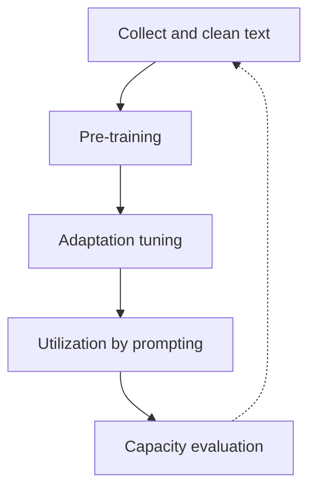

## The hook

In the months after ChatGPT launched in late 2022, it felt as if a new language model paper appeared every hour. Training tricks lived in scattered preprints, blog posts and model cards. A student trying to understand how these systems were built had no map.

A group at Renmin University of China decided to draw one. Their survey became one of the most read guides to the field, and they kept updating it as the field kept moving.

## Before you start

You should know the idea of [scaling laws](article:paper-scaling-laws), how [GPT-3](article:paper-gpt-3) solves tasks from a prompt, and how [InstructGPT](article:paper-instructgpt) used human feedback to make a model helpful. This article ties those pieces together.

## The world before this paper

The survey tells the story of language modelling in four steps.

- **Statistical language models** counted how often words follow each other.
- **Neural language models** learned word vectors and used neural networks to predict the next word.
- **Pre-trained language models** such as BERT and GPT-2 were trained on large text collections, then fine-tuned for each task.
- **Large language models** scaled those pre-trained models up dramatically.

That last step was more than "bigger is better". When the parameter count passed a certain scale, models not only improved but showed abilities small models lacked. The community coined the term large language model to mark that difference.

By early 2023, industry and academia were producing results faster than anyone could read them, and many details of the strongest models were not published.

:::history
Wayne Xin Zhao, Kun Zhou, Junyi Li and many colleagues, with Ji-Rong Wen, at Renmin University of China, posted the survey on arXiv at the end of March 2023. Unusually, they treated it as a living document, releasing many revised versions to keep pace with new models and methods.
:::

## The big idea

:::analogy
Think of how a bright student becomes a doctor. First come years in the library, reading everything: anatomy, chemistry, case reports. Then residency, where senior doctors give instructions and correct bedside manner. Then practice at the bedside, where the craft lies in asking the right questions and ordering the right tests. And throughout, board exams check what the doctor can really do.
:::

The survey organises the whole field around four matching stages:

- **[[Pre-training]]** is the library: learn general knowledge by predicting the next token on vast text.
- **Adaptation tuning** is residency: [[instruction tuning]] and alignment with human preferences.
- **Utilization** is the bedside: prompting techniques that get the most from a trained model.
- **Capacity evaluation** is the board exam: measuring what the model can and cannot do.

It also collects the resources for building LLMs, such as public model checkpoints, datasets and libraries, and ends with open problems.

The dotted arrow is the honest part: evaluation results send people back to fix the data and the training.

## How it works

### Stage 1: the library, pre-training

Most of a model's knowledge comes from pre-training, so the survey spends much of its length on the reading list. Sources include web pages, books, code and conversation data. Raw web text needs heavy cleaning: filtering low-quality pages, removing duplicates, and stripping private information. Then text is split into tokens and fed to the model, almost always a decoder-only transformer.

How big a model, and how much text? That is what a [[scaling law]] answers. A handy approximation for training compute is:

$$C \approx 6ND$$

Here $C$ is the number of floating-point operations, $N$ is the number of parameters, and $D$ is the number of training tokens. The 6 comes from about 2 operations per parameter per token in the forward pass and about 4 in the backward pass.

### A worked example: two reading plans

| Model | Parameters $N$ | Tokens $D$ | Compute $6ND$ | Tokens per parameter |
|---|---|---|---|---|
| GPT-3 | 175 billion | 300 billion | about $3.2 × 10^{23}$ | about 1.7 |
| Chinchilla | 70 billion | 1.4 trillion | about $5.9 × 10^{23}$ | 20 |

The [Chinchilla](article:paper-chinchilla) study concluded that, for a fixed compute budget, parameters and training tokens should grow in roughly equal proportion. GPT-3 had a large brain but a short reading list.

What if you spent GPT-3's budget the Chinchilla way, at 20 tokens per parameter? Solve $6 × N × 20N = 3.15 × 10^{23}$: you get $N \approx 51$ billion parameters and $D \approx 1.0$ trillion tokens. In doctor terms: a somewhat smaller student who reads far more books.

:::try-this
You have $1.2 × 10^{22}$ operations and want 20 tokens per parameter. How big a model, on how many tokens? (Solve $6 × N × 20N = 1.2 × 10^{22}$, so $N^2 = 10^{20}$, giving 10 billion parameters trained on 200 billion tokens.)
:::

### Stage 2: residency, adaptation tuning

A pre-trained model completes text; it does not follow requests. Ask it a question and it may continue with more questions. Adaptation fixes that in two ways.

- **Instruction tuning.** Fine-tune on many tasks phrased as instructions with good answers. The model learns the shape of "someone asks, I answer", and generalises to new instructions.
- **Alignment tuning.** Make answers helpful, honest and harmless. The main method surveyed is [[RLHF]], as in InstructGPT: people rank answers, a reward model learns their taste, and reinforcement learning tunes the model toward it.

The survey also covers cheaper adaptation, such as [LoRA](article:paper-lora), which trains small add-on matrices instead of the whole model.

### Stage 3: the bedside, utilization

A trained model's skill depends a lot on how you ask. The survey covers [[in-context learning]], where a few examples in the prompt define a new task, and [chain-of-thought prompting](article:paper-chain-of-thought), where the model writes intermediate steps before answering. It also covers planning, where the model breaks a complex task into steps and may call tools.

:::warning
Common misconception: "An emergent ability appears at one exact size for every model." The survey describes abilities such as in-context learning, instruction following and step-by-step reasoning as clearly present in large models but weak in small ones. Where they appear depends on the model, the data and the task, and later work argued that some apparent jumps partly reflect how the tests are scored.
:::

### Stage 4: the board exam, capacity evaluation

The survey groups evaluation into basic abilities, such as language generation, using knowledge and complex reasoning, and advanced abilities, such as alignment with human values, interacting with an environment and using tools. It also lists the benchmarks people used for each. Like a doctor's exams, no single score captures everything; each test probes one skill.

:::insight
Almost every LLM paper slots into one stage of the pipeline: what the model reads, how it is trained to behave, how it is prompted, or how it is tested. Knowing which stage a new idea improves tells you most of what you need to place it.
:::

## What they found

A survey's findings are its synthesis. The abstract's main points:

- **Scale changes behaviour, not just accuracy.** Enlarged language models showed significant improvements and special abilities absent in small models, the observation that motivated the term "large language model".
- **Four aspects organise the field.** Pre-training, adaptation tuning, utilization and capacity evaluation together cover how LLMs are built and used.
- **Resources matter.** The survey summarises the models, datasets and libraries available for developing LLMs, which makes the field easier to enter.
- **Many issues remain open.** It closes with problems and directions for future work.

## What it got wrong (or left open)

- **A snapshot of a moving target.** Even with frequent updates, any survey of this field is partly out of date when you read it. Specific models and benchmark scores age fastest.
- **Limited by what labs disclosed.** For the strongest closed models, the survey could only report what was published, so some "how it was done" questions had no answer.
- **Emergence was contested.** Soon after, researchers argued that some sudden jumps come from all-or-nothing scoring and look smoother under other measures. The question of why abilities appear with scale is still debated.
- **Theory lags practice.** The survey can describe what works, such as scaling, instruction tuning and RLHF, far better than explain why.

## What happened next

The four-stage picture held up as the field kept changing. Open model families such as [Llama 3](article:paper-the-llama-3-herd-of-models) describe their work in the same terms: data, pre-training, post-training, evaluation. Alignment methods were simplified, for example by [DPO](article:paper-dpo), which learns from preferences without a separate reward model. Serving systems like [vLLM](article:paper-vllm) made the bedside stage cheaper, and retrieval methods like [RAG](article:paper-rag) gave models fresh information at answer time.

The survey itself kept growing through new versions, a reminder that in a field this fast, a map has to be redrawn often.

## Key takeaways

- The survey organises large language model research into four stages: pre-training, adaptation tuning, utilization and capacity evaluation.
- Its abstract highlights that past a certain scale, language models show special abilities that small models lack, which is why the term large language model exists.
- Training compute is roughly six times parameters times tokens, and compute-optimal training grows parameters and tokens together, as the Chinchilla example shows.
- Adaptation through instruction tuning and RLHF turns a text predictor into an assistant, and prompting methods like in-context learning and chain-of-thought get more from it.
- Any survey of this field is a snapshot; the four-stage map is the part that has lasted.
