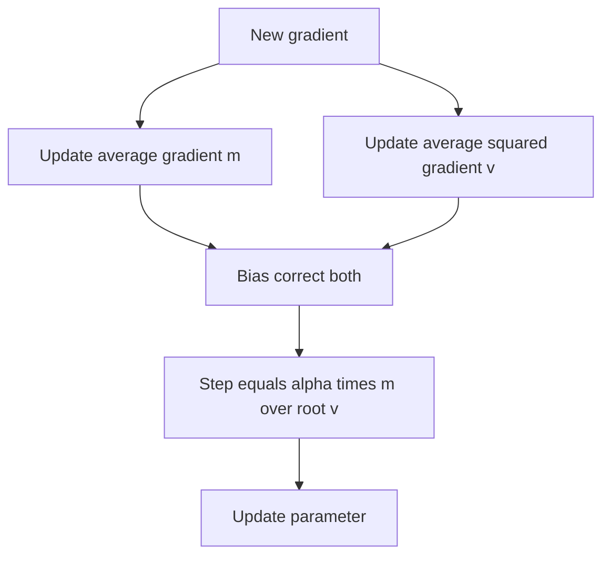

## The hook

If you have ever trained a neural network, there is a very good chance you typed one particular line of code without thinking about it: something like `optimizer = Adam(model.parameters())`. It is the default in countless tutorials, research papers and production systems.

That line comes from a paper first posted in December 2014 by two PhD students, one in Amsterdam and one in Toronto. It has since become one of the most cited scientific papers of the 21st century. Its idea fits on a napkin: give every single parameter in a network its own personal, self-adjusting step size.

## Before you start

You need [Gradient Descent](article:primer-gradient-descent): the loss is a landscape, the gradient is the slope, and the learning rate is the step size. Adam is a smarter way to choose those steps.

## The world before this paper

Plain stochastic gradient descent uses **one learning rate for every parameter**. That causes real problems in big networks:

- Some parameters get large, frequent gradients; others get tiny or rare ones. A single step size is too big for the first group and too small for the second.
- Mini-batch gradients are noisy, so the walk downhill zig-zags.
- Choosing the learning rate is a painful trial-and-error process.

:::history
Researchers had already found partial fixes. [[Momentum]], an old idea from optimization, averages recent gradients so the walk builds speed in consistent directions. AdaGrad (2011) gave each parameter its own step size, shrinking it for parameters with big past gradients, which helped with rare features but made steps shrink too much over time. RMSProp, proposed by Geoffrey Hinton in a 2012 online course lecture rather than a paper, fixed that by using a [[moving average]] of squared gradients instead of a sum.
:::

Diederik Kingma (also the lead author of the [VAE paper](article:paper-vae)) and Jimmy Ba asked: why not combine the best of both?

## The big idea

Adam, short for "adaptive moment estimation," keeps two running averages for every parameter:

1. The average gradient: which direction has this parameter been pushed lately? (Momentum.)
2. The average **squared** gradient: how big are this parameter's gradients typically? (RMSProp.)

Each step moves in the direction of the first, divided by the square root of the second. Parameters with consistently large gradients take careful steps. Parameters with small gradients get boosted.

:::analogy
Think of a hiker descending in fog with a smart pair of boots, one per leg, for every direction they could move. Each boot remembers the recent slope it has felt (momentum) and how bumpy its ground has been (the squared gradients). On rough, steep ground, the boot takes short careful steps. On a gentle, consistent slope, it takes confident strides. Every direction gets its own [[adaptive learning rate]].
:::

:::insight
Dividing the average gradient by its typical size makes each step roughly the same size no matter how big or small the raw gradients are. That scale-independence is what makes Adam so robust with little tuning.
:::

## How it works

### The update, one line at a time

At step $t$, with gradient $g_t$ for a parameter $\theta$:

$$m_t = \beta_1 m_{t-1} + (1 - \beta_1)\, g_t$$
$$v_t = \beta_2 v_{t-1} + (1 - \beta_2)\, g_t^2$$
$$\hat{m}_t = \frac{m_t}{1 - \beta_1^t}, \qquad \hat{v}_t = \frac{v_t}{1 - \beta_2^t}$$
$$\theta_t = \theta_{t-1} - \alpha\, \frac{\hat{m}_t}{\sqrt{\hat{v}_t} + \epsilon}$$

In plain words:

- $m_t$ is the moving average of gradients. $\beta_1$, usually 0.9, says how much to remember: 90% old average, 10% new gradient.
- $v_t$ is the moving average of squared gradients, with $\beta_2$ usually 0.999, so it remembers much longer.
- $\hat{m}_t$ and $\hat{v}_t$ are the bias-corrected versions (explained below).
- $\alpha$ is the base step size, usually 0.001.
- $\epsilon$ is a tiny number, like $10^{-8}$, that prevents division by zero.

The paper recommended these defaults, and they turned out to work across a remarkable range of problems.

### Why bias correction?

Both averages start at zero. After the first step, $m_1 = 0.1 \times g_1$: only a tenth of the real gradient, simply because the average has not "warmed up." Without a fix, the first steps would be wrongly tiny or distorted.

[[Bias correction]] divides by $1 - \beta^t$. At $t = 1$, that is $1 - 0.9 = 0.1$ for $m$, so $\hat{m}_1 = 0.1\, g_1 / 0.1 = g_1$, exactly the true gradient. As $t$ grows, $\beta^t$ shrinks toward zero and the correction fades away.

### A worked first step

Say the very first gradient is $g_1 = 2$.

- $m_1 = 0.1 \times 2 = 0.2$, corrected: $\hat{m}_1 = 0.2 / 0.1 = 2$.
- $v_1 = 0.001 \times 4 = 0.004$, corrected: $\hat{v}_1 = 0.004 / 0.001 = 4$.
- Step size: $\alpha \times 2 / \sqrt{4} = \alpha \times 1$.

The parameter moves by exactly $\alpha$, which is 0.001 with the defaults.

:::try-this
Repeat the first step with a much bigger gradient, $g_1 = 200$. Compute $\hat{m}_1$, $\hat{v}_1$ and the step. (You get $\hat{m}_1 = 200$, $\hat{v}_1 = 40{,}000$, and a step of $\alpha \times 200/200 = \alpha$. Same step size! Adam's steps depend on the gradient's direction and consistency, not its raw scale.)
:::

### Why this behaves so well

The ratio $\hat{m}/\sqrt{\hat{v}}$ acts like a signal-to-noise ratio. If a parameter's gradients consistently point the same way, $\hat{m}$ is large relative to $\sqrt{\hat{v}}$ and the step approaches $\alpha$. If they flip back and forth randomly, $\hat{m}$ averages out near zero while $\hat{v}$ stays large, so the step shrinks. Adam automatically slows down when it is unsure.

### Adam in practice

Two habits grew up around Adam. First, **warm-up**: for very large models, practitioners start with a tiny learning rate and raise it over the first few thousand steps, because the early estimates of $v$ are based on very few gradients and can be unreliable. Second, **decay**: after warm-up, the learning rate is slowly lowered so the final steps settle gently into a good spot instead of bouncing around it. Neither habit is in the original paper, but almost every large language model is trained with Adam plus some version of this schedule.

## What they found

The authors tested Adam on several standard tasks: logistic regression on handwritten digits and on movie-review text, multi-layer networks, convolutional networks on the CIFAR-10 image dataset, and variational autoencoders. Across these, Adam converged as fast as or faster than the alternatives, including SGD with momentum, AdaGrad and RMSProp, and handled the sparse gradients of text features well.

They also gave a theoretical convergence analysis for convex problems, and introduced a variant called AdaMax based on a different way of measuring gradient size.

:::warning
Common misconception: "Adam always beats plain SGD." In several areas, notably image classification with convolutional networks, carefully tuned SGD with momentum often reached slightly better final accuracy on test data. Adam's big advantage is that it works well with little tuning, which matters enormously in practice.
:::

## What it got wrong (or left open)

In 2018, Sashank Reddi, Satyen Kale and Sanjiv Kumar showed that the paper's convergence proof had a flaw, and constructed simple problems where Adam fails to converge to the best solution. They proposed a fix called AMSGrad. In everyday deep learning, though, the failure cases rarely bite, and plain Adam remained popular.

A subtler issue involved weight decay, a common regularizer. Ilya Loshchilov and Frank Hutter showed that the usual way of adding weight decay interacts badly with Adam's per-parameter scaling, and proposed AdamW, which applies weight decay separately. AdamW became the standard optimizer for training Transformers and large language models.

Adam also costs memory: it stores two extra numbers for every parameter. For a model with billions of parameters, that is many gigabytes, a real concern in the systems covered by [Megatron-LM](article:paper-megatron-lm).

## What happened next

- Adam and AdamW became the default optimizers for most deep learning, including the training of [Transformers](article:paper-attention-is-all-you-need), [BERT](article:paper-bert) and [GPT-3](article:paper-gpt-3).
- Learning-rate schedules, such as a short warm-up followed by gradual decay, were layered on top and became standard for large models.
- Research on new optimizers continues, but beating Adam reliably across many tasks has proven surprisingly hard.
- Jimmy Ba was also the lead author of Layer Normalization (2016), a cousin of [Batch Normalization](article:paper-batch-normalization) that became a standard part of every Transformer.

## Key takeaways

- Adam keeps two running averages per parameter: the average gradient (momentum) and the average squared gradient (scale).
- Each step divides the first by the square root of the second, giving every parameter its own adaptive step size that is independent of the gradient's raw scale.
- Bias correction fixes the fact that both averages start at zero and would otherwise be too small early in training.
- Its default settings work well on a wide range of problems, which is the main reason it became deep learning's default optimizer.
- Later work found a flaw in its convergence proof and improved its handling of weight decay, giving AdamW, the standard for large language models.
