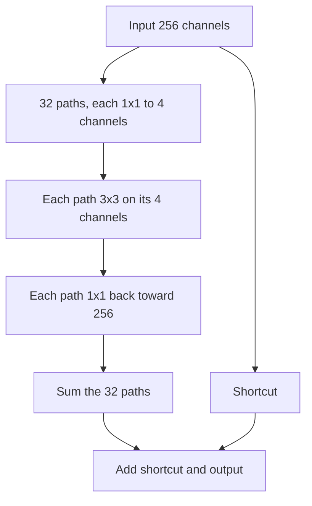

## The hook

By 2016, the recipe for a better image classifier was "make it deeper" or "make it wider". ResNet had made very deep networks trainable, and Google's Inception family had shown that clever multi-branch blocks could be efficient. But Inception blocks were hand-crafted puzzles, each branch tuned separately, hard to adapt to new problems.

A team at Facebook AI Research and UC San Diego asked a cleaner question. What if every branch in a block were identical, and the only new knob was how many branches there are?

## Before you start

You should know how residual connections work from [ResNet](article:paper-resnet), and the idea of multi-branch blocks from [the Inception article](article:paper-going-deeper-with-convolutions). Knowing that a convolution's cost depends on its input and output channels helps.

## The world before this paper

ResNet's workhorse is the [[bottleneck block]]: a 1 by 1 convolution shrinks 256 channels to 64, a 3 by 3 convolution works on those 64, and another 1 by 1 expands back to 256, with a shortcut adding the input to the output.

Inception blocks took a different route: [[split-transform-merge]]. Split the input into several branches with different filter sizes, transform each, and concatenate. They were accurate and efficient, but each block had many hand-set [[hyperparameter]]s: how many branches, what sizes, how many channels per branch.

:::history
Saining Xie, Ross Girshick, Piotr Dollár, Zhuowen Tu and Kaiming He, the lead author of ResNet, published ResNeXt on arXiv in November 2016, and it appeared at CVPR 2017. Their entry based on ResNeXt took second place in the ImageNet (ILSVRC) 2016 classification task. The goal was explicitly simplicity: one template, repeated, with as few knobs as possible.
:::

## The big idea

:::analogy
Think of a team reviewing a long report. One approach hires a single brilliant reviewer who reads everything. Another hires 32 reviewers, each reading the same report with the same checklist but focusing on their own slice of the details, then pools their notes. For the same total salary, the team of 32 often catches more, because many simple, similar viewpoints combine into a richer judgement.
:::

ResNeXt's big idea is a new dimension of network design, [[cardinality]]: the number of parallel paths in a block. Every path has the same small shape, and their outputs are summed. Cardinality joins depth (how many blocks) and width (how many channels) as a knob, and the paper argues it is the most effective one to turn.

## How it works

A ResNeXt block with cardinality 32 splits the work into 32 paths. Each path does a 1 by 1 convolution from 256 channels down to 4, a 3 by 3 convolution on those 4 channels, and a 1 by 1 back up. The 32 path outputs are summed and added to the shortcut, exactly as in ResNet.

### The grouped convolution trick

Running 32 tiny separate convolutions would be slow. But the 32 paths are equivalent to one layer:

1. A 1 by 1 convolution from 256 to 128 channels (32 paths times 4).
2. A [[grouped convolution]], 3 by 3, with 32 groups: channels 1 to 4 only connect to channels 1 to 4, and so on.
3. A 1 by 1 convolution from 128 back to 256.

The paper shows these forms are equivalent and uses the grouped version.

### Why not just go wider?

The obvious way to add capacity is to widen the ResNet bottleneck from 64 to 128 channels. Count the cost: 256 × 128 + 3 × 3 × 128 × 128 + 128 × 256 is about 213,000 weights, roughly three times the original block, because the 3 by 3 layer grows with the square of its width. ResNeXt reaches the same 128-channel middle while the 3 by 3 layer stays tiny, because each group only connects 4 channels to 4. So for a fixed budget, cardinality buys width in the cheapest possible place. That is the review team again: instead of paying one reader to read twice as much, you hire more readers who each read a narrow slice.

### Same cost, compare the counts

Count weights per block (ignoring biases):

| Block | 1×1 reduce | 3×3 middle | 1×1 expand | Total |
|---|---|---|---|---|
| ResNet bottleneck (64 wide) | 256 × 64 = 16,384 | 3 × 3 × 64 × 64 = 36,864 | 64 × 256 = 16,384 | about 69,600 |
| ResNeXt 32 × 4 (128 wide, 32 groups) | 256 × 128 = 32,768 | 3 × 3 × 4 × 4 × 32 = 4,608 | 128 × 256 = 32,768 | about 70,100 |

Grouping makes the 3 by 3 layer about 32 times cheaper than a full one of the same width, so the block can afford twice as many channels in the middle for almost exactly the same cost.

:::try-this
How many weights would the 3 by 3 layer of the ResNeXt block have without grouping, at 128 channels in and out? (3 × 3 × 128 × 128 = 147,456, which is 32 times the grouped 4,608.)
:::

The whole network is these blocks stacked like ResNet: same stages, same depth choices, same training recipe, so comparisons isolate the effect of cardinality. Back to the review team: the budget is fixed, and the only question is whether to spend it on one wide reader or many narrower ones.

:::insight
Many identical, simple paths, combined, can beat one big path of the same cost. Because the paths share a template, adding them is a single clean knob, not a new design puzzle.
:::

## What they found

- **Cardinality beats depth and width at equal cost.** When the authors increased the capacity of a ResNet-style model, raising cardinality improved ImageNet accuracy more than making the network deeper or wider for a comparable amount of computation.
- **Better accuracy at the same complexity as ResNet.** ResNeXt-50 had noticeably lower ImageNet error than ResNet-50 with roughly the same number of parameters and operations, and the larger ResNeXt-101 models improved further.
- **Competition result.** A ResNeXt-based entry took second place in the ILSVRC 2016 classification task.
- **Transfer.** The models also did well on other benchmarks, such as ImageNet-5K and object detection on COCO, when used as the backbone.

:::warning
Common misconception: "more paths is always better." The paper found strong gains up to a point, but with the cost held fixed, each path gets fewer channels as cardinality rises. With very narrow paths, the gains shrink. Cardinality is a powerful knob, not an infinite one.
:::

The broader lesson outlived the specific numbers: when a design has a repeated, uniform structure, you can study one knob at a time and trust the comparison. That style of controlled experiment, holding cost fixed and changing one thing, became a model for later architecture papers, and ResNeXt is still a common baseline when people test new ideas on image classification today.

## What it got wrong (or left open)

- **Grouped convolutions are not free in practice.** They use fewer operations, but on some hardware and software they run less efficiently than their operation count suggests, so wall-clock speed did not always improve as much as the numbers implied.
- **Why cardinality helps was empirical.** The paper showed that it works across settings, but did not provide a theory of why many narrow paths generalise better.
- **Hand-chosen templates remained.** The "32 by 4" template was found by experiment, leaving open how to search for the best design systematically.

## What happened next

ResNeXt became a popular backbone for detection and segmentation. Facebook researchers later trained very large ResNeXt models on billions of Instagram images with hashtags as weak labels, reaching strong ImageNet accuracy after fine-tuning.

The idea of grouped convolutions was pushed to its extreme in depthwise convolutions, where every channel is its own group, as in MobileNet-style networks. In 2020, Dollár and colleagues studied whole design spaces of networks in RegNet, and in 2022 ConvNeXt modernised ResNets step by step, including a "ResNeXt-ify" step that adopts grouped, then depthwise, convolutions. Meanwhile, vision transformers, introduced in [An Image is Worth 16x16 Words](article:paper-vit), offered a different route to scale.

## Key takeaways

- ResNeXt introduced cardinality, the number of identical parallel paths in a block, as a design knob alongside depth and width.
- Each block splits work into many small paths with the same shape, transforms them, and sums the results before the residual addition.
- A grouped convolution computes all the paths at once, making the middle layer about 32 times cheaper so the block can be wider at the same cost.
- At comparable complexity, increasing cardinality improved ImageNet accuracy more than adding depth or width.
- The idea fed into later efficient designs, from depthwise convolutions to ConvNeXt.
