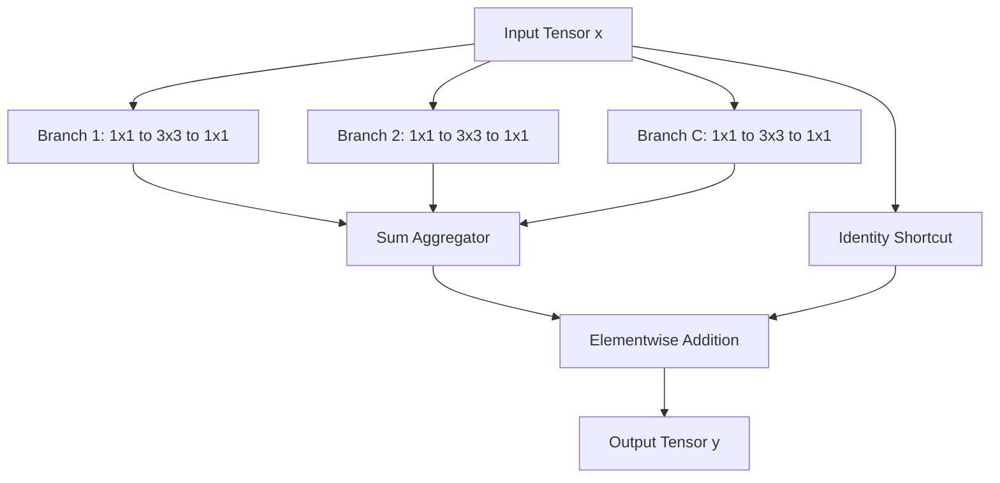
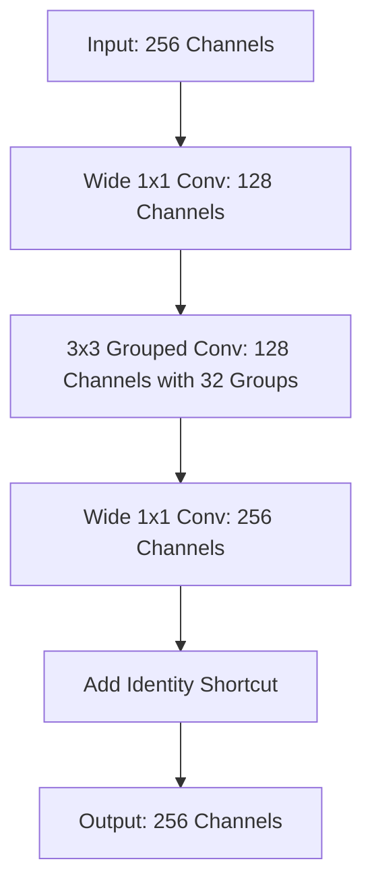

## The hook

If you want to make an image-recognition network more accurate, what knob do you turn?

For years, the deep learning playbook had only two obvious answers: go deeper by stacking more layers, or go wider by packing more channels into each layer. Both strategies helped, but both soon ran into walls of diminishing returns. Stacking past a hundred layers yielded tiny fractional improvements, and widening layers inflated compute budgets without making representations richer.

In late 2016, researchers at UC San Diego and Facebook AI Research revealed that we had been looking at the problem along the wrong axes. What if the most effective way to scale a network was neither height nor width, but a third dimension hiding in plain sight?

## Before you start

To get the most out of this paper, you should be familiar with basic convolutional networks from [The Night Deep Learning Won](article:paper-alexnet), understand how normalization stabilizes activations from [The Simple Fix That Made Deep Networks Train Fast](article:paper-batch-normalization), and know how skip connections rescue deep models from [Why Deeper Got Worse, and the Shortcut That Fixed It](article:paper-resnet).

## The world before this paper

By 2016, modern computer vision was dominated by two contrasting architectural philosophies.

On one side stood VGG and [ResNet](article:paper-resnet). Their strength lay in modular simplicity. They repeated identical building blocks throughout the network. If feature maps had the same spatial resolution, they shared the exact same channel width; whenever a pooling layer halved spatial dimensions, the channels doubled. This elegant repetition meant engineers did not have to tweak individual filter sizes for every layer. Depth became the primary knob.

On the other side stood the Inception family from Google. Inception rejected the idea of a single monolithic filter per layer. Instead, it embraced a [[Split-Transform-Merge]] strategy: slice the incoming feature channels into separate paths, transform them using different filter sizes (like $1 \times 1$, $3 \times 3$, and $5 \times 5$), and concatenate the results. Inception delivered stunning parameter efficiency. By distributing work across diverse branches, it matched massive networks with far fewer mathematical operations.

:::history
The Inception approach had an Achilles heel: architectural friction. Each branch required manual tailoring of filter sizes, channel counts, and pooling operations at every stage of the network. Adapting Inception to a brand-new dataset meant navigating an intimidating maze of architectural hyperparameters. Researchers loved Inception's efficiency, but dreaded tuning it.
:::

Vision practitioners faced an unappealing dilemma. You could pick ResNet's clean, modular simplicity at the cost of brute-force compute, or Inception's surgical parameter efficiency at the cost of grueling engineering headaches.

## The big idea

The authors asked a deceptively simple question: what happens if you apply the split-transform-merge mechanism of Inception, but force every single branch to have the exact same structure?

:::analogy
Imagine running a corporate research office. 

A standard ResNet bottleneck is like hiring a single massive consulting firm with 64 generalists in one room: they all talk to each other at once, which requires enormous coordination and creates groupthink. 

An Inception block is like assembling a messy committee of a chemist, a lawyer, and an economist: each produces a report in a different format with custom requirements, making management difficult to scale.

ResNeXt hires 32 independent four-person specialist strike teams. Every team follows the exact same briefing template, works in parallel on its own slice of the problem, and files a standardized report. You sum up their final conclusions.
:::

Because every branch shares an identical topology, you do not need to customize filter sizes or channel allocations by hand. You only need to choose one number: the total count of parallel branches.

The authors gave this number a name: **[[Cardinality]]**.

Cardinality introduces a new axis of network design. Instead of only making networks deeper or wider, you can scale them along cardinality—and as the authors proved, cardinality delivers far more representational power per floating-point operation than depth or width ever did.

:::insight
Cardinality is not just an arbitrary design trick; it is a fundamental architectural dimension. Splitting a transformation into many parallel, identical paths creates stronger feature representations than feeding the entire feature map through one dense layer.
:::

## How it works

To understand why this design is so powerful, let us trace how a standard artificial neuron works, and how the authors scaled that concept into a complete network module.

### From neurons to aggregated transformations

Think back to the simplest building block in machine learning: a single artificial neuron. It takes a vector of inputs $x = [x_1, x_2, \dots, x_D]$, multiplies each input by a weight $w_i$, and sums them up:

$$\sum_{i=1}^{D} w_i x_i$$

Notice the three steps:
1. **Split:** The input vector $x$ is separated into individual dimensions $x_i$.
2. **Transform:** Each dimension is scaled by its own weight $w_i$.
3. **Merge:** All the transformed values are aggregated via summation.

The authors realized that standard neurons perform this split-transform-merge pipeline on elementary scalar values. What if we replace each elementary transformation $w_i x_i$ with a rich, multi-layer neural network?

That gives us an **aggregated transformation**:

$$\mathcal{F}(x) = \sum_{i=1}^{C} \mathcal{T}_i(x)$$

Here:
- $x$ is the input feature map entering the block.
- $C$ is the **[[Cardinality]]**—the number of parallel branches you decide to create.
- $\mathcal{T}_i(x)$ is an arbitrary neural transformation on branch $i$.
- $\mathcal{F}(x)$ is the summed output of all $C$ paths.

To keep things modular and clean, every $\mathcal{T}_i$ adopts the same [[Bottleneck Block]] structure:
1. A $1 \times 1$ convolution that projects the high-dimensional input into a tiny channel slice of width $d$.
2. A $3 \times 3$ convolution that processes spatial patterns within that narrow slice.
3. A final $1 \times 1$ convolution that expands the narrow slice back to the full output width.

Finally, following the core lesson of ResNet, they wrap an identity skip connection around the entire aggregate sum:

$$y = x + \sum_{i=1}^{C} \mathcal{T}_i(x)$$

Here, $y$ is the final output of the ResNeXt block, passed along to the next layer after a ReLU activation.

### The hidden trick: Grouped convolutions

Writing code that splits a tensor into 32 separate paths, executes 32 separate small convolutions, and adds their outputs together would be painfully inefficient on modern graphics hardware.

Fortunately, the authors proved a mathematical equivalence that makes implementation effortless. Because all 32 branches share the exact same shape, the parallel pathways can be merged into a single layer using **[[Grouped Convolution]]**.

In a grouped convolution, the input and output channels are divided into $C$ distinct buckets. Filter weights inside bucket 1 only touch channels inside bucket 1; they never interact with bucket 2. 

The three architectures shown below produce mathematically identical results:
1. **Branch-and-sum:** 32 individual 3-layer paths summed together.
2. **Early concatenation:** 32 paths whose intermediate activations are concatenated before a shared expanding $1 \times 1$ layer.
3. **Grouped convolution:** A single $1 \times 1$ compression layer, followed by one grouped $3 \times 3$ convolution with 32 groups, followed by an expanding $1 \times 1$ layer.

In practice, you only need to add one argument to standard PyTorch or TensorFlow convolution calls: `groups=32`.

### Keeping the budget fair

When proposing a new architecture, it is easy to cheat by quietly adding more parameters or floating-point operations (FLOPs). The authors took great care to hold computational complexity strictly constant against the ResNet baseline.

Consider the first residual stage of ResNet-50. A standard ResNet bottleneck takes a 256-channel input, compresses it to 64 channels with a $1 \times 1$ filter, applies a $3 \times 3$ convolution, and expands back to 256 channels.

Ignoring biases, the parameter count inside that block is:

$$\text{Params}_{\text{ResNet}} = (256 \times 64) + (3 \times 3 \times 64 \times 64) + (64 \times 256) \approx 70{,}000$$

Now look at a ResNeXt block with cardinality $C$ and bottleneck width $d$:

$$\text{Params}_{\text{ResNeXt}} = C \times \left( (256 \times d) + (3 \times 3 \times d \times d) + (d \times 256) \right)$$

Let us plug in real numbers. If we choose a cardinality of $C = 32$ and set the bottleneck width of each branch to $d = 4$:

$$\text{Params} = 32 \times \left( (256 \times 4) + (9 \times 4 \times 4) + (4 \times 256) \right)$$
$$\text{Params} = 32 \times (1{,}024 + 144 + 1{,}024) = 32 \times 2{,}192 = 70{,}144$$

The parameter counts and FLOPs match almost to the exact digit! A $32 \times 4d$ ResNeXt block consumes virtually the exact same memory and arithmetic as a standard ResNet block. We are not giving the network more compute; we are reorganizing how that compute is structured.

:::try-this
Suppose you want to double the cardinality to $C = 64$ while still keeping the parameter budget at roughly $70{,}000$. What bottleneck width $d$ should you choose? 

If you drop $d$ to 2:
$$64 \times \left( (256 \times 2) + (9 \times 4) + (2 \times 256) \right) = 64 \times (512 + 36 + 512) = 67{,}840$$
Notice how rapidly the quadratic term ($9 \times d^2$) shrinks, allowing you to run 64 parallel pathways inside the same computational envelope!
:::

## What they found

The authors put ResNeXt to the test across ImageNet classification, CIFAR, and COCO object detection. The empirical results were decisive.

### 1. Cardinality beats width and depth under fixed compute

Under the exact same compute budget (~4.1 billion FLOPs), the $32 \times 4d$ ResNeXt-50 achieved an ImageNet top-1 validation error of 22.2%, outperforming the standard ResNet-50 baseline (23.9%) by 1.7%. 

When scaling to 101 layers at ~7.8 billion FLOPs, ResNeXt-101 ($32 \times 4d$) reached 21.2% top-1 error versus 22.0% for ResNet-101. 

Crucially, ResNeXt achieved substantially lower training error as well as lower validation error. This proved that the accuracy gain was not a side effect of regularizing the model; the network genuinely possessed higher representation capacity.

### 2. When doubling compute, cardinality is the best lever

What if you have the budget to double FLOPs from 7.8 billion to roughly 15 billion? The authors compared three scaling strategies against the ResNet-101 baseline (22.0% error):
- **Go deeper:** ResNet-200 lowered error to 21.7% (a modest 0.3% drop).
- **Go wider:** A wider ResNet-101 lowered error to 21.3% (a 0.7% drop).
- **Increase cardinality:** Doubling cardinality to $64 \times 4d$ pushed the error down to 20.4%—beating depth and width by a wide margin.

In fact, the 101-layer ResNeXt with 32 paths at *standard* compute (21.2%) outperformed ResNet-200 (21.7%), even though ResNet-200 had twice the computational complexity.

### 3. Skip connections remain essential

What happens if you remove the residual connections? 

| Model | Top-1 Error with Shortcuts | Top-1 Error without Shortcuts |
| :--- | :--- | :--- |
| ResNet-50 | 23.9% | 31.2% |
| ResNeXt-50 ($32 \times 4d$) | 22.2% | 26.1% |

Without skip connections, ResNeXt's error jumped by 3.9 percentage points to 26.1%. But ResNet-50 suffered far more severely, degrading to 31.2%. The aggregated transformation provided stronger representational power regardless, but skip connections remained vital for optimizing deep gradients.

### 4. Generalization beyond ImageNet

The improvements transferred directly to smaller datasets and downstream vision tasks:
- **CIFAR:** On CIFAR-10 and CIFAR-100, ResNeXt-29 ($16 \times 64d$) set new state-of-the-art benchmarks with test error rates of 3.58% and 17.31%.
- **COCO Object Detection:** Swapping a ResNet-50 backbone for ResNeXt-50 inside Faster R-CNN improved Average Precision at 0.5 IoU from 47.6% to 49.7% without adding FLOPs.

:::warning
You cannot push cardinality to infinity. The authors observed that once you decrease bottleneck width $d$ below 4 channels (for example, attempting $64 \times 1d$ under a strict budget), accuracy saturates. At very small widths, individual spatial convolutions lose the subspace capacity required to model local geometric textures.
:::

## What it got wrong (or left open)

While ResNeXt proved the theoretical dominance of cardinality, it left several practical and architectural questions unanswered.

First, **theoretical FLOP parity did not equal wall-clock parity**. In 2016, GPU acceleration libraries like cuDNN were heavily optimized for standard dense matrix multiplications. Grouped convolutions forced memory lookups across scattered channel groups. As a result, training a $32 \times 4d$ ResNeXt-101 on eight NVIDIA M40 GPUs took 0.95 seconds per mini-batch, compared to 0.70 seconds for ResNet-101—roughly a 35% real-world latency overhead despite identical floating-point math.

Second, the architecture remains strictly **homogeneous**. Every path is forced to have the same kernel size ($3 \times 3$). While this eliminated Inception's tuning nightmares, it left open whether fixed uniform paths leave some multi-scale spatial features on the table.

Finally, the authors did not explore mixing channels across groups after the grouped convolution. Each group operated in an isolated silo until the final $1 \times 1$ layer merged them, missing an opportunity for intermediate cross-talk.

## What happened next

ResNeXt quickly became an essential pillar of modern computer vision. Its architectural balance made it the primary backbone for landmark vision models, including Mask R-CNN, which won the COCO 2016 challenge for object detection and instance segmentation.

More fundamentally, the paper completely rehabilitated grouped convolutions. Originally introduced in [AlexNet](article:paper-alexnet) merely as a clunky hardware workaround to split a network across two small 1.5 GB GPUs, grouped convolutions were suddenly recognized as an exceptional architectural regularizer.

This insight sparked an entire generation of mobile and edge architectures:
- **MobileNet** pushed cardinality to its absolute mathematical extreme, creating depthwise separable convolutions where the number of groups equals the total number of channels ($C = D$, width $d = 1$).
- **ShuffleNet** solved the channel isolation issue by introducing channel shuffle operations, allowing information to flow between grouped pathways without expensive dense projections.

Today, grouped and multi-head transformations are everywhere. In fact, if you squint at the multi-head attention mechanism introduced in [The Paper That Taught Machines Where to Look](article:paper-attention-is-all-you-need), you will see the exact same philosophy at work: rather than running one gigantic attention operation, project inputs into parallel, low-dimensional subspaces, process them independently, and merge their outputs.

## Key takeaways

- Cardinality—the number of parallel, identically structured transformation paths inside a block—serves as an architectural dimension as fundamental as depth and width.
- Increasing cardinality improves representation strength and lowers classification error much more effectively than making layers deeper or wider.
- ResNeXt can match the parameter count and FLOP budget of a baseline ResNet while substantially improving top-1 accuracy on ImageNet.
- A multi-branch block of identical pathways can be implemented efficiently in standard frameworks using a single grouped convolution layer.
- Residual skip connections are complementary to aggregated transformations: aggregated transformations boost expressive power, while residual connections ensure stable gradient optimization.
