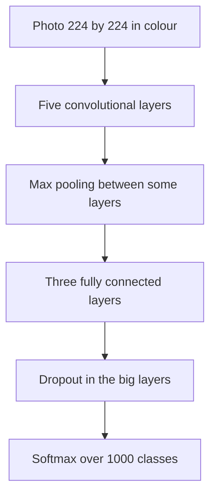

## The hook

Every year from 2010, the best computer vision teams in the world entered a contest: label a million photos into a thousand categories, from "golden retriever" to "container ship." Progress was steady and slow. A good year meant shaving a percentage point or two off the error.

In 2012, a team from the University of Toronto entered a neural network trained on two gaming graphics cards, reportedly in a student's bedroom. Its error was not a point or two lower than the competition. It was about **eleven** points lower. Researchers at the results workshop reportedly stared at the slide in disbelief. Within a couple of years, nearly every serious vision system in the world was a neural network.

## Before you start

You should know how convolutional networks work from [The Network That Read Your Cheques](article:paper-lenet). AlexNet is, in essence, LeNet's design scaled up by a factor of a thousand, plus a handful of crucial tricks.

## The world before this paper

In 2012, the best image recognition systems were pipelines. Engineers hand-designed feature detectors, with names like SIFT and HOG, that measured local edge directions and gradients. Those features were pooled into summaries and fed to a classifier, usually a [support vector machine](article:paper-support-vector-networks). Teams competed by tuning these pipelines carefully.

Neural networks were considered a niche. They had worked on small problems like handwritten digits, but on large, messy photos they were thought to be too slow to train, too prone to overfitting, and too finicky.

:::history
The missing ingredient was data. In 2009, Fei-Fei Li and colleagues released [[ImageNet]], a dataset of millions of photos labeled by crowd workers through Amazon Mechanical Turk. Its annual challenge used about 1.2 million training images in 1,000 categories, vastly more than earlier datasets. Many researchers thought it was a bit excessive. It turned out to be exactly what deep networks needed.
:::

Alex Krizhevsky, a graduate student in Geoffrey Hinton's group, had written very efficient code for running convolutional networks on [[GPU|GPUs]]. Ilya Sutskever, another student, was convinced that a big enough network trained on ImageNet would win.

## The big idea

AlexNet's idea was not a single new invention. It was a bet: **take the convolutional network, make it far bigger and deeper than anyone had dared, train it on a huge labeled dataset using GPUs, and use a set of tricks to keep it from overfitting.**

:::analogy
Think of LeNet as a talented local cook who could make a perfect small batch of one dish. AlexNet is the same cook, given an industrial kitchen (GPUs), a warehouse of ingredients (ImageNet) and a few professional techniques (ReLU, dropout, augmentation), and asked to cater a wedding for ten thousand guests. Same craft, radically different scale, and it turned out the craft got better, not worse, with scale.
:::

:::insight
Learned features beat hand-designed ones once there was enough data and compute. AlexNet was the moment the whole field saw it at once.
:::

## How it works

### The architecture

AlexNet had five convolutional layers and three fully connected layers, with about **60 million parameters** and 650,000 neurons. For comparison, LeNet-5 had about 60,000 parameters.

### Trick 1: ReLU

Instead of the sigmoid or tanh activations common at the time, AlexNet used [[ReLU]], $\max(0, z)$. Sigmoid-like functions flatten out for large inputs, so their slopes shrink and learning slows down. ReLU keeps a constant slope for all positive inputs. The paper showed that a network with ReLU reached a given training error several times faster than the same network with tanh.

### Trick 2: two GPUs

Each NVIDIA GTX 580 card had only 3 GB of memory, not enough for the whole network. So the authors split it across two GPUs, with half the neurons on each and communication between the cards only at certain layers. Training took about five to six days.

Why were gaming chips so good at this? Drawing a video game frame means computing the colour of millions of pixels, each with the same simple maths, all at once. A graphics card is built from thousands of small cores designed to do exactly that kind of parallel arithmetic. A convolutional layer is the same story: the same filter multiplied against thousands of image patches, independently. A CPU does a few complicated things very quickly; a GPU does thousands of simple things at the same time. Neural networks need the second.

### Trick 3: fighting overfitting

Sixty million parameters and 1.2 million images is a recipe for memorizing. Two defences made the difference:

- **[[Data augmentation]].** Each training image was randomly cropped and horizontally flipped, so the network rarely saw exactly the same picture twice. The colours were also randomly shifted a little. This multiplied the effective size of the training set.
- **[[Dropout]].** In the large fully connected layers, each neuron was switched off with probability 0.5 on every training step. This stopped neurons from relying on specific partners. The full idea is explained in [Dropout](article:paper-dropout).

### Trick 4: smaller details

The network also used overlapping max pooling, a normalisation step between some layers, and plain gradient descent with momentum. At test time, it averaged its predictions over several crops of each image.

## What they found

The headline is one of the most famous numbers in AI history. In the ImageNet Large Scale Visual Recognition Challenge 2012:

| Entry | [[Top-5 error]] |
|---|---|
| AlexNet (best submission) | about 15.3% |
| Second-best team | about 26.2% |

That gap of roughly eleven percentage points was enormous in a field used to fighting over fractions of a point.

The paper also showed what the network learned. The filters in the first layer had organised themselves into edge detectors at various angles and colour-blob detectors, strikingly similar to the hand-designed features that rival teams had spent years refining. When the authors looked at which training images were closest to a test image in the network's final layer, they found images that matched in meaning even when they looked quite different pixel by pixel.

:::try-this
Top-5 error lets the model make five guesses. Why might the contest use top-5 instead of just checking the single top guess? Think about a photo of a cat sitting on a laptop on a desk. (Many photos genuinely contain several objects, and some categories are very similar, like different dog breeds. Top-5 avoids punishing a model for a reasonable answer that differs from the one official label.)
:::

:::warning
Common misconception: "AlexNet invented convolutional networks" or "AlexNet invented GPU training." Both existed before. Its contribution was showing, at a scale and margin nobody could ignore, that the combination works on real-world images.
:::

## What it got wrong (or left open)

Some of AlexNet's design choices did not survive. The normalisation layer it used was dropped by later networks, which found it added little. The awkward split across two GPUs was a workaround for 2012 hardware, not a design principle.

The network was also hungry: it needed a million labeled images, and labeling is expensive. Many important problems, like rare diseases, do not come with a million examples. And it was a black box, accurate but hard to explain, which raised questions that the field is still working on.

Finally, depth was a puzzle. Eight learned layers worked well, but simply stacking many more layers made networks harder to train, a problem that took several more years to solve.

## What happened next

- Hinton, Krizhevsky and Sutskever formed a tiny company, DNNresearch, which Google acquired in 2013. Sutskever later co-founded OpenAI.
- Deeper networks followed quickly, helped by [Batch Normalization](article:paper-batch-normalization) and culminating in [ResNet](article:paper-resnet), which by 2015 surpassed reported human-level top-5 error on ImageNet.
- The recipe of big network, big data and GPUs spread from vision to speech and language, and eventually to [Transformers](article:paper-attention-is-all-you-need) and [GPT-3](article:paper-gpt-3).
- GPUs became the engine of AI, and NVIDIA, a company known for gaming chips, became one of the most valuable companies in the world.

## Key takeaways

- AlexNet scaled up the convolutional network to about 60 million parameters and trained it on 1.2 million ImageNet photos using two GPUs.
- It won the 2012 ImageNet challenge with a top-5 error of about 15.3%, roughly eleven points better than the runner-up.
- ReLU activations made training much faster, while data augmentation and dropout kept the large network from overfitting.
- Its learned first-layer filters resembled hand-designed edge and colour detectors, showing that features could be learned from data.
- The result convinced the field that deep learning, big data and GPUs were the way forward, launching the modern AI era.
