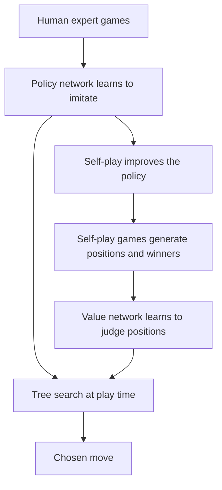

## The hook

In March 2016, in a hotel in Seoul, a board game was broadcast live to millions of viewers around the world. On one side sat Lee Sedol, one of the greatest Go players of his generation. On the other, a person placing stones on behalf of a program called AlphaGo.

In the second game, AlphaGo played its 37th move on a point so unusual that commentators assumed it was a mistake. It was not. AlphaGo won the match 4 games to 1. Experts had predicted that a computer would not beat a top professional at Go for at least another decade.

The paper describing how AlphaGo worked had appeared in Nature two months earlier, revealing that the program had already beaten the European champion, Fan Hui, 5 games to 0.

## Before you start

You need the basics of reinforcement learning and Q-values from [One Program, Forty-Nine Atari Games](article:paper-dqn), and an understanding of how convolutional networks read grid-like images, from [AlexNet](article:paper-alexnet). A Go board is a 19 by 19 grid, which turns out to look a lot like an image.

## The world before this paper

Go has simple rules. Two players take turns placing black and white stones on a 19 by 19 board, trying to surround territory. But its [[search space]] is mind-boggling. A typical position has about 250 legal moves, and a game lasts around 150 moves. The number of possible games dwarfs the number of atoms in the observable universe.

:::history
Chess fell to computers in 1997, when IBM's Deep Blue defeated Garry Kasparov using fast, deep search and a hand-tuned evaluation function. That approach failed for Go: there are too many moves to search, and nobody could write a good formula for who is winning, since Go strength depends on subtle, global judgements of "shape" and influence that even professionals describe as intuition. The best Go programs around 2015 used [[Monte Carlo tree search]] and reached strong amateur level, far below top professionals.
:::

David Silver had studied computer Go for his PhD. With Aja Huang, himself a strong Go player and programmer, and a large DeepMind team, he set out to give a computer the one thing it lacked: intuition.

## The big idea

Use deep neural networks to provide the intuition a human professional has, and combine them with search to provide careful calculation.

- A [[policy network]] looks at the board and suggests promising moves, cutting down the **breadth** of the search.
- A [[value network]] looks at a position and estimates who is winning, cutting down the **depth** of the search.
- Monte Carlo tree search ties them together, exploring the most promising lines more deeply.

:::analogy
Think of how a strong human player thinks. They do not consider all 250 moves; a glance tells them which three or four "look right." That is the policy network. They do not read every line to the end either; at some point they look at a position and feel "black is comfortably ahead." That is the value network. Then they spend their thinking time reading out the most critical variations. That is the search. AlphaGo combined all three, but with a speed and stamina no human has.
:::

:::insight
Learned intuition and explicit search are stronger together than either alone. Networks make the search smarter, and search corrects the networks' mistakes.
:::

## How it works

### Step 1: learn from human experts

The first policy network was trained with supervised learning on 30 million positions from games played by strong amateur players on the KGS online Go server. Given a board, it learned to predict the move the human actually played. It reached about 57% accuracy at predicting expert moves, far above earlier programs.

The board was fed in like an image: 19 by 19 grids marking black stones, white stones, empty points and some simple extra features, processed by a deep convolutional network.

### Step 2: improve by self-play

Copying humans only gets you to human level. So the policy network was then improved with reinforcement learning through [[self-play]]: it played games against earlier versions of itself, and each move's probability was nudged up if that game was won and down if it was lost. The reinforcement-learned policy won about 80% of its games against the original supervised version.

### Step 3: learn to judge positions

The value network was trained to predict the winner from a position, using 30 million positions from self-play games. The authors took just one position from each game, because consecutive positions in the same game are so similar that using them all made the network memorize game outcomes instead of learning to judge.

### Step 4: search, guided by the networks

At game time, AlphaGo runs Monte Carlo tree search. From the current position, it repeatedly walks down a tree of possible future moves, preferring moves that the policy network likes and that have led to good results so far. When it reaches a new position, it evaluates it in two ways and averages them: the value network's judgement, and the result of a fast [[rollout]], a quick game played to the end by a small, fast policy.

After thousands of these simulations, it plays the move that was explored most often, a robust signal of the move the search trusts.

### A worked example of the search balance

Suppose, after some simulations, three candidate moves have these statistics:

| Move | Times explored | Average win rate | Policy prior |
|---|---|---|---|
| A | 40 | 0.55 | 0.50 |
| B | 10 | 0.60 | 0.30 |
| C | 1 | 0.40 | 0.20 |

Move B has the best average so far but few visits, so the search keeps checking it to see if the result holds up. Move C looks weak but has barely been explored, so it gets an occasional bonus visit in case it is a hidden gem. The search balances exploiting what looks good against exploring what is uncertain, guided by the policy network's priors.

:::try-this
If move B keeps winning about 60% of its simulations as its visit count grows past 40, which move will AlphaGo eventually play, and why does it use visit counts rather than the single highest average? (It will play B. Visit counts are robust: a move only gets explored a lot if it keeps looking good, whereas a high average from a handful of visits might just be luck.)
:::

## What they found

- Against the strongest existing Go programs, AlphaGo won 494 out of 495 games.
- The distributed version, running on 1,202 CPUs and 176 GPUs, defeated European champion Fan Hui 5 games to 0 in October 2015, the first time a computer program had beaten a professional human Go player in an even game on a full-size board, without handicap.
- Combining the value network and rollouts gave stronger play than either evaluation method alone.
- Even without any search, the reinforcement-learned policy network alone beat a widely used open-source Go program in most games, showing how much knowledge the network had absorbed.

:::warning
Common misconception: "AlphaGo won by brute-force calculation, like Deep Blue." It actually evaluated far fewer positions than Deep Blue evaluated in chess, thousands of times fewer per second. Its strength came from evaluating positions more wisely, with learned judgement, not from searching more.
:::

## What it got wrong (or left open)

AlphaGo depended on a large set of human expert games to get started, and on a complex pipeline of several networks and handcrafted rollout features. It needed huge computing resources to play at its best.

It also showed blind spots. In the fourth game against Lee Sedol, Lee found a brilliant move, his famous move 78, that AlphaGo had judged very unlikely. The program misjudged the position for several moves afterwards and lost, a reminder that even superhuman systems can have unexpected weaknesses.

## What happened next

- AlphaGo defeated Lee Sedol 4 to 1 in March 2016, and in 2017 beat Ke Jie, then ranked number one in the world.
- AlphaGo Zero (2017) learned entirely from self-play, with no human games, and became even stronger. AlphaZero (2017 to 2018) used the same method to master chess and shogi as well.
- MuZero (2019 to 2020) learned to plan without even being told the rules of the game.
- Human Go changed too: professionals began studying AI moves, and once-unusual openings became mainstream. Lee Sedol retired in 2019, saying that AI had become an entity that could not be defeated.
- The ideas of self-play and search guided by learned judgement influenced later work on reasoning in language models, alongside policy-optimization methods like [PPO](article:paper-ppo).

## Key takeaways

- Go was considered a grand challenge because its enormous search space and subtle positional judgement defeated chess-style brute-force methods.
- AlphaGo used a policy network to suggest promising moves and a value network to judge positions, both deep convolutional networks.
- The policy was first trained on human expert games, then improved through self-play reinforcement learning.
- Monte Carlo tree search combined the networks' intuition with explicit look-ahead to choose moves.
- AlphaGo beat the European champion 5 to 0 and then Lee Sedol 4 to 1, and its successors learned to master games entirely from self-play.
