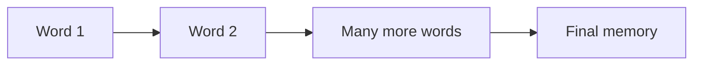
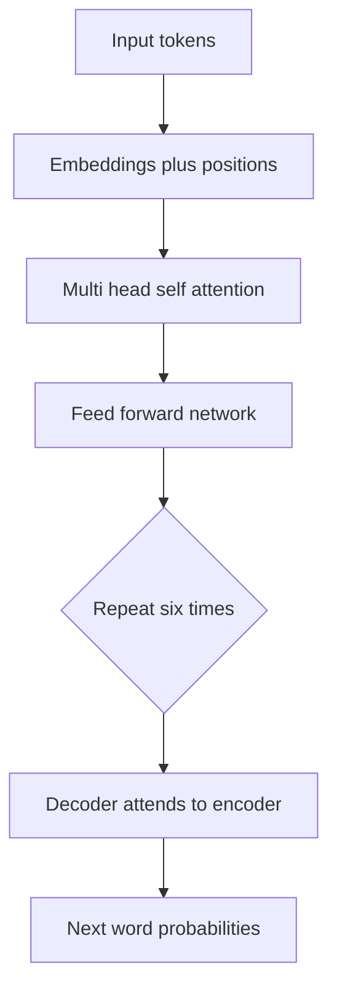

## The hook

In 2017, the best translation systems in the world read sentences the way you read a long receipt: one item at a time, struggling to remember what came at the top. Eight researchers at Google asked a strange question. What if the model could look at every word at once, and simply decide which ones matter?

Their answer fit in a fifteen-page paper with a cheeky title. Almost every AI system you have used since, from ChatGPT to Google Translate to image generators, is built on it.

## Before you start

You should be comfortable with how words become vectors, from [Embeddings](article:primer-embeddings). It also helps to have met the first attention mechanism in [Bahdanau attention](article:paper-bahdanau-attention), because this paper takes that idea and pushes it to its logical extreme.

## The world before this paper

In 2017, language models were built from [[Recurrent neural network|recurrent neural networks]] (RNNs), usually a sturdier variant called the LSTM. An RNN reads a sentence one [[token]] at a time. After each word, it updates a hidden "memory" vector and passes it on to the next step.

:::analogy
Think of an RNN as a game of telephone. The first person whispers a message to the second, who whispers it to the third, and so on down a long line. By the time the message reaches the end, details have faded or changed. The Transformer replaces the line with a **meeting room** where everyone can hear everyone directly, and each person decides who is worth listening to.
:::

This design had two painful problems.

**It was slow.** Step 5 cannot start until step 4 finishes. You cannot spread the work across thousands of GPU cores, because each step waits for the one before. Training on large datasets took a very long time.

**It forgot.** Information from the start of a long sentence had to survive many hand-offs to reach the end. Long-range connections, like matching "it" back to a noun twenty words earlier, were hard.

:::history
In 2014, Dzmitry Bahdanau and colleagues added an **attention** mechanism on top of RNNs: when producing each translated word, the decoder could look back at all the input words and weigh them. Translation quality jumped. But attention was still a helper bolted onto a recurrent backbone. The telephone line was still there.
:::

## The big idea

The Google team, including Ashish Vaswani, Noam Shazeer and Jakob Uszkoreit, made a bold bet: **throw away recurrence completely.** Keep only attention, and let every word attend to every other word in the same sentence. They called this [[self-attention]], and the architecture built from it the **Transformer**.

:::insight
Instead of passing a message down a line, let every word look directly at every other word and decide how much each one matters to it. Distance no longer hurts, and all words can be processed at the same time.
:::

That one change fixed both problems at once. Every word is processed in parallel, which suits GPUs perfectly. And any two words are just one step apart, no matter how far apart they sit in the sentence.

## How it works

### Questions, name tags and answers

Back in our meeting room, each word does three things. It asks a question, it wears a name tag, and it has something to say. In the paper, these are a [[Query, key and value|query, a key and a value]], three vectors computed from the word's embedding by multiplying it with three learned matrices.

- The **query** is the question: "What kind of information am I looking for?"
- The **key** is the name tag: "Here is what I can offer."
- The **value** is what the word actually says if someone listens.

To understand the word "it" in *"The animal didn't cross the street because it was too tired,"* the query for "it" is compared against every key. The key for "animal" matches well. The key for "street" matches poorly. So "it" mostly listens to "animal," and its new representation absorbs that meaning.

### The formula, one symbol at a time

The paper packs all of this into one line:

$$\text{Attention}(Q, K, V) = \text{softmax}\left(\frac{QK^\top}{\sqrt{d_k}}\right)V$$

Here is what each piece means:

- $Q$, $K$, $V$ are the queries, keys and values for all words, stacked into matrices.
- $QK^\top$ compares every query with every key using a dot product. A big dot product means "these two match."
- $\sqrt{d_k}$ is the square root of the key's length. Dividing by it keeps scores from getting so large that the softmax becomes extreme.
- [[Softmax]] turns each row of scores into weights that are positive and add up to 1.
- Multiplying by $V$ blends the values together using those weights.

### A worked example with real numbers

Let's shrink everything to two dimensions. Say the query for "it" is $q = [1, 0]$, and three words have these keys:

| Word | Key | Dot product with $q$ |
|---|---|---|
| animal | [2, 0] | 2 |
| street | [0, 2] | 0 |
| tired | [1, 1] | 1 |

Here $d_k = 2$, so we divide by $\sqrt{2} \approx 1.41$, giving scores of about 1.41, 0 and 0.71. Now apply softmax: $e^{1.41} \approx 4.1$, $e^{0} = 1$, $e^{0.71} \approx 2.0$. These add up to about 7.1, so the weights are roughly **0.58 for animal, 0.14 for street and 0.28 for tired**.

The new vector for "it" is 58% animal, 14% street and 28% tired. The model has worked out, using nothing but multiplication, that "it" refers mainly to the animal.

:::try-this
Change the key for "street" to [3, 0], so it now points in the same direction as the query. Before calculating anything, guess: which word wins the attention now? Then check with the dot products. (Street scores 3, animal scores 2, so street takes the biggest share.)
:::

### Many heads, many questions

One round of attention asks one kind of question. But words relate in many ways at once: grammar, meaning, who did what to whom. So the Transformer runs several attention operations side by side, each with its own query, key and value matrices. The paper's base model used 8 of these **heads**. One head might track which noun a pronoun refers to, while another tracks which verb goes with which subject.

### Remembering the order

There is a catch. Attention compares every word with every other word, but nothing in that process knows which word came first. "Dog bites man" and "man bites dog" would look the same. The fix is [[positional encoding]]: before anything else happens, each word's embedding gets a pattern of sine and cosine waves added to it, a unique fingerprint for each position.

### Stacking the blocks

A Transformer layer is attention followed by a small feed-forward network applied to each word separately, with some shortcut connections and normalization to keep training stable. The original model stacked six of these layers in an **encoder** that reads the source sentence, and six in a **decoder** that writes the translation, attending both to its own output so far and to the encoder.

## What they found

The team tested the Transformer on standard translation benchmarks, scored with [[BLEU]].

- On English-to-German, the big Transformer scored **28.4 BLEU**, beating the best previous results, including ensembles of several models, by more than 2 points.
- On English-to-French, it set a new single-model record.
- It got there with far less training. The big model trained for 3.5 days on eight GPUs, a small fraction of the compute used by the previous best systems. The base model trained in about 12 hours.

They also tried it on a completely different task, parsing the grammatical structure of English sentences, and it performed well there too. That was a hint that this was not just a translation trick, but a general-purpose design.

:::warning
Common misconception: the Transformer did not invent attention. Attention existed since 2014. The breakthrough was showing that attention alone, with no recurrence at all, was enough, and that it trained far faster.
:::

## What it got wrong (or left open)

Self-attention compares every word with every other word. For a sentence of $n$ tokens, that is $n \times n$ comparisons. Double the length, and the work quadruples. For sentences this was fine, but for whole books, long conversations or high-resolution images, the cost becomes a serious bottleneck.

The paper also focused on translation, with an encoder and a decoder working as a pair. It did not yet show what would happen if you took just one half, made it enormous and trained it on most of the internet. That discovery was still a year away.

Finally, the sine-wave positional encodings were a reasonable first guess, but later work found other ways to represent position that handle long inputs better.

## What happened next

The Transformer became the foundation of modern AI almost overnight.

- In 2018, OpenAI kept only the decoder and trained it to predict the next word on lots of text, creating [GPT](article:paper-gpt-1).
- The same year, Google kept only the encoder and trained it to fill in blanks, creating [BERT](article:paper-bert), which soon powered Google Search.
- Scaling the decoder up led to [GPT-3](article:paper-gpt-3) and, eventually, ChatGPT.
- In 2020, researchers chopped images into patches and fed them to a Transformer as if they were words, creating the [Vision Transformer](article:paper-vit).
- The $n^2$ cost problem inspired a whole line of systems work, including [FlashAttention](article:paper-flashattention), which makes exact attention much faster on real hardware.

Within a few years, every one of the eight authors had left Google, and several founded their own AI companies. Few papers have changed a field this quickly.

## Key takeaways

- The Transformer removed recurrence entirely and built a language model out of attention alone.
- Self-attention lets every token look directly at every other token, so distant words are only one step apart and all tokens can be processed in parallel.
- Each token produces a query, a key and a value; matching queries against keys decides how much each token listens to every other one.
- Positional encodings are needed because attention by itself has no sense of word order.
- The design trained faster and translated better than anything before it, and it became the base of GPT, BERT and nearly every modern AI model.
