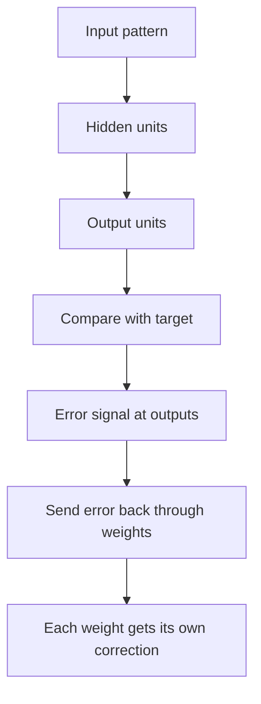

## The hook

By the early 1980s, neural networks were a career risk. Minsky and Papert's book had shown what single-layer perceptrons could not do, funding had dried up, and serious researchers were advised to work on something else.

Then, in October 1986, the journal Nature published a paper just four pages long. Its message was simple: if you give a network hidden layers and train them the right way, it will invent its own features, ones that nobody told it about. The winter began to thaw. One of its authors, Geoffrey Hinton, would later share the Turing Award and the Nobel Prize, in part for work that grew from this moment.

## Before you start

You need the intuition from [Backpropagation Without the Scary Math](article:primer-backprop-intuition): blame flows backward through the network using the chain rule. It also helps to remember from [The Machine That Learned From Its Mistakes](article:paper-perceptron) why single-layer networks hit a wall.

## The world before this paper

The perceptron could only learn straight-line boundaries. Everyone knew the fix in principle: add layers of [[hidden unit|hidden units]] between the input and the output. A network with hidden layers can carve curved boundaries and solve XOR easily.

The problem was training. For an output unit, you know the right answer, so you know which way to nudge its weights. But a hidden unit has no target. If the network gets something wrong, should a particular hidden unit have been more active or less? Nobody had a widely known, practical answer.

:::history
The mathematics needed was not brand new. Versions of the reverse-mode chain-rule calculation had been worked out independently in the 1960s and 1970s, including by Seppo Linnainmaa in 1970 and by Paul Werbos, whose 1974 PhD thesis proposed using it to train neural networks. Others, including David Parker and Yann LeCun, rediscovered it in the mid-1980s. What the 1986 paper did was demonstrate, clearly and convincingly, what hidden units trained this way actually learn.
:::

David Rumelhart, Geoffrey Hinton and Ronald Williams were part of a group, based largely at the University of California, San Diego, that believed intelligence could emerge from many simple connected units working in parallel. They needed a learning method to prove it.

## The big idea

Treat the whole network as one big function, measure the error at the output, and use the [[chain rule]] to compute how much every single weight, including those deep inside, contributed to that error. Then nudge every weight to reduce it. This is [[backpropagation]].

:::analogy
Think of a factory producing defective toys. Inspecting the final toy tells you it is wrong, but the defect could come from any station on the assembly line. Backpropagation is a quality-control trace that walks backward from the finished toy, station by station, working out exactly how much each station's settings contributed to the defect. Every station then gets a precise, personal adjustment, even the ones far from the end of the line.
:::

The paper's real headline was not the algorithm, though. It was what the algorithm produced. The hidden units, trained only to reduce output error, organised themselves into useful [[internal representation|internal representations]]: features that captured the hidden structure of the task.

:::insight
Backpropagation lets a network discover its own features. Instead of a human deciding what the hidden units should detect, the error signal shapes them into whatever detectors make the task easier.
:::

## How it works

### Forward, then backward

The procedure in the paper has two phases for each training case:

1. **Forward pass:** feed the input in, compute each layer's outputs in turn, and get the network's answer.
2. **Backward pass:** compare the answer to the target. Starting at the output, compute how sensitive the error is to each unit's activity, then pass those sensitivities back through the weights to the layer before, all the way to the first layer.

The units used a smooth S-shaped activation (the logistic sigmoid) rather than the perceptron's hard step. That smoothness matters: a hard step has no useful slope, so you cannot tell which direction to nudge. A smooth curve always has a slope.

### The error and the update

The paper measured error as the sum of squared differences between outputs and targets, the same squared error you met in [How Wrong Is the Model?](article:primer-loss-functions):

$$E = \frac{1}{2}\sum_{c}\sum_{j}(y_{j,c} - d_{j,c})^2$$

- $c$ runs over training cases and $j$ over output units.
- $y$ is what the network output and $d$ is the desired output.
- The $\frac{1}{2}$ just makes the slope formula tidier.

Each weight then moves a small step downhill: $\Delta w = -\varepsilon \frac{\partial E}{\partial w}$, where $\varepsilon$ is the learning rate. The authors also added [[momentum]]: each step carries along a fraction of the previous step, like a ball rolling downhill that does not stop dead at every small bump.

### What the hidden units learned

The most memorable demonstration used two family trees, one English and one Italian, each with 12 people. The network was trained on facts like "Colin's aunt is Jennifer." People were given as inputs with no description at all: each person was just an arbitrary on-off code.

After training, the researchers looked inside. Some hidden units had come to represent whether a person was English or Italian. Others encoded which generation they belonged to, or which branch of the family. Nobody had labeled nationality or generation. The network invented those features because they made the relationship facts easier to predict.

Another task asked the network to detect whether a row of binary inputs was symmetric about its centre. With just two hidden units, the network found an elegant solution using carefully balanced weights, one that the authors described in the paper.

:::try-this
Think about the family-tree network. If it had only been given English family facts, could it ever have learned a "nationality" feature? Why or why not? (No: a feature only emerges if it helps reduce the error. With one nationality, that feature carries no useful information, so nothing would push a hidden unit to encode it.)
:::

## What they found

- Multi-layer networks with hidden units could be trained effectively by gradient descent using backpropagated error signals.
- The hidden units developed meaningful internal representations that captured regularities of the task domain, without being told what to represent.
- Problems that single-layer perceptrons provably could not solve became learnable.

The paper appeared alongside a two-volume book, *Parallel Distributed Processing*, edited by Rumelhart and James McClelland, which gave many more examples. Together they relaunched neural network research under the name connectionism.

## What it got wrong (or left open)

The authors were candid about limits. Gradient descent on the error surface can get stuck in a [[local minimum]], though they observed that in their experiments this rarely caused serious trouble. They also stated plainly that the procedure was not a plausible model of how real brains learn.

Two practical problems loomed larger in the following years:

- **Vanishing gradients.** In networks with many layers, the error signal shrinks as it is multiplied backward, so early layers learn painfully slowly. Deep networks stayed hard to train for two more decades.
- **Data and compute.** The demonstrations were small. Larger problems needed far more data and computing power than existed in 1986, and for much of the 1990s, methods like [support vector machines](article:paper-support-vector-networks) often worked better in practice.

:::warning
Common misconception: "this paper invented backpropagation." It did not invent the underlying maths, which had been found several times before. Its contribution was showing, persuasively, that backpropagation in neural networks learns useful internal representations, and that message is what changed the field.
:::

## What happened next

- In 1989, Yann LeCun used backpropagation to train convolutional networks that read handwritten zip codes, leading to [LeNet](article:paper-lenet).
- [Long Short-Term Memory](article:paper-lstm) attacked the vanishing gradient problem for sequences.
- In 2006, [Hinton and Salakhutdinov](article:paper-deep-autoencoders) showed a way to train deeper networks, and in 2012, [AlexNet](article:paper-alexnet) made backpropagation on GPUs the dominant way to do AI.
- In 2018, Hinton, LeCun and Yoshua Bengio received the Turing Award for their work on deep learning, and in 2024 Hinton shared the Nobel Prize in Physics with John Hopfield for foundational work on neural networks.

## Key takeaways

- Before 1986, there was no widely known, practical way to train the hidden units of a multi-layer neural network.
- Backpropagation uses the chain rule to compute how much every weight contributes to the output error, so all layers can be trained with gradient descent.
- The paper's big message was that hidden units trained this way invent their own meaningful features, such as nationality and generation in the family-tree task.
- The authors admitted the method could hit local minima and was not a model of the brain, and deep networks stayed hard to train for years because of vanishing gradients.
- Nearly every neural network trained today, from image classifiers to large language models, still learns with backpropagation.
