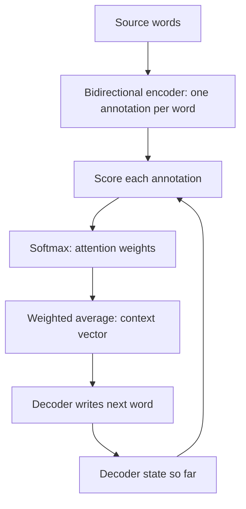

## The hook

In the summer of 2014, a young researcher visiting Yoshua Bengio's lab in Montreal was frustrated. The new neural translation systems squeezed every sentence, however long, into a single vector before translating it. That felt wrong. No human translator memorizes a whole sentence, closes the book, and then writes. They glance back at the source, again and again, focusing on whichever words they are translating at that moment.

So Dzmitry Bahdanau gave the network a way to glance back. The mechanism he built with Kyunghyun Cho and Bengio became known as **attention**. Three years later, a paper titled "Attention Is All You Need" took that idea and built the engine of modern AI out of nothing else.

## Before you start

You need the encoder-decoder design from [Read the Whole Sentence, Then Write the Translation](article:paper-seq2seq), and its weakness: everything squeezed through one fixed-size vector. Comfort with [embeddings](article:primer-embeddings) and the softmax from [Yes or No?](article:primer-classification) helps too.

## The world before this paper

Encoder-decoder networks had just shown that neural translation could work. But their quality dropped sharply as sentences got longer. A short sentence fits comfortably into a vector of a few thousand numbers. A 40-word sentence with clauses, names and numbers does not.

:::history
Bahdanau was a master's student from Jacobs University Bremen doing an internship in Montreal. Cho had just co-authored one of the first encoder-decoder translation papers, which also introduced a simpler recurrent unit, later called the GRU. Their experiments confirmed the bottleneck: the basic encoder-decoder's quality fell off steeply on long sentences. They posted their solution on arXiv in September 2014, almost simultaneously with the sequence-to-sequence paper from Google.
:::

Traditional statistical translation systems had a concept the neural systems lacked: [[alignment]], an explicit record of which source words correspond to which target words. Those systems learned alignments as a separate step. Bahdanau's idea was to let the neural network learn them **jointly** with translation, inside the same model, without any alignment labels.

## The big idea

Do not compress the source sentence into one vector. Keep a vector for **every** source word. Then, each time the decoder is about to produce a word, let it compute a fresh weighted average of all those vectors, putting most of the weight on the source words that matter for this particular output word.

:::analogy
Think of a student translating a paragraph with a highlighter in hand. Before writing each word of the translation, they sweep their eyes across the original, highlight the one or two words that matter most for this next word, and lightly mark a few others that give context. Then they write. For the next word, they wipe the highlights and do it again. The highlighting is [[attention]]: a fresh decision, at every step, about where to look.
:::

:::insight
Instead of remembering everything up front, a model can decide what to look at, step by step, based on what it needs right now. That shift from memory to retrieval is the core idea behind attention.
:::

## How it works

### Step 1: annotate every source word

The encoder is a [[bidirectional RNN]]. One recurrent network reads the sentence left to right; another reads it right to left. For each word, their two hidden states are joined into an [[annotation]]: a vector describing that word in the context of the whole sentence, both before and after it.

### Step 2: score each annotation

When the decoder is about to generate target word $i$, it looks at its own current state $s_{i-1}$, which summarises what it has written so far. A small neural network compares that state with each source annotation $h_j$ and outputs a score:

$$e_{ij} = a(s_{i-1}, h_j)$$

A high score means "this source word looks relevant for what I am about to write."

### Step 3: turn scores into weights

The scores go through a [[softmax]], producing weights that are positive and sum to 1:

$$\alpha_{ij} = \frac{\exp(e_{ij})}{\sum_k \exp(e_{ik})}$$

### Step 4: blend and write

The [[context vector]] for this step is the weighted average of the annotations:

$$c_i = \sum_j \alpha_{ij} h_j$$

The decoder uses $c_i$, together with its own state and the previous word, to choose the next target word. Then the whole process repeats for the next word, with a brand-new set of weights.

Everything here, including the little scoring network, is differentiable, so the whole system is trained end to end with backpropagation. Nobody tells it which words align. It discovers alignment because looking at the right words reduces the translation loss.

### A worked example

The decoder is translating "the green house" into French and is about to write the word for "house." Suppose the scores for the three source words come out as:

| Source word | Score $e$ | $\exp(e)$ | Weight $\alpha$ |
|---|---|---|---|
| the | 0.5 | 1.65 | 0.11 |
| green | 1.0 | 2.72 | 0.18 |
| house | 2.4 | 11.02 | 0.71 |

The weights come from dividing each $\exp(e)$ by their total, about 15.4. The context vector is 71% "house," 18% "green" and 11% "the." The decoder writes "maison."

For the next French word, "verte," the decoder's state has changed, so the scores change too, and most of the weight shifts to "green." French puts the adjective after the noun, and attention handles that reordering naturally.

:::try-this
Suppose, while writing "verte," the scores are 0.2 for "the," 2.5 for "green" and 1.0 for "house." Estimate the weights. ($e^{0.2} \approx 1.22$, $e^{2.5} \approx 12.18$, $e^{1.0} \approx 2.72$; total about 16.1. Weights: roughly 0.08, 0.76 and 0.17. Attention has moved to "green," exactly where a human would look.)
:::

## What they found

The model, which the authors called RNNsearch, was compared with a basic encoder-decoder (RNNencdec) on WMT 2014 English-to-French, each trained on sentences up to 30 words and up to 50 words.

- RNNsearch beat the basic encoder-decoder by a wide margin in BLEU score.
- Crucially, its quality **did not collapse on long sentences**. The basic model's score fell steeply as sentence length grew past about 20 to 30 words; RNNsearch-50 stayed strong even on sentences of 50 words and more.
- On sentences without unknown words, its performance was comparable to the established phrase-based system, Moses, which used extra monolingual data. For a single neural model at the time, that was remarkable.
- The attention weights, drawn as a grid of source words against target words, showed clean, sensible alignments. In one example, "European Economic Area" was correctly aligned to "zone économique européenne," with the order of the words reversed.

:::warning
Common misconception: "attention weights explain exactly why the model made its decision." They show where the model looked, which is often illuminating, but later research showed that attention weights are not always a faithful explanation of the model's reasoning. Treat them as a useful clue, not proof.
:::

## What it got wrong (or left open)

The model was still built on recurrent networks, which process words one after another. That made training slow, since each step had to wait for the previous one.

Attention also costs computation: for every target word, the decoder scores every source word. For sentences that is cheap, but it grows with the product of the two lengths.

And the vocabulary was limited to 30,000 words per language, so rare words became "unknown" tokens, a weakness that later sub-word tokenization methods fixed.

## What happened next

- Attention quickly became standard in neural translation. Google's 2016 neural translation system used LSTMs with attention.
- Attention spread to image captioning, where a model learned to look at different parts of a photo while writing each word of its caption, and to speech recognition.
- In 2017, the [Transformer](article:paper-attention-is-all-you-need) asked: what if attention is not a helper for an RNN, but the whole model? It replaced Bahdanau's small scoring network with a dot product between queries and keys, removed recurrence entirely, and the rest is history.
- Every large language model, from [GPT-3](article:paper-gpt-3) to modern chat assistants, runs on attention.

## Key takeaways

- Basic encoder-decoder translators squeezed whole sentences into one vector, and their quality fell sharply on long sentences.
- Bahdanau attention keeps a vector for every source word and, for each output word, computes a fresh weighted average focused on the most relevant source words.
- The weights come from scoring each source annotation against the decoder's current state, then applying a softmax.
- Trained end to end with no alignment labels, the model learned sensible word alignments, including reordering between languages.
- This mechanism became the seed of the Transformer and of every modern large language model.
