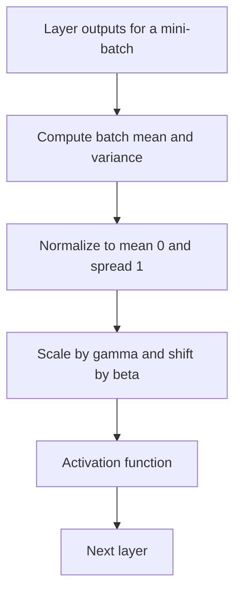

## The hook

In early 2015, two researchers at Google took one of the best image recognition networks in the world, added a few lines of arithmetic between its layers, and retrained it. The modified network reached the same accuracy as the original using **fourteen times fewer training steps**.

Weeks of computer time became days. Learning rates that used to blow training up became safe. And the trick was so simple that within a couple of years it was standard in nearly every convolutional network. It is called batch normalization.

## Before you start

You should know how deep networks are trained from [AlexNet](article:paper-alexnet), and the role of the learning rate from [Gradient Descent](article:primer-gradient-descent). Batch normalization is about making that downhill walk smoother and faster.

## The world before this paper

Training deep networks in 2014 was a delicate craft. Practitioners had to:

- choose small learning rates, because large ones made training diverge;
- initialise weights very carefully, or the network would never get going;
- avoid saturating activation functions like the sigmoid, whose slopes vanish when inputs get large.

Ioffe and Szegedy argued that a single underlying problem made all of this hard. Consider any layer in the middle of a network. Its inputs are the outputs of the layers below it. Every time those earlier layers update their weights, the distribution of numbers flowing into our layer changes: the average drifts, the spread grows or shrinks. The layer is trying to learn while the ground keeps shifting under its feet. They called this [[internal covariate shift]].

:::history
It was already well known that **inputs** to a network train better when they are normalized: subtract the average, divide by the spread. Researchers did this routinely to raw pixels or features. Christian Szegedy had also led the design of GoogLeNet (Inception), the winner of the 2014 ImageNet challenge. The new question was: what if you normalized the inputs of **every** layer, not just the first one, and did it inside the network during training?
:::

## The big idea

Insert a small [[normalization]] step before a layer's activation. For each feature, compute its [[mean]] and [[standard deviation]] over the current [[mini-batch]], and rescale it to mean 0 and spread 1. Then let the network apply a learned scale and shift, so it can still choose whatever range it actually prefers.

:::analogy
Think of a relay team where each runner hands a baton to the next. If one runner sometimes hands it over at shoulder height and sometimes at knee height, the next runner wastes effort adapting every time. Batch normalization is a rule that every handover happens at the same, standard height. Each runner can focus on running, not on chasing the baton. And if the team discovers a better handover height, they are allowed to agree on a new standard together.
:::

:::insight
Keeping the numbers flowing between layers in a consistent, standard range makes every layer's job easier, which lets the whole network learn faster with larger steps.
:::

## How it works

### The four lines

For one feature, with values $x_1, \dots, x_m$ across a mini-batch of $m$ examples:

$$\mu_B = \frac{1}{m}\sum_{i=1}^{m} x_i, \qquad \sigma_B^2 = \frac{1}{m}\sum_{i=1}^{m}(x_i - \mu_B)^2$$
$$\hat{x}_i = \frac{x_i - \mu_B}{\sqrt{\sigma_B^2 + \epsilon}}, \qquad y_i = \gamma\,\hat{x}_i + \beta$$

In plain words:

- $\mu_B$ is the batch mean of this feature, and $\sigma_B^2$ is its variance (the standard deviation squared).
- $\hat{x}_i$ is the normalized value: centred at 0 with a spread of 1. The tiny $\epsilon$ prevents dividing by zero.
- $\gamma$ (gamma) and $\beta$ (beta) are learned parameters, one pair per feature, that scale and shift the result.

Why learn $\gamma$ and $\beta$? Because forcing every feature to sit exactly at mean 0 and spread 1 might take away useful flexibility. If the best thing is to undo the normalization entirely, the network can learn $\gamma = \sigma_B$ and $\beta = \mu_B$ and get its original values back.

### A worked example

One feature takes these values across a mini-batch of four images: $2, 4, 6, 8$.

- Mean: $(2 + 4 + 6 + 8) / 4 = 5$.
- Variance: the squared distances from 5 are $9, 1, 1, 9$, averaging to $5$. Standard deviation: $\sqrt{5} \approx 2.24$.
- Normalized: $(2 - 5)/2.24 \approx -1.34$, and similarly $-0.45$, $0.45$, $1.34$.

Now suppose the network has learned $\gamma = 2$ and $\beta = 1$. The outputs become about $-1.68$, $0.11$, $1.89$ and $3.68$. Whatever the earlier layers did to the raw scale, this layer always hands on numbers in the range the network chose.

:::try-this
Suppose the earlier layers change during training and the same four images now produce $20, 40, 60, 80$ for this feature: everything ten times bigger. Normalize them. What do you notice? (You get exactly the same normalized values, $-1.34, -0.45, 0.45, 1.34$, because both the mean and the spread scaled by ten. The next layer sees no change at all. That is the stability batch norm buys.)
:::

### Training versus testing

During training, the statistics come from the current mini-batch. At test time, you might process a single image, which has no meaningful batch. So during training the layer also keeps a [[running average]] of each feature's mean and variance. At test time, it normalizes with those fixed averages. The network's behaviour on an input then no longer depends on what else happened to be in the batch.

### Where it goes

In convolutional networks, the paper normalized each feature map as a whole, sharing statistics across all spatial positions, so a feature is treated consistently wherever it appears in an image. The normalization step is placed between the convolution or fully connected computation and the activation function.

## What they found

The authors added batch normalization to an Inception network for ImageNet classification and tested several variants:

- With batch norm alone, the network reached the original network's accuracy in **14 times fewer training steps**.
- Batch norm made much higher learning rates safe. With a learning rate five times larger, and other small changes, training was faster still.
- It made networks with saturating sigmoid activations trainable, which had been very difficult before.
- It acted as a regularizer. Each example's normalized value depends a little on the other examples in its batch, which adds noise, and in some cases this reduced or removed the need for [dropout](article:paper-dropout).
- An ensemble of batch-normalized networks achieved a top-5 error of about 4.9% on the ImageNet validation set, which the authors reported as exceeding the accuracy of human raters.

:::warning
Common misconception: "we know exactly why batch norm works: it removes internal covariate shift." The method clearly works, but in 2018 researchers at MIT (Santurkar and colleagues) published experiments suggesting that reducing internal covariate shift is not the main reason. They argued that batch norm makes the loss landscape smoother, so gradients are more reliable and larger steps are safe. The practical benefits are well established; the full explanation is still debated.
:::

## What it got wrong (or left open)

Batch normalization depends on the batch. That causes several headaches:

- **Small batches.** With only two or four examples per batch, the mean and variance estimates are noisy and performance drops. This matters for large images or video, where memory limits batch size.
- **Train and test mismatch.** Training uses batch statistics while testing uses running averages, and subtle bugs often come from that difference.
- **Sequences.** In recurrent networks and language models, each position in a sequence has different statistics, and batch norm fits awkwardly.

These problems led directly to alternatives that normalize within a single example instead of across a batch. Layer normalization (2016), co-authored by Jimmy Ba of [Adam](article:paper-adam), normalizes across the features of each example and became the standard in Transformers. Group normalization (2018) helped vision models trained with small batches.

## What happened next

- Batch norm became a standard component of convolutional networks almost overnight, including [ResNet](article:paper-resnet) later that same year, which used it after nearly every convolution.
- The same team used it in later versions of the Inception architecture.
- Layer normalization took over in [Transformers](article:paper-attention-is-all-you-need) and all large language models, keeping the core idea, standardize the numbers between layers, without depending on the batch.
- The paper sparked a long line of research into why normalization helps, which deepened understanding of how optimization in deep networks works.

## Key takeaways

- Batch normalization standardizes each feature to mean 0 and spread 1 using the mini-batch's statistics, then applies a learned scale and shift.
- It lets networks train with much higher learning rates and less careful initialization, reaching the same accuracy in far fewer steps.
- At test time it uses running averages of the statistics collected during training, so predictions do not depend on the batch.
- The paper's explanation, reducing internal covariate shift, has been challenged; a smoother loss landscape is a leading alternative explanation.
- Its dependence on batch size led to layer normalization, which became the standard in Transformers.
