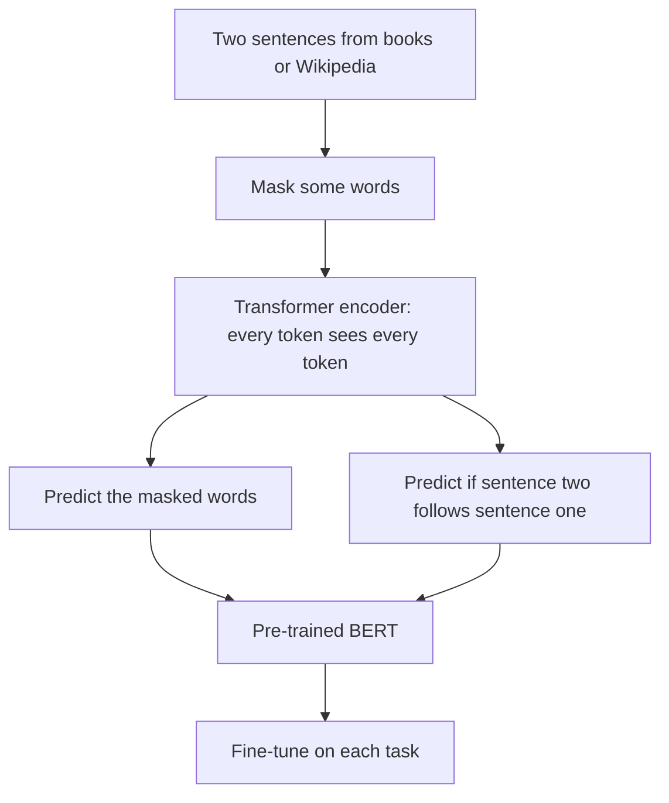

## The hook

Try this: "I went to the ___ to deposit my salary." You filled the gap with "bank" instantly. But notice how you did it. You used "went to the" on the left **and** "deposit my salary" on the right. Without the right side, the blank could be "market," "gym" or "beach."

In October 2018, a team at Google published a model built around that simple observation: to understand a word, look at both sides of it. They called it BERT. It shattered records on eleven language benchmarks at once, and a year later Google announced it was using BERT in Search, calling it one of the biggest leaps forward in the history of the product.

## Before you start

You should know the Transformer, especially self-attention and the encoder, from [The Paper That Taught Machines Where to Look](article:paper-attention-is-all-you-need). It also helps to know the pre-train then fine-tune recipe from [GPT-1](article:paper-gpt-1), which BERT adopted and challenged.

## The world before this paper

By mid-2018, the idea of pre-training on unlabeled text had arrived. ELMo produced word representations from two LSTMs, one reading forwards and one backwards, glued together. OpenAI's GPT pre-trained a Transformer to predict the next word, then fine-tuned it on tasks.

Both had a limitation. GPT read strictly left to right: when processing a word, it could only see the words before it. ELMo looked both ways, but each direction was trained separately, and the two were only combined at the end, shallowly.

:::history
Jacob Devlin, Ming-Wei Chang, Kenton Lee and Kristina Toutanova were at Google AI Language. The team released the code and pre-trained models openly, which helped BERT spread through research and industry at remarkable speed. The name is a backronym for Bidirectional Encoder Representations from Transformers, and a playful nod to ELMo, since both names come from Sesame Street characters.
:::

The obvious fix, train a Transformer [[encoder]] where every word sees every other word, ran into a problem. If you train it to predict the next word, each word can simply look ahead and see the answer.

## The big idea

Change the game. Instead of predicting the next word, hide some words in the middle of the sentence and train the model to fill them in, using everything around them. This is the [[masked language model]], and it lets the model be deeply [[bidirectional]] at every layer.

:::analogy
Think of the cloze tests from school: a paragraph with words blanked out, where you must fill each gap. To do well, you have to understand the whole passage, not just read left to right. BERT spent its pre-training doing millions of cloze tests on Wikipedia and books, and became a remarkably good reader.
:::

:::insight
Hiding words and asking the model to recover them lets it use context from both sides at once, which produces much richer representations for understanding tasks than reading in one direction.
:::

## How it works

### The architecture

BERT is a stack of Transformer encoder layers. The paper released two sizes:

| Model | Layers | Hidden size | Attention heads | Parameters |
|---|---|---|---|---|
| BERT-Base | 12 | 768 | 12 | about 110 million |
| BERT-Large | 24 | 1024 | 16 | about 340 million |

BERT-Base was deliberately the same size as GPT to allow a fair comparison. Text was split into word pieces from a 30,000-token vocabulary, and every input began with a special [CLS] token whose final vector summarizes the whole input for classification. A [SEP] token separates two sentences.

### Pre-training task 1: masked words

For each training sentence, 15% of the tokens are chosen as prediction targets. Of those:

- 80% are replaced with a special [MASK] token,
- 10% are replaced with a random word,
- 10% are left unchanged.

The model must predict the original word at each chosen position. The mixed strategy matters: during fine-tuning, the [MASK] token never appears, so always using [MASK] would create a mismatch. Random and unchanged tokens force the model to keep a good representation of **every** word, since it never knows which ones it will be asked about.

### Pre-training task 2: does this sentence follow?

The second task, [[next sentence prediction]], feeds the model two sentences. Half the time the second really follows the first; half the time it is a random sentence from elsewhere. The model predicts which, using the [CLS] vector. The goal was to teach relationships between sentences, which matter for question answering and inference.

The pre-training data was BooksCorpus (about 800 million words) plus English Wikipedia (about 2.5 billion words).

### A worked example

Input: "The [MASK] barked at the postman all morning."

The model produces a probability for every word in its vocabulary at the masked position. Suppose it gives "dog" 0.85, "puppy" 0.06 and "neighbour" 0.01. The loss here is $-\log 0.85 \approx 0.16$, small, because the model got it right. Notice that "barked" (to the right) is what made "dog" so likely. A left-to-right model, seeing only "The," could not have known.

:::try-this
Mask a different word: "The dog barked at the [MASK] all morning." Which words on the left and right would BERT use to guess? What might it predict? (It might predict "postman," "mailman," "cat" or "stranger." "Barked at" suggests a target that a dog reacts to; "all morning" suggests something that stayed around. Both sides help.)
:::

### Contextual embeddings

The vectors BERT produces at its top layer are [[contextual embedding|contextual embeddings]]. Unlike a [word2vec](article:paper-word2vec) vector, which is the same for "bank" everywhere, BERT's vector for "bank" in "she sat on the river bank" differs from its vector in "the bank approved the loan," because attention mixes in the surrounding words at every layer. That single change, word meaning that depends on context, is a big part of why BERT helped so much on search queries, where short phrases are often ambiguous.

### Fine-tuning

For each task, add one small output layer and fine-tune all the weights briefly. Classification uses the [CLS] vector. For question answering on SQuAD, the question and a passage are fed together, and the model learns to point at the start and end of the answer span in the passage. The paper reported that every fine-tuning result could be reproduced in at most an hour on a single Cloud TPU, or a few hours on a GPU.

## What they found

BERT set new state-of-the-art results on eleven language tasks. Some headline numbers from the paper:

- The GLUE benchmark score rose to 80.5, a 7.7 point absolute improvement.
- Accuracy on MultiNLI, a textual entailment task, reached 86.7%, up 4.6 points.
- On the SQuAD v1.1 question answering test, the F1 score reached 93.2, and on the harder SQuAD v2.0, 83.1, gains of 1.5 and 5.1 points.

Ablation experiments showed that bidirectionality mattered: a left-to-right version of BERT did clearly worse. Bigger was better: BERT-Large beat BERT-Base on every task, even small ones.

:::warning
Common misconception: "BERT is a chatbot or text generator like GPT." BERT is an encoder: it is excellent at understanding and representing text, for classification, search and extracting answers, but it is not designed to write long passages. GPT-style decoders generate; BERT-style encoders understand.
:::

## What it got wrong (or left open)

Later work found that next sentence prediction was not really pulling its weight. In 2019, Facebook's RoBERTa removed it, trained longer on more data with larger batches, and beat BERT, suggesting BERT had been significantly undertrained.

The [MASK] token creates a mismatch between pre-training and real use, which the 80/10/10 trick only softens. Predicting only 15% of tokens per sentence also makes pre-training less efficient than predicting every token.

And BERT could not generate fluent text, so it could not do the open-ended tasks that larger GPT models later handled from a simple prompt.

## What happened next

- In 2019, Google began using BERT in Search, reporting that it affected about one in ten English queries in the US.
- A family of variants followed: RoBERTa, DistilBERT (smaller and faster), ALBERT, and many domain-specific versions for biology, law and finance.
- BERT-style encoders became the workhorses of search, classification and retrieval, including the retrievers in [Retrieval-Augmented Generation](article:paper-rag).
- The [Vision Transformer](article:paper-vit) borrowed BERT's [CLS] token idea for images.
- In the longer run, scaled-up decoder models like [GPT-3](article:paper-gpt-3) showed that generation could handle understanding tasks too, and decoders became dominant for general assistants.

## Key takeaways

- BERT pre-trains a Transformer encoder to be deeply bidirectional, using context from both sides of every word.
- Its masked language model hides 15% of tokens and trains the model to recover them, with an 80/10/10 mix to avoid relying on the [MASK] token.
- A second task, next sentence prediction, aimed to teach relationships between sentences, though later work found it unnecessary.
- Fine-tuning with one small output layer set new records on eleven benchmarks, including large gains on GLUE and SQuAD.
- BERT produced contextual embeddings that transformed search and language understanding, and it went into Google Search in 2019.
