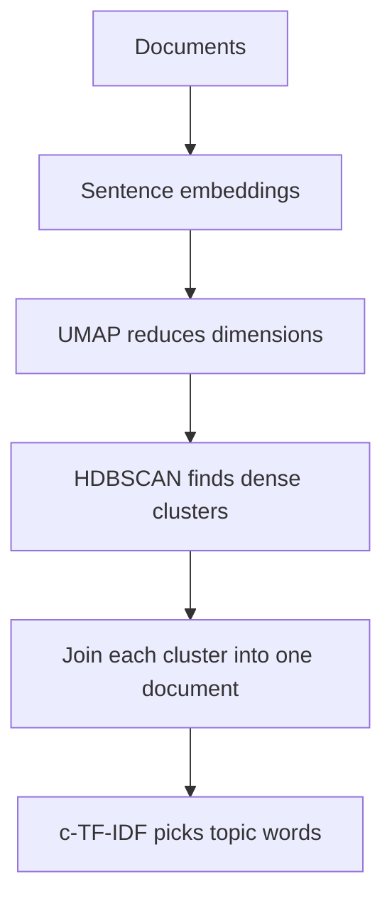

## The hook

A company receives fifty thousand customer complaints a month. Nobody can read them all, but everybody wants to know: what are people actually complaining about? Delivery delays? Refunds? A broken app update?

Finding the themes in a pile of text without labels is called topic modelling. For two decades the standard tools counted words and treated "late" and "delayed" as unrelated. BERTopic, released by Maarten Grootendorst and described in a 2022 paper, starts instead from what each document means.

## Before you start

You should know what an embedding is from [Embeddings: How Words Become Numbers With Meaning](article:primer-embeddings). It helps to know that models like [BERT](article:paper-bert) produce context-aware vectors for text, and that similar meanings land close together.

## The world before this paper

The classic [[topic model]] was Latent Dirichlet Allocation (LDA), from 2003. It treats each document as a bag of words, assumes each document mixes a few topics, and learns which words go with which topic from word co-occurrence counts.

LDA works, but it has blind spots. It ignores word order and meaning, so synonyms look unrelated. It needs careful text cleaning. And on short texts like tweets, there are too few words per document for the counts to say much.

Meanwhile, [[sentence embedding]]s from transformer models had become good at placing similar texts near each other. Some methods, such as Top2Vec, had begun clustering embeddings to find topics.

:::history
Maarten Grootendorst, a data scientist, built BERTopic as an open-source Python library first; it was already widely used before the paper appeared on arXiv in March 2022. The paper describes the method's design and compares it with LDA, NMF, Top2Vec and a neural topic model called CTM.
:::

## The big idea

:::analogy
Imagine sorting a huge pile of letters in a post room. First you read each letter and place it on a big map of the room, putting letters about similar things close together. Then you look for crowded spots on the floor and tie each crowd into a bundle, leaving stray letters aside. Finally, for each bundle, you write a label by picking the words that show up a lot in that bundle but rarely in the others.
:::

BERTopic's big idea is to separate "which documents belong together" from "what words describe them". Grouping uses meaning, through embeddings and clustering. Naming uses words, through a cluster-level version of [[TF-IDF]]. Each step uses the right tool for its job, and any step can be swapped out.

## How it works

BERTopic runs four steps.

1. **Embed.** Turn each document into a sentence embedding with a pre-trained model, by default a Sentence-BERT model.
2. **Reduce.** Squeeze the embeddings into a handful of dimensions with UMAP, a [[dimensionality reduction]] method that keeps nearby points nearby. Clustering works much better in a few dimensions than in hundreds.
3. **Cluster.** Group the points with HDBSCAN, a [[density-based clustering]] method. It finds dense regions of any shape and labels scattered documents as outliers instead of forcing them into a topic.
4. **Describe.** Join all documents in each cluster into one long document and score words with [[c-TF-IDF]].

### c-TF-IDF in plain words

For word t in cluster c, the paper uses

$$W_{t,c} = \text{tf}_{t,c} \cdot \log\left(1 + \frac{A}{\text{tf}_t}\right)$$

- $\text{tf}_{t,c}$ is how often word t appears in cluster c's joined document.
- $\text{tf}_t$ is how often t appears across all clusters.
- $A$ is the average number of words per cluster.

A word scores high when it is common in this cluster but not common everywhere. In the post room, that is the word you would write on the bundle's label.

### A tiny example

Two clusters of complaints, about 100 words each, so A = 100.

| Word | Count in cluster 1 (delivery) | Count in all clusters | Score for cluster 1 |
|---|---|---|---|
| "late" | 8 | 9 | 8 × log(1 + 100/9) ≈ 8 × 2.49 ≈ 19.9 |
| "refund" | 1 | 10 | 1 × log(1 + 10) ≈ 2.40 |
| "the" | 9 | 18 | 9 × log(1 + 100/18) ≈ 9 × 1.88 ≈ 16.9 |

"late" tops cluster 1. In practice, common words like "the" are removed first, which is why BERTopic lets you set stop words and other options for the word-counting step.

:::try-this
Compute the score of "refund" for a second cluster where it appears 9 times, with the same totals (10 overall, A = 100). (9 × log(1 + 100/10) = 9 × log(11) ≈ 9 × 2.40 ≈ 21.6, so "refund" labels the second cluster.)
:::

:::insight
Grouping by meaning and naming by words are different problems. Embeddings are good at the first and poor at producing readable labels; word statistics are the reverse. BERTopic gets readable topics by letting each tool do only what it is good at.
:::

### How many topics?

Unlike LDA, BERTopic does not ask you for the number of topics up front. HDBSCAN decides how many dense regions exist, guided mainly by a minimum cluster size: small values give many fine-grained topics, large values give a few broad ones. Documents that fall in no dense region get the outlier label −1, which is honest but can be a large share of a messy dataset; the library offers ways to reassign outliers to their nearest topic afterwards. If there are still too many topics, similar ones can be merged by comparing their c-TF-IDF vectors and joining the closest pairs. In the post-room picture, that is tying two nearly identical bundles into one and rewriting the label.

### Topics over time

The same machinery supports dynamic topic modelling. Cluster all documents once, then compute c-TF-IDF separately for each time period. You see the same topic's keywords shift, for example how complaints about an app change after an update.

## What they found

- **Coherent and diverse topics.** On datasets such as 20 Newsgroups, BBC News and a collection of tweets, BERTopic produced topics with high coherence (their words tend to appear together) and good diversity (topics do not repeat each other), competitive with or better than LDA, NMF, Top2Vec and CTM in the paper's comparisons.
- **Stable across embedding models.** Results held up with different sentence-embedding models, which supports the modular design.
- **Useful dynamic topics.** The time-sliced representation captured how topics evolved in datasets with timestamps.

:::warning
Common misconception: "BERTopic understands the topics it finds." It groups documents with similar embeddings and labels them with frequent distinctive words. A human still has to read the clusters and decide whether they are meaningful, and the results depend on the embedding model and clustering settings.
:::

### When to choose it

BERTopic shines on short or messy texts, such as reviews, support tickets and social media posts, where word counts are too sparse for LDA. It is also a good first look at an unfamiliar collection: a few minutes of clustering shows the main themes and the strange outliers. For long documents that genuinely mix many themes, a mixture model like LDA, or splitting documents into paragraphs first, can be a better fit.

## What it got wrong (or left open)

- **One topic per document.** Clustering assigns each document to a single group, though real documents often mix themes. The paper acknowledges this.
- **Bag-of-words labels.** c-TF-IDF ignores word order, so topic words can be redundant, such as several forms of the same word.
- **Disconnected steps.** Embeddings and topic words are computed separately, so the words describing a topic are not guaranteed to reflect what the embedding model actually grouped on.
- **Sensitive settings.** Outlier counts and topic numbers depend on UMAP and HDBSCAN parameters.

## What happened next

The open-source BERTopic library became one of the most widely used topic modelling tools in research and industry. Later versions added ways to refine topic labels, including using large language models to write a short human-readable name for each cluster from its keywords and example documents.

More broadly, the pattern of embedding text, clustering, and then summarising each cluster has become a standard way to explore large text collections, now often using embeddings from the same kinds of models described in [Language Models are Few-Shot Learners](article:paper-gpt-3).

## Key takeaways

- BERTopic finds themes in unlabelled text by embedding documents, reducing dimensions, clustering by density and describing each cluster with c-TF-IDF.
- Embeddings group documents by meaning, so synonyms and short texts are handled better than by pure word counting.
- c-TF-IDF treats each cluster as one document to find words that are common there but rare elsewhere, giving readable topic labels.
- Its modular design lets each step be swapped, and it supports topics that change over time.
- It assigns one topic per document and depends on clustering settings, so human review of the topics remains essential.
