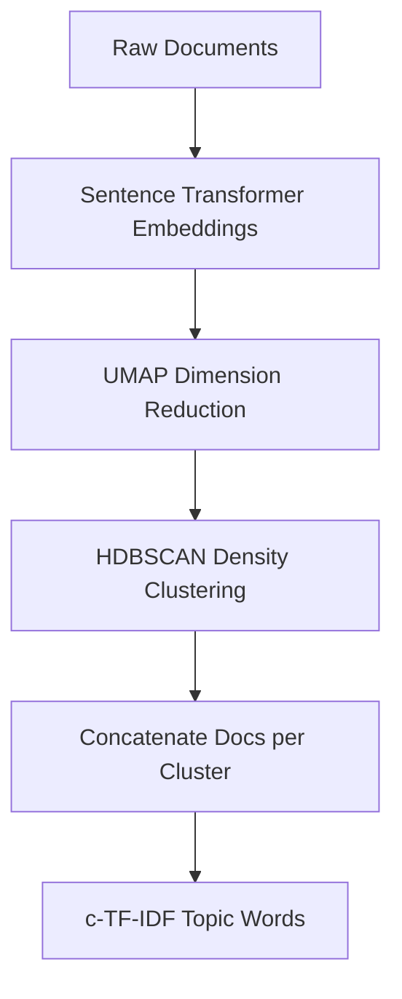

## The hook

Suppose you are handed forty thousand raw customer reviews, support tickets, or political tweets. Your boss asks a simple question: what are people actually talking about? 

For twenty years, the standard answer was Latent Dirichlet Allocation (LDA). You treated every document as an unordered bag of words, threw away sentence structure, ignored context, and hoped the statistical dice rolled in your favor. 

If someone wrote "the battery died after two days" versus "the band had an energetic battery of drummers", LDA saw identical words. 

Maarten Grootendorst changed this by uniting modern transformer representations with a surprisingly simple statistical tweak. The result was BERTopic, a system that quickly became one of the most widely used topic modeling algorithms in data science.

## Before you start

Before jumping in, make sure you are comfortable with:
- How text turns into vector representations in [our guide to embeddings](article:primer-embeddings).
- How bidirectional self-attention captures contextual word meaning in [the BERT paper](article:paper-bert).

## The world before this paper

Topic modeling belongs to unsupervised machine learning. You do not have human labels; you only have text, and you want to discover the themes hidden inside.

The classical workhorse was LDA, introduced in 2003. LDA imagines that every document is a blend of topics, and each topic is a probability distribution over a vocabulary. 

While LDA is mathematically elegant, it relies on the bag-of-words assumption. It strips away grammar, context, and word order. On short texts like social media posts, LDA routinely falls apart because a tweet only contains ten or fifteen words. There simply are not enough word co-occurrences for LDA to infer reliable topics.

:::history
When transformers took over natural language processing in 2018, researchers naturally tried applying contextual embeddings to topic discovery. Models like Top2Vec emerged. Top2Vec embedded both words and documents, clustered the documents, and found topic words by picking the vocabulary vectors physically closest to each cluster's center (its centroid).

Maarten Grootendorst, an NLP data scientist building practical applications, ran into a quiet flaw in that strategy. Centroid-based word matching assumes that clusters are tidy, spherical balls in vector space. Real language data is not spherical. Real document clusters form winding ribbons, dense bends, and irregular shapes. Picking words near the center often yielded nonsense or missed the defining vocabulary of the cluster entirely.
:::

At the same time, end-to-end neural topic models like CTM (Contextualized Topic Models) tried training deep generative networks to link BERT embeddings with topic distributions. They produced good results, but they were notoriously slow to train, tricky to tune, and demanded heavy compute.

The community faced an awkward dilemma. You could have classical models that ran fast but ignored context, or neural models that were either rigid or sluggish.

## The big idea

Grootendorst realized that topic modeling does not need to be a single, monolithic mathematical model. You can decouple the problem into three clean, modular stages:

1. **Understand:** Turn documents into contextual vectors using pre-trained sentence transformers.
2. **Cluster:** Group similar documents together based on their geometric density, pushing weird documents aside as noise.
3. **Describe:** Extract the most distinctive words for each cluster using an adapted version of classical term-weighting.

The breakthrough was in stage three: an algorithm Grootendorst named `[[c-TF-IDF]]` (class-based Term Frequency-Inverse Document Frequency).

:::analogy
Imagine organizing a chaotic archive of fifty thousand mixed documents. 

First, an expert reader places every document onto a vast floor map. Documents with similar themes land near each other, regardless of whether they share the exact same words.

Next, an organizer walks the floor, spots tight clusters of papers, draws chalk circles around them, and shuffles offbeat oddities into an "unclassified" pile.

Finally, to create a label for each pile, you staple all the documents in that pile into one giant mega-book. You run a quick count: which words appear frequently inside this mega-book, yet stay surprisingly rare across the rest of the library? Those standout words become the title of your topic.
:::



## How it works

Let us walk through each step of the pipeline.

### Step 1: Contextual document embeddings

BERTopic begins by embedding each document into a continuous vector space using Sentence-BERT (SBERT). 

Unlike earlier static embeddings like [Word2Vec](article:paper-word2vec), SBERT processes entire sentences through deep self-attention layers. Polysemous words receive different vectors depending on their sentence context. 

Because BERTopic treats the embedding step as an interchangeable module, you can plug in any embedding model: MPNet, MiniLM, multilingual encoders, or domain-specific biomedical models.

### Step 2: Dimensionality reduction with UMAP

Transformer embeddings typically contain between 384 and 768 dimensions. In such high-dimensional spaces, machine learning algorithms hit the *curse of dimensionality*: the distance from any point to its nearest neighbor approaches the distance to its farthest neighbor. 

Distances lose their discriminative power, making density-based clustering unreliable.

To solve this, BERTopic applies `[[UMAP]]` (Uniform Manifold Approximation and Projection). UMAP reduces vectors down to a manageable size (typically 5 dimensions) while preserving both the local neighborhoods and global trajectory of the data manifold.

### Step 3: Density-based clustering with HDBSCAN

With embeddings compressed into 5 dimensions, BERTopic clusters them using `[[HDBSCAN]]` (Hierarchical Density-Based Spatial Clustering of Applications with Noise).

HDBSCAN brings two enormous benefits over traditional algorithms like k-Means:
1. **Arbitrary shapes:** It detects clusters of any geometric shape, from bends to branches, rather than forcing everything into spheres.
2. **Noise awareness:** It does not force every document into a topic. Irrelevant, junk, or outlier documents receive a label of `-1` (noise). Keeping noise out stops garbage text from polluting coherent topics.

### Step 4: Class-based TF-IDF (c-TF-IDF)

Now you have clusters of documents, but you do not know what words describe them. 

Earlier methods tried finding words whose embeddings sat nearest the cluster centroid. As we saw, that fails on non-spherical clusters. 

Grootendorst took a different path: treat each discovered cluster $c$ as a single giant document formed by concatenating all texts assigned to that cluster.

In classical TF-IDF, a word's score measures how frequently it appears in document $d$ relative to how many documents across the corpus contain it:

$$W_{t, d} = \mathrm{tf}_{t, d} \cdot \log\left(\frac{N}{\mathrm{df}_t}\right)$$

Where:
- $\mathrm{tf}_{t, d}$ is the raw count of term $t$ in document $d$.
- $N$ is the total count of documents in the collection.
- $\mathrm{df}_t$ is the number of documents containing term $t$.

Grootendorst adapted this formula from individual documents to clusters (classes):

$$W_{t, c} = \mathrm{tf}_{t, c} \cdot \log\left(1 + \frac{A}{\mathrm{tf}_t}\right)$$

Let us break down every piece of this equation:
- $W_{t, c}$: The importance score of term $t$ for cluster $c$.
- $\mathrm{tf}_{t, c}$: How many times term $t$ appears across all concatenated text in cluster $c$.
- $A$: The average word count across all clusters ($\frac{\text{total words in all clusters}}{\text{number of clusters}}$).
- $\mathrm{tf}_t$: The total frequency of term $t$ across the entire dataset.
- $\log(1 + \dots)$: Adding 1 ensures the value inside the logarithm is always greater than or equal to 1, preventing negative weights.

:::insight
Instead of asking "which words are geometrically closest to the center of this vector blob?", c-TF-IDF asks "which words are uniquely concentrated in this cluster compared to all other clusters?"
:::

Let us work through a tiny numerical example.

Suppose we have 2 clusters ($C_1$ and $C_2$). Each cluster contains 500 total words. 

The average cluster length $A$ is:

$$A = \frac{500 + 500}{2} = 500$$

Now consider two words inside Cluster 1:
- The word **"battery"** appears 40 times in $C_1$ and 10 times in $C_2$. Its total frequency $\mathrm{tf}_{\text{battery}} = 50$.
- The common word **"the"** appears 50 times in $C_1$ and 150 times in $C_2$. Its total frequency $\mathrm{tf}_{\text{the}} = 200$.

Let us calculate their `[[c-TF-IDF]]` weights for Cluster 1 using the natural log:

For **"battery"**:
$$\frac{A}{\mathrm{tf}_{\text{battery}}} = \frac{500}{50} = 10$$
$$W_{\text{battery}, C_1} = 40 \cdot \ln(1 + 10) = 40 \cdot \ln(11) \approx 40 \cdot 2.398 = 95.92$$

For **"the"**:
$$\frac{A}{\mathrm{tf}_{\text{the}}} = \frac{500}{200} = 2.5$$
$$W_{\text{the}, C_1} = 50 \cdot \ln(1 + 2.5) = 50 \cdot \ln(3.5) \approx 50 \cdot 1.253 = 62.65$$

Even though "the" appeared 50 times in Cluster 1, its heavy use everywhere else penalized its score. "Battery", which is concentrated in Cluster 1, easily wins the top spot.

:::try-this
Suppose a niche word "carburetor" appears 15 times in Cluster 1 and nowhere else in the entire dataset ($\mathrm{tf}_{\text{carburetor}} = 15$). With $A = 500$, compute its c-TF-IDF score for Cluster 1. 

Notice how $500 / 15 \approx 33.33$, giving $\ln(34.33) \approx 3.536$, and a score of $15 \cdot 3.536 \approx 53.04$. Even with fewer raw occurrences, its high distinctiveness gives it a strong score.
:::

### Step 5: Dynamic topic modeling

Topics change over time. In 1995, documents about "phones" spoke of landlines and cords. In 2022, they discussed touchscreens and 5G.

Because c-TF-IDF separates the clustering from the word scoring, modeling temporal evolution becomes lightweight:

```mermaid
flowchart TD
    A[Global Topic Clusters] --> B[Slice Texts by Timestep]
    B --> C[Compute Timestep Frequencies]
    C --> D[Multiply by Precalculated Global IDF]
    D --> E[L1 Normalize Vectors]
    E --> F[Average Timestep t and t minus 1]
    G[Smoothly Evolving Topic Words] <-- F
```

1. Train the global BERTopic model on all data at once. This establishes stable, consistent cluster assignments.
2. For any given timestep $i$, compute the local term frequency $\mathrm{tf}_{t, c, i}$ of words inside each cluster.
3. Multiply that local frequency by the global IDF values already computed:

$$W_{t, c, i} = \mathrm{tf}_{t, c, i} \cdot \log\left(1 + \frac{A}{\mathrm{tf}_t}\right)$$

To prevent sudden jitter from one time window to the next, BERTopic optionally smooths the representations: it normalizes each topic vector with the L1-norm and averages the representation at time $t$ with time $t - 1$.

:::warning
You do not need to re-run embeddings or clustering to track topics over time. Because the clusters are already fixed, updating topic descriptions across years or months only requires basic word counts.
:::

## What they found

Grootendorst evaluated BERTopic across three distinct datasets:
1. **20 NewsGroups:** 16,309 articles across 20 categories, heavily preprocessed.
2. **BBC News:** 2,225 news articles from 2004 to 2005.
3. **Trump Tweets:** 44,253 short, noisy tweets spanning 2009 to 2021.

Performance was evaluated using `[[Topic Coherence (NPMI)]]` (how frequently top topic words co-occur in documents) and `[[Topic Diversity]]` (the percentage of unique words across all topic lists).

| Model | 20 NewsGroups (TC / TD) | BBC News (TC / TD) | Trump Tweets (TC / TD) |
|---|---|---|---|
| **LDA** | 0.058 / 0.749 | 0.014 / 0.577 | -0.011 / 0.502 |
| **NMF** | 0.089 / 0.663 | 0.012 / 0.549 | 0.009 / 0.379 |
| **CTM** | 0.096 / **0.886** | 0.094 / **0.819** | 0.009 / **0.855** |
| **Top2Vec (MPNet)** | 0.068 / 0.718 | -0.027 / 0.540 | -0.213 / 0.698 |
| **BERTopic (MPNet)** | **0.166** / 0.851 | **0.167** / 0.794 | **0.066** / 0.663 |

Several notable insights emerged from the numbers:

- **Dominance on short, noisy text:** On the Trump tweet dataset, classical LDA produced a negative coherence score (-0.011), and Top2Vec-MPNet plummeted to -0.213. BERTopic achieved 0.066 coherence. Contextual embeddings allowed BERTopic to understand tweet semantics where bag-of-words counting broke down.
- **Top2Vec brittleness:** When Top2Vec used MPNet transformer embeddings instead of Doc2Vec, its coherence collapsed across all datasets. Why? Doc2Vec trains word vectors and document vectors into the exact same shared space. SBERT does not. Because BERTopic uses c-TF-IDF rather than vector centroids to pick words, it worked reliably across all embedding backends.
- **Lightweight models win:** When using the smaller, faster `all-MiniLM-L6-v2` encoder, BERTopic scored 0.159 coherence on 20 NewsGroups and 0.170 on BBC News. It delivered top-tier quality while running in a fraction of the time.
- **Dynamic modeling:** In dynamic topic tracking, BERTopic achieved 0.079 coherence on the Trump dataset and 0.231 on UN General Debates, comfortably beating dynamic LDA (LDA Sequence, which scored 0.009 and 0.173 respectively).

In wall-clock speed benchmarks, CTM was drastically slower than every other model due to its complex neural optimization loop. BERTopic ran dramatically faster, remaining competitive with classical algorithms while scaling naturally whenever a GPU was present.

## What it got wrong (or left open)

While BERTopic provided a major leap in usability, the paper acknowledges distinct limitations:

- **Single topic assumption:** Real documents often discuss multiple themes. An article about electric cars touches technology, climate politics, and corporate finance. BERTopic assigns each document to exactly one cluster (or marks it as noise). While HDBSCAN outputs soft cluster probabilities, the core algorithm trains under the assumption of one topic per document.
- **Topic words are still bags of words:** Although the documents are grouped using sophisticated deep attention, the final topic representation is extracted via c-TF-IDF word counts. This means topic summaries can still feature redundant synonyms (such as "space", "orbit", and "satellite" filling half the top-ten list).
- **GPU dependence:** Computing transformer embeddings for hundreds of thousands of documents requires GPU acceleration. On a CPU-only server, calculating embeddings creates a noticeable bottleneck compared to fast linear models like NMF.

## What happened next

After the paper was released, BERTopic became a cornerstone tool for text analysis across academia and industry. 

Because Grootendorst engineered the framework around independent, modular components, the community quickly extended it:

- **Multimodal topic modeling:** By swapping SBERT for vision-language encoders like [CLIP](article:paper-clip), researchers began clustering images and text into unified multimodal topics.
- **LLM topic representations:** Later versions of BERTopic added direct integration with large language models. Instead of relying purely on a raw list of c-TF-IDF keywords, users can pipe the top c-TF-IDF words into models like [Llama](article:paper-llama) or GPT to generate natural, descriptive topic titles and summaries.
- **Hierarchical exploration:** By exploiting the hierarchical trees natively produced by HDBSCAN, users can zoom in and out of topics, viewing broad macro-themes or drilling down into hyper-specific sub-conversations.

BERTopic proved that state-of-the-art NLP does not always require end-to-end differentiable neural architectures. Pairing deep contextual embeddings with smart, transparent statistical formulas often produces cleaner, faster, and far more interpretable results.

## Key takeaways

- Traditional topic models like LDA rely on bag-of-words assumptions that ignore word order and fail on short texts.
- Centroid-based embedding clustering fails when document clusters have curved or irregular non-spherical shapes.
- BERTopic decouples the pipeline into dense embedding (SBERT), dimensionality reduction (UMAP), density clustering (HDBSCAN), and lexical extraction (c-TF-IDF).
- Class-based TF-IDF treats each cluster as a mega-document, extracting words that are uniquely frequent within that cluster relative to the corpus.
- The modular design allows seamless adaptation to dynamic time-series modeling, multimodal inputs, and prompt-based LLM topic summaries.
