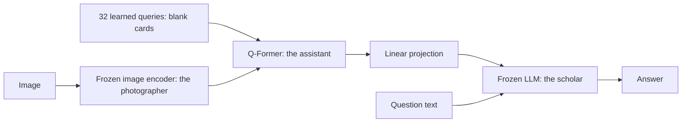

## The hook

You have two experts. One is a superb photographer who notices everything in a picture but can only describe it in long lists of numbers. The other is a brilliant scholar who has read nearly everything and reasons well in words, but has never seen an image. You want them to answer questions about photos together.

Retraining either of them is enormously expensive and risks damaging what they already do well. BLIP-2, from Salesforce Research in 2023, took a cheaper route: keep both experts exactly as they are, and train a small assistant who looks at the photographer's numbers and writes the scholar a short set of notes.

## Before you start

You should know how a [Vision Transformer](article:paper-vit) turns an image into a sequence of patch vectors, how [CLIP](article:paper-clip) aligns images and text in one embedding space, and how [BERT](article:paper-bert) uses a transformer encoder with attention masks. It helps to know that a language model reads a sequence of vectors, normally the embeddings of word tokens.

## The world before this paper

By 2022 there were strong image encoders and strong large language models, trained separately at great cost. Combining them into a model that can talk about images had two common approaches.

1. **Train everything together.** Connecting the models and updating all their weights costs a lot of compute, and the language model can suffer [[catastrophic forgetting]], losing some of its text skills as it adapts.
2. **Insert new layers into a frozen LLM.** DeepMind's Flamingo kept its language model frozen but added new cross-attention layers throughout it, plus a module to summarise image features, and trained these new parts on a very large set of image-text data. It worked impressively, but the added trainable parts were still large and the training very costly.

The open question was whether a much smaller trainable piece, sitting only between the two [[frozen model]]s, could be enough.

:::history
Junnan Li, Dongxu Li, Silvio Savarese and Steven Hoi posted BLIP-2 in January 2023, and it appeared at ICML 2023. It followed their earlier BLIP model, and the code and models were released in Salesforce's LAVIS library.
:::

## The big idea

:::analogy
Picture the photographer and the scholar in separate rooms. Between them sits an assistant with a stack of 32 blank index cards. Each card has a question printed on top, and the assistant learns which questions are worth asking: what objects are there, what are they doing, what is unusual. The assistant studies the photographer's detailed notes, fills in each card briefly, and slides all 32 cards under the scholar's door. The scholar never sees the photo, only the cards, and answers from them.
:::

The assistant is the [[Q-Former]], a small transformer of about 188 million parameters. The 32 cards are [[learned queries]], vectors that gather information from the frozen image encoder's output through [[cross-attention]]. Their outputs, after one linear layer, are placed in front of the frozen LLM's input as a [[soft prompt]]. Only the Q-Former and that linear layer are trained.

## How it works

### The 32 cards

The Q-Former is initialised from BERT-base. Its 32 queries, each a 768-dimensional vector, attend to each other with self-attention, and in every other block they also cross-attend to the frozen image encoder's patch features. Whatever they learn to gather, the output is always 32 vectors.

This is a deliberate bottleneck. A large ViT can output 257 vectors of 1,024 numbers each:

| | Vectors | Size each | Numbers in total |
|---|---|---|---|
| Image encoder output | 257 | 1,024 | 263,168 |
| Q-Former output | 32 | 768 | 24,576 |

The assistant must squeeze the scene into about 10.7 times fewer numbers, so it learns to keep what language needs, such as objects, actions and relations, and drop the rest, such as the exact texture of a wall.

### Stage 1: learning what is worth writing down

First, the Q-Former is trained with the frozen image encoder only, on image-caption pairs. It shares its self-attention layers with a text branch, and three objectives teach the queries to capture language-relevant content. Each one uses a different attention mask to control what the queries and the text can see:

- **Image-text contrastive learning**: queries and text cannot see each other. The model pulls matching image and caption embeddings together and pushes mismatched ones apart.
- **Image-text matching**: queries and text can see each other fully. The model predicts whether a caption truly belongs to the image.
- **Image-grounded text generation**: the text can see the queries but only earlier words, and the queries cannot see the text. The model must write the caption, so the queries are forced to carry all the visual information the caption needs.

For the contrastive score, each of the 32 query outputs is compared with the caption's embedding, and the highest similarity counts. A toy example with two queries and two-dimensional unit vectors: z₁ = [0.6, 0.8], z₂ = [1.0, 0.0], and a caption embedding t = [0.0, 1.0]. The similarities are z₁·t = 0.8 and z₂·t = 0.0, so the image-text score is max(0.8, 0.0) = 0.8: the card that wrote about the right thing decides the match.

:::insight
The generation objective is the sharpest teacher. Because the caption decoder can see the image only through the 32 query outputs, any detail the caption needs, such as "bicycle", must be written on one of the cards. The bottleneck makes the assistant learn to take useful notes.
:::

### Stage 2: learning the scholar's language

Next, the Q-Former is connected to a frozen LLM. A linear layer maps its 32 outputs to the LLM's embedding size, and they are placed in front of the text, like 32 extra tokens. The LLM is trained on, but never updated, with ordinary language modelling: with OPT models, it generates the caption after the visual prompt; with FlanT5 models, the caption is split into a prefix given to the encoder and a suffix to be generated. Only the Q-Former and the linear layer learn, so they adapt the cards to a form the scholar can read.

:::try-this
Using the toy vectors above, suppose a different caption has embedding t = [0.8, 0.6]. Which card decides the score, and what is it? (z₁·t = 0.48 + 0.48 = 0.96, z₂·t = 0.8. The score is 0.96, from card z₁.)
:::

:::warning
Common misconception: "the LLM is looking at the image." It is not. The frozen LLM only receives 32 vectors that sit where word embeddings would. All of its "vision" is the assistant's notes, so anything the Q-Former fails to capture, such as small text in the background, is simply invisible to it.
:::

## What they found

- **Strong zero-shot results with few trainable parameters.** The abstract reports that BLIP-2 beats Flamingo80B by 8.7% on zero-shot VQAv2 visual question answering while using 54 times fewer trainable parameters.
- **Cheap to train.** The paper reports that its largest model trained on a single machine with 16 A100 GPUs, taking under 6 days for stage 1 and under 3 days for stage 2.
- **Stage 1 matters.** Without the representation learning stage, zero-shot performance was much worse, and with OPT the model's performance even declined as training continued, a sign of forgetting.
- **Better parts, better whole.** Using a stronger image encoder or a larger LLM improved results, so the design can benefit from future models without retraining them.
- **Instructed generation.** With an instruction-tuned LLM such as FlanT5, BLIP-2 could follow natural-language prompts about images, such as explaining or reasoning about what is shown.

## What it got wrong (or left open)

- **No benefit from in-context examples.** Giving BLIP-2 a few example image-question-answer pairs in its prompt did not improve answers. The authors attribute this to pretraining on single image-caption pairs, not documents mixing several images and texts.
- **Inherited LLM mistakes.** When the LLM lacks knowledge or reasons wrongly, BLIP-2 produces confident wrong answers, and it can also inherit the LLM's biases and unsafe outputs.
- **A tight bottleneck.** 32 vectors are small for dense scenes, fine spatial detail or reading text in images.

## What happened next

BLIP-2's recipe, a frozen vision encoder plus a frozen LLM joined by a small trained bridge, became a template for open multimodal models. MiniGPT-4 reused BLIP-2's vision side with a chat-tuned LLM. Salesforce's InstructBLIP made the Q-Former aware of the user's instruction, so its 32 cards could focus on what was asked. LLaVA simplified the bridge to a linear layer or small MLP over all patch features, trained with visual instruction data. The general lesson, reuse expensive pretrained models and train only the connection, is now standard practice.

## Key takeaways

- BLIP-2 keeps a pretrained image encoder and a pretrained LLM frozen and trains only a small Q-Former and a linear projection between them.
- The Q-Former's 32 learned queries cross-attend to image features and squeeze them into a compact set of language-relevant vectors.
- Stage 1 trains the queries with contrastive, matching and caption-generation objectives against the image encoder alone, and stage 2 adapts their output to serve as a soft prompt for the LLM.
- The paper reports beating Flamingo80B on zero-shot VQAv2 with 54 times fewer trainable parameters, trained on a single 16-GPU machine.
- Its limits, no gain from in-context examples and a tight visual bottleneck, shaped later models such as InstructBLIP and LLaVA.
