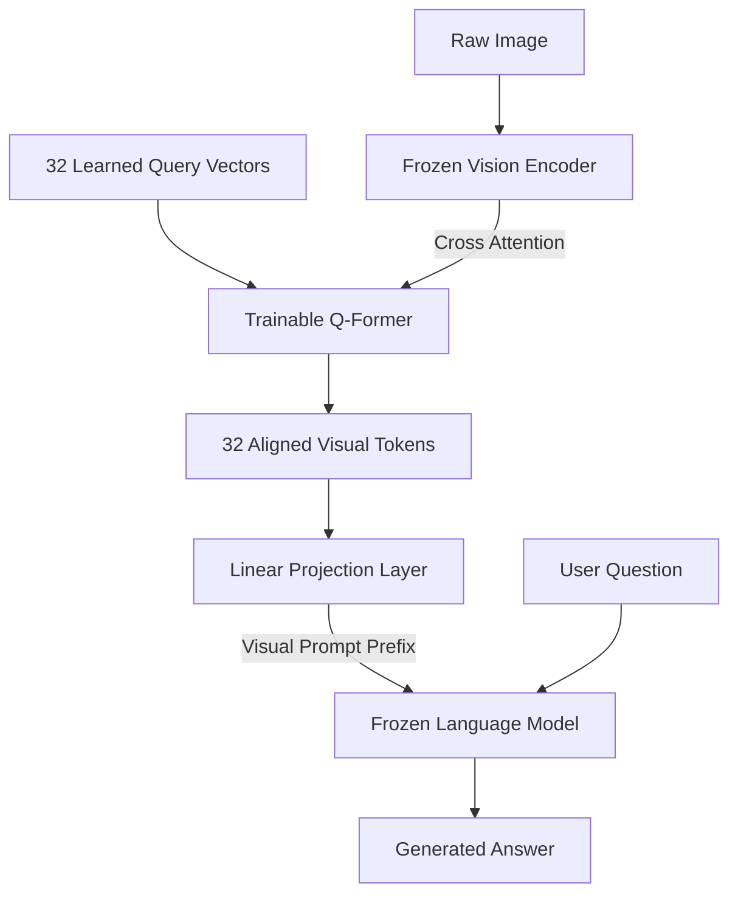
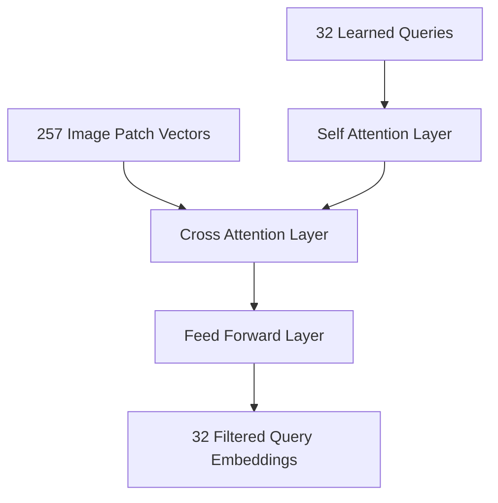
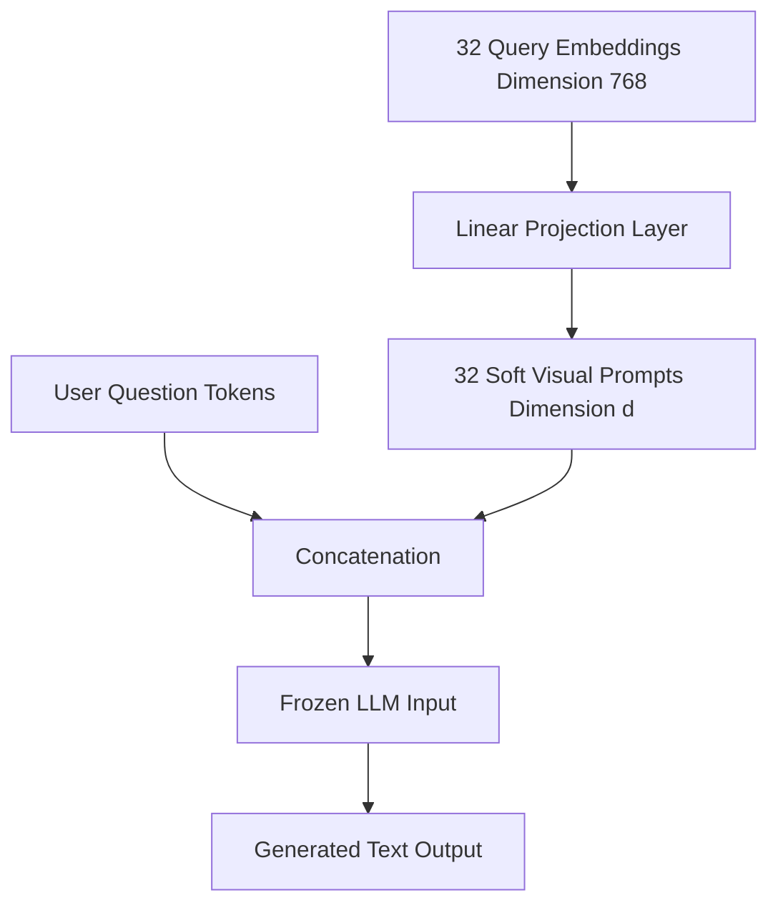

## The hook

Imagine you have two geniuses in a room. One is a master photographer who inspects pictures with forensic precision but speaks only in coordinate vectors. The other is a brilliant writer who has read every book in human history, knows how to reason through complex logic, but was born completely blind. 

You want them to write an essay explaining the subtle humor in an absurd photo. 

Retraining the writer to see, or retraining the photographer to write, would cost millions of dollars in compute time. Worse, attempting to force them into a single mind often ruins the unique skills they already have. What if you did not retrain either of them? What if you simply hired a tiny, lightning-fast interpreter to stand between them, look at the photographer's notes, write down 32 short bullet points, and hand them to the writer?

That interpreter is the core idea behind BLIP-2.

## Before you start

Before reading this, you should be comfortable with:
- How vision transformers divide pictures into token patches in [Vision Transformer](article:paper-vit).
- How models like [CLIP](article:paper-clip) align images and text into shared concept spaces.
- How transformer self-attention and masked language modeling work in [BERT](article:paper-bert).

## The world before this paper

By late 2022, deep learning was facing an expensive identity crisis. Large language models (LLMs) were getting remarkably smart at reasoning, following instructions, and answering questions. At the same time, vision models like CLIP could reliably spot objects, artistic styles, and scenes. 

Naturally, researchers wanted to combine them into multimodal models that could look at an image and chat about it.

:::history
DeepMind's Flamingo demonstrated impressive multimodal abilities in 2022. But Flamingo required training new cross-attention layers inserted throughout an 80-billion parameter model, churning through billions of image-text pairs on massive supercomputers. The sheer cost put that line of research out of reach for almost everyone outside giant tech labs.
:::

Earlier methods tried two main paths, and both had serious drawbacks:

1. **End-to-end retraining:** You take a vision backbone and an LLM, glue them together, and train the entire system. This burned hundreds of thousands of dollars of GPU time. Even worse, it caused *catastrophic forgetting*: as the LLM adjusted its weights to process visual tokens, its sharp text reasoning began to degrade.
2. **Naive prompting:** You freeze both models and pass visual features directly into the LLM as soft prompt prefixes. But this failed because the raw representations of a vision model do not speak the dialect of a language decoder. A visual patch contains textures, lighting, and background noise that confuse a frozen language model.

The research community hit a wall. How could you bridge the modality gap without spending a fortune or wrecking your pre-trained models?

:::analogy
Think of the frozen vision encoder as an expert photographer and the frozen LLM as a blind scholar. Instead of teaching the scholar to open their eyes, you hire a bilingual note-taker. The note-taker inspects the raw image features, writes down exactly 32 concise index cards summarizing the scene, and leaves those cards on the scholar's desk.
:::

## The big idea

BLIP-2 solves the problem by keeping both heavyweight unimodal models completely frozen. 

The image encoder stays untouched. The large language model stays untouched. All the learning happens inside a lightweight middleman called the **[[Q-Former (Querying Transformer)]]**.

To make this bridge work, BLIP-2 splits the training into two distinct stages:

1. **Representation learning:** Connect the Q-Former to the frozen vision encoder. Force it to discover visual features that correspond to human language using a small set of learned query tokens.
2. **Generative learning:** Connect the Q-Former's output to the frozen LLM. Train the Q-Former so its output tokens act as clear, interpretable prompts that tell the LLM what to talk about.

Because the Q-Former is tiny (just 188 million parameters) compared to the giant models it connects, the entire training pipeline runs on modest hardware in days, not months.

## How it works

Let us pull back the curtain on the Q-Former and look at its gears.

### The 32 learned queries

The Q-Former starts with 32 learnable vector embeddings. Think of these like 32 blank question slips created before training starts. Each query has an embedding dimension of 768.

These queries enter the Q-Former and interact with each other using self-attention. Every other block, the queries also run cross-attention over the output of the frozen vision encoder. 

Why do this instead of passing all the image patches directly? 

A typical vision transformer outputs hundreds of patch vectors (for example, 257 vectors of size 1024). Many of these patches contain repetitive textures like blue sky, plain wall, or blurry floor tiles. By forcing all image information to pass through just 32 vectors, the architecture creates an **[[Information Bottleneck]]**. The queries are forced to summarize the scene and discard irrelevant visual noise.

### Stage 1: Representation learning

In the first stage, the Q-Former learns what visual signals matter to language. The team attaches the Q-Former to the frozen vision encoder and feeds it paired image-caption data.

To train the queries, the Q-Former shares its self-attention layers with a text transformer (initialized from pre-trained BERT weights). The model optimizes three complementary losses simultaneously:

1. **[[Image-Text Contrastive Learning (ITC)]]:** Compares the query representations against the text caption's `[CLS]` token embedding. The model computes similarity between every query output and the text vector, takes the highest score, and contrasts positive pairs with negative pairs. The attention mask prevents the image queries and text tokens from seeing each other directly.
2. **[[Image-Text Matching (ITM)]]:** A binary classification task. The model looks at an image and a candidate caption with a bidirectional attention mask (where queries and text can freely attend to one another) and predicts whether they match.
3. **[[Image-Grounded Text Generation (ITG)]]:** Forces the model to generate the image caption word-by-word. Because a causal mask prevents the text from seeing future words, and prevents the image queries from seeing the text, the queries *must* pull the necessary visual facts from the image so the text decoder can output the caption.

:::insight
The Image-Grounded Text Generation loss turns the queries into an information bridge. If the queries fail to pull the concept of a bicycle out of the image, the text tokens will lack the context needed to predict the word bicycle.
:::

#### A tiny look at the math

Consider the contrastive score between an image representation and a text representation. 

Let the 32 query output vectors from the Q-Former be $Z = \{z_1, z_2, \dots, z_{32}\}$, where each $z_i$ is a normalized vector. Let $t$ be the normalized embedding of the caption's `[CLS]` token.

The match score $s(I, T)$ between the image $I$ and text $T$ is defined by the query that has the strongest agreement with the text:

$$s(I, T) = \max_{i} (z_i^\top t)$$

Here:
- $z_i^\top t$ is the dot product (cosine similarity) between query $z_i$ and text vector $t$.
- $\max_{i}$ picks the highest similarity among all 32 queries.

Let us test this with real numbers. Suppose we had only 2 queries and vectors of length 2:
- $z_1 = [0.6, 0.8]$ (perhaps looking for animals)
- $z_2 = [1.0, 0.0]$ (perhaps looking for vehicles)
- $t = [0.0, 1.0]$ (a caption describing a sleeping puppy)

We calculate:
- $z_1^\top t = (0.6 \times 0.0) + (0.8 \times 1.0) = 0.8$
- $z_2^\top t = (1.0 \times 0.0) + (0.0 \times 1.0) = 0.0$

The score is $\max(0.8, 0.0) = 0.8$. The first query matched the text topic, so its alignment score drives the contrastive signal.

:::try-this
Suppose an image contains a girl riding a bicycle down a mountain trail. If you were only allowed to write down 3 words on an index card for a friend who has never seen the photo, which 3 words would you choose? Notice how easily your brain skips the shade of gray in the gravel or the precise shape of the clouds to focus on the semantic core. That is exactly what the 32 query tokens learn to do.
:::

### Stage 2: Generative pre-training

Once Stage 1 finishes, the Q-Former knows how to extract text-relevant visual features. But it still does not know how to speak to an off-the-shelf LLM.

In Stage 2, the team connects the Q-Former to a frozen LLM (such as OPT for decoder-only models, or FlanT5 for encoder-decoder models).

1. The Q-Former outputs 32 vectors of dimension 768.
2. A single linear projection layer (a fully connected layer) maps these 768-dimensional vectors to match the hidden dimension $d$ of the LLM.
3. These 32 projected vectors are placed directly in front of the text prompt tokens as a visual prefix.
4. The frozen LLM runs standard language modeling: predict the next token in the sequence.

Because the Q-Former was already trained to filter out visual clutter during Stage 1, the LLM receives clean, language-like conceptual embeddings. The LLM is never updated, so its ability to construct sentences, follow rules, and apply logical reasoning stays completely intact.

:::warning
Common misconception: people often assume the frozen LLM is reading images. In reality, the LLM has no idea what an image is. It simply receives 32 continuous embedding vectors that masquerade as prefix tokens in its familiar vocabulary space.
:::

## What they found

The results demonstrated that you do not need hundreds of billions of trainable parameters to build an elite vision-language system.

### Crushing giant models with 54x fewer parameters

When tested on zero-shot Visual Question Answering (VQAv2), BLIP-2 with a ViT-g encoder and FlanT5-XXL scored **65.0%**. 

For comparison, DeepMind's Flamingo80B achieved 56.3% in zero-shot settings. BLIP-2 beat Flamingo by 8.7% while using **54 times fewer trainable parameters** (108 million trainable parameters in Stage 2 compared to Flamingo's 10.2 billion trainable parameters).

| Model | Total Params | Trainable Params | Zero-Shot VQAv2 |
| :--- | :--- | :--- | :--- |
| Flamingo80B | 80B | 10.2B | 56.3% |
| **BLIP-2 (ViT-g + FlanT5-XXL)** | **12.1B** | **108M** | **65.0%** |

### Radical training efficiency

Because only the 188M-parameter Q-Former and a projection layer were being updated, training required shockingly little compute:
- A single machine with 16 A100 (40GB) GPUs was sufficient.
- Stage 1 took less than 6 days.
- Stage 2 took less than 3 days.

In under 9 days on one machine, the authors trained a state-of-the-art multimodal model.

### Generalization to out-of-domain images

On the NoCaps zero-shot image captioning benchmark, BLIP-2 posted an overall CIDEr score of 121.6 without seeing any in-domain training examples, outperforming prior systems trained directly on caption datasets.

### The necessity of Stage 1

What happens if you skip Stage 1 and wire the Q-Former straight into the LLM with just the generative loss?

The authors tried this ablation and found that performance collapsed. When training decoder models like OPT without Stage 1, the model suffered severe catastrophic forgetting—its zero-shot VQA accuracy dropped sharply as training progressed. Stage 1's representation bottleneck is what protects the LLM from getting overwhelmed.

## What it got wrong (or left open)

Despite its efficiency and benchmark wins, BLIP-2 had real blind spots:

- **No in-context few-shot learning:** Flamingo's hallmark party trick was that you could feed it three examples of `[Image A -> Answer A]`, `[Image B -> Answer B]`, and it would learn the pattern on the fly. BLIP-2 could not do this. Why? Its pre-training dataset consisted strictly of single image-text pairs. It never saw interleaved web documents with multiple images and paragraphs mixed together.
- **Inherited hallucinations:** When the LLM was wrong, it was confidently wrong. If FlanT5 or OPT lacked factual knowledge about a subject, or if visual prompts triggered an incorrect reasoning chain, the model hallucinated believable falsehoods.
- **Surface-level grounding:** Because the 32 queries compress an entire image into a tiny bottleneck, fine-grained spatial information (such as exact bounding boxes or small background text) frequently gets lost in translation.

## What happened next

BLIP-2 changed the trajectory of multimodal research in 2023. Before it, building a competitive vision-language model felt like a privilege reserved for tech giants with massive compute clusters. BLIP-2 proved that an adapter-based design could beat massive end-to-end architectures.

Its design directly catalyzed several landmark milestones:
- Open-source projects like MiniGPT-4 quickly demonstrated that pairing BLIP-2's vision pipeline with conversational models produced convincing visual chat assistants in a matter of hours.
- Salesforce followed up with InstructBLIP, conditioning the Q-Former directly on user instructions to extract task-tailored image features.
- Later architectures like LLaVA adopted an even simpler variant of this modular philosophy, swapping the Q-Former for an MLP projector and using instruction tuning.

The central thesis of BLIP-2—that pre-trained unimodal models already know most of what they need to know—remains one of the most practical insights in modern AI engineering.

## Key takeaways

- BLIP-2 bridges frozen image encoders and frozen LLMs using a lightweight, 188-million parameter module called the Q-Former.
- An information bottleneck of 32 learned query tokens distills dense image patches into concise visual vectors that correspond to language concepts.
- A two-stage training scheme first aligns visual representations with text, and then teaches the frozen LLM to treat those representations as soft prompt prefixes.
- The model beat Flamingo80B on zero-shot visual question answering while training 54 times fewer parameters on a single 16-GPU node in under nine days.
- Modular multimodal design avoids catastrophic forgetting and allows developers to upgrade vision backbones and language models independently.
