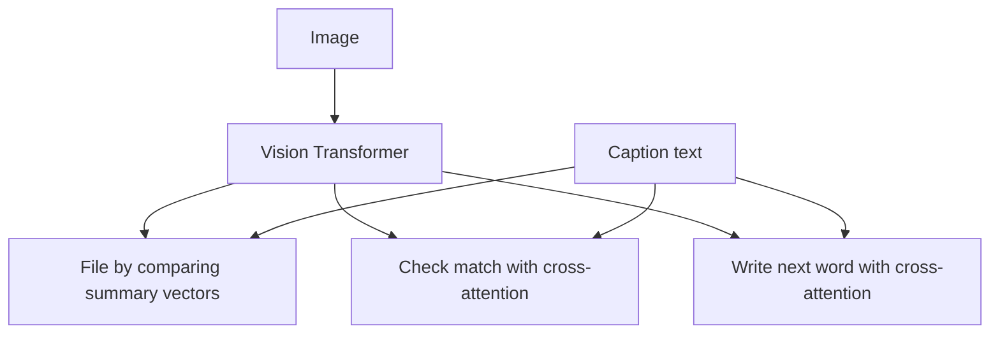
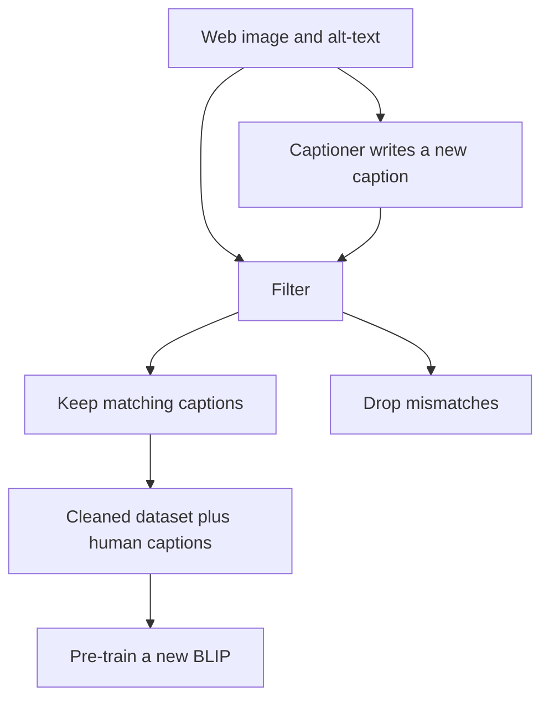

## The hook

Open any large web scrape of photos and read the text attached to them. A picture of a dog on a beach is labelled "summer sale 20% off". A plate of noodles is labelled "IMG_4471". A mountain lake is labelled with the name of the travel blog.

Researchers trained their best vision-language models on hundreds of millions of pairs like these, hoping the noise would wash out. A team at Salesforce Research tried something different: before studying the data, let the model rewrite the bad captions and throw out the ones that lie.

## Before you start

You should know how [the Vision Transformer](article:paper-vit) turns an image into a sequence of patch vectors, and how [CLIP](article:paper-clip) matches images and texts by comparing vectors. Knowing that [BERT](article:paper-bert) reads a sentence in both directions while GPT-style models write left to right will help a lot.

## The world before this paper

[[Vision-language pre-training]] had split into two camps, each good at half the job.

- **Encoder models** such as CLIP turn an image and a caption into separate vectors and compare them. Search over millions of images is fast, but the model cannot write a caption or answer a question in words.
- **Encoder-decoder models** feed image features into a text generator. They can caption and answer questions, but they were weaker at retrieval, and comparing every image with every caption through a heavy joint model is slow.

Both camps shared a data problem. Human-written captions, such as the COCO dataset, are clean but small. Web [[alt-text]] is huge and free, but much of it does not describe the picture. The usual answer was to collect even more of it.

:::history
Junnan Li, Dongxu Li, Caiming Xiong and Steven Hoi at Salesforce Research posted BLIP in January 2022, and it appeared at ICML 2022. Their abstract makes two complaints: most pre-trained models excel at either understanding or generation, not both, and scaling up noisy web pairs is "a suboptimal source of supervision". BLIP was their answer to both.
:::

## The big idea

:::analogy
Picture the photo desk of a busy newspaper. Thousands of photos arrive every day with notes from whoever sent them, and many notes are useless. The desk has three jobs: **file** each photo so it can be found later, **check** whether a note really describes its photo, and **write** a fresh caption when the note is bad. One well-trained team does all three, because the same knowledge of photos serves every job. Once the team is good enough, it cleans up the old archive, and the next generation of staff is trained on the cleaned archive.
:::

BLIP has two parts that match that desk.

1. **One model, three jobs.** The [[MED]] (Multimodal mixture of Encoder-Decoder) can file (encode an image and a text separately for fast search), check (read both together and judge whether they match), and write (generate a caption for an image).
2. **Clean the archive.** [[CapFilt]] uses the writer to produce new captions for web images and the checker to throw out captions, old or new, that do not match. A fresh model is then trained on the cleaned data.

## How it works

### The three jobs of MED

Every image first passes through a Vision Transformer, which produces one vector per patch plus a summary vector. The text side is a transformer that can run in three modes:

- **Unimodal text encoder (file).** Reads the caption on its own, BERT-style, and produces a summary vector. Trained with an [[image-text contrastive loss]], like CLIP.
- **Image-grounded text encoder (check).** Adds cross-attention layers so each word can look at the image patches. A small head on top answers yes or no: does this caption match? This is [[image-text matching]].
- **Image-grounded text decoder (write).** Uses the same cross-attention and feed-forward layers, but swaps bidirectional self-attention for causal self-attention, so each word only sees earlier words. Trained to predict the next word of the caption.

The encoder and the decoder share every parameter except their self-attention layers. In desk terms, the checker and the writer share their knowledge of photos and words; they differ only in how they read, because checking looks at the whole caption at once while writing goes word by word.

Each training pair gets one pass through the image encoder and three passes through the text side, one per job, and the three losses are added.

### A worked example: how filing learns

The contrastive loss turns similarity scores into a guessing game. Take one photo and three captions in a batch, with toy cosine similarities of 0.8 for the true caption and 0.3 and 0.1 for the others. Divide each by a toy temperature of 0.1 and apply softmax:

| Caption | Similarity | Probability |
|---|---|---|
| True caption | 0.8 | 0.9924 |
| Wrong caption 1 | 0.3 | 0.0067 |
| Wrong caption 2 | 0.1 | 0.0009 |

The loss is minus the log of the true caption's probability: about 0.0076, almost nothing. If the true caption's similarity were only 0.4, the probabilities would be 0.7054, 0.2595 and 0.0351, and the loss would jump to 0.349. Training pushes the true pair's vectors closer until that loss is small.

:::insight
The three jobs are not three models glued together. They are one model with shared knowledge and three ways of reading, so pre-training it once gives you both the fast search of CLIP and the writing ability of a captioner.
:::

### CapFilt: cleaning the archive

After pre-training on the noisy data, the authors make two copies of the model and fine-tune each on the clean, human-written COCO captions:

1. The **captioner** is the decoder, fine-tuned to write captions.
2. The **filter** is the image-grounded encoder, fine-tuned to judge matches.

The captioner writes one synthetic caption for every web image. The filter then reads both the original web text and the synthetic caption, and drops whichever it judges not to match. The surviving pairs, plus the human-written ones, form the new dataset, and a new BLIP model is pre-trained on it.

### A worked example: one round of cleaning

Here are five toy web photos. The filter gives each caption a match probability, and we keep anything above 0.5.

| Photo | Web text score | Keep web? | Synthetic score | Keep synthetic? |
|---|---|---|---|---|
| 1 | 0.92 | yes | 0.88 | yes |
| 2 | 0.08 | no | 0.81 | yes |
| 3 | 0.71 | yes | 0.64 | yes |
| 4 | 0.12 | no | 0.27 | no |
| 5 | 0.35 | no | 0.93 | yes |

Three of the five web texts are dropped, a 60% noise rate in this toy batch. The captioner rescues photos 2 and 5, and photo 4 contributes no pair this round. The cleaned set holds 6 captions for 5 photos, and most of them actually describe the picture. That is the newspaper desk clearing out its archive: bad notes binned, fresh captions written, nothing kept that the checker rejects.

:::try-this
Raise the filter threshold from 0.5 to 0.75. How many captions survive, and which photos are left with no caption at all? (The web text for photo 1 and the synthetic captions for photos 1, 2 and 5 survive: 4 captions. Photo 3 now loses both of its captions, joining photo 4. A stricter checker gives cleaner data but less of it.)
:::

### Why sampling beats safe captions

How the captioner writes matters. Beam search picks the most likely words and produces safe captions such as "a dog on a beach". [[Nucleus sampling]] picks words at random from the likely ones, producing varied captions such as "a brown dog chasing a ball across wet sand". The paper found that sampling led to better downstream results, even though the filter rejected more of its captions. Varied captions teach the model things it does not already know.

:::warning
Common misconception: "the filter and captioner can be the same model, since they come from the same checkpoint." The paper fine-tunes them separately and reports that sharing their parameters hurt results. A checker that shares the writer's blind spots tends to approve the writer's mistakes, the problem the authors call confirmation bias. On the newspaper desk, you do not let writers proof their own captions.
:::

## What they found

The abstract reports state-of-the-art results across a wide range of vision-language tasks, including:

- **Image-text retrieval:** +2.7% in average recall@1 over the previous best.
- **Image captioning:** +2.8% in CIDEr, a standard caption-quality score.
- **Visual question answering:** +1.6% in VQA score.
- **Video:** strong results when transferred directly to video-language tasks in a zero-shot way, without training on video.

The ablations inside the paper support the two ideas separately: CapFilt improved results over training on raw web data, and diverse sampled captions helped more than beam-search captions. The authors also released code, models and the bootstrapped datasets.

## What it got wrong (or left open)

- **A costly pipeline.** You pre-train a model, fine-tune two copies, caption and filter the whole web dataset, then pre-train again from scratch. That is a lot of compute for one data-cleaning round.
- **Cleaning is only as good as the checker.** The filter learned from COCO-style captions, so it may reject unusual but correct web texts and accept plausible but subtly wrong synthetic ones.
- **The language side stays small.** BLIP trains its own BERT-sized text model, so its writing and reasoning are far below large language models.
- **Video is treated as a pile of frames.** The zero-shot video results come from sampling frames, with no model of motion or time order.

## What happened next

The same group followed up with [BLIP-2](article:paper-blip-2-bootstrapping-language-image-pre-training-with-frozen), which keeps a frozen image encoder and a frozen large language model and trains only a small bridge between them. That fixed the small-language-model limit without paying to retrain everything. Models like [MiniGPT-4](article:paper-minigpt-4-enhancing-vision-language-understanding-with-advan) then connected vision encoders to chat-style language models.

The data idea travelled even further. Using a captioning model to rewrite noisy web captions became a common step when building image and text datasets, including for training text-to-image models. The newspaper desk that cleans its own archive turned out to be one of the most reusable ideas in the paper.

## Key takeaways

- BLIP's MED model handles search, caption matching and caption writing with one set of mostly shared weights, differing only in how its self-attention reads the text.
- Web alt-text is plentiful but noisy, and BLIP showed that cleaning it beats simply collecting more of it.
- CapFilt uses a fine-tuned captioner to write new captions and a separately fine-tuned filter to remove mismatches, then pre-trains a fresh model on the cleaned data.
- Diverse sampled captions taught the model more than safe beam-search captions, even though more of them were filtered out.
- The abstract reports gains in retrieval, captioning and question answering, and zero-shot transfer to video tasks.
