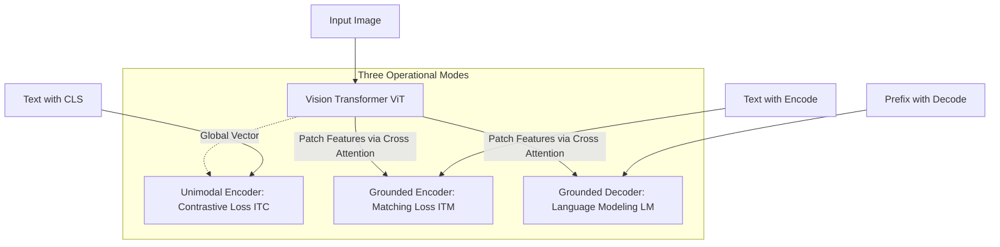
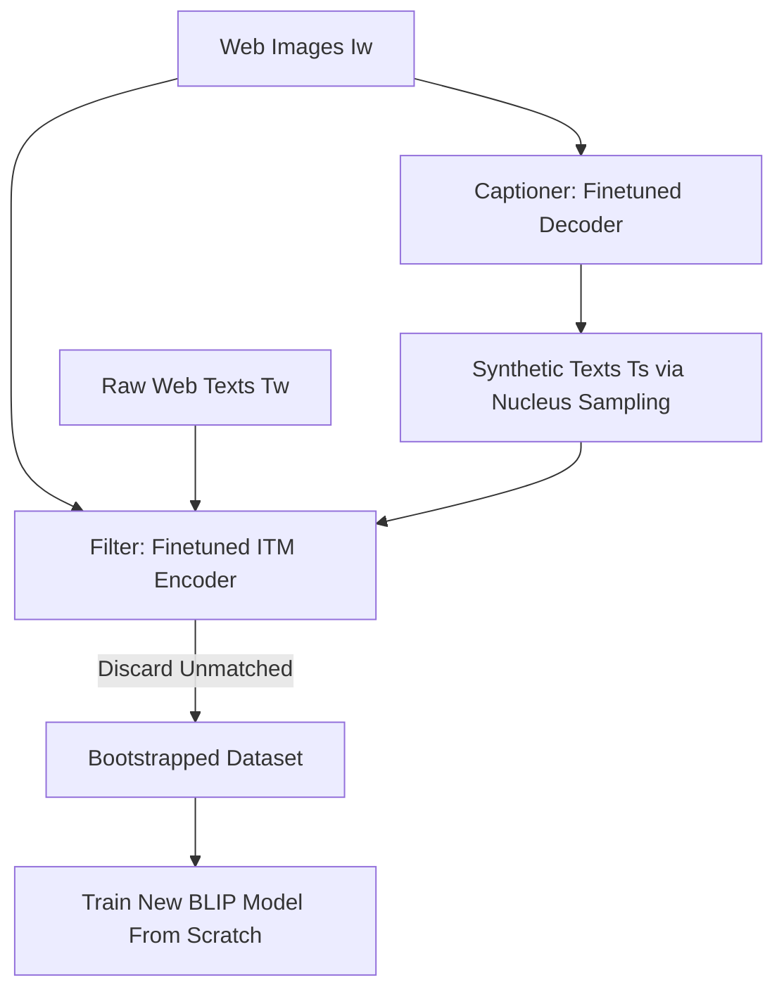

## The hook

Scrape ten million photos from the open web, and you will notice a frustrating pattern in the image descriptions. A gorgeous photo of a chocolate fudge cake will have the caption "sunset park bakery order 4029". A crisp snapshot of a red fox in the snow will read "IMG_2041_edited.jpg" or "buy prints today with 20% discount".

If you train a neural network on hundreds of millions of these web pairs, you are asking it to learn visual concepts from a teacher who is constantly distracted, half-asleep, or lying. 

In early 2022, a team at Salesforce Research asked a simple question: what if we trained a model to clean up the internet's messy captions before using them for homework? 

The result was BLIP, short for Bootstrapping Language-Image Pre-training. It bridged the divide between understanding and generating text, and it showed the field that curated, synthetic text could beat brute-force dataset scaling.

---

## Before you start

To get the most out of this paper, you should be comfortable with:
- How [BERT](article:paper-bert) uses bidirectional self-attention to build rich representations of text.
- How the [Vision Transformer (ViT)](article:paper-vit) chops images into patches and processes them like sentences.
- How [CLIP](article:paper-clip) uses contrastive learning to match images with descriptive sentences.

---

## The world before this paper

By 2021, multimodal AI was divided into two distinct architectural camps, and neither camp could do what the other did well.

```
Camp 1: Dual Encoders (e.g., CLIP)
[Image] -> [Vision Encoder] \
                              -> Dot Product -> Fast Search & Retrieval
[Text]  -> [Text Encoder]   /
(Cannot generate captions or answer open-ended questions)

Camp 2: Encoder-Decoders (e.g., SimVLM)
[Image] -> [Encoder] -> [Decoder] -> Generates Text & Answers
(Too slow and heavy for massive cross-modal search)
```

In the first camp were encoder models like [CLIP](article:paper-clip). CLIP takes an image through a vision encoder, passes a sentence through a text encoder, and pulls their embeddings together if they match. CLIP was blazing fast at image-text search. But because it had no text decoder, it could never generate a caption or hold a open-ended conversation about a photo.

In the second camp were encoder-decoder models. These fed visual features into a language decoder to predict text word-by-word. They could write captions and answer questions, but they were awful at image retrieval tasks. Searching a database of millions of photos by calculating full multimodal cross-attention for every candidate was computationally impossible.

Underneath both camps lay an even bigger dirty secret: dataset pollution. 

To train models without paying millions of dollars to human annotators, researchers scraped hundreds of millions of images and their raw HTML `alt` tags from the web. The web is full of keyword-stuffed SEO garbage, personal shopping notes, and irrelevant file names. 

The prevailing wisdom at the time was simple: just scrape more. The noise would wash out if you collected billions of pairs. BLIP proved that intuition was wrong.

---

## The big idea

BLIP introduces two separate breakthroughs: one architectural, and one data-centric.

First, instead of building an encoder *or* a decoder, the authors built **[[MED]]** (Multimodal mixture of Encoder-Decoder). It is a single model that effortlessly switches hats depending on what you ask it to do. It can act as a unimodal encoder for fast search, a cross-modal encoder for deep matching, or an autoregressive decoder to generate fluid sentences.

Second, the authors created **[[CapFilt]]** (Captioning and Filtering). Instead of blindly swallowing noisy web data, BLIP cleans its own curriculum.

:::analogy
Imagine preparing for a tough biology exam using unorganized family photo albums found in an attic. Some photos of birds are labeled with accurate species names, but others are labeled "vacation day 3" or "Aunt May's backyard". 

Instead of memorizing all that noise, you bring in two helpers:
1. **The Captioner (a smart teaching assistant):** Looks at the unlabeled photos and writes clear, detailed descriptions of the animals.
2. **The Filter (a strict fact-checker):** Reads every note in the album, throwing out absurd labels like "vacation day 3" while keeping the good ones.

Once the photo album is scrubbed clean and filled with sharp descriptions, you sit down and study from a pristine textbook.
:::

---

## How it works

Let's look under the hood at both pieces: the unified [[MED]] architecture and the [[CapFilt]] data engine.

### 1. The MED Architecture: Three Roles in One

Every visual task starts by passing the image through a standard [Vision Transformer](article:paper-vit). The ViT splits the image into $16 \times 16$ pixel patches, adds a `[CLS]` token, and produces a sequence of visual embedding vectors.

The magic happens in how the text transformer interacts with those visual vectors. Depending on the task, it activates one of three pathways:



1. **Unimodal Text Encoder (for quick retrieval):**
   The text enters a standard transformer with bidirectional self-attention, identical to [BERT](article:paper-bert). It outputs a single feature vector representing the text. The model is trained using **[[ITC]]** (Image-Text Contrastive loss), aligning the image vector and text vector in a shared space just like [CLIP](article:paper-clip).

2. **Image-Grounded Text Encoder (for detailed reasoning):**
   Between each self-attention layer and feed-forward layer, the authors insert a cross-attention layer that attends directly to the ViT's patch tokens. A special `[Encode]` token is prepended to the text. The output vector at that position feeds into a linear layer trained with **[[ITM]]** (Image-Text Matching loss), a binary classification head that outputs whether the image and text are an authentic match.

3. **Image-Grounded Text Decoder (for caption generation):**
   This pathway uses the exact same cross-attention layers and feed-forward networks as the grounded encoder. However, it replaces bidirectional self-attention with **causal self-attention**. The words can only look at tokens that came before them. Prepended with a `[Decode]` token, it is trained using **LM** (Language Modeling loss) to predict the next word in the caption autoregressively.

:::insight
Notice the clever engineering trick: the grounded text encoder and grounded text decoder **share almost all their parameters**. Their token embeddings, cross-attention layers, and feed-forward blocks are identical. They only swap out their self-attention mechanisms—bidirectional for reading, causal for writing.
:::

Why keep the self-attention weights separate? Because reading a full sentence at once requires radically different attention patterns than predicting the next token from left to right. Tying those weights hurts performance; separating only those layers gives you the best of both worlds with minimal parameter bloat.

### 2. The Training Losses

During pre-training, each image-text pair requires only one forward pass through the heavy vision transformer, followed by three lighter forward passes through the text module:

$$\mathcal{L}_{\text{total}} = \mathcal{L}_{\text{ITC}} + \mathcal{L}_{\text{ITM}} + \mathcal{L}_{\text{LM}}$$

- $\mathcal{L}_{\text{ITC}}$ aligns unimodal vectors using a contrastive InfoNCE objective, using a momentum encoder to produce soft targets for noisy pairs.
- $\mathcal{L}_{\text{ITM}}$ mines "hard negatives"—pairs that share similar words or visual styles but do not actually match—forcing the cross-attention layers to learn subtle visual cues.
- $\mathcal{L}_{\text{LM}}$ applies cross-entropy with a $0.1$ label smoothing factor to train the model to output human-like descriptions from scratch.

### 3. The CapFilt Engine

Once the base MED model is pre-trained, how do we use it to clean the noisy web data?



Here is the step-by-step [[CapFilt]] workflow:

1. **Fine-tune on clean data:** The authors take the pre-trained MED model and fine-tune it on COCO, a modest dataset of roughly 100,000 human-annotated, high-quality image-text pairs.
2. **Create two specialists:**
   - The decoder becomes the **Captioner ($C$)**, generating a synthetic caption $T_s$ for every raw web image $I_w$.
   - The grounded encoder becomes the **Filter ($F$)**, trained to predict whether an image and sentence match.
3. **Generate diverse text:** The Captioner uses **[[Nucleus Sampling]]** ($p = 0.9$) to draft descriptions. Rather than always picking the single most probable word, nucleus sampling draws tokens from the top 90% probability mass. This injects surprising, descriptive vocabulary.
4. **Purge the noise:** The Filter inspects both the raw web text $T_w$ and the synthetic text $T_s$. If its ITM classifier flags a pair as mismatched, that caption is tossed straight into the digital trash bin.
5. **Re-train from scratch:** The authors combine the remaining web pairs, the accepted synthetic pairs, and the human labels into one clean dataset, and train an entirely new BLIP model on it.

:::try-this
Look at an image of a red vintage car parked outside an Italian restaurant. 
- A raw web alt-text might say: *"IMG_0921 trip to Rome best pizza deal"*. 
- A beam-search captioner might play it safe and say: *"A car parked on a street"*. 
- A nucleus-sampling captioner might say: *"A shiny cherry-red vintage coupe parked outside a cobblestone cafe"*.

Notice how the third caption provides the model with rich concepts: colors ("cherry-red"), vehicle types ("coupe"), and backgrounds ("cobblestone cafe").
:::

---

## What they found

The empirical results were striking. Cleaning data beat simply downloading more web pages.

### 1. Superior Understanding and Generation

When pre-trained on identical data (14 million images), BLIP swept existing baselines across both understanding and generation:

| Model | Pre-train Images | COCO Retrieval (TR@1) | COCO Retrieval (IR@1) | Captioning (CIDEr) | VQA Score |
| :--- | :--- | :--- | :--- | :--- | :--- |
| **ALBEF** | 14M | 77.6% | 60.7% | — | 75.84 |
| **SimVLM** | 1,800M (1.8B) | — | — | 143.3 | 77.87 |
| **BLIP (ViT-B)** | 14M | **80.6%** | **63.1%** | **129.7** | **77.54** |
| **BLIP (ViT-L)** | 129M | **82.4%** | **65.1%** | **136.7** | **78.25** |

On COCO image-to-text retrieval, BLIP beat ALBEF by **+2.7%** in average recall@1. In visual question answering (VQA), BLIP matched or beat SimVLM—a model trained on **13 times more data** with a significantly larger backbone.

### 2. Diverse Captions Beat Safe Captions

Why did the authors choose nucleus sampling over beam search for CapFilt? Beam search picks the most mathematically probable words, producing generic sentences. Nucleus sampling takes small risks.

| Sampling Method | Filter Rejection Rate | COCO Retrieval (TR@1) | Captioning (CIDEr) |
| :--- | :--- | :--- | :--- |
| **None (Raw Web)** | N/A | 78.4% | 127.8 |
| **Beam Search** | 19% | 79.6% | 128.9 |
| **Nucleus Sampling** | 25% | **80.6%** | **129.7** |

Even though the filter rejected more nucleus-sampled captions as noisy ($25\%$ vs $19\%$), the surviving captions were far richer in detail. Variety mattered more than absolute precision.

:::warning
**The Confirmation Bias Trap:**
You might wonder: why not save memory and let the Captioner and Filter share weights during the CapFilt stage? 

The authors tested this, and performance crashed. When the Filter shares weights with the Captioner, it suffers from confirmation bias. It trusts the Captioner's mistakes because they share the same blind spots, dropping the filtered noise ratio from $25\%$ down to just $8\%$. The modules must remain decoupled.
:::

### 3. Out-of-the-Box Video Domination

Without looking at a single video during pre-training, the authors tested BLIP on zero-shot text-to-video retrieval (MSR-VTT) by simply sampling frames from each clip and passing them through the vision encoder.

BLIP scored **43.3% recall@1**. It did not just beat previous zero-shot models (which hovered around 10-18%); it beat models that had been **specifically fine-tuned on the video dataset by +12.4%**.

---

## What it got wrong (or left open)

While BLIP was a massive leap forward, it had several clear limitations:

- **The multi-stage training tax:** BLIP is expensive to train. You must pre-train model 1, fine-tune its pieces on COCO to build the Captioner and Filter, run inference across millions of web images to bootstrap the text, and then train model 2 from scratch.
- **You cannot just "continue training":** The authors tried resuming pre-training on the bootstrapped data using their existing checkpoint instead of starting fresh. It delivered significantly worse downstream results. In knowledge distillation, a student cannot easily initialize its weights directly from the teacher.
- **The NLVR2 plateau:** On Natural Language Visual Reasoning (NLVR2)—which tests abstract logic across pairs of images—scaling web images gave BLIP almost zero improvement. Web captions describe single photos; they do not teach cross-image relational reasoning.
- **Crude video handling:** BLIP treated videos as loose piles of unlinked photos. It completely ignored temporal order, frame velocity, and motion dynamics.

---

## What happened next

BLIP changed the multimodal landscape in two profound ways.

First, it established synthetic data bootstrapping as a foundational pillar of modern vision-language pre-training. Today, nearly every state-of-the-art multimodal pipeline relies on a smaller model generating detailed synthetic descriptions to train a larger successor.

Second, the authors realized that while training both the vision encoder and language model from scratch was effective, it capped language reasoning at the size of small text transformers like BERT. 

In late 2022, the same team introduced [BLIP-2](article:paper-blip-2-bootstrapping-language-image-pre-training-with-frozen). Instead of training a small text transformer from scratch, BLIP-2 froze a massive pre-trained Large Language Model (like Flan-T5 or OPT) and froze a giant pre-trained Vision Transformer, inventing a lightweight module called the Q-Former to bridge the two. 

BLIP proved that data quality was king; BLIP-2 proved that frozen foundation models were the fastest way to scale that insight.

---

## Key takeaways

- Traditional vision-language models were split into fast retrieval encoders (like CLIP) or flexible text decoders (like SimVLM), rarely performing both well.
- The Multimodal mixture of Encoder-Decoder (MED) solves this by sharing cross-attention and feed-forward layers while keeping self-attention separate for bidirectional encoding versus causal decoding.
- Web alt-text is far too noisy for optimal vision-language pre-training; blindly scaling noisy data yields diminishing returns.
- CapFilt bootstraps noisy datasets by pairing a fine-tuned decoder that generates rich, diverse captions with an encoder that filters out mismatches.
- Stochastic nucleus sampling generates superior multimodal training data compared to deterministic beam search because semantic diversity teaches models more than repetitive, safe guesses.
