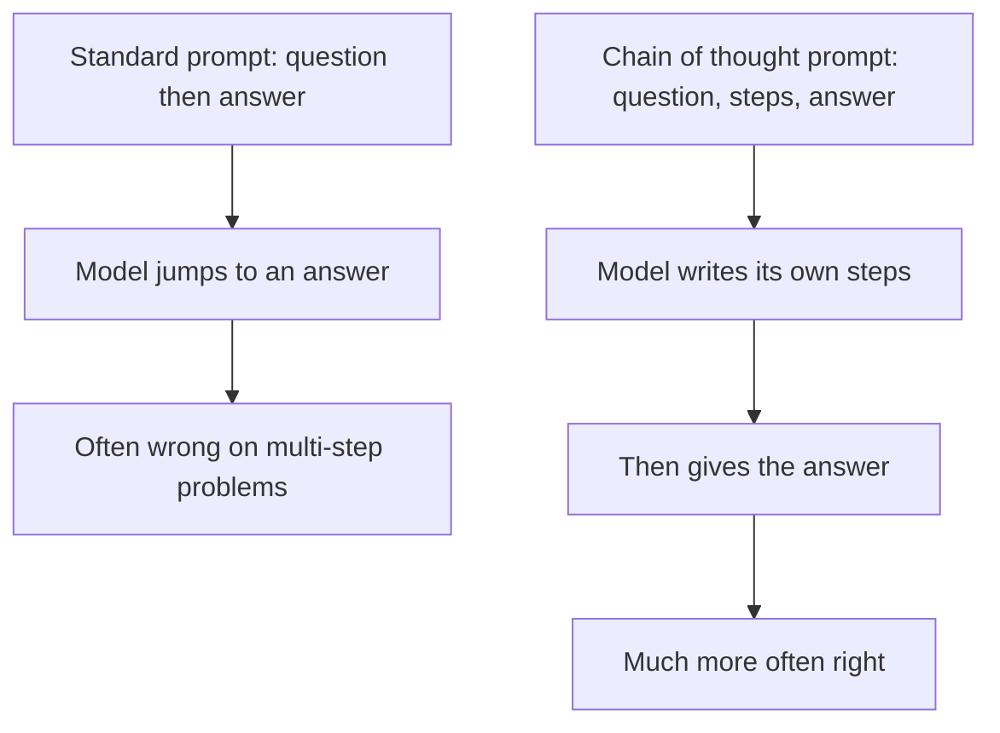

## The hook

Here is a puzzle for a language model: *"The cafeteria had 23 apples. If they used 20 to make lunch and bought 6 more, how many apples do they have?"*

In early 2022, Google's 540-billion-parameter language model PaLM, one of the largest in the world, could get questions like this wrong when asked for the answer directly. Then researchers changed one thing. In the examples at the top of the prompt, instead of showing only answers, they showed the working: *"They had 23, used 20, so 23 − 20 = 3. They bought 6 more, so 3 + 6 = 9. The answer is 9."*

Now the model wrote out its own steps on new questions, and its accuracy on a benchmark of grade-school maths problems roughly tripled. No retraining. No new data. Just a different prompt.

## Before you start

You need the idea of few-shot prompting and in-context learning from [Just Show It a Few Examples](article:paper-gpt-3). Everything in this paper happens inside the prompt; the model's weights never change.

## The world before this paper

Large language models had become impressive at fluent text and at many tasks given a few examples. But multi-step reasoning, like maths word problems, stayed stubbornly hard. Making models bigger helped much less on these tasks than on others; some researchers described the improvement curves for reasoning as "flat."

Two earlier lines of work offered clues. Some researchers had trained or fine-tuned models to produce step-by-step solutions to maths problems, which helped but required collecting many worked solutions. Others had shown that letting a model write intermediate "scratchpad" computations helped with tasks like long addition.

:::history
Jason Wei, Denny Zhou and colleagues at Google Research asked whether the same benefit could be had with no training at all, just by changing the [[exemplar|exemplars]] in a [[few-shot prompting|few-shot prompt]]. Large models already imitated the format of examples remarkably well. If the examples contained reasoning, perhaps the model would reason too.
:::

## The big idea

In a few-shot prompt, write each example's answer as a [[chain of thought]]: a short sequence of natural-language reasoning steps leading to the final answer. The model, imitating the pattern, produces its own chain of thought for the new question, and the reasoning steps help it reach the right answer.

:::analogy
Think of a maths teacher who insists, "Show your working!" A student who jumps straight to an answer makes careless mistakes on multi-step problems. A student who writes each step catches errors and keeps track of intermediate results. Chain-of-thought prompting is the model's teacher saying "show your working," simply by giving it examples where the working is shown.
:::

:::insight
Giving a model room to reason step by step, in words, can unlock abilities it already has but cannot use when forced to answer in one jump.
:::

## How it works

### Standard prompt versus chain-of-thought prompt

A standard few-shot example looks like:

*Q: Roger has 5 tennis balls. He buys 2 more cans of tennis balls. Each can has 3 tennis balls. How many tennis balls does he have now?*
*A: The answer is 11.*

The chain-of-thought version of the same example:

*A: Roger started with 5 balls. 2 cans of 3 tennis balls each is 6 tennis balls. 5 + 6 = 11. The answer is 11.*

The paper used about eight such examples per task. That is the entire method.

### Why might it work?

The authors offered several reasons. Breaking a problem into steps lets the model spend more computation on harder problems, since each generated token is another pass through the network. The steps can be checked by a human reading them. And language models have seen huge amounts of human explanatory text, so writing steps plays to their strengths.

### A worked example

New question: *"A shop sells pens in packs of 6. Meena buys 4 packs and gives away 5 pens. How many pens does she have left?"*

A model answering in one jump might blurt out "24" (forgetting the giveaway) or "15" (adding the numbers instead of multiplying). With a chain of thought, it writes:

*"4 packs of 6 pens is 4 × 6 = 24 pens. She gives away 5, so 24 − 5 = 19. The answer is 19."*

Each step is a single, easy operation, and an error in any step is visible to anyone reading it. The model no longer has to hold the whole calculation "in its head" and produce the result in one token.

:::try-this
Write a chain-of-thought exemplar for this question: "A train leaves at 9:40 and the journey takes 2 hours and 35 minutes. When does it arrive?" Keep each step to one small operation. (One possibility: "9:40 plus 2 hours is 11:40. 11:40 plus 20 minutes is 12:00. 15 more minutes makes 12:15. The answer is 12:15.")
:::

### Not only arithmetic

The same trick worked on problems with no numbers at all. For a commonsense question like "Would a pear sink in water?", an exemplar from the paper notes that a pear is less dense than water, and that objects less dense than water float, and only then answers "no." For a symbolic task like "Take the last letters of the words in 'Amy Brown' and join them," the chain spells out "The last letter of Amy is y. The last letter of Brown is n. Joining them gives yn." Writing the intermediate facts down turns one hard leap into several small, checkable hops, whatever the subject.

## What they found

The method was tested on three kinds of reasoning [[benchmark|benchmarks]]: arithmetic word problems (such as GSM8K), commonsense reasoning (such as questions about dates or sports), and symbolic reasoning (such as concatenating the last letters of words, or tracking whether a coin is still heads up after several flips).

- **Big gains for big models.** With PaLM 540B, chain-of-thought prompting improved accuracy on GSM8K from about 18% to about 57%, a new state of the art at the time, surpassing even a GPT-3 model that had been fine-tuned for maths and paired with a separate answer checker.
- **An emergent ability.** The benefit appeared only at large scale, roughly 100 billion parameters and above. Smaller models wrote fluent but illogical chains and sometimes did worse than with standard prompts. The authors described chain-of-thought reasoning as an [[emergent ability]] of model scale.
- **The words matter.** Ablations showed that writing only an equation, or padding the answer with a series of dots of the same length to give the model extra computation, did not reproduce the gains. Putting the reasoning **after** the answer did not help either; the steps had to come first.
- **Robust to style.** Chains written by different people, in different styles, all helped, though by varying amounts.

:::warning
Common misconception: "the written chain of thought is exactly how the model reached its answer." The steps often help, and they are a useful window into the model's behaviour, but later research showed that models sometimes write plausible-sounding reasoning that does not reflect what actually drove the answer, or reach correct answers despite flawed steps.
:::

## What it got wrong (or left open)

Chain-of-thought prompting does not guarantee correct reasoning. The paper's own error analysis found chains with calculation mistakes, missing steps and outright logical errors, sometimes still ending in the right answer by luck.

The results also depended on very large models, which were expensive and, in PaLM's case, not publicly available. And writing good exemplars takes some human effort for each new task.

## What happened next

- Months later, researchers found that simply adding "Let's think step by step" to a prompt, with no examples at all, also boosted reasoning in large models, an approach called zero-shot chain of thought.
- [[Self-consistency]] sampled many reasoning chains and took a majority vote on the final answers, improving accuracy further.
- Chain-of-thought formats became standard in training data for assistants, and fine-tuning on reasoning traces let smaller models benefit too.
- From 2024, "reasoning models" were trained with reinforcement learning to produce long chains of thought before answering, spending more computation at inference time on harder problems, an idea with roots in this paper and in the policy optimization methods of [PPO](article:paper-ppo) and [InstructGPT](article:paper-instructgpt).

## Key takeaways

- Chain-of-thought prompting puts worked examples with intermediate reasoning steps into a few-shot prompt, so the model writes its own steps before answering.
- With very large models, it dramatically improved accuracy on maths, commonsense and symbolic reasoning tasks, with no change to the model's weights.
- The benefit emerged only at large scale, around 100 billion parameters and above; smaller models produced illogical chains.
- Ablations showed the natural-language reasoning itself mattered, not just extra tokens or equations.
- The idea led to zero-shot "think step by step" prompting, self-consistency and modern reasoning models trained to think before answering.
