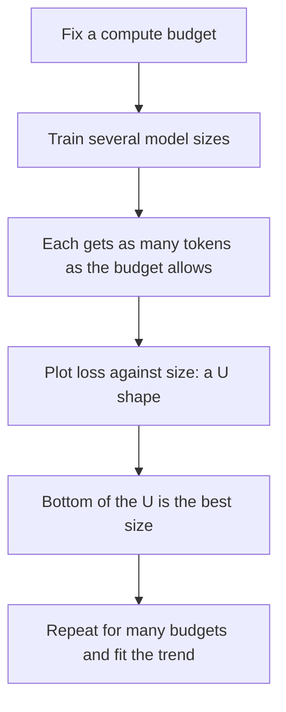

## The hook

By early 2022, the race to build bigger language models was in full swing. GPT-3 had 175 billion parameters. Google, DeepMind and Microsoft with NVIDIA had built models with 280 billion and even 530 billion. The assumption was simple: bigger models, better results.

Then a DeepMind team ran an experiment with the same compute budget they had used for their own 280-billion-parameter model, Gopher. Instead, they trained a model one quarter the size and fed it four times as much text. They named it Chinchilla. It beat Gopher on almost every test, and it beat the even larger models too.

The industry had been building giants on a starvation diet.

## Before you start

You need the idea that loss improves predictably with size, data and compute, from [The Straight Lines That Launched a Race](article:paper-scaling-laws). Chinchilla re-ran that analysis more carefully and came to a different conclusion about how to spend a budget.

## The world before this paper

Kaplan's 2020 scaling laws suggested that, as your compute budget grows, you should put most of it into a bigger model and only a little into more data. Labs followed that advice. Most large models of the period were trained on roughly 300 billion tokens, whether they had 175 billion or 530 billion parameters.

:::history
DeepMind had trained Gopher, a 280-billion-parameter model, in 2021, and published a detailed study of it. Jordan Hoffmann, Sebastian Borgeaud, Arthur Mensch and colleagues then asked a sharper question: for a fixed amount of training compute, what is the best combination of model size and number of [[training tokens]]? Arthur Mensch later co-founded the French AI company Mistral.
:::

The cost of training a Transformer is roughly proportional to its size times the data it reads. A common estimate is that training compute $C$ in [[FLOPs]] is about

$$C \approx 6 \times N \times D$$

where $N$ is the number of parameters and $D$ is the number of training tokens. So for a fixed $C$, a bigger model means less data, and vice versa. The question is where the sweet spot lies.

## The big idea

Measure the trade-off directly, at large scale, with careful training settings, and find the [[compute-optimal]] balance.

:::analogy
Think of a fixed budget for a cricket academy: you can hire more coaches (model size) or pay for more practice sessions (data). Hiring a hundred coaches for a single afternoon of practice wastes most of their talent. Booking a hundred sessions with one coach wears that coach out. The best results come from growing both together. The industry, it turned out, had been hiring armies of coaches and booking almost no practice time.
:::

:::insight
For the best model at a given training cost, scale parameters and data in roughly equal proportion. Double the model, double the data.
:::

## How it works

The team trained over 400 language models, from about 70 million to over 16 billion parameters, on between 5 and 500 billion tokens. They then estimated the optimal trade-off in three independent ways.

### Approach 1: fix the size, vary the data

For each model size, train for different numbers of tokens and track the lowest loss reachable for each amount of compute. This traces out, for each budget, which size did best.

### Approach 2: IsoFLOP curves

Pick a fixed compute budget. Train several models of different sizes, each for exactly as many tokens as that budget allows. Plot final loss against model size. The result is a U-shaped [[IsoFLOP curve]]: too small a model underfits, too big a model is [[undertrained]], and the bottom of the U is the optimal size for that budget. Repeat for many budgets and see how the bottom moves.

### Approach 3: fit a formula for loss

Model the final loss as a sum of three parts:

$$L(N, D) = E + \frac{A}{N^{\alpha}} + \frac{B}{D^{\beta}}$$

- $E$ is the irreducible loss: the unpredictability of natural text that no model can remove.
- $A / N^{\alpha}$ is the penalty for a model that is too small.
- $B / D^{\beta}$ is the penalty for too little data.

Fitting this to all 400 runs and minimising it under a fixed compute budget gives the optimal split.

### All three agreed

All three approaches pointed to the same answer: the optimal model size and the optimal number of training tokens should grow at about the **same rate** as compute increases. A handy rule of thumb that follows from the results is roughly **20 training tokens per parameter**.

### A worked example: same budget, different split

Use $C \approx 6ND$ to compare Gopher and Chinchilla:

- Gopher: $6 \times 280 \text{ billion} \times 300 \text{ billion} \approx 5.0 \times 10^{23}$ FLOPs.
- Chinchilla: $6 \times 70 \text{ billion} \times 1.4 \text{ trillion} \approx 5.9 \times 10^{23}$ FLOPs.

Roughly the same compute. But Chinchilla saw 20 tokens per parameter, while Gopher saw only about one.

:::try-this
Using the 20-tokens-per-parameter rule of thumb, how many training tokens would a compute-optimal 175-billion-parameter model need? How does that compare with the 300 billion tokens GPT-3 was trained on? ($175 \times 20 = 3{,}500$ billion, or 3.5 trillion tokens, more than ten times what GPT-3 used. By this analysis, GPT-3 was heavily undertrained.)
:::

### Why had everyone got it wrong?

The paper traced part of the disagreement with the earlier scaling laws to a training detail. Learning rates are usually lowered gradually over a planned number of steps, following a schedule shaped like a cosine curve. Kaplan's experiments used schedules that did not match the actual training length for every run, which made models trained on more data look worse than they really were. When Hoffmann and colleagues matched the schedule to each run's length, data turned out to be worth much more. A small methodological choice had steered a whole industry toward oversized models.

## What they found

- **Chinchilla beat bigger models.** The 70-billion-parameter Chinchilla, trained on 1.4 trillion tokens, outperformed Gopher (280 billion), GPT-3 (175 billion), Jurassic-1 (178 billion) and Megatron-Turing NLG (530 billion) on a large range of downstream evaluations.
- **A big jump on knowledge tests.** On the MMLU benchmark, a broad exam of academic subjects, Chinchilla reached an average accuracy of 67.5%, more than 7 points higher than Gopher.
- **Existing giants were undertrained.** By the paper's analysis, the large models of the time were considerably too big for the amount of data they had been trained on.
- **Cheaper to use.** Being four times smaller than Gopher, Chinchilla also needed far less compute for [[inference]] and fine-tuning.

:::warning
Common misconception: "Chinchilla showed smaller models are always better." It showed that, for a fixed **training** budget, a balanced split beats an oversized model. With more compute, the optimal model still gets bigger. And if a model will answer billions of queries, it can make sense to train an even smaller model on far more than 20 tokens per parameter, accepting extra training cost to save on inference.
:::

## What it got wrong (or left open)

The analysis assumes you can always find more high-quality text. Scaling data in step with model size quickly runs into the limits of what exists on the internet, which became a major concern a few years later.

It also optimises only for training compute. In real deployments, inference often dominates total cost, which changes the best choice. And later replication attempts suggested some of the fitted constants in approach 3 were sensitive to how the fit was done, even though the headline conclusion, scale both together, held up well.

## What happened next

- The industry changed course almost immediately. Models began to be trained on trillions of tokens.
- Meta's [LLaMA](article:paper-llama) (2023) took the inference argument further, training relatively small models on more tokens than Chinchilla's rule suggested, so they would be cheap to run, and released them to researchers.
- "Chinchilla-optimal" became standard vocabulary in AI labs, and data collection and filtering became a central focus of model building.
- The concern about running out of text led to research on data quality, synthetic data and repeating data over multiple epochs.

## Key takeaways

- For a fixed training compute budget, model size and number of training tokens should be scaled up in roughly equal proportion.
- Three independent methods, including U-shaped IsoFLOP curves, agreed on this, suggesting roughly 20 training tokens per parameter.
- Chinchilla, at 70 billion parameters and 1.4 trillion tokens, beat Gopher and other models up to 530 billion parameters with similar training compute.
- The giant models of 2020 to 2021 were undertrained: too big for the data they had seen.
- The paper redirected the field toward much larger datasets and smaller, cheaper-to-run models such as LLaMA.
